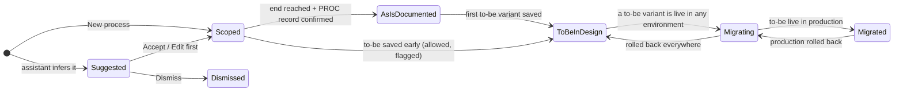
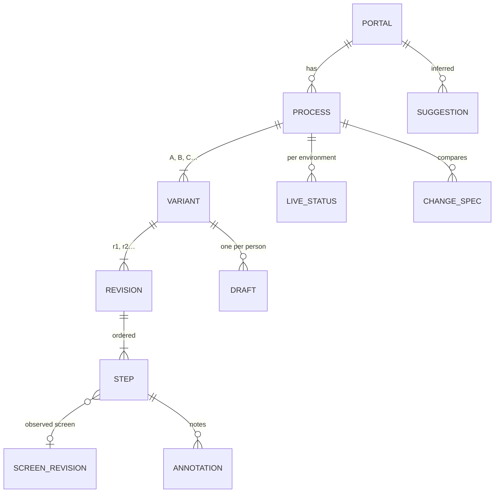

# 10 · Processes: how the redesigned feature works

End-to-end functional spec for the **Processes workspace**. It covers what a process is now, its
lifecycle, every flow step by step, the rules, the diff logic, a data model and API sketch, and how
today's "Process scope" form moves over. Screens: `screens/04–07` (wireframes `05–08`).
Visual overview: `docs/10-processes-flow.html` (screenshot `screenshots/system/processes-flow.png`).

> **Precondition, open item O-1.** The mission doc's product rule 4 says *"As-is only: MudPuppy
> describes the current state and does not propose the target design."* This spec adds drawing the
> to-be (sections 6.6–6.11). Proposed new wording for the rule: **"MudPuppy records the as-is.
> People draw the to-be in it; the assistant only proposes. Observed and designed content are never
> mixed."** Confirm it before building variant B. Sections 6.1–6.5 (suggest, scope, as-is,
> document) are not affected.

---

## 1. In one paragraph

A **process** is a named path through the portal's screens for one persona (for example "Oblicz
składkę OC/AC" as guest). It has **variants**: **A** is the **as-is**, built only from what scans
observed and read-only to people; **B** (and C, D…) are **to-be** designs that people draw over A.
Every change to a variant is a new **revision** (A r1, A r2, B r1…), so nothing is ever overwritten.
The assistant **suggests** processes from the links it saw and **proposes** changes, but never saves
anything itself. **Compare** turns A vs B into a **change spec** that the migration team builds from.
Rescans keep A up to date and detect which variant each **environment** runs now (**live**).

## 2. What changes

| | Today (SCR-007, chat side panel) | Now (Processes workspace) |
|---|---|---|
| Where | "Process scope" panel inside Guided chat | Its own section: **Processes** (list, process page, compare, history) |
| Creating | Fill Process name, Persona, tick screens, mark one start and one end, optional notes; `[save scope]` | Accept an assistant **suggestion**, or **New process** (same fields, BR-011 kept); or select loose screens and choose "New process from these" |
| What is saved | One scope row tied to a chat conversation (`POST /chat/conversations/:id/scope` → 201) | A process owned by the portal, with variant A r1 built from the scope; conversations only reference it |
| Steps | An unordered set of ticked screens + start/end | An ordered list of **steps**, each pointing at a screen revision (route + cluster) |
| As-is vs to-be | The as-is is implicit; the to-be exists only as screen-level **amendments** (AMD-…) | **A** (as-is, observed) and **B…** (to-be, drawn) side by side; step **annotations** for process-level notes; amendments stay for screen-level notes |
| Changes | Re-saving the scope replaces it | Every save is a new revision; restore = new revision; conflicts are detected |
| Output | "Ask the assistant to produce its documentation" | The as-is is documented as a PROC record (Docs); A vs B gives a **change spec** (export) |
| Workflow step | "Narrow" stays `[TODO]` even after saving a scope (SRS open question) | "Sort into processes" is **done** as soon as one process is scoped |

## 3. Concepts

| Term | Meaning | Shown as |
|---|---|---|
| **Process** | A named path for one persona through the portal: start screen → … → end screen | Row in Processes; page title |
| **Scope** | The process's name, persona, start screen, end screen and included screens | Scope fields (New process / Edit scope) |
| **Step** | One position in a variant's path. It points at a screen revision (observed) or a designed screen (drawn) | Step card |
| **Variant** | A version of the path. **A** = as-is (observed). **B, C…** = to-be (designed). Branched from a revision of another variant | Segmented switch "A · As-is r1 · observed / B · To-be r1 · draft open" |
| **Revision** | An immutable snapshot of one variant: `A r1`, `B r2`… | Tag |
| **Draft** | Your unsaved working copy of a to-be revision. Autosaved; only you see it | Draft bar "Draft of B r2 · 3 changes since B r1" |
| **Suggestion** | A process the assistant inferred from links between screens. Nothing is saved until accepted | Dashed blueprint plate, "inferred" |
| **Proposal** | A change the assistant suggests to a draft (for example "merge steps 3 and 4") | `.sy-proposal`; applied only when you press Apply |
| **Annotation** | A person's note on a step (why it should change) | Typewriter note with a dimension line |
| **Amendment** (unchanged) | A person's note on a screen or element (AMD-…). Can be cited by an annotation | Typewriter note, AMD tag |
| **Change spec** | Generated document from a comparison: scope, as-is, to-be, delta, affected records, migration cut, open questions | Change spec plate; export |
| **Live** | Which variant an environment runs now: detected by scans or marked by a person | "■ LIVE · sandbox" |
| **Stage** | Where the process is in its life (section 4) | Stage column |

## 4. Lifecycle

| Stage | Enters when | Shows |
|---|---|---|
| **Suggested** | The assistant infers a grouping | Dashed plate in "Suggested by the assistant", with a *Why* line |
| **Scoped** | A suggestion is accepted, or a process is created by hand. A r1 is built from the scope | Process row; A r1 |
| **As-is documented** | A person presses **Mark as-is documented**, a signed sign-off that records which A revision it covers | Stage "As-is documented"; "As-is changed since documented (A r2 → r3)" once a later A revision arrives |
| **To-be in design** | A to-be variant has at least one saved revision | Stage "To-be in design"; Compare enabled |
| **Migrating** | A to-be variant is live in at least one environment (detected or marked) | Stage "Migrating" |
| **Migrated** | A to-be variant is live in production | Stage "Migrated" |

Stages are a **signed choice** of a person (owner, 2026-10-14; spec 027): the stage control in the
process page's "As-is documentation" plate lists all five stages, and each move, back or on, is a
signed `stage` revision in History. The "Enters when" column is when a person would normally move it.
Signing off A again while already As-is documented writes another `stage` revision with the same
stage, which clears the "changed since documented" notice.
"To-be saved early" (before the as-is is documented) is allowed but shows a needs-you hint: "The as-is end
was never observed. Resume the scan before sign-off."

## 5. Who can change what

| Actor | Can | Cannot |
|---|---|---|
| **Scan** (crawler) | Create **A** revisions from observations; detect **live** per environment | Touch any to-be variant |
| **Assistant** | Create **suggestions**; create **proposals** on a draft; draft PROC documentation; draft the change spec text | Save a process, a revision, or live status. Everything it makes is dashed until a person accepts |
| **Person** (BA, dev, QA) | Accept/edit/dismiss suggestions; create and edit scope; branch, draft and save to-be revisions; annotate; restore; compare; export; mark a variant live (with confirmation); edit A by screens (add, remove, reorder steps) as signed `edit` revisions; set the stage; archive and restore a process | Delete a process (archive only) |
| **Reviewer** | Confirm the PROC record; everything a person can do | — |

## 6. Flows

### 6.1 Get suggestions — Home (01), Processes (04)
1. In chat, the person picks "Sort screens into processes", or on Processes presses **Ask the assistant to regroup**.
2. The assistant groups the portal's mapped screens. Each suggestion has: name (from the link text), path (`/ → /porownanie`), screen count and a **Why** line naming the evidence ("'Na skróty' link 'Porównaj produkty' and menu link 'Porównanie'").
3. A suggestion that crosses a login or form the scan cannot pass is marked **locked** ("Past the login form the scan needs a credential").
4. Suggestions appear as dashed blueprint plates in chat (01) and under "Suggested by the assistant" (04). Nothing is saved.
5. Regrouping replaces open suggestions but never touches saved processes or dismissed ones.

### 6.2 Accept, edit first, dismiss — Processes (04)
- **Accept** → creates the process with the suggested scope → builds **A r1** (6.4) → stage Scoped. A toast offers Undo; undo archives it again.
- **Edit first** → opens the scope form prefilled. Saving it = Accept with your changes.
- **Dismiss** → hides the suggestion and records the dismissal in the process log, so the same screens aren't suggested again unless the person asks to regroup with "include dismissed".

### 6.3 New process by hand — replaces today's "Process scope" form
Fields (BR-011 kept): **Process name** (required, ≤ 200), **Persona** (required, the portal's personas),
**Start screen** (exactly one), **End screen** (exactly one), **Included screens** (optional ticks),
**Note** on start or end (≤ 2000, becomes an annotation on that step).
Shortcut: select several loose screens in "In no process" → **New process from these**.
Save → process created, A r1 built, status toast **"■ SAVED · “Test process”, 2 screens."**, and the workflow step
"Sort into processes" becomes OK.

### 6.4 Building and updating the as-is (A) — automatic
1. **A r1** is built from the scope and the recorded navigation edges: order the included screens along the observed path from start to end. Each step points at a **screen revision** (route + cluster).
2. If the scan never reached the end screen, the last step is followed by an **"End not reached"** marker (needs you) with the scan id and the queue size, and **Resume scan to reach the end** is offered.
3. Every later scan that walks the process compares its path with the latest A:
   - same path → nothing new (the timeline shows "seen unchanged by scan N");
   - different path, or the end reached for the first time → **A r(n+1)**, author "scan N" ("Observed the last step; the end is now known");
   - a step's screen changed (new screen revision) → A r(n+1) pointing at the new screen revision; amendments on it carry forward or are flagged for re-anchoring (screen 08 rules).
4. A person can **edit A by screens** (add a screen from the picker, remove or reorder steps); each change is a signed A revision (`change: 'edit'`). Later rescans still add `observe` revisions on top. To design a different path, branch a to-be variant.

### 6.5 Document the as-is — Docs, Review
1. The person asks the assistant to document the process (from the process page or chat).
2. The assistant drafts a **PROC record** in Docs from A's latest revision, with evidence links to scans and screens. It is a draft (dashed) and lands in **Review → Records to confirm**.
3. A reviewer confirms it. When the as-is is complete, a person presses **Mark as-is documented** (section 4).

### 6.6 Draw the to-be (B) — Process edit (05)
1. **+ Variant** branches **B** from a chosen revision (default: A's latest). B r1 is saved immediately as an exact copy, "Branched from A r1".
2. Opening B starts your **draft** of B r(n+1): it is autosaved and only you see it. The draft bar shows changes since the base and the autosave time.
3. Draft operations on the **B flow**:

   | Operation | Result on the step card |
   |---|---|
   | Keep a step | "unchanged" (solid, points at the observed screen revision) |
   | Rename, change route or screen | "changed" (dashed blueprint) |
   | Merge two or more steps | One "changed" step, "merges N as-is steps", **Built from** lists the sources |
   | Split a step | Two "changed" steps, both built from the source |
   | Add a step | "+ added" (dashed): a **designed** screen with no observation ("Designed, not observed") |
   | Remove a step | Goes to the "Removed from A" strip, with a reason note |
   | Reorder | Steps keep their identity; the diff shows a move |
   | Annotate | Typewriter note on the step, author and time |

4. The ghosted **A** flow stays visible underneath for reference.
5. **Save as B r(n+1)** creates the revision (6.9 if someone saved first). **Discard draft** throws away the draft; B r(n) stays.
6. The step inspector (right) shows **Built from** (the source steps and revisions), annotations, a new-annotation form, **Ask the assistant about this step**, and **Remove step from B** (destructive, confirm).

### 6.7 Assistant help on a to-be
- From the step inspector or the drawer (context **This page** = process, variant, revision, selected step), the person asks a question.
- Answers may contain a **proposal** (dashed): "Merge steps 3 and 4 into one form". **Apply** puts it into your **draft** (not straight into a revision). Applied proposals show solid with Undo.
- The assistant may cite records (BR-…, CAP-…) and amendments (AMD-…) as tags.

### 6.8 Compare and change spec — Compare (06)
1. Pick **Left** and **Right**: any two revisions of any variants (default A latest ↔ B latest; the to-be picker is dashed).
2. The diff table pairs steps (section 8) and labels each row: **Unchanged · Changed · Merged · Split · Added · Removed · Moved**, plus "End not reached" when the as-is is incomplete. "Only changes" hides unchanged rows.
3. Annotations appear next to the steps they belong to.
4. The **change spec** is generated from the diff and is editable per section:

   | Section | Content |
   |---|---|
   | Scope | Process, persona, environment |
   | As-is | Left revision summary (screens observed, scans, end reached or not) |
   | To-be | Right revision summary |
   | Delta | One line per diff row that isn't unchanged |
   | Records that cite these screens | Tags (CAP-, NFR-, SCR-, BR-…) found through traceability |
   | Migration cut | Routes that move (old → new), entry points that stay, rollback |
   | Open questions | Generated from gaps (end not reached, unobserved screens, locked steps) |

5. **Export spec** downloads Markdown (proposal: also PDF). **Save to Docs** stores it as a doc record tied to both revisions. Editing a section saves a new spec revision; regenerating after new revisions asks before replacing edited text.

### 6.9 Conflicts — Edit (05), History (07)
- Every draft remembers its **base revision**. On Save, if the variant's latest revision is newer than the base (someone saved first), the draft bar becomes the conflict notice: *"The reviewer saved B r3 while your draft was based on B r2. Your draft is kept; nothing was overwritten."*
- **Compare your draft with r3** → Compare (06) with the draft on the right.
- **Rebase your draft onto r3** → a new draft on top of r3. Your changes are re-applied where they don't collide; where they collide they become **proposals** in the draft for you to apply or discard.

### 6.10 History and restore — History (07)
- **Timeline:** scans across the top; one lane per variant (A: scan and accept events; B: people's revisions; your draft); a lane "Live in sandbox" showing which variant each scan detected.
- **Revisions:** per variant, newest first, with author, what changed, when, and View / Compare / **Restore as r(n+1)**.
- Restore creates a **new** revision equal to the old one. Nothing is deleted.
- A rescan only ever adds revisions to **A**, and never edits B.

### 6.11 Live per environment — History (07)
1. **Detection:** when a scan walks a process in an environment, it matches the observed path against the latest revision of each variant. Walks all steps of B → "B live in sandbox · scan 5 matched B". Walks A again → "A · rolled back".
2. **Manual mark:** **Mark B as live…** opens a confirm dialog naming the environment and the revision; it records who marked it and is shown as "marked by you" until a scan confirms or contradicts it.
3. Live status informs the stage a person sets (section 4) and shows in the process list ("Live in sandbox: A").

## 7. Rules

| ID | Rule |
|---|---|
| PR-01 | A process belongs to one portal and one persona. Its name is required, ≤ 200 characters and unique within the portal. |
| PR-02 | Scope has exactly one start screen and one end screen (BR-011). A note on start or end is ≤ 2000 characters. |
| PR-03 | Variant A is created with the process and is the only as-is variant. Scans create A revisions (`observe`); a person can too, by screens, as signed `edit` revisions (owner, 2026-10-14). |
| PR-04 | To-be variants are created only by branching from an existing revision. B, C… are named in order; a display name is optional. |
| PR-05 | Revisions are immutable. Save, restore, rebase and accept all create new revisions. Nothing is updated in place or deleted. |
| PR-06 | A draft belongs to one person and one variant, has a base revision, is autosaved, and is invisible to others. |
| PR-07 | Saving a draft whose base isn't the variant's latest revision is refused (409) and shows the conflict notice (6.9). |
| PR-08 | Every step of A points at an observed screen revision. A to-be step is either observed (points at a screen revision) or designed (has a route and title, no observation) and is drawn dashed. |
| PR-09 | The assistant never creates processes, revisions or live status. Its suggestions and proposals are inferred until a person accepts them. |
| PR-10 | A suggestion needs a Why line citing evidence (links, menu entries, edges). Locked suggestions say which credential or form blocks them. |
| PR-11 | If A's end screen was never observed, A ends with "End not reached" (needs you), and the change spec lists it as an open question. |
| PR-12 | When a screen revision under a step changes, annotations and amendments carry forward. If their element disappears they are flagged for re-anchoring in Review, never deleted. |
| PR-13 | Live status per environment comes from the latest scan that walked the process in that environment, or a manual mark; a later scan overrides a manual mark. |
| PR-14 | Stage is a person's signed choice (section 4); each move is a `stage` revision. Marking the as-is documented records the A revision it covers. |
| PR-15 | A screen can belong to several processes. Screens in no process are listed under "In no process"; screens of archived processes count as in no process, also for the assistant's groupings. |
| PR-16 | A process is archived, not deleted. Archiving keeps all revisions, specs and links. |
| PR-17 | The workflow step "Sort into processes" is done when the portal has at least one scoped process. "Document as-is" is done when at least one process is As-is documented. "Draw the to-be" is done when at least one to-be revision is saved. |

## 8. How the diff pairs steps

Steps are matched left ↔ right in this order:
1. **Same step identity:** the to-be step was branched from that as-is step and kept (unchanged, or changed if its title, route or screen differs).
2. **Built from links:** a to-be step built from several left steps → **Merged** ("2 steps merged into 1"); several to-be steps built from one → **Split**.
3. **Same screen cluster or route template**, when no identity link exists (comparing two independently drawn variants).
4. Left steps left over → **Removed**; right steps left over → **Added**. A matched step at a different position → **Moved**.

Unchanged rows are solid; changed, merged, split and added rows are dashed blueprint; removed rows are struck through.

## 9. Data model (sketch)

| Table | Key fields |
|---|---|
| `process` | id, portal_id, name, persona, start_screen_id, end_screen_id, included_screen_ids, stage (latest signed `stage` revision, which records the signed-off A revision as `as_is_rev`), archived_at, created_by, created_at, source (`suggestion` / `manual` / `migrated_scope`), suggestion_id |
| `variant` | id, process_id, letter (A, B…), kind (`as_is` / `to_be`), branched_from_revision_id, display_name |
| `revision` | id, variant_id, number, author (`scan:<run_id>` / user), summary ("Merged driver data and options into one step"), created_at, based_on_revision_id |
| `step` | id, revision_id, position, identity_id (stable across revisions), title, route, screen_revision_id (null when designed), kind (`observed` / `designed`), built_from_identity_ids[], removed_reason |
| `annotation` | id, step_identity_id, variant_id, text (≤ 2000), author, created_at, cites (AMD/record ids) |
| `draft` | id, variant_id, user, base_revision_id, payload (steps + annotations), updated_at |
| `suggestion` | id, portal_id, name, path, screen_ids, why, locked_reason, status (`open` / `accepted` / `dismissed`), created_at |
| `live_status` | process_id, environment, variant_id, revision_id, source (`scan:<run_id>` / `manual:<user>`), at |
| `change_spec` | id, process_id, left_revision_id, right_revision_id, sections (JSON), edited_sections[], revision, created_at |

**Migrating existing scopes:** each row saved by `POST /chat/conversations/:id/scope` becomes a `process`
(source `migrated_scope`) with A r1 built from `start_state_id`, `end_state_id`, `selected_state_ids`.
Its `comments` become annotations on the start and end steps, and `conversation_id` is kept as a reference.
Example: "Test process" (guest, `/` → `/faq`, 2 screens) becomes a Scoped process with A r1 of 2 steps.

## 10. API (sketch)

| Method | Path | Does | Notes |
|---|---|---|---|
| GET | `/portals/{p}/processes` | List processes + open suggestions | stage, live per env, counts |
| POST | `/portals/{p}/processes` | New process (scope) | 201; 422 with field errors (BR-011) |
| POST | `/portals/{p}/suggestions:regroup` | Ask the assistant to regroup | 202 (async); suggestions arrive by event |
| POST | `/suggestions/{id}:accept` | Accept (optional scope edits in body) | 201 process |
| POST | `/suggestions/{id}:dismiss` | Dismiss | 204 |
| GET | `/processes/{id}` | Process with variants and latest revisions | |
| POST | `/processes/{id}/variants` | Branch `{from_revision_id}` | 201 variant + r1 |
| GET/PUT | `/variants/{id}/draft` | Read / autosave your draft | PUT is idempotent; includes `base_revision_id` |
| POST | `/variants/{id}/revisions` | Save draft as a new revision | **409** when the base isn't latest; body has `latest_revision_id` |
| POST | `/variants/{id}/draft:rebase` | Rebase onto `{revision_id}` | collisions come back as proposals |
| POST | `/revisions/{id}:restore` | Restore as a new revision | 201 |
| GET | `/compare?left={rev}&right={rev}` | Diff rows (section 8) | |
| POST | `/processes/{id}/change-specs` | Generate spec for a pair | editable sections |
| GET | `/change-specs/{id}/export?format=md` | Export | Markdown (PDF optional) |
| PUT | `/processes/{id}/live/{env}` | Manual mark `{variant_id, revision_id}` | confirm in UI; audit |
| DELETE | `/processes/{id}` | **Archive** (not delete) | 204 |

Writes keep today's behaviour when the chat service is down: process pages stay readable; assistant
actions (regroup, ask, propose) show the failure state; saving scope and drafts does **not** depend on
the chat service.

## 11. Assistant behaviour

- **Grouping evidence:** "Na skróty" (shortcut) links, menu links, navigation edges recorded by scans, form chains (a form whose submit leads to the next screen), and URL families (`/kalkulator/*`). Every suggestion carries its Why line.
- **Naming:** use the portal's own link text ("Porównaj produkty"), never invented names.
- **Locked:** if the path needs a credential or a form the safety class forbids, mark it locked and say which.
- **Proposals:** only into a draft; never saves; always cites what it read (screens, records, amendments).
- **Context:** on process pages "This page" sends process id, variant, revision, selected step, and draft status.

## 12. Edge cases

| Case | Behaviour |
|---|---|
| End never reached | "End not reached" marker; Resume scan; spec open question; stage can't pass Scoped → As-is documented |
| Step's screen disappears in a rescan | A r(n+1) without it; to-be steps built from it show "source removed in A r(n+1)" (needs you) |
| Same screen in several processes | Allowed; the screen page lists its processes ("In processes: …") |
| Process spans a login | Locked steps until a credential is stored; the assistant asks for it in chat (vault) |
| Two people draft B at once | Each has a private draft; the second to save gets the conflict notice |
| Variant B saved before the as-is is documented | Allowed; needs-you hint; spec carries the open question |
| Chat service down | Regroup and Ask show the failure state; everything else works |
| Persona mismatch (scan ran as another persona) | The scan doesn't update A; the timeline notes "walked as guest-reader, not counted" |
| Archiving a process with a live to-be | Confirm dialog warns that live tracking stops; history is kept |

## 13. Where each flow lives (screens and requirements)

| Flow | Screen | Requirements |
|---|---|---|
| 6.1 Suggestions | 01 Home, 04 Processes | FE-P01, FE-P06 |
| 6.2 Accept / edit / dismiss | 04 | FE-P01, FE-P07 |
| 6.3 New process | 04 (New process) | FE-P08 |
| 6.4 As-is updates | 05 (ghosted A), 07 | FE-P09 |
| 6.5 Document as-is | Docs, 09 Review | FE-R01 |
| 6.6–6.7 Draw the to-be, assistant help | 05, 02 drawer | FE-P02, FE-A04 |
| 6.8 Compare and spec | 06 | FE-P03, FE-P10 |
| 6.9 Conflicts | 05, 07 | FE-P05 |
| 6.10 History and restore | 07 | FE-P04 |
| 6.11 Live per environment | 07, 04 list | FE-P11 |
| Migration of existing scopes | — | FE-P12 |

## 14. Open items

- **O-1** "As-is only" product rule (see the top of this doc).
- **O-5** Who may **mark live** manually: any person, or reviewers only?
- **O-6** "Migrated" means live in **production**. Confirm, or define per portal (some portals have no production environment).
- **O-7** Change spec export formats beyond Markdown (PDF, DOCX, Jira tickets?).
- **O-8** Should accepting a suggestion also start documenting it (PROC draft) automatically?
