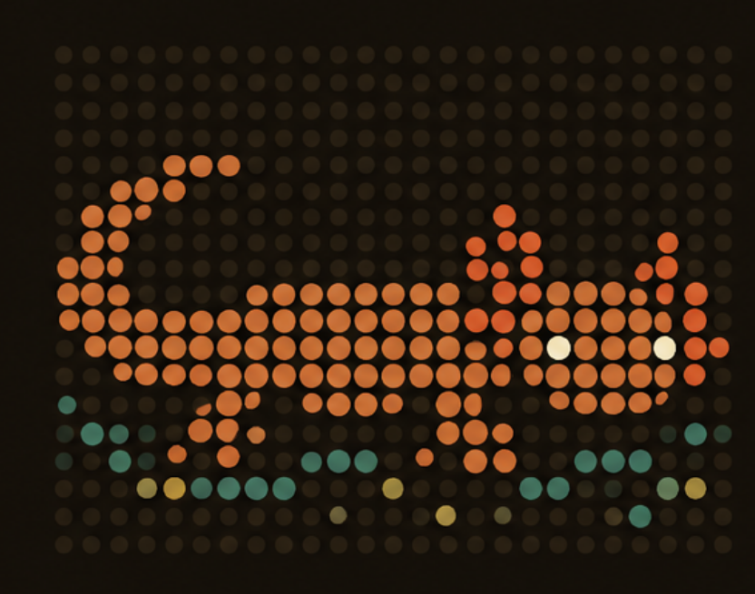

<p align="center">
  
</p>

# MudPuppy

MudPuppy maps a web portal the way a careful visitor would, records what it finds, and turns that
into documentation good enough to re-create the portal. The **crawler** (`specs/001-crawler-map-mode/`)
explores a portal as a guest or a logged-in persona, up to the action limit you set, and stores states, transitions, forms and API
shapes with evidence; in `trace` mode it records one named business process step by step. The **BA
agent** (`specs/004-ba-documentation/`) reads that evidence and writes keyed, evidence-linked
documentation records (an as-is SRS), which a person reviews, exports and scores against a known
answer key.


**New here?** Follow [`docs/getting-started.md`](docs/getting-started.md): install, scan the bundled
practice portal, document it and export it, step by step. [`docs/sample-documentation/`](docs/sample-documentation/README.md)
shows what comes out: MudPuppy's documentation of its own console.

## How the crawler works

The crawler is a Claude Code subagent (`.claude/agents/crawler.md`). It has **no shell, file, web or browser
tools**: its only tools are the `mcp__mudpuppy__*` tools exposed by the `mudpuppy` MCP server
(`apps/crawler/packages/mcp-server`, registered in `.mcp.json`). The server owns the only browser, the
database and the evidence store.

The agent proposes where to go; the server decides what is safe, executes it, waits for the page to settle,
observes it, fingerprints it and records it. The agent cannot write records, invent ids, or choose selectors.

```
start_run  ->  navigate / act  <-  get_next_frontier_item   ...   finish_run
```

## Running it

1. Install: `pnpm install` at the repo root (one workspace for all apps), then a browser once: `pnpm --dir apps/crawler exec playwright install --with-deps chromium`.
2. Ask the main Claude Code session: *"Use the crawler subagent to map `<portal>` as `<persona>`"*. There is no
   crawler CLI. Approve the `mudpuppy` MCP server when prompted.
3. Results land in `data/db/<environment>.sqlite` and `data/evidence/`; both are generated and git-ignored.
   The `MUDPUPPY_ENV` variable in `.mcp.json` picks the database (required, no default; the repo sets `local-dev`).

`specs/001-crawler-map-mode/quickstart.md` lists the checks that prove a run behaved.

## Seeing the results: the dashboard

`apps/dashboard/` (Python, FastAPI, managed with `uv`) is a read-only JSON API over the same database, and it
serves the console: a React single-page app (`apps/web/`). The console shows each portal's scans and why they
ended, the screens, processes, rules and documentation, and the review inbox, updating live while the crawler
writes:

```bash
pnpm --dir apps/web build
cd apps/dashboard && uv sync && uv run mudpuppy-dashboard --env local-dev   # http://127.0.0.1:8765/app/
```

Or start everything at once with `.claude/skills/preflight/scripts/harness.sh start`.

See [`apps/dashboard/README.md`](apps/dashboard/README.md) (spec `specs/003-dashboard-ui/`).
For the guided chat (scan, narrow, document, amend) step by step with screenshots, see
[`docs/how-to-use.md`](docs/how-to-use.md).

## From crawl to documentation

The whole flow, with the agents named in `.claude/agents/`:

1. **Map.** *"Use the crawler agent to map `<portal>` as `<persona>`"* records the guest-visible
   portal (`map` mode).
2. **Document.** *"Use the ba agent to document `<portal>` from run `<run_id>`"*: the `ba` agent
   (skill `ba-practice`) has no browser; through the `mudpuppy-ba` MCP server it writes screens,
   capabilities, requirements, business rules, data items, glossary terms, assumptions and open
   questions, each with a confidence label and evidence, and asks for **follow-up** traces of the
   processes it found.
3. **Trace.** The crawler agent traces each open follow-up (`trace` mode); where the action limit
   stops it, it records what could not be observed. Re-running the ba agent
   turns the traces into process and use-case records.
4. **Review.** The dashboard's Docs tab shows the documentation; signed with `MUDPUPPY_REVIEWER` ("unknown" by default), a
   person confirms, rejects or comments (see `apps/dashboard/README.md`). Rejections come back to
   the BA as feedback in its next session.
5. **Export.** `pnpm --dir apps/crawler docs:export <portal> --env <env> [--confirmed-only]` writes
   the SRS: Markdown chapters along ISO/IEC/IEEE 29148, Mermaid diagrams, a traceability matrix,
   an Unknowns chapter, `records.json` and `images/` (each screen's screenshot and wireframe, and
   crops with the elements a record cites outlined), byte-identical for the same store.
6. **Evaluate.** `pnpm --dir apps/crawler docs:evaluate <portal> --env <env> --ground-truth <file>`
   scores the documentation per category (screens, fields, constraints, rules, processes, terms),
   lists every miss and every over-claim, and fails below the targets.

`pnpm --dir apps/crawler docs:audit <portal> --env <env>` checks that every revision has resolvable
evidence (screen-region keys included) and every status is explained by a review.

**Pictures.** Every new state is recorded with a screenshot and a wireframe (an SVG plus an editable
`.excalidraw` file, drawn from the page's accessibility snapshot in one fixed style). The BA cites
the field or button a record is about as a *screen region*, and the dashboard and the export outline
it on the screenshot. `pnpm --dir apps/crawler wireframes:build <portal> --env <env> [--all]`
redraws wireframes, for example for states recorded before screenshots existed. States from before
migration 0006 have no screenshot; to get them, wipe the store and re-crawl
(`specs/008-screenshots-wireframes/quickstart.md` §0).

The **reference portal** (`apps/crawler/packages/reference-portal`, portal `reference-insurer`) is a
local fake Polish insurer whose full truth is written down in `ground-truth.yaml`. Start it with
`pnpm --dir apps/crawler reference-portal` (http://127.0.0.1:4010) and run the flow above with the MCP
servers on `MUDPUPPY_ENV=sandbox`; step 6 then says how close the documentation gets.

## MudPuppy 2.0: the portal model

Since 2.0 (`specs/039-mudpuppy-2-portal-model/`, design in `design.md`) every scan is reconciled
into one **portal model** that lives over time: screens (`SC-…`) with their page versions
(variants), actions and the links between screens, each with a state (active, not seen since,
not checked, retired), on releases detected from the portal's builds. Scans are never rewritten;
the model is rebuilt from them (`pnpm --dir apps/crawler model:reconcile <portal>`).

- **Changes.** Each new model version is compared with the previous one. Rules R1–R8 explain the
  differences as findings (a new release, a persona variant, an A/B test, a flaky error, a renamed
  button, a business rule that changed); a fact the rules can derive is confirmed by itself, the
  rest waits for a person in **Review**. Decided items, with the person's reason, stay listed.
- **Rules.** `model:mine` mines decision rules (inputs → which screen comes next) from the scans,
  `model:replay` tests their boundaries on the headless driver (no LLM), `model:regress` re-runs
  them after a release, and `model:rules-export` writes them as DMN, Markdown and CSV.
- **Processes.** `model:propose` suggests processes from the model; a person names, splits or
  merges them, and each process shows its triggers, outcomes, paths and rules.
- **Same screen?** A person labels two page versions as one screen or two; every answer is kept,
  and the labels calibrate the threshold the reconciler groups pages by.
- **Dashboard.** Home, Changes and Review; Processes, Screens (list and map), Rules and Docs under
  "Portal model"; Scans and Settings under "Machine". [`docs/how-to-use.md`](docs/how-to-use.md)
  walks through them.

New to the vocabulary (run, frontier, evidence, settled, …)? Read the
[MudPuppy glossary](docs/glossary/README.md), also in the dashboard's Glossary tab, and the
[BA wiki](docs/wiki/README.md) for the business-analysis concepts behind the documentation.

## Proving ground, vault, gates and evals

The **proving ground** (`apps/proving-ground`) is a fictional legacy estate (shop, bank, insurer,
old pages) that reproduces the obstacles in `docs/legacy-obstacles.md`. Its data is disposable.

1. Start it: `pnpm --dir apps/proving-ground start` (http://127.0.0.1:4100/). See
   `apps/proving-ground/README.md`.
2. Generate test users: `pnpm vault generate proving-ground-bank --login PG_BANK_LOGIN=jan.testowy
   --password PG_BANK_PASSWORD --seed ../proving-ground/backend/var/users.local.json --seed-user
   bank-client` (in `apps/crawler`). The first call creates the vault key. `pnpm vault list` shows
   names only.
3. `pnpm test` in `apps/crawler` also runs the quality gates (tier 1). They start the estate on
   4200/4201, so stop anything on those ports first. The run writes `data/gates/report.json`.
   Cases with real waits (LO-32 session expiry, LO-35 fresh browsers) are skipped there and run
   with `pnpm test:slow` (the whole gate set, for a nightly run).
4. `pnpm eval <portal> [--persona <id>] [--budget-usd 5]` (in `apps/crawler`) runs the real
   crawler and BA agents headless, scores the result and compares it with the baseline. It costs
   real tokens (the budget cap defaults to 5 USD) and is never part of `pnpm test`. It writes
   `data/evals/<portal>/<timestamp>.json`; `--promote` makes it the new baseline.

Walk-through: `specs/009-legacy-proving-ground/quickstart.md`.

## Configuration

| File | Purpose |
| --- | --- |
| `portals/<portal>/portal.yaml` | Address, environment, scope and budgets, denylist, rate limit, obstacles (cookie banners), compliance |
| `personas/<portal>/<persona>.yaml` | Who the crawler acts as: auth references, action ceiling, viewport, locale, consent. Composable with `extends` |
| `personas/_mixins/*.yaml` | Shared persona fragments |

The schemas are in `specs/001-crawler-map-mode/contracts/config-schema.md`. A bad file is rejected with a message
naming the file and the problem; credentials are never stored, only `ref:NAME` references.

## Safety model

There is **no production guard** (constitution Principle V, owner decision 2026-10-13): every
environment is treated the same, and how far a crawl may change a site is the analyst's decision.
These rules are enforced in code, outside the agent:

- **Action limit.** Every action is classified (read / mutating / destructive / external-side-effect)
  by rules over its label, role, target URL and HTTP method; unknown means unsafe. A limit set per portal,
  environment or persona (the lowest wins) is enforced by the server, which re-derives the class before
  executing, so an agent that calls a bid button "read" gains nothing. Without a limit every class is allowed;
  set `read` for a site you must not change.
- **Environment is a label.** A portal may hold several environments (production, staging, sandbox, …), each
  with its own address and limit; every run records the one it targets. The `compliance` fields are notes only.
- **Scope and denylist.** Allowed domains and paths, external links recorded but not followed, and a denylist of
  logout, delete, payment, bidding, buy-now, contacting the seller, revealing contact details and listing creation.
  Browser-initiated navigations (redirects, scripts) pass through the same check.
- **Polite.** The portal's `User-Agent`, rate limit and concurrency cap apply to every request.
- **CAPTCHAs go to a person.** A CAPTCHA is never solved by automation: it is handed to a human (a decision note
  and an open question) and the crawl goes on elsewhere. Any other block (403/429, a portal-specific block page)
  ends the run (`stopped_warning`).
- **Forms are filled with test data.** Map mode fills a form with the persona's test data before pressing its
  submit button (form autofill), so the pages behind forms are recorded too, on any environment the limit
  allows; on a live site that submission really happens.
- **Evidence as recorded.** Every new state gets an unmasked full-page screenshot and a layout (element keys
  with boxes). Text evidence is masked only when the portal sets `pii_scrub: true`; network calls are recorded
  as shapes only either way.

`pnpm --dir apps/crawler audit:pii` scans the evidence and database for personal data (it reports findings
for every portal that does not set `pii_scrub`, which is expected since constitution 2.0.0), and
`pnpm --dir apps/crawler stability <runA> <runB>` measures how stable state identity is between two runs.

## Architecture and decisions

[`docs/architecture/`](docs/architecture/README.md) describes the system (containers, the agent harness, the
data model, the workflow); [`docs/adr/`](docs/adr/README.md) holds the architecture decision records.

## Repository layout

- `apps/<name>/` — every app, whatever its language, self-contained with its own manifest, lockfile and tests
  - `apps/crawler/` — the TypeScript workspace (`packages/*`: core, fingerprint, safety, config, obstacles, crawler, mcp-server, docs, reference-portal)
  - `apps/dashboard/` — the read-only JSON API and the server of the console (Python, uv, FastAPI); `apps/web/` — the React console
- `data/` — migrations, the schema snapshot, and generated databases and evidence
- `docs/` — the MudPuppy glossary (`docs/glossary/glossary.yaml` is the source) and the BA wiki
- `specs/` — spec-driven development documents (spec, plan, tasks, contracts, quickstart)
- `.claude/agents/` — subagents (crawler, ba, db-admin, frontend-dev, governor, po); `.claude/skills/` holds `ba-practice` (how the BA documents) and `revamp-dashboard` (the UI design system)
- `roadmap.md`, `CHANGELOG.md` — status and history, maintained by the `po` agent

Develop with `pnpm --dir apps/crawler test`, `typecheck`, `lint`, and in `apps/dashboard` with `uv run pytest` and
`uv run ruff check .`. Tests that need a browser skip themselves when
Chromium cannot start.

## License

Licensed under the [Apache License, Version 2.0](LICENSE). Copyright 2026 Dawid Gałęziewski; see
[`NOTICE`](NOTICE). Third-party files keep their own licences
([`THIRD_PARTY_NOTICES.md`](THIRD_PARTY_NOTICES.md)).
