# PROC-001 Process steps

[README](README.md) · Steps · [Business](BUSINESS_REQUIREMENTS.md) · [Functional](FUNCTIONAL_REQUIREMENTS.md) · [EARS](EARS.md) · [Contracts](CONTRACTS.md) · [Gaps](GAPS.md)

---

## Step 1 · Ubezpieczenia dla Ciebie | Towarzystwo Ubezpieczeń Wzorcowych

route `/` · state `01a148dd-3aeb-7000-b722-0757ee45112e`

### States

| State | Kind | Reached by | Picture |
| --- | --- | --- | --- |
| Ubezpieczenia dla Ciebie \| Towarzystwo Ubezpieczeń Wzorcowych | happy path | "Start" on /faq; "Towarzystwo Ubezpieczeń Wzorcowych" on /faq; "Start" on /kalkulator/kierowca; "Towarzystwo Ubezpieczeń Wzorcowych" on /kalkulator/kierowca; "Start" on /kalkulator/opcje; "Towarzystwo Ubezpieczeń Wzorcowych" on /kalkulator/opcje; its address, opened directly | 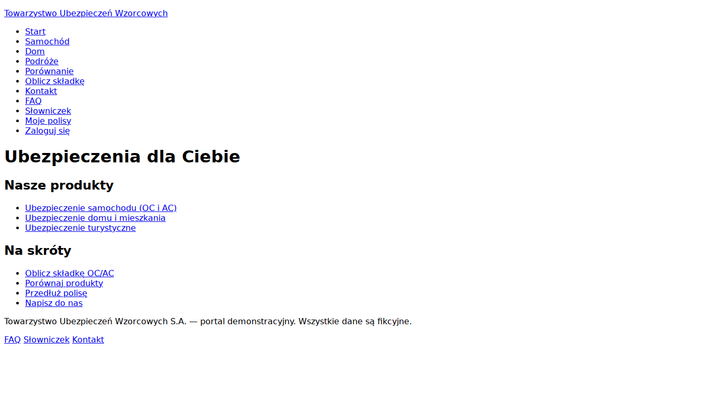 |
| Blank page (no title, no content) | technical (error) | "Dalej" on /kalkulator/kierowca; "Oblicz składkę" on /kalkulator/opcje; "Dalej" on /kalkulator/pojazd; "Wyślij zapytanie" on /kontakt; "Porównaj" on /porownanie |  |

### Wireframe and fields

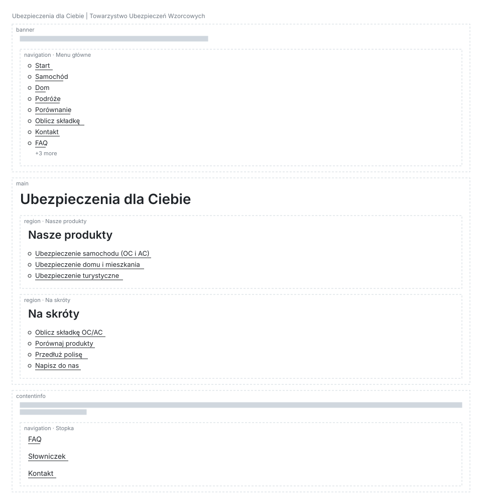

_No form field recorded on this step._

### Elements on the page

Fields carry their number from the table above, buttons and links a letter.

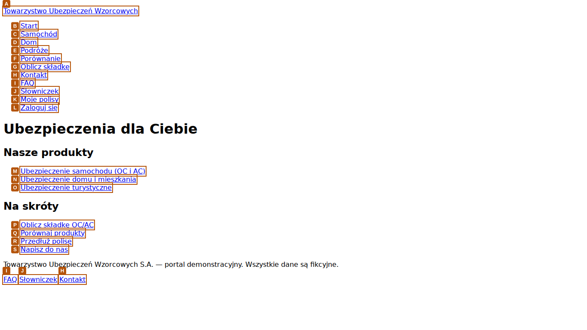

| Tag | Element | Role | Leads to |
| --- | --- | --- | --- |
| **A** | Towarzystwo Ubezpieczeń Wzorcowych | link | `/` |
| **B** | Start | link | `/` |
| **C** | Samochód | link | `/ubezpieczenia/samochod` |
| **D** | Dom | link | `/ubezpieczenia/dom` |
| **E** | Podróże | link | `/ubezpieczenia/podroze` |
| **F** | Porównanie | link | `/porownanie` |
| **G** | Oblicz składkę | link | `/kalkulator/pojazd` |
| **H** | Kontakt | link | `/kontakt` |
| **I** | FAQ | link | `/faq` |
| **J** | Słowniczek | link | `/slowniczek` |
| **K** | Moje polisy | link | `/moje-polisy` |
| **L** | Zaloguj się | link | `/logowanie` |
| **M** | Ubezpieczenie samochodu (OC i AC) | link | `/ubezpieczenia/samochod` |
| **N** | Ubezpieczenie domu i mieszkania | link | `/ubezpieczenia/dom` |
| **O** | Ubezpieczenie turystyczne | link | `/ubezpieczenia/podroze` |
| **P** | Oblicz składkę OC/AC | link | `/kalkulator/pojazd` |
| **Q** | Porównaj produkty | link | `/porownanie` |
| **R** | Przedłuż polisę | link | `/moje-polisy/przedluz` |
| **S** | Napisz do nas | link | `/kontakt` |

### Validation

_No validation probe ran on this step._

### Rules and requirements on this step

- [`FUP-007`](GAPS.md#fup-007) Trace and probe the AC quote with "Wartość pojazdu (zł)" (draft, needs_confirmation)

### API calls

_No API call recorded on this step._

---

## Step 2 · Kalkulator OC/AC — dane pojazdu | Towarzystwo Ubezpieczeń Wzorcowych

route `/kalkulator/pojazd` · state `01a148dd-7213-7000-bc0f-c1bef15714b5`

### States

| State | Kind | Reached by | Picture |
| --- | --- | --- | --- |
| Kalkulator OC/AC — dane pojazdu \| Towarzystwo Ubezpieczeń Wzorcowych · form step 1 (Dane pojazdu) · 8 recordings with other typed values | happy path | "Oblicz składkę" on /; "Oblicz składkę OC/AC" on /; "Oblicz składkę" on /faq; "Oblicz składkę" on /kalkulator/kierowca; "Oblicz składkę" on /kalkulator/opcje; "Oblicz składkę" on /kalkulator/wynik; its address, opened directly | 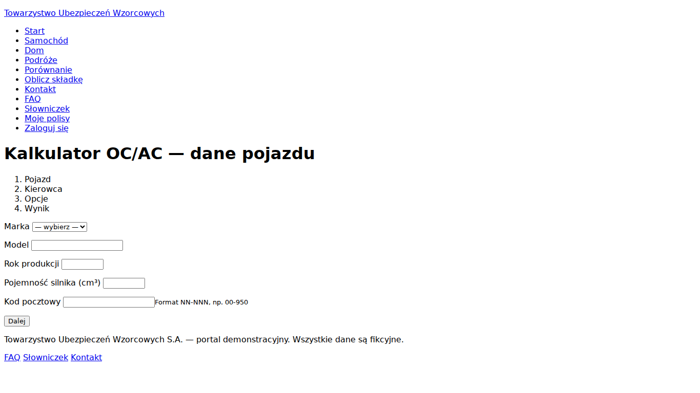 |
| 500 | technical (error) | "Dalej" on /kalkulator/pojazd |  |

### Wireframe and fields

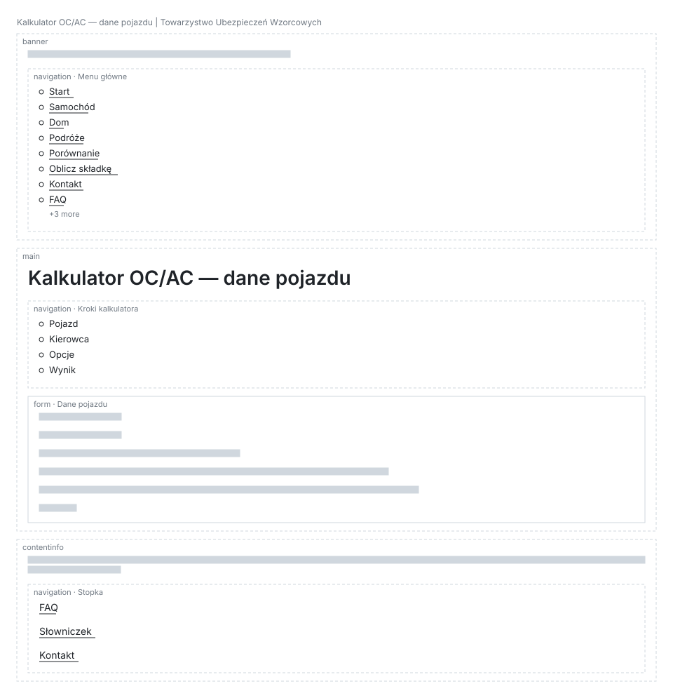

| # | Label (verbatim) | English | Type | Required | Validation | Options | Documented as |
| --- | --- | --- | --- | --- | --- | --- | --- |
| 1 | Marka | Vehicle make | select | yes | “Please select an item in the list.” | — wybierz —, Toyota, Skoda, Volkswagen, Fiat, Inna | DI-001 |
| 2 | Model | Vehicle model | text | yes | maxlength 40; “Please fill out this field.” | — | DI-002 |
| 3 | Rok produkcji | Production year | number | yes | min 1990; max 2026; “Please fill out this field.” | — | DI-003 |
| 4 | Pojemność silnika (cm³) | Engine capacity (cm³) | number | yes | min 50; max 8000; “Please fill out this field.” | — | DI-004 |
| 5 | Kod pocztowy | Postal code | text | yes | pattern [0-9]{2}-[0-9]{3}; “Please fill out this field.” | — | DI-005 |

### Elements on the page

Fields carry their number from the table above, buttons and links a letter.

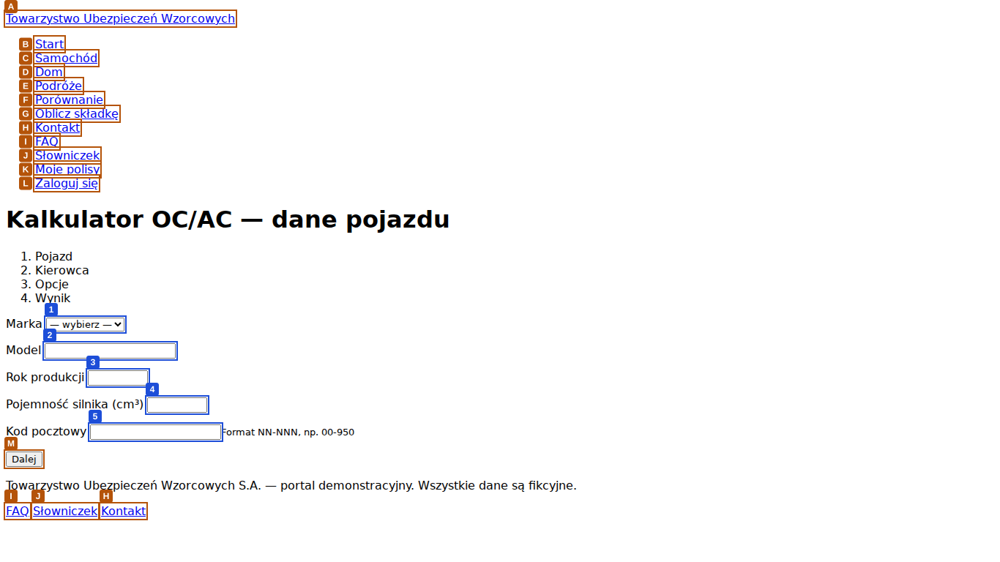

| Tag | Element | Role | Leads to |
| --- | --- | --- | --- |
| **A** | Towarzystwo Ubezpieczeń Wzorcowych | link | `/` |
| **B** | Start | link | `/` |
| **C** | Samochód | link | `/ubezpieczenia/samochod` |
| **D** | Dom | link | `/ubezpieczenia/dom` |
| **E** | Podróże | link | `/ubezpieczenia/podroze` |
| **F** | Porównanie | link | `/porownanie` |
| **G** | Oblicz składkę | link | `/kalkulator/pojazd` |
| **H** | Kontakt | link | `/kontakt` |
| **I** | FAQ | link | `/faq` |
| **J** | Słowniczek | link | `/slowniczek` |
| **K** | Moje polisy | link | `/moje-polisy` |
| **L** | Zaloguj się | link | `/logowanie` |
| **1** | Marka | combobox | — |
| **2** | Model | textbox | — |
| **3** | Rok produkcji | spinbutton | — |
| **4** | Pojemność silnika (cm³) | spinbutton | — |
| **5** | Kod pocztowy | textbox | — |
| **M** | Dalej | button | `/`, `/kalkulator/kierowca`, `/kalkulator/pojazd` |

### Validation

What the form says to wrong input, from the validation probes. A browser bubble is the
browser's own message (in the browser's language): it shows one at a time, on the first wrong
field; the picture draws each field’s first message at once, in a box under the field.

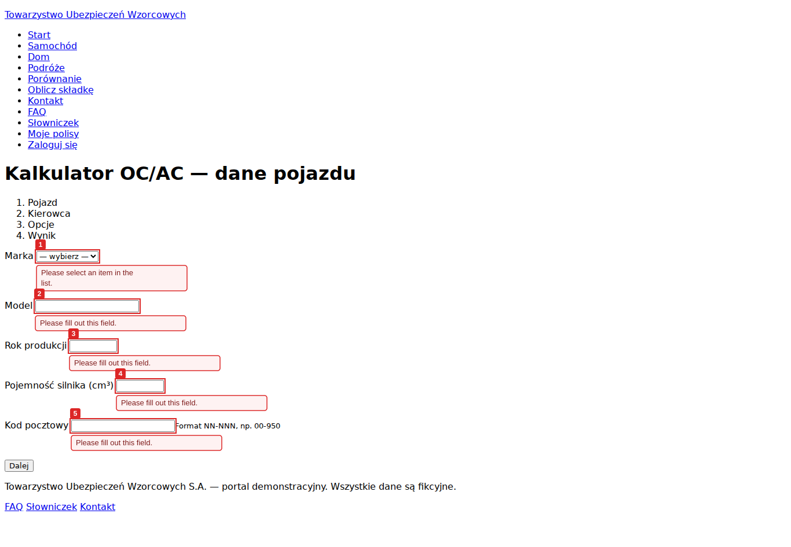

| Field | Tried | Message (exact) | Shown as |
| --- | --- | --- | --- |
| Marka | every field left empty | “Please select an item in the list.” | browser bubble |
| Marka | left empty | “Please select an item in the list.” | browser bubble |
| Model | every field left empty | “Please fill out this field.” | browser bubble |
| Model | left empty | “Please fill out this field.” | browser bubble |
| Rok produkcji | typed "1989" | “Value must be greater than or equal to 1990.” | browser bubble |
| Rok produkcji | every field left empty | “Please fill out this field.” | browser bubble |
| Rok produkcji | typed "abc" | “Please fill out this field.” | browser bubble |
| Pojemność silnika (cm³) | every field left empty | “Please fill out this field.” | browser bubble |
| Pojemność silnika (cm³) | typed "abc" | “Please fill out this field.” | browser bubble |
| Kod pocztowy | every field left empty | “Please fill out this field.” | browser bubble |

### Rules and requirements on this step

- [`BR-001`](BUSINESS_REQUIREMENTS.md#br-001) All vehicle fields are required (draft, observed)
- [`BR-002`](BUSINESS_REQUIREMENTS.md#br-002) "Model" is at most 40 characters (draft, observed)
- [`BR-003`](BUSINESS_REQUIREMENTS.md#br-003) "Rok produkcji" between 1990 and 2026 (draft, observed)
- [`BR-004`](BUSINESS_REQUIREMENTS.md#br-004) "Pojemność silnika (cm³)" between 50 and 8000 (draft, observed)
- [`BR-005`](BUSINESS_REQUIREMENTS.md#br-005) "Kod pocztowy" format NN-NNN (draft, observed)
- [`NFR-002`](FUNCTIONAL_REQUIREMENTS.md#nfr-002) Calculator forms have accessible names; step indicator does not mark the current step (draft, observed)
- [`OQ-002`](GAPS.md#oq-002) Are the year and date limits fixed or relative to today? (draft, needs_confirmation)
- [`FUP-002`](GAPS.md#fup-002) Probe the calculator forms for validation and the AC age limit (draft, inferred)
- [`FUP-007`](GAPS.md#fup-007) Trace and probe the AC quote with "Wartość pojazdu (zł)" (draft, needs_confirmation)

### API calls

_No API call recorded on this step._

---

## Step 3 · Kalkulator OC/AC — dane kierowcy | Towarzystwo Ubezpieczeń Wzorcowych

route `/kalkulator/kierowca` · state `01a148de-06d6-7001-9d80-bbe01feafe74`

### States

| State | Kind | Reached by | Picture |
| --- | --- | --- | --- |
| Kalkulator OC/AC — dane kierowcy \| Towarzystwo Ubezpieczeń Wzorcowych · form step 1 (Dane kierowcy) · 6 recordings with other typed values | happy path | "Dalej" on /kalkulator/pojazd; its address, opened directly | 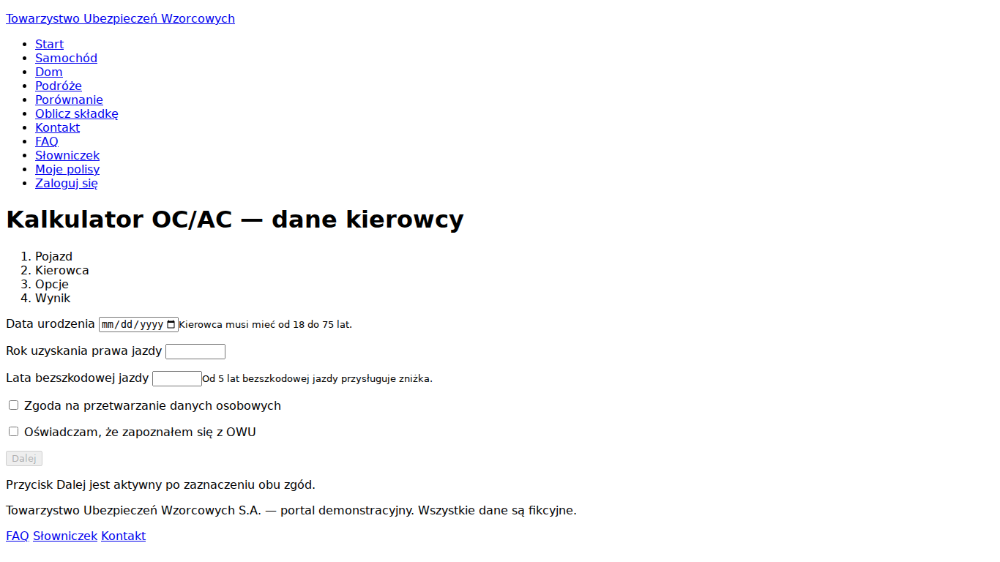 |
| 500 | technical (error) | "Dalej" on /kalkulator/kierowca |  |

### Wireframe and fields

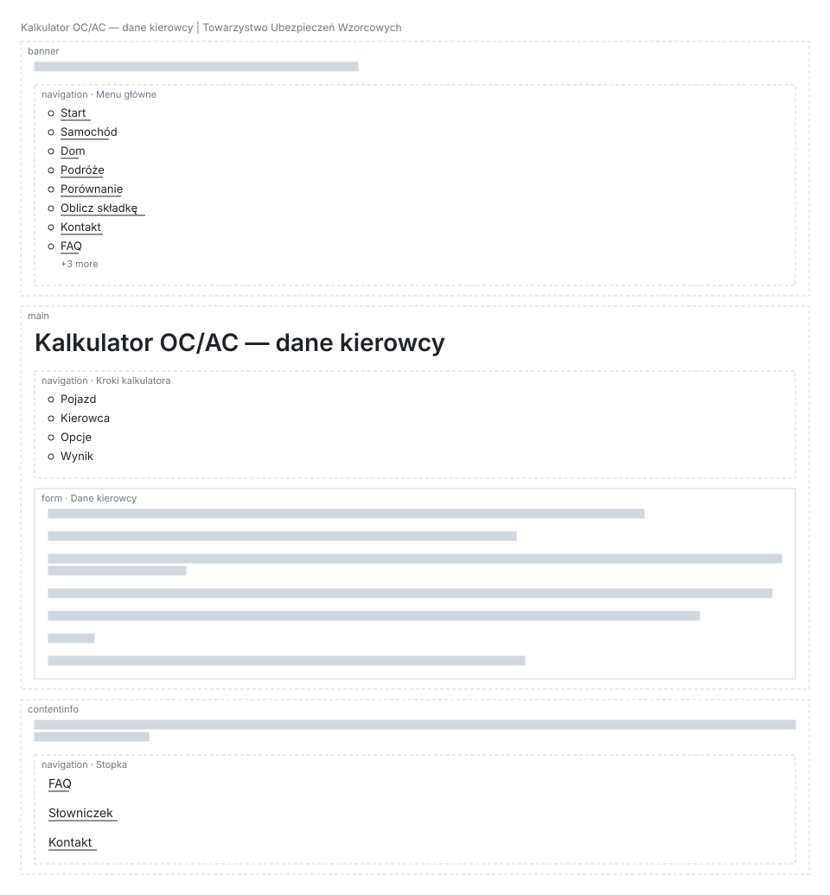

| # | Label (verbatim) | English | Type | Required | Validation | Options | Documented as |
| --- | --- | --- | --- | --- | --- | --- | --- |
| 1 | Data urodzenia | Driver's date of birth | date | yes | min 1950-01-16; max 2008-01-15; “Please fill out this field.” | — | DI-006 |
| 2 | Rok uzyskania prawa jazdy | Year the driving licence was obtained | number | yes | min 1968; max 2026; “Please fill out this field.” | — | DI-007 |
| 3 | Lata bezszkodowej jazdy | Claim-free driving years | number | yes | min 0; max 60; “Please fill out this field.” | — | DI-008 |
| 4 | Zgoda na przetwarzanie danych osobowych | Consent to personal data processing | checkbox | yes | “Please check this box if you want to proceed.” | — | DI-009 |
| 5 | Oświadczam, że zapoznałem się z OWU | Declaration of having read the general insurance terms (OWU) | checkbox | yes | “Please check this box if you want to proceed.” | — | DI-010 |

### Elements on the page

Fields carry their number from the table above, buttons and links a letter.

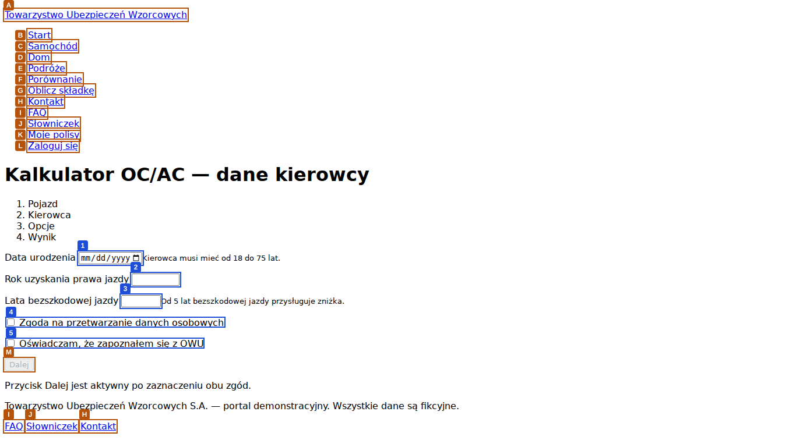

| Tag | Element | Role | Leads to |
| --- | --- | --- | --- |
| **A** | Towarzystwo Ubezpieczeń Wzorcowych | link | `/` |
| **B** | Start | link | `/` |
| **C** | Samochód | link | `/ubezpieczenia/samochod` |
| **D** | Dom | link | `/ubezpieczenia/dom` |
| **E** | Podróże | link | `/ubezpieczenia/podroze` |
| **F** | Porównanie | link | `/porownanie` |
| **G** | Oblicz składkę | link | `/kalkulator/pojazd` |
| **H** | Kontakt | link | `/kontakt` |
| **I** | FAQ | link | `/faq` |
| **J** | Słowniczek | link | `/slowniczek` |
| **K** | Moje polisy | link | `/moje-polisy` |
| **L** | Zaloguj się | link | `/logowanie` |
| **1** | Data urodzenia | textbox | — |
| **2** | Rok uzyskania prawa jazdy | spinbutton | — |
| **3** | Lata bezszkodowej jazdy | spinbutton | — |
| **4** | Zgoda na przetwarzanie danych osobowych | checkbox | — |
| **5** | Oświadczam, że zapoznałem się z OWU | checkbox | — |
| **M** | Dalej | button | `/`, `/kalkulator/kierowca`, `/kalkulator/opcje` |

### Validation

What the form says to wrong input, from the validation probes. A browser bubble is the
browser's own message (in the browser's language): it shows one at a time, on the first wrong
field; the picture draws each field’s first message at once, in a box under the field.

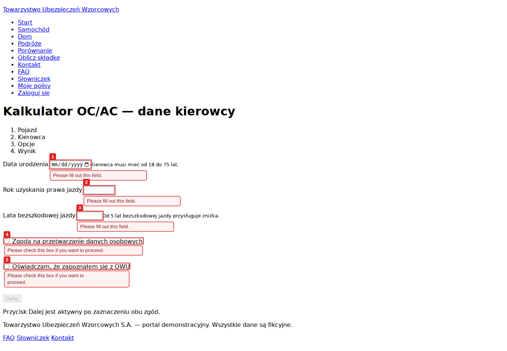

| Field | Tried | Message (exact) | Shown as |
| --- | --- | --- | --- |
| Data urodzenia | every field left empty | “Please fill out this field.” | browser bubble |
| Data urodzenia | left empty | “Please fill out this field.” | browser bubble |
| Data urodzenia | typed "yesterday" | “Please fill out this field.” | browser bubble |
| Rok uzyskania prawa jazdy | typed "1967" | “Value must be greater than or equal to 1968.” | browser bubble |
| Rok uzyskania prawa jazdy | typed "2027" | “Value must be less than or equal to 2026.” | browser bubble |
| Rok uzyskania prawa jazdy | every field left empty | “Please fill out this field.” | browser bubble |
| Rok uzyskania prawa jazdy | left empty | “Please fill out this field.” | browser bubble |
| Rok uzyskania prawa jazdy | typed "abc" | “Please fill out this field.” | browser bubble |
| Lata bezszkodowej jazdy | every field left empty | “Please fill out this field.” | browser bubble |
| Lata bezszkodowej jazdy | typed "abc" | “Please fill out this field.” | browser bubble |
| Zgoda na przetwarzanie danych osobowych | every field left empty | “Please check this box if you want to proceed.” | browser bubble |
| Oświadczam, że zapoznałem się z OWU | every field left empty | “Please check this box if you want to proceed.” | browser bubble |

### Rules and requirements on this step

- [`BR-006`](BUSINESS_REQUIREMENTS.md#br-006) Driver must be 18 to 75 years old ("Data urodzenia") (draft, observed)
- [`BR-007`](BUSINESS_REQUIREMENTS.md#br-007) "Rok uzyskania prawa jazdy" between 1968 and 2026 (draft, observed)
- [`BR-008`](BUSINESS_REQUIREMENTS.md#br-008) "Lata bezszkodowej jazdy" between 0 and 60 (draft, observed)
- [`BR-009`](BUSINESS_REQUIREMENTS.md#br-009) "Dalej" enabled only after both consents (draft, observed)
- [`BR-013`](BUSINESS_REQUIREMENTS.md#br-013) No-claims discount from 5 years of "Lata bezszkodowej jazdy" (draft, inferred)
- [`NFR-002`](FUNCTIONAL_REQUIREMENTS.md#nfr-002) Calculator forms have accessible names; step indicator does not mark the current step (draft, observed)
- [`OQ-002`](GAPS.md#oq-002) Are the year and date limits fixed or relative to today? (draft, needs_confirmation)
- [`FUP-002`](GAPS.md#fup-002) Probe the calculator forms for validation and the AC age limit (draft, inferred)
- [`FUP-007`](GAPS.md#fup-007) Trace and probe the AC quote with "Wartość pojazdu (zł)" (draft, needs_confirmation)

### API calls

_No API call recorded on this step._

---

## Step 4 · Kalkulator OC/AC — opcje | Towarzystwo Ubezpieczeń Wzorcowych

route `/kalkulator/opcje` · state `01a148de-42ff-7001-b4db-971cb7465b8b`

### States

| State | Kind | Reached by | Picture |
| --- | --- | --- | --- |
| **4a** Kalkulator OC/AC — opcje \| Towarzystwo Ubezpieczeń Wzorcowych · form step 1 (Opcje) · 3 recordings with other typed values | happy path | "Dalej" on /kalkulator/kierowca; "Zmień opcje" on /kalkulator/wynik; its address, opened directly | 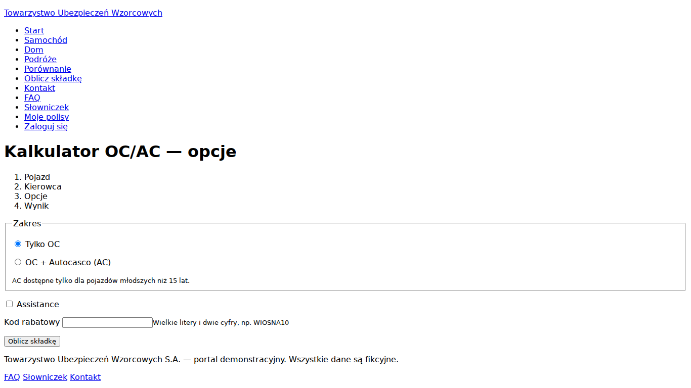 |
| **4b** Kalkulator OC/AC — opcje \| Towarzystwo Ubezpieczeń Wzorcowych · form step 1 (Opcje) · 2 recordings with other typed values | happy path | "OC + Autocasco (AC)" on /kalkulator/opcje | 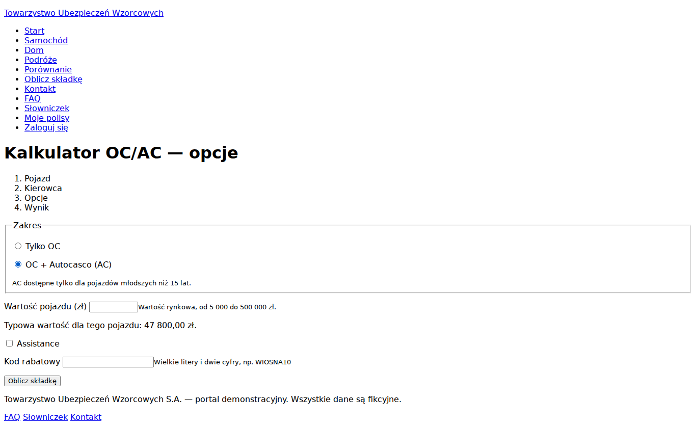 |
| 500 | technical (error) | "Oblicz składkę" on /kalkulator/opcje |  |

**One step, 2 variants.** The page's form differs depending on what came before:

- **4a**: when reached by "Dalej" on /kalkulator/kierowca; "Zmień opcje" on /kalkulator/wynik; its address, opened directly.
- **4b**: when reached by "OC + Autocasco (AC)" on /kalkulator/opcje.

### Wireframe and fields

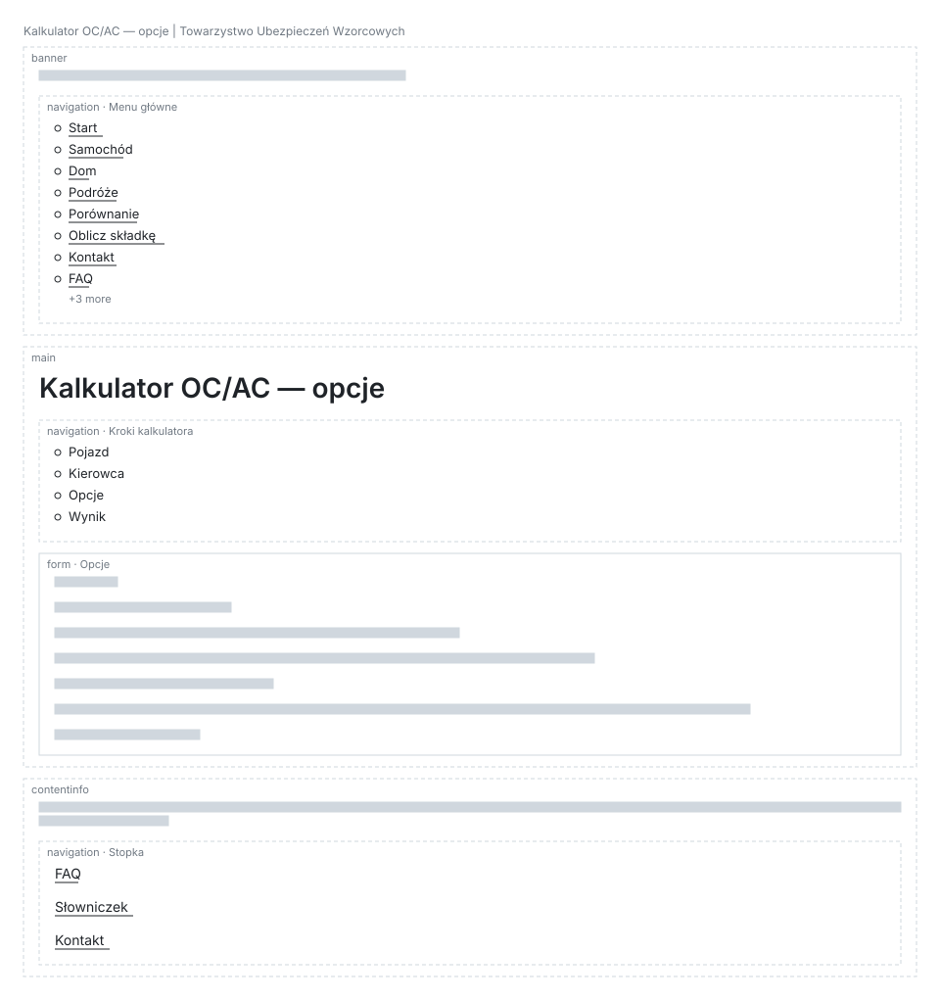

| # | Label (verbatim) | English | Type | Required | Validation | Options | Documented as |
| --- | --- | --- | --- | --- | --- | --- | --- |
| 1 | Tylko OC | — | radio | yes | — | — | — |
| 2 | OC + Autocasco (AC) | — | radio | no | — | — | — |
| 3 | Assistance | Assistance add-on | checkbox | no | — | — | DI-012 |
| 4 | Kod rabatowy | Discount code | text | no | maxlength 12; pattern [A-Z]+[0-9]{2} | — | DI-013 |
| 5 | Wartość pojazdu (zł) _(only in 4b)_ | Vehicle value (PLN) | number | yes | min 5000; max 500000; “Please fill out this field.” | — | DI-029 |

### Elements on the page

Fields carry their number from the table above, buttons and links a letter.

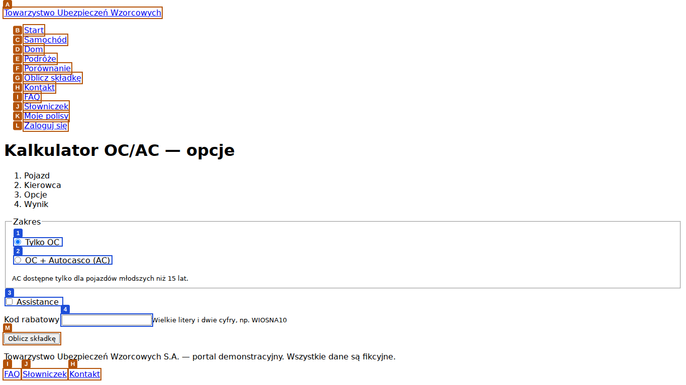

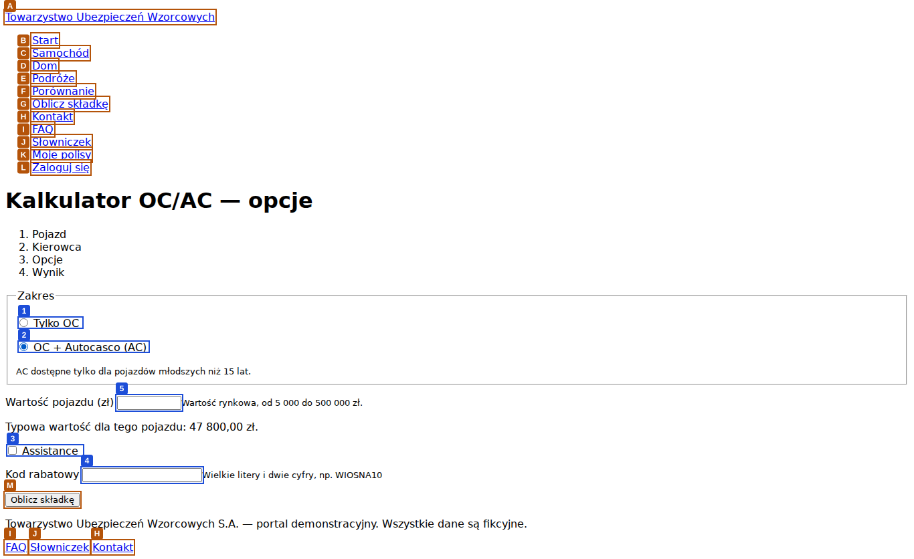

| Tag | Element | Role | Leads to |
| --- | --- | --- | --- |
| **A** | Towarzystwo Ubezpieczeń Wzorcowych | link | `/` |
| **B** | Start | link | `/` |
| **C** | Samochód | link | `/ubezpieczenia/samochod` |
| **D** | Dom | link | `/ubezpieczenia/dom` |
| **E** | Podróże | link | `/ubezpieczenia/podroze` |
| **F** | Porównanie | link | `/porownanie` |
| **G** | Oblicz składkę | link | `/`, `/kalkulator/opcje`, `/kalkulator/pojazd`, `/kalkulator/wynik` |
| **H** | Kontakt | link | `/kontakt` |
| **I** | FAQ | link | `/faq` |
| **J** | Słowniczek | link | `/slowniczek` |
| **K** | Moje polisy | link | `/moje-polisy` |
| **L** | Zaloguj się | link | `/logowanie` |
| **1** | Tylko OC | radio | — |
| **2** | OC + Autocasco (AC) | radio | — |
| **3** | Assistance | checkbox | — |
| **4** | Kod rabatowy | textbox | — |
| **M** | Oblicz składkę | button | `/`, `/kalkulator/opcje`, `/kalkulator/pojazd`, `/kalkulator/wynik` |
| **5** | Wartość pojazdu (zł) | spinbutton | — |

### Validation

What the form says to wrong input, from the validation probes. A browser bubble is the
browser's own message (in the browser's language): it shows one at a time, on the first wrong
field; the picture draws each field’s first message at once, in a box under the field.

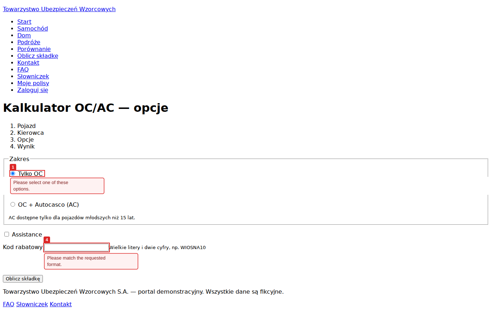

| Field | Tried | Message (exact) | Shown as |
| --- | --- | --- | --- |
| Tylko OC | every field left empty | “Please select one of these options.” | browser bubble |
| Tylko OC | left empty | “Please select one of these options.” | browser bubble |
| OC + Autocasco (AC) | every field left empty | “Please select one of these options.” | browser bubble |
| OC + Autocasco (AC) | left empty | “Please select one of these options.” | browser bubble |
| Kod rabatowy | typed "?" | “Please match the requested format.” | browser bubble |
| _the form_ | only the required fields filled | — | _accepted: the form went on_ |

### Rules and requirements on this step

- [`REQ-002`](FUNCTIONAL_REQUIREMENTS.md#req-002) Calculator steps pass all entered data in the URL (draft, observed)
- [`REQ-004`](FUNCTIONAL_REQUIREMENTS.md#req-004) "Zmień opcje" reopens the options with the previous choices (draft, observed)
- [`BR-009`](BUSINESS_REQUIREMENTS.md#br-009) "Dalej" enabled only after both consents (draft, observed)
- [`BR-010`](BUSINESS_REQUIREMENTS.md#br-010) "Zakres" is required, default "Tylko OC" (draft, observed)
- [`BR-011`](BUSINESS_REQUIREMENTS.md#br-011) AC only for vehicles younger than 15 years (draft, inferred)
- [`BR-012`](BUSINESS_REQUIREMENTS.md#br-012) "Kod rabatowy" format: capital letters and two digits (draft, observed)
- [`BR-021`](BUSINESS_REQUIREMENTS.md#br-021) Choosing "OC + Autocasco (AC)" asks for "Wartość pojazdu (zł)" (draft, observed)
- [`BR-022`](BUSINESS_REQUIREMENTS.md#br-022) "Wartość pojazdu (zł)" between 5 000 and 500 000 zł (draft, observed)
- [`BR-023`](BUSINESS_REQUIREMENTS.md#br-023) Typical vehicle value suggested from "Marka" and "Rok produkcji" (draft, inferred)
- [`NFR-002`](FUNCTIONAL_REQUIREMENTS.md#nfr-002) Calculator forms have accessible names; step indicator does not mark the current step (draft, observed)
- [`OQ-003`](GAPS.md#oq-003) How is the 15-year AC limit enforced? (draft, needs_confirmation)
- [`OQ-004`](GAPS.md#oq-004) Which discount codes exist and what does an unknown code do? (draft, needs_confirmation)
- [`OQ-008`](GAPS.md#oq-008) How does "Wartość pojazdu (zł)" change the AC premium? (draft, needs_confirmation)
- [`OQ-009`](GAPS.md#oq-009) Was "Wartość pojazdu (zł)" always required for AC? (draft, needs_confirmation)
- [`FUP-001`](GAPS.md#fup-001) Trace the OC/AC calculator and purchase (draft, inferred)
- [`FUP-002`](GAPS.md#fup-002) Probe the calculator forms for validation and the AC age limit (draft, inferred)
- [`FUP-003`](GAPS.md#fup-003) Map the "Opcje" screen reached by "Zmień opcje" (draft, inferred)
- [`FUP-007`](GAPS.md#fup-007) Trace and probe the AC quote with "Wartość pojazdu (zł)" (draft, needs_confirmation)

### API calls

| Trigger | Calls |
| --- | --- |
| OC + Autocasco (AC) | GET /api/wartosc-pojazdu (200) |

---

## Step 5 · Twoja składka | Towarzystwo Ubezpieczeń Wzorcowych

route `/kalkulator/wynik` · state `01a14983-5108-7008-b824-064d7b19b04b`

### States

| State | Kind | Reached by | Picture |
| --- | --- | --- | --- |
| Twoja składka \| Towarzystwo Ubezpieczeń Wzorcowych · 3 recordings with other typed values | happy path | "Oblicz składkę" on /kalkulator/opcje | 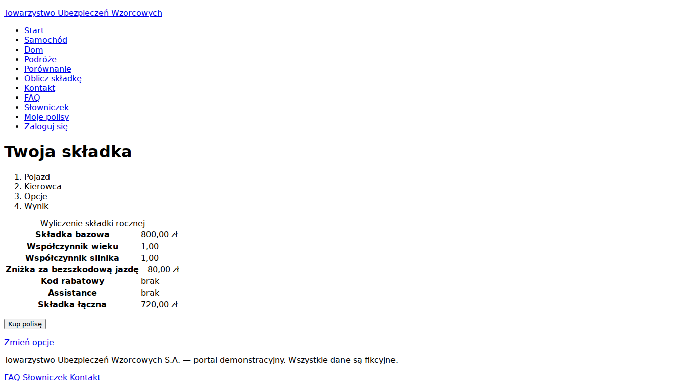 |

### Wireframe and fields

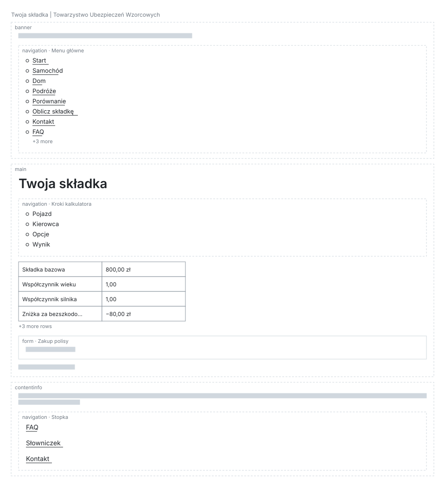

_No form field recorded on this step._

### Elements on the page

Fields carry their number from the table above, buttons and links a letter.

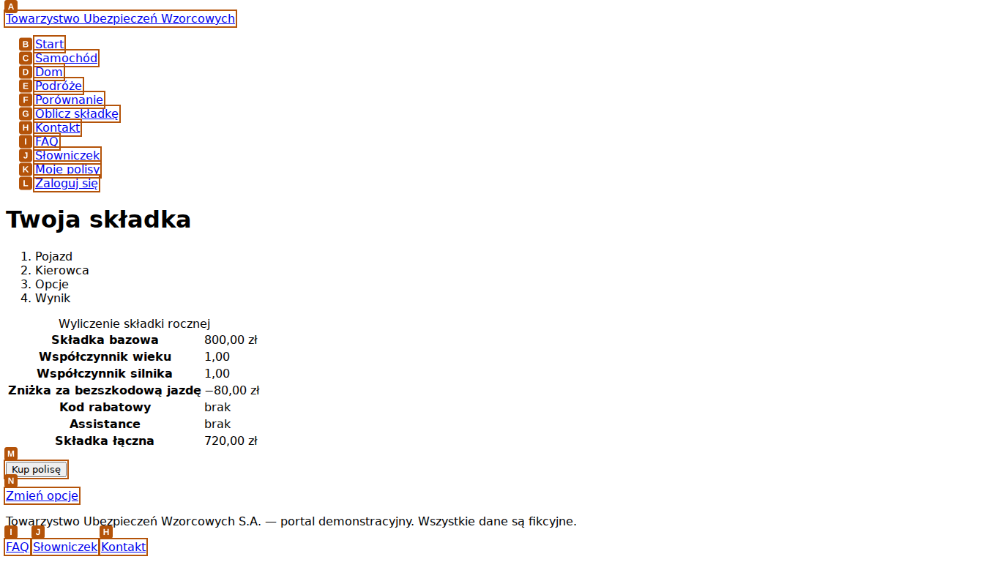

| Tag | Element | Role | Leads to |
| --- | --- | --- | --- |
| **A** | Towarzystwo Ubezpieczeń Wzorcowych | link | `/` |
| **B** | Start | link | `/` |
| **C** | Samochód | link | `/ubezpieczenia/samochod` |
| **D** | Dom | link | `/ubezpieczenia/dom` |
| **E** | Podróże | link | `/ubezpieczenia/podroze` |
| **F** | Porównanie | link | `/porownanie` |
| **G** | Oblicz składkę | link | `/kalkulator/pojazd` |
| **H** | Kontakt | link | `/kontakt` |
| **I** | FAQ | link | `/faq` |
| **J** | Słowniczek | link | `/slowniczek` |
| **K** | Moje polisy | link | `/moje-polisy` |
| **L** | Zaloguj się | link | `/logowanie` |
| **M** | Kup polisę | button | `/kalkulator/zakup` |
| **N** | Zmień opcje | link | `/kalkulator/opcje` |

### Validation

_No validation probe ran on this step._

### Rules and requirements on this step

- [`REQ-002`](FUNCTIONAL_REQUIREMENTS.md#req-002) Calculator steps pass all entered data in the URL (draft, observed)
- [`REQ-003`](FUNCTIONAL_REQUIREMENTS.md#req-003) "Kup polisę" submits the whole quote and confirms the application (draft, observed)
- [`REQ-004`](FUNCTIONAL_REQUIREMENTS.md#req-004) "Zmień opcje" reopens the options with the previous choices (draft, observed)
- [`BR-010`](BUSINESS_REQUIREMENTS.md#br-010) "Zakres" is required, default "Tylko OC" (draft, observed)
- [`BR-012`](BUSINESS_REQUIREMENTS.md#br-012) "Kod rabatowy" format: capital letters and two digits (draft, observed)
- [`BR-013`](BUSINESS_REQUIREMENTS.md#br-013) No-claims discount from 5 years of "Lata bezszkodowej jazdy" (draft, inferred)
- [`NFR-001`](FUNCTIONAL_REQUIREMENTS.md#nfr-001) Polish-only UI with Polish number and money formats (draft, observed)
- [`NFR-003`](FUNCTIONAL_REQUIREMENTS.md#nfr-003) Quote data and consents travel in the URL (draft, observed)
- [`OQ-001`](GAPS.md#oq-001) What happens after "Kup polisę"? (draft, needs_confirmation)
- [`OQ-004`](GAPS.md#oq-004) Which discount codes exist and what does an unknown code do? (draft, needs_confirmation)
- [`OQ-005`](GAPS.md#oq-005) Tables behind "Współczynnik wieku", "Współczynnik silnika" and the no-claims discount (draft, needs_confirmation)
- [`OQ-008`](GAPS.md#oq-008) How does "Wartość pojazdu (zł)" change the AC premium? (draft, needs_confirmation)
- [`OQ-009`](GAPS.md#oq-009) Was "Wartość pojazdu (zł)" always required for AC? (draft, needs_confirmation)
- [`FUP-001`](GAPS.md#fup-001) Trace the OC/AC calculator and purchase (draft, inferred)
- [`FUP-003`](GAPS.md#fup-003) Map the "Opcje" screen reached by "Zmień opcje" (draft, inferred)
- [`FUP-007`](GAPS.md#fup-007) Trace and probe the AC quote with "Wartość pojazdu (zł)" (draft, needs_confirmation)

### API calls

| Trigger | Calls |
| --- | --- |
| Kup polisę | POST /kalkulator/zakup (200) |

---

## Step 6 · Wniosek przyjęty | Towarzystwo Ubezpieczeń Wzorcowych

route `/kalkulator/zakup` · state `01a148de-86d8-7000-9309-4349aaae8045` · cited, not on the walked path

### States

| State | Kind | Reached by | Picture |
| --- | --- | --- | --- |
| Wniosek przyjęty \| Towarzystwo Ubezpieczeń Wzorcowych | happy path | "Kup polisę" on /kalkulator/wynik | 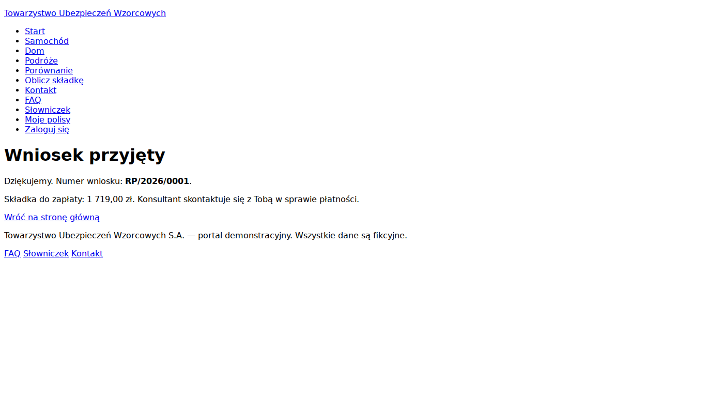 |

### Wireframe and fields

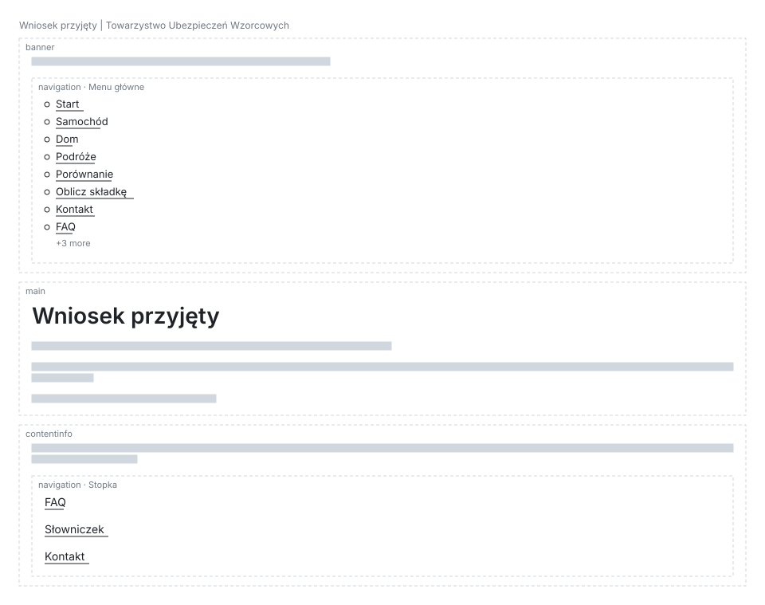

_No form field recorded on this step._

### Elements on the page

Fields carry their number from the table above, buttons and links a letter.

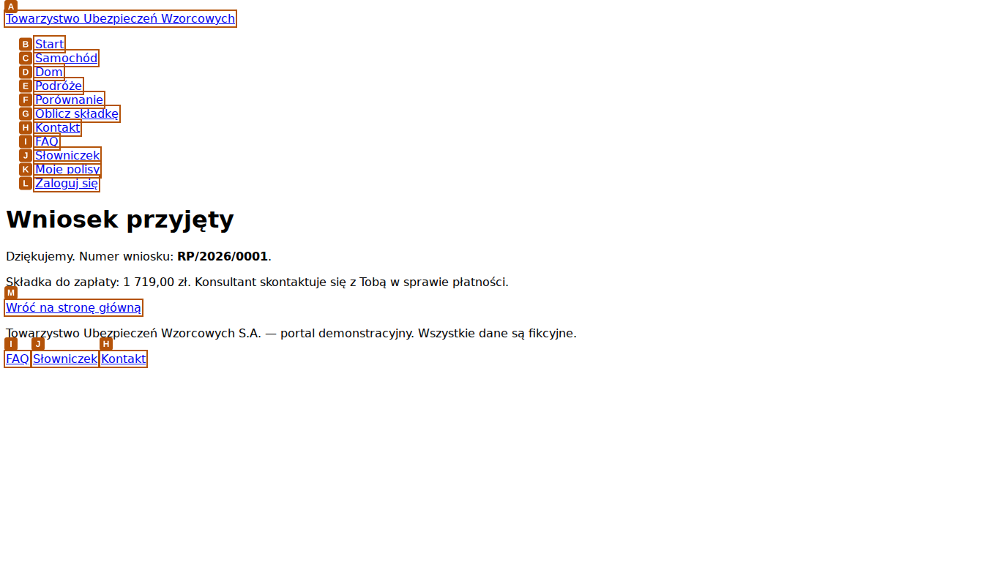

| Tag | Element | Role | Leads to |
| --- | --- | --- | --- |
| **A** | Towarzystwo Ubezpieczeń Wzorcowych | link | _not clicked_ |
| **B** | Start | link | _not clicked_ |
| **C** | Samochód | link | _not clicked_ |
| **D** | Dom | link | _not clicked_ |
| **E** | Podróże | link | _not clicked_ |
| **F** | Porównanie | link | _not clicked_ |
| **G** | Oblicz składkę | link | _not clicked_ |
| **H** | Kontakt | link | _not clicked_ |
| **I** | FAQ | link | _not clicked_ |
| **J** | Słowniczek | link | _not clicked_ |
| **K** | Moje polisy | link | _not clicked_ |
| **L** | Zaloguj się | link | _not clicked_ |
| **M** | Wróć na stronę główną | link | _not clicked_ |

### Validation

_No validation probe ran on this step._

### Rules and requirements on this step

- [`REQ-001`](FUNCTIONAL_REQUIREMENTS.md#req-001) Back-office handling of an accepted application (draft, needs_confirmation)
- [`REQ-003`](FUNCTIONAL_REQUIREMENTS.md#req-003) "Kup polisę" submits the whole quote and confirms the application (draft, observed)
- [`NFR-003`](FUNCTIONAL_REQUIREMENTS.md#nfr-003) Quote data and consents travel in the URL (draft, observed)
- [`OQ-001`](GAPS.md#oq-001) What happens after "Kup polisę"? (draft, needs_confirmation)

### API calls

_No API call recorded on this step._
