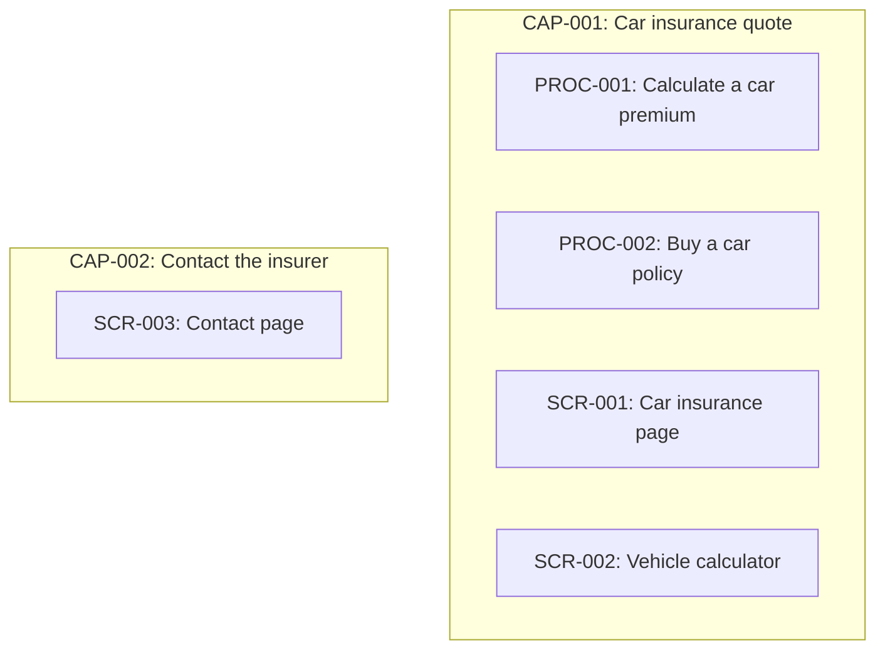

# 2. Capabilities

### CAP-001 — Car insurance quote

**CAP-001** · rev 1 · confirmed · observed

A guest finds car insurance and calculates an OC/AC premium.

**Contains:**

- [PROC-001](04-processes-and-use-cases.md#PROC-001) Calculate a car premium
- [PROC-002](04-processes-and-use-cases.md#PROC-002) Buy a car policy
- [SCR-001](03-screens.md#SCR-001) Car insurance page
- [SCR-002](03-screens.md#SCR-002) Vehicle calculator

Evidence:

- state `00000000-0000-7000-8000-000000000003` — Ubezpieczenie samochodu | Towarzystwo Ubezpieczeń Wzorcowych (/ubezpieczenia/samochod) (run `00000000-0000-7000-8000-000000000001`, map, 2026-01-15)
- state `00000000-0000-7000-8000-000000000004` — Kalkulator OC/AC — dane pojazdu | Towarzystwo Ubezpieczeń Wzorcowych (/kalkulator/pojazd) (run `00000000-0000-7000-8000-000000000001`, map, 2026-01-15)

### CAP-002 — Contact the insurer

**CAP-002** · rev 1 · draft · observed

> DRAFT — not confirmed by a reviewer

A guest sends a message through the contact form.

**Contains:**

- [SCR-003](03-screens.md#SCR-003) Contact page

Evidence:

- state `00000000-0000-7000-8000-000000000005` — Kontakt | Towarzystwo Ubezpieczeń Wzorcowych (/kontakt) (run `00000000-0000-7000-8000-000000000001`, map, 2026-01-15)
