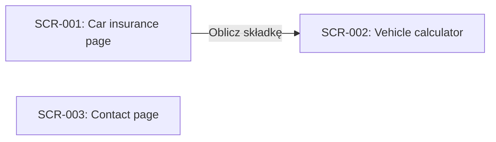

# 3. Screens

## Navigation

### SCR-001 — Car insurance page

**SCR-001** · rev 1 · confirmed · observed

**Purpose:** Presents OC and Autocasco (AC) and links to the premium calculator.

**Route templates:**

- `/ubezpieczenia/samochod`

**Elements** (labels verbatim):

| Role | Label |
| --- | --- |
| heading | Ubezpieczenie samochodu |
| link | Oblicz składkę |
| button | Kup polisę |

**Data items shown:**

_none recorded_

**Entry points:**

- Main menu link "Samochód"

**Screenshot:**

_No screenshot recorded._

**Wireframe:**

_No wireframe recorded._

Related: uses term [GL-001](08-glossary.md#GL-001)

Evidence:

- state `00000000-0000-7000-8000-000000000003` — Ubezpieczenie samochodu | Towarzystwo Ubezpieczeń Wzorcowych (/ubezpieczenia/samochod) (run `00000000-0000-7000-8000-000000000001`, map, 2026-01-15)

### SCR-002 — Vehicle calculator

**SCR-002** · rev 2 · draft · observed

> DRAFT — not confirmed by a reviewer
>
> confirmed baseline: rev 1

**Purpose:** First step of the premium calculator: vehicle data, sent with "Dalej".

**Route templates:**

- `/kalkulator/pojazd`

**Elements** (labels verbatim):

| Role | Label |
| --- | --- |
| heading | Kalkulator OC/AC — dane pojazdu |
| combobox | Marka |
| textbox | Model |
| spinbutton | Rok produkcji |
| button | Dalej |

**Data items shown:**

- [DI-001](07-data-dictionary.md#DI-001) Vehicle make
- [DI-002](07-data-dictionary.md#DI-002) Vehicle model

**Entry points:**

- Link "Oblicz składkę" on the car insurance page

**Screenshot:**

_No screenshot recorded._

**Wireframe:**

_No wireframe recorded._

Evidence:

- form `00000000-0000-7000-8000-000000000006` — form: marka, model, rok_produkcji, pojemnosc (run `00000000-0000-7000-8000-000000000001`, map, 2026-01-15)
- state `00000000-0000-7000-8000-000000000004` — Kalkulator OC/AC — dane pojazdu | Towarzystwo Ubezpieczeń Wzorcowych (/kalkulator/pojazd) (run `00000000-0000-7000-8000-000000000001`, map, 2026-01-15)

### SCR-003 — Contact page

**SCR-003** · rev 1 · draft · observed

> DRAFT — not confirmed by a reviewer

**Purpose:** Contact form for questions to the insurer.

**Route templates:**

- `/kontakt`

**Elements** (labels verbatim):

| Role | Label |
| --- | --- |
| heading | Kontakt |
| button | Wyślij |

**Data items shown:**

_none recorded_

**Entry points:**

- Main menu link "Kontakt"

**Screenshot:**

_No screenshot recorded._

**Wireframe:**

_No wireframe recorded._

Evidence:

- state `00000000-0000-7000-8000-000000000005` — Kontakt | Towarzystwo Ubezpieczeń Wzorcowych (/kontakt) (run `00000000-0000-7000-8000-000000000001`, map, 2026-01-15)
