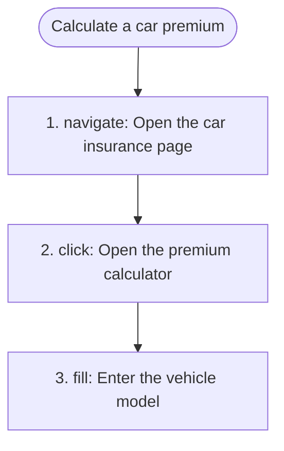
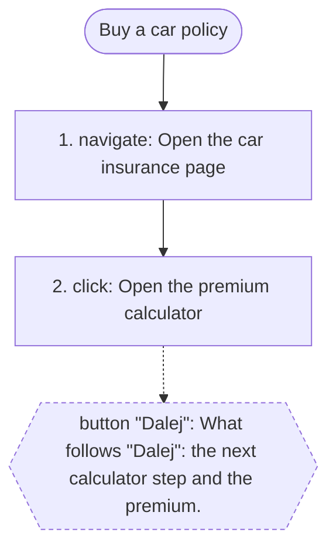

# 4. Processes and use cases

## 4.1 Processes

### PROC-001 — Calculate a car premium

**PROC-001** · rev 1 · confirmed · observed

**Goal:** See an OC/AC premium for a car

**Persona:** guest

**Trigger:** The guest opens "Oblicz składkę".

**Outcome:** The vehicle data form is shown.

**Observed extent:** full

**Process map:**

Evidence:

- process `00000000-0000-7000-8000-00000000001c` — Calculate a car premium (run `00000000-0000-7000-8000-000000000018`, trace, 2026-01-15)
- process step `00000000-0000-7000-8000-00000000001e` — step 2: Open the premium calculator (run `00000000-0000-7000-8000-000000000018`, trace, 2026-01-15)

#### UC-001 — Calculate a premium

**UC-001** · rev 1 · draft · inferred

> DRAFT — not confirmed by a reviewer

**Primary actor:** Guest

**Trigger:** The guest selects "Oblicz składkę".

**Preconditions:**

- The guest is on the car insurance page.

**Main success scenario:**

1. Guest: Selects "Oblicz składkę".
2. System: Shows the form "Dane pojazdu".
3. Guest: Enters the vehicle model.

**Extensions:**

*Exception flow E1:*

1. System: Marks an empty required field.

**Postconditions:**

- The vehicle data is entered.

Related: describes [PROC-001](#PROC-001)

Evidence:

- process `00000000-0000-7000-8000-00000000001c` — Calculate a car premium (run `00000000-0000-7000-8000-000000000018`, trace, 2026-01-15)

### PROC-002 — Buy a car policy

**PROC-002** · rev 1 · draft · observed

> DRAFT — not confirmed by a reviewer

**Goal:** Reach the purchase confirmation

**Persona:** guest

**Trigger:** The guest starts the calculator.

**Outcome:** Stops before "Dalej"; what follows is not observable on production.

**Observed extent:** until boundary

**Process map:**

**Not observable beyond the boundary** (button "Dalej"): What follows "Dalej": the next calculator step and the premium.

Evidence:

- process `00000000-0000-7000-8000-000000000024` — Buy a car policy (run `00000000-0000-7000-8000-000000000020`, trace, 2026-01-15)
- process step `00000000-0000-7000-8000-000000000025` — step 1: Open the car insurance page (run `00000000-0000-7000-8000-000000000020`, trace, 2026-01-15)

## 4.2 Use cases not linked to a process

_none_
