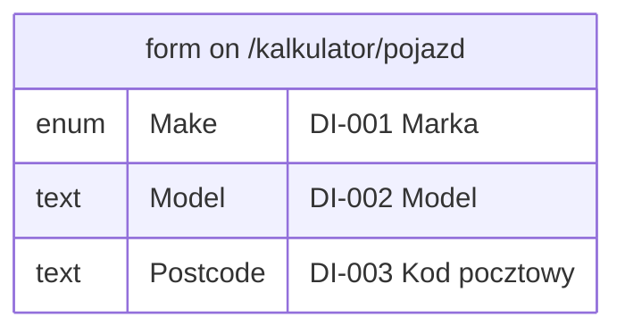

# 7. Data dictionary

### DI-001 — Vehicle make

**DI-001** · rev 1 · confirmed · observed

**Name (verbatim):** Marka (pl)

**English name:** Make

**Type:** enum

**Constraints:** allowed values: Toyota, Skoda, Inna; required: true

**Seen in:**

- form on /kalkulator/pojazd (`00000000-0000-7000-8000-000000000006`)

Related: appears on [SCR-002](03-screens.md#SCR-002)

Evidence:

- form `00000000-0000-7000-8000-000000000006` — form: marka, model, rok_produkcji, pojemnosc (run `00000000-0000-7000-8000-000000000001`, map, 2026-01-15)

### DI-002 — Vehicle model

**DI-002** · rev 1 · draft · observed

> DRAFT — not confirmed by a reviewer

**Name (verbatim):** Model (pl)

**English name:** Model

**Type:** text

**Constraints:** max length: 40; required: true

**Seen in:**

- form on /kalkulator/pojazd (`00000000-0000-7000-8000-000000000006`)

Related: appears on [SCR-002](03-screens.md#SCR-002)

Evidence:

- form `00000000-0000-7000-8000-000000000006` — form: marka, model, rok_produkcji, pojemnosc (run `00000000-0000-7000-8000-000000000001`, map, 2026-01-15)

### DI-003 — Postcode

**DI-003** · rev 1 · draft · observed

> DRAFT — not confirmed by a reviewer

**Name (verbatim):** Kod pocztowy (pl)

**English name:** Postcode

**Type:** text

**Constraints:** format: NN-NNN; pattern observed: [0-9]{2}-[0-9]{3}; required: true

**Seen in:**

- form on /kalkulator/pojazd (`00000000-0000-7000-8000-000000000006`)

Evidence:

- form `00000000-0000-7000-8000-000000000006` — form: marka, model, rok_produkcji, pojemnosc (run `00000000-0000-7000-8000-000000000001`, map, 2026-01-15)

## Entities

Data items seen together in one form or call, grouped as an entity. No relationships are drawn: none were observed.

