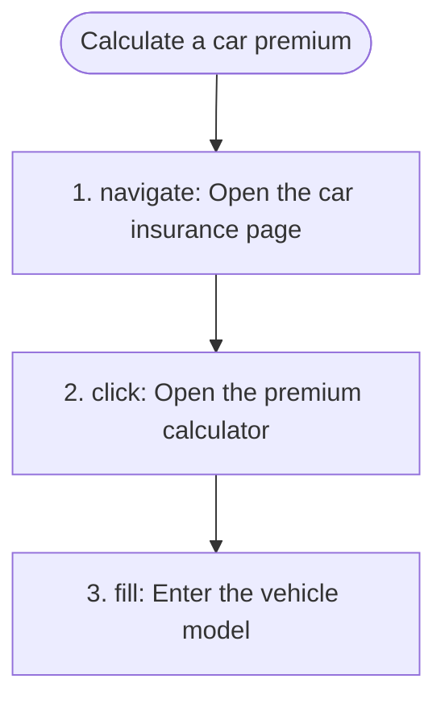

# 4. Processes and use cases

## 4.1 Processes

### PROC-001 — Calculate a car premium

**PROC-001** · rev 1 · confirmed · observed

**Goal:** See an OC/AC premium for a car

**Persona:** guest

**Trigger:** The guest opens "Oblicz składkę".

**Outcome:** The vehicle data form is shown.

**Observed extent:** full

**Process map:**

Evidence:

- process `00000000-0000-7000-8000-00000000001c` — Calculate a car premium (run `00000000-0000-7000-8000-000000000018`, trace, 2026-01-15)
- process step `00000000-0000-7000-8000-00000000001e` — step 2: Open the premium calculator (run `00000000-0000-7000-8000-000000000018`, trace, 2026-01-15)

## 4.2 Use cases not linked to a process

_none_
