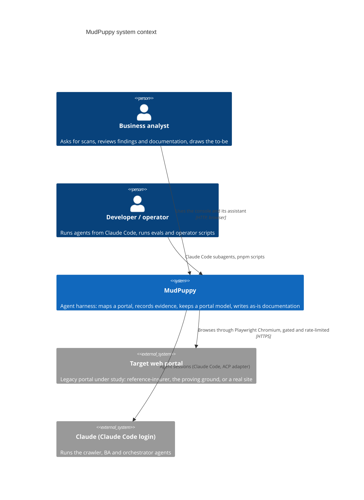
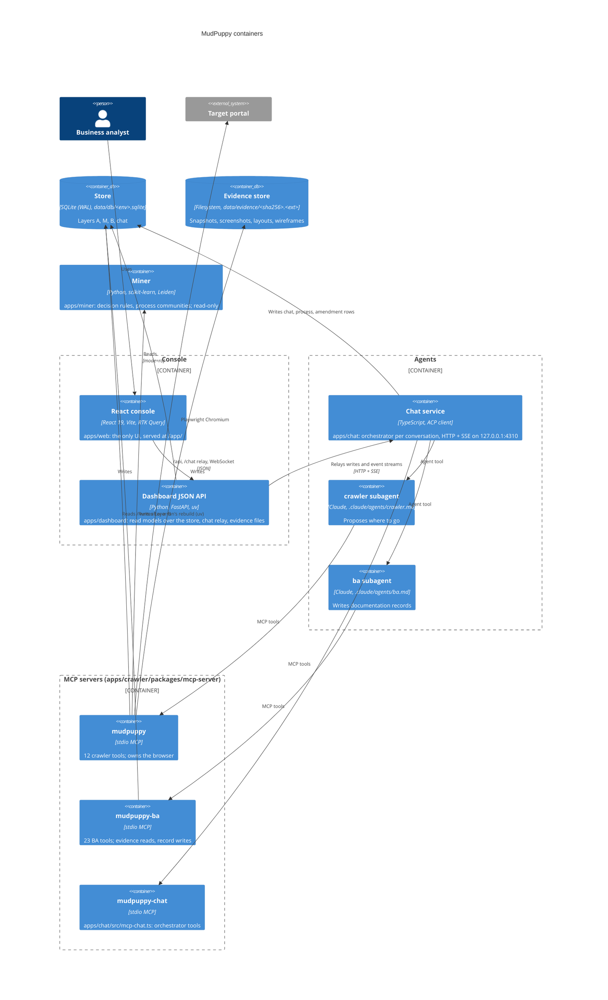
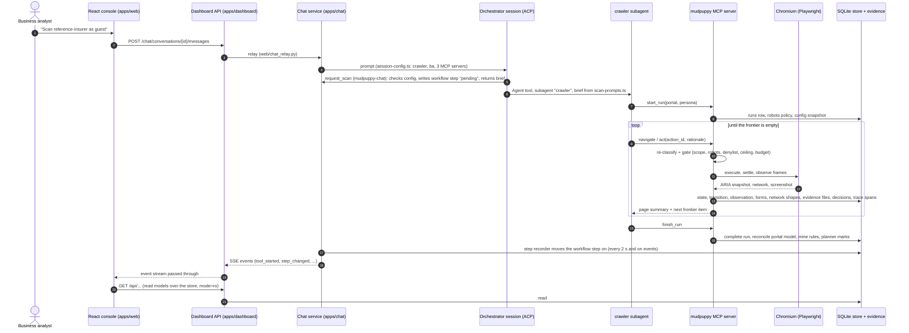
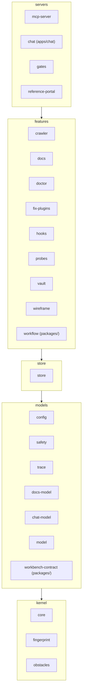
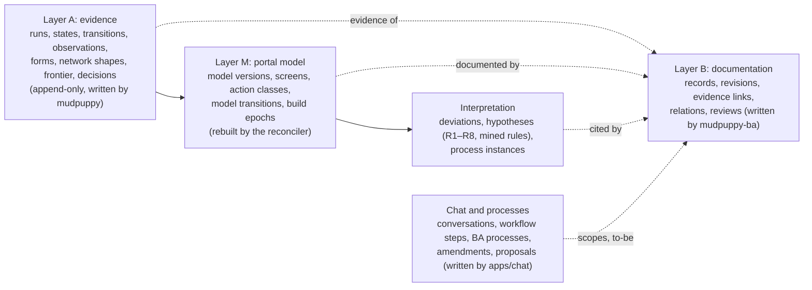

# MudPuppy architecture

MudPuppy is an **agent harness** that maps legacy web portals and turns what it saw into **as-is
documentation**: good enough to re-create the portal from the documentation alone
(`.specify/memory/constitution.md`, preamble). Two LLM agents do the open-ended work; everything
that must be safe, repeatable or true is deterministic code around them.

- The **crawler** agent walks a portal in a real browser and records evidence: states, transitions,
  forms, network shapes, screenshots, wireframes.
- The **BA** (business analyst) agent never browses. It reads the recorded evidence and writes keyed,
  evidence-linked documentation records (an SRS).
- Since 2.0 every scan is reconciled into one **portal model** (screens, actions, links, rules,
  processes) that lives over time (`specs/039-mudpuppy-2-portal-model/design.md`).
- People review, decide and export through the **console** (a React app) and a chat assistant.

Further reading in this folder:

| Document | What it covers |
| --- | --- |
| [harness.md](harness.md) | How the agent harness works: tools, safety, evidence, the portal model, the chat orchestrator, evals and gates |
| [data-model.md](data-model.md) | The SQLite schema by area, conventions, evidence store, config files, exports |
| [workflow.md](workflow.md) | Spec-driven development, guidelines, commit hook, test tiers |
| [../adr/README.md](../adr/README.md) | Architecture decision records |
| [../getting-started.md](../getting-started.md) | Install, scan the practice portal, document and export it |
| [../glossary/README.md](../glossary/README.md) | The project vocabulary (run, frontier, evidence, settled, ...) |

## System context

There is no crawler CLI: a developer asks a Claude Code session to "use the crawler subagent to map
`<portal>` as `<persona>`" (`README.md` "Running it"), or a BA uses the console's assistant, which
starts the same subagents (`apps/chat`).

## Containers

| Container | Where | Tech | Role |
| --- | --- | --- | --- |
| Claude Code subagents | `.claude/agents/*.md` | Markdown agent definitions | `crawler` (sonnet, only `mcp__mudpuppy__*` tools), `ba` (opus, only `mcp__mudpuppy-ba__*` tools + `Read` of its skill references, guarded by `.claude/hooks/ba-guard.py`). Development agents: `code-reviewer`, `db-admin`, `frontend-dev`, `governor`, `po` |
| Orchestrator prompts | `apps/chat/agents/` | Markdown | `orchestrator.md` (console chat), `workbench.md`, `workbench-live.md`. Loaded by `apps/chat/src/session-config.ts`, not Claude Code subagents |
| MCP servers | `apps/crawler/packages/mcp-server` (`src/main.ts`, `src/ba-main.ts`) | TypeScript, `@modelcontextprotocol/sdk` | `mudpuppy` (crawler tools, owns Chromium, DB, evidence) and `mudpuppy-ba` (BA tools). Registered for Claude Code in `.mcp.json` with `MUDPUPPY_ENV=local-dev` |
| Crawler packages | `apps/crawler/packages/*` | TypeScript, pnpm workspace | The deterministic core: config, safety, fingerprint, crawler runtime, store, model, docs, ... (see [Layers](#crawler-packages-and-layers)) |
| Operator scripts | `apps/crawler/scripts/*.ts` | `pnpm <script>` in `apps/crawler` | `docs:*`, `portal:*`, `model:*`, `vault`, `eval*`, `store:reset`, ... (`apps/crawler/CLAUDE.md`) |
| Chat service | `apps/chat` | TypeScript, ACP (`@agentclientprotocol/claude-agent-acp`) | One orchestrator ACP session per conversation with its own MCP servers; HTTP + SSE on 127.0.0.1:4310; the only writer of chat, process and amendment rows |
| Dashboard JSON API | `apps/dashboard` | Python 3, FastAPI, Pydantic, uv | Read models over the store (`queries_app_*.py`), one router per console page (`web/api_*.py`), chat relay (`web/chat_relay.py`), evidence files, serves `apps/web/dist` at `/app/`. Opens the store read-only |
| React console | `apps/web` | React 19, React Router 7, RTK Query, React Hook Form, Vite, Storybook | Salvage Yard design system in `src/design-system/`, pages in `src/pages/`; dev server on 5173 proxies `/api` to 8765 |
| Miner | `apps/miner` | Python, uv, scikit-learn, Leiden | `rules`, `communities`, `classify`; prints JSON that `model:mine`, `model:propose`, `model:classify` validate with Zod and write. Opens the store `mode=ro` |
| Shared packages | `packages/workflow`, `packages/workbench-contract` | TypeScript | `workflow`: pure workflow-step statuses and amendment impact (used by `apps/chat`). `workbench-contract`: what the Workbench assistant may return, and the checker |
| Reference portal | `apps/crawler/packages/reference-portal` | TypeScript HTTP server | Portal `reference-insurer` on 127.0.0.1:4010, a fake Polish insurer with `ground-truth.yaml` and switchable 2.0 scenarios (`src/scenarios.ts`) |
| Proving ground | `apps/proving-ground` | Django backend (no ORM), Vite/React micro-frontends | A fictional legacy estate (shop, bank, insurer, old pages) reproducing `docs/legacy-obstacles.md`; 4100/4101, gates use 4200/4201; ground truth in `ground-truth/*.yaml`; its own pnpm workspace |
| Scar-maker | `apps/scar-maker` | TypeScript HTTP server | One route per real-world obstacle ("scar", `scars.yaml`) on 127.0.0.1 and 127.0.0.2; gates use port 4400 |
| Evals | `apps/crawler/evals`, `apps/chat/evals` | TypeScript | Tier-2 trials with real agents, graded against ground truth (`pnpm eval`), results in `data/evals/` |
| Gates | `apps/crawler/packages/gates` | Vitest | Tier-1 quality gates against the proving ground and scar-maker; report in `data/gates/report.json` |
| Data | `data/` | SQLite + files | `migrations/` and `schema/` tracked; `db/`, `evidence/`, `exports/`, `traces/`, `logs/` generated (`data/README.md`) |
| Config | `portals/`, `personas/` | YAML, validated by `@mudpuppy/config` | Where to crawl and who acts ([data-model.md](data-model.md#configuration-files)) |

## A scan, end to end

The path of one map scan started from the console's assistant. The same crawler subagent and
`mudpuppy` server run when a developer asks Claude Code directly (then `.mcp.json` starts the
servers).

Sources: `apps/chat/src/scan.ts`, `scan-prompts.ts`, `session-config.ts`, `step-recorder.ts`;
`apps/crawler/packages/mcp-server/src/runtime/pipeline/process-page.ts`, `services/complete-run.ts`;
`apps/dashboard/src/mudpuppy_dashboard/web/chat_relay.py`.

## Crawler packages and layers

All TypeScript workspace packages belong to one layer of `apps/crawler/layers.json`; imports only go
downward or within a layer, and the kernel depends on no workspace package. `apps/crawler/tests/layers.test.ts`
enforces it for the crawler packages, `apps/chat` and `packages/*` (guidelines G-07, G-08).

| Package | Layer | What it holds (from its `CLAUDE.md`) |
| --- | --- | --- |
| `core` | kernel | The crawl model's Zod schemas (`src/schemas/`), ids (UUIDv7), PII scrubber, content-addressed evidence store, element keys, layout, secrets redactor, pino logger |
| `fingerprint` | kernel | Pure state fingerprinting: route templates, ARIA canonicalisation, two-level fingerprint |
| `obstacles` | kernel | Dismisses cookie banners, pop-ups, chat widgets (Playwright `addLocatorHandler` + `sweep()`) |
| `config` | models | Loads and validates `portal.yaml` and persona YAML with Zod, resolves `extends`, computes the effective config |
| `safety` | models | Pure action classifier, rule set, robots.txt parser, scope checks, URL lists, denylist, block detector |
| `trace` | models | Zod schemas of trace boots, spans and imported agent turns; scrubbing and payload limits |
| `docs-model` | models | Zod schemas of everything the BA records, and of traced processes and steps |
| `chat-model` | models | Zod schemas of conversations, messages, workflow steps, process scopes, amendments, BA processes, Workbench |
| `model` | models | The 2.0 portal model as pure functions: reconcile, deviations, rules R1–R8, decision tables, planner |
| `workbench-contract` | models | The Workbench view/command contract and the view checker |
| `store` | store | SQLite through Kysely (`db-types*.ts` mirror the schema), migration runner, decision log, tracer, portal export/delete, model writer |
| `crawler` | features | Browser runtime library: action/request gates, rate limiter, robots registry, stabilizer, network recorder, ARIA observer, screenshot capture, autofill, action extractor, frontier |
| `docs` | features | Layer B core: record keys, status engine, relations, evidence resolution, audit, review, SRS rendering and export, process export, evaluation against ground truth |
| `doctor` | features | First-start diagnosis of the machine and the way to the portal (`pnpm portal:doctor`) |
| `fix-plugins` | features | Tested fixes for portal-specific scars, turned into portal hooks |
| `hooks` | features | Per-portal hooks (`portals/<id>/hooks.ts`), time-boxed, recorded, never stop the crawl |
| `probes` | features | Form probe catalogue and the deterministic outcome classifier |
| `vault` | features | Encrypted test-user credentials (AES-256-GCM) resolved from `ref:` names; `pnpm vault` |
| `wireframe` | features | Deterministic SVG + `.excalidraw` wireframes from ARIA snapshots |
| `workflow` | features | Pure workflow step statuses, next moves and amendment impact |
| `mcp-server` | servers | The `mudpuppy` and `mudpuppy-ba` servers; `src/runtime/pipeline/` is the crawl pipeline; replay driver |
| `chat` | servers | `apps/chat` (see above) |
| `gates` | servers | Tier-1 gate cases and tier-2 eval result types and comparison |
| `reference-portal` | servers | The `reference-insurer` portal and its ground truth |

File maps: `apps/crawler/packages/mcp-server/LAYOUT.md`, `apps/crawler/packages/store/LAYOUT.md`,
`apps/chat/LAYOUT.md`, `apps/dashboard/LAYOUT.md`, `apps/web/LAYOUT.md` (guideline G-30: every
package keeps a short `CLAUDE.md`, larger ones a `LAYOUT.md`).

## Three data layers

The constitution (Technical Constraints, "Data model") splits the store into three layers; chat and
Workbench rows sit beside them.

Details: [data-model.md](data-model.md).

## Ports and processes

| Port | What | Source |
| --- | --- | --- |
| 8765 | Dashboard API + console at `/app/` | `CLAUDE.md`, `apps/dashboard/CLAUDE.md` |
| 5173 | Vite dev server of the console | `apps/web/CLAUDE.md` |
| 6006 | Storybook | `apps/web/CLAUDE.md` |
| 4310 | Chat service (127.0.0.1 only) | `apps/chat/README.md` |
| 4010 | Reference portal | `README.md` |
| 4100, 4101 | Proving ground (main, widget host) | `apps/proving-ground/README.md` |
| 4200, 4201 | Proving ground started by the gates | `apps/crawler/packages/gates/CLAUDE.md` |
| 4300 / 4400 | Scar-maker (manual / gates), on 127.0.0.1 and 127.0.0.2 | `apps/scar-maker/CLAUDE.md` |

`MUDPUPPY_ENV` selects the store `data/db/<env>.sqlite` for the MCP servers and the chat service; it
has no default in the servers (`boot-environment.ts`). `local-dev` is the local test store that
`.mcp.json` and the `portals/*-local` copies use; `sandbox` serves the original local portals, the
gates and the tests (`CLAUDE.md`).
