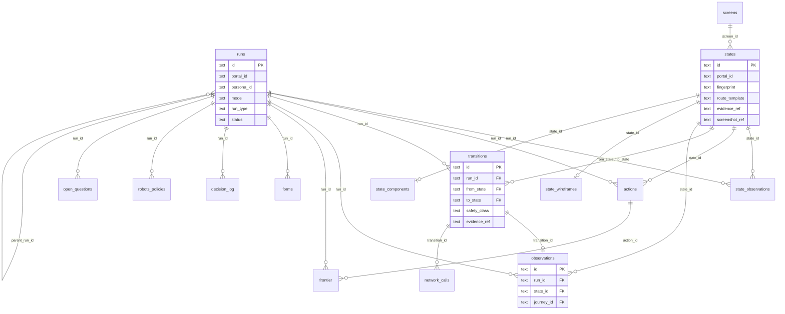
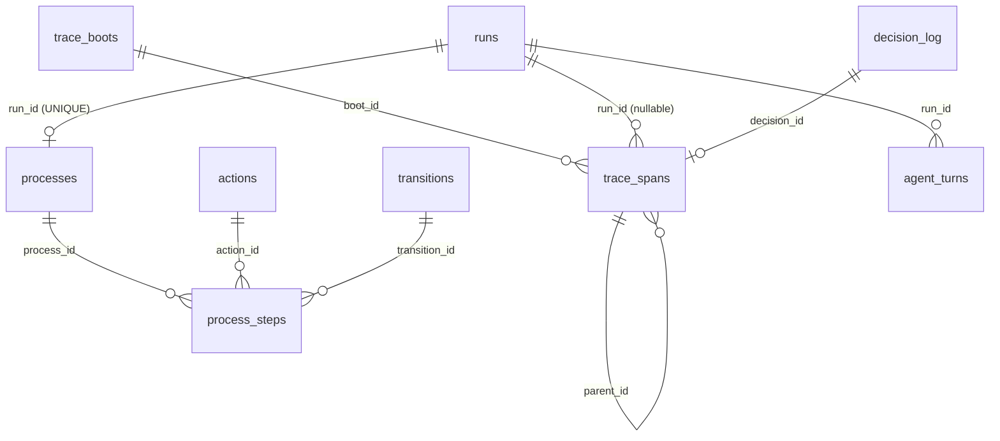
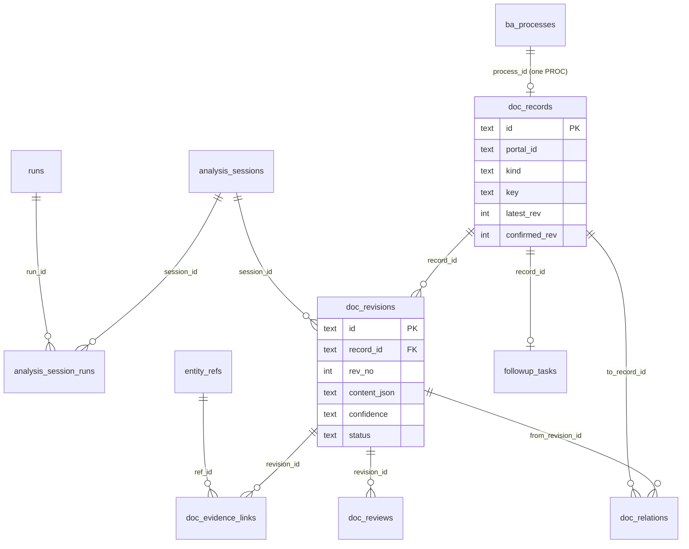
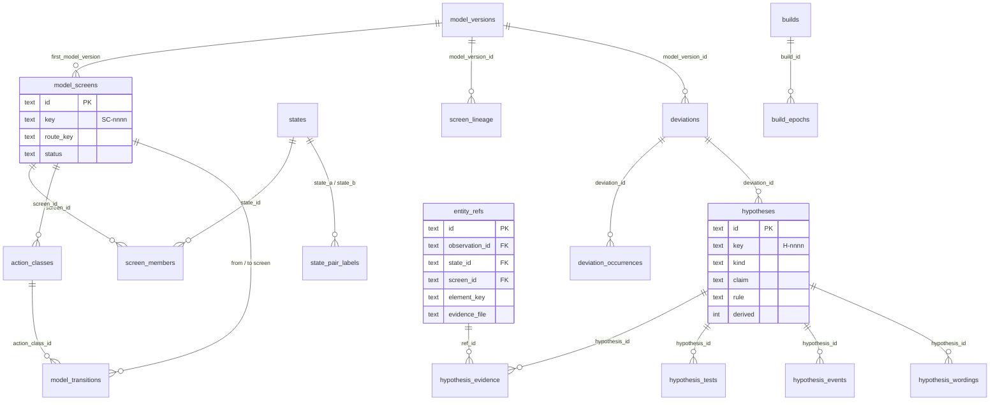
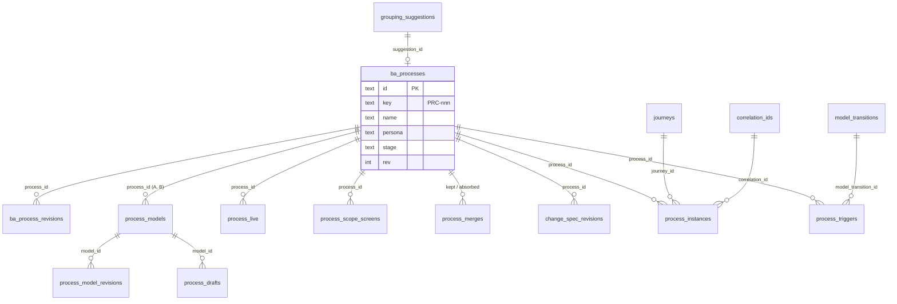
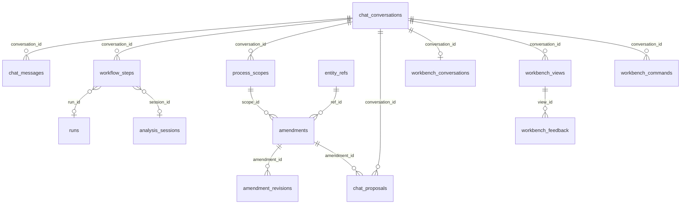

# Data model

What MudPuppy persists, where, and under which rules. Sources: `data/schema/schema.sql` (generated
snapshot, 85 tables, 3 views, 4 triggers), `data/schema/README.md`, `data/README.md`, the
migrations in `data/migrations/` and `.claude/skills/sqlite-conventions/`. Overview: [README.md](README.md).

## Storage at a glance

| What | Where | Tracked in git |
| --- | --- | --- |
| Migrations, reversible (`NNNN_name.up.sql` + `.down.sql`, 0001 → 0053) | `data/migrations/` | yes |
| Schema snapshot (applied migrations dumped from `sqlite_master`; never hand-edited) | `data/schema/schema.sql` | yes |
| One SQLite store per environment | `data/db/<env>.sqlite` (`dbPathFor` in `apps/crawler/packages/store/src/db.ts`) | no |
| Evidence blobs, content-addressed | `data/evidence/<sha256>.<ext>` | no |
| Playwright trace zips per call | `data/traces/<portal>/<run_id>/<seq>-<tool>.zip` | no |
| Exports | `data/exports/` | no |
| Gate report | `data/gates/report.json` | no |
| Eval results and baselines | `data/evals/<portal>/` | yes |
| Chat error logs (JSONL, 30 days) | `data/logs/chat/` | no |

Writers and readers:

| Rows | Written by | Read by |
| --- | --- | --- |
| Layer A (evidence), trace | `mudpuppy` MCP server only | everyone |
| Layer M + interpretation | `@mudpuppy/store` writers (`model-writer.ts`, `interpret-writer.ts`, `model-decide.ts`) from the MCP server's run end, `pnpm model:*`, and the chat service's model routes | BA tools, dashboard |
| Layer B (documentation) | `mudpuppy-ba` tools; reviews through `pnpm docs:review` | dashboard, exports |
| Chat, processes, amendments, Workbench | `apps/chat` only | dashboard |
| Credentials | `@mudpuppy/vault` only; never exported, never shown | MCP server (`login`), chat |
| Everything | | `apps/dashboard` (`mode=ro`), `apps/miner` (`mode=ro`) |

The constitution forbids Python writes except through the TypeScript schemas (Technical Constraints
▸ Python tooling); the dashboard opens the store with `?mode=ro` and `query_only`
(`apps/dashboard/src/mudpuppy_dashboard/db.py`).

## Conventions

From `data/schema/README.md` and `.claude/skills/sqlite-conventions/references/house-rules.md`.

| Topic | Rule |
| --- | --- |
| Connection | `journal_mode=WAL`, `foreign_keys=ON`, `busy_timeout=5000`, set on every connection, never in a migration (`applyPragmas`) |
| Tables | `STRICT`; some link tables `WITHOUT ROWID` |
| Ids | Server-generated UUIDv7, lowercase hyphenated text (`core/src/ids.ts`); no API takes client ids. `states.fingerprint` is unique per portal and is not the id; `actions.id` is the `action_id` handed to the agent |
| People-facing keys | `doc_records.key` = `<PREFIX>-<seq>` (`REQ-017`), unique per portal; prefixes CAP, SCR, PROC, UC, REQ, NFR, BR, GL, DI, ASM, OQ, FUP, API (`KEY_PREFIX` in `docs-model/src/schemas/doc-record.ts`). Model screens `SC-nnnn`, hypotheses `H-nnnn` (GLOB CHECKs), BA processes `PRC-nnn` |
| Timestamps | UTC ISO 8601 text with milliseconds and `Z` (`new Date().toISOString()`), supplied by the app; durations in integer ms |
| JSON | `TEXT` with `CHECK (json_valid(...))`, column names end in `_json` (or `steps`, `payload`, `sections`); arrays checked with `json_type = 'array'` where required |
| Booleans | `INTEGER` 0/1 with a CHECK |
| Enums | CHECK-constrained; `runs.mode` deliberately has none (Zod enforces it) |
| Evidence | `evidence_ref` and `confidence` (`observed`, `inferred`, `needs_confirmation`) are `NOT NULL` with CHECKs on `states`, `transitions`, `forms`; a record without evidence cannot be inserted (Principle II) |
| Append-only history | Revisions are rows (`doc_revisions`, `amendment_revisions`, `ba_process_revisions`, `process_model_revisions`, `hypothesis_events`, `state_pair_label_history`); heads keep `rev` and a `base_rev` check gives optimistic concurrency (`STALE_REVISION`) |
| Status | Derived by deterministic code from events or reviews (`@mudpuppy/docs` status engine; `hypothesis_events`), never a tool input |
| Indexes | Only for a query a contract names; a single-writer file DB pays for each |
| Portal partition | Every portal-owned table is listed in `PORTAL_TABLES` (`store/src/portal-tables.ts`) with its delete order, for `pnpm portal:export` and `portal:delete` (logged in `portal_data_log`) |

## Areas

### 1. Runs and crawl evidence (Layer A)

| Table | Holds |
| --- | --- |
| `runs` | One crawl run: portal, persona, `mode` (`map`, `trace`, `probe`), `run_type` (`full`, `continue`, `focused`, `recheck`, `retry`, `probe`, `trace`) with `plan_json` and `parent_run_id`, environment, `config_snapshot`, status (`running`, `completed`, `stopped_warning`, `interrupted`; a warning is required when stopped), budgets used, coverage, owner pid |
| `states` | A distinct page state per portal, by fingerprint; route template, cluster, title, ARIA evidence, screenshot and layout refs, crawl-time screen (`screen_id`, `screen_rev`), form step and `state_kind` |
| `state_observations` | Which run saw which state (PK `run_id, state_id`), with its evidence and page composition |
| `observations` | Every visit (renamed from `page_visits` in 0032): how it was reached (`via`, URL, hops), journey position, result, context key, flags, fingerprint profile |
| `actions` | Actions issued to the agent per state: role, accessible name, descriptor JSON, safety class, allowed / skip reason |
| `transitions` | Edges (renamed from `edges` in 0032): action, safety class, status `executed`/`skipped`, evidence, confidence, stabilization, journey, element key, kind, result, `driver` (agent or headless) |
| `frontier` | The queue and its history: `pending`, `done`, or a skip status with a reason (`skipped_unsafe`, `out_of_scope`, `denylisted`, `robots_disallowed`, `budget_reached`, `unreachable`), priority, depth |
| `forms` | Form fields per state, with evidence and confidence |
| `network_calls` | Request shapes: method, `url_template`, status, request/response schemas, `schema_hash`, console errors, capped samples |
| `robots_policies` | One fetch of one host's robots.txt per row; latest per `(run_id, host)` is in force |
| `decision_log` | Every skip, refuse, merge, split, warning, note, with its rule |
| `open_questions` | Crawler questions (`open` / `addressed`), subject through `entity_refs`, optional hypothesis |
| `screens` | Crawl-time provisional screens (route + cluster, revisions r1, r2, …), `merged_into`; the model's screens are `model_screens` |
| `state_wireframes` | Derived SVG and `.excalidraw` refs per state, `generator_version` |
| `checkpoints` | Shortest recorded path per state (directed scans, `go_to_state`) |
| `journeys`, `attribute_writes` | Continuous paths of a run (backtracks are child journeys) and the persona attributes, typed inputs and shown values along them |
| `builds`, `observation_builds` | Build signatures per scope (content-hashed assets) and which observation saw which build |
| `state_components`, `fingerprint_profiles` | 2.0 fingerprint components per state; the fingerprint profile per portal |
| `form_steps`, `probe_outcomes`, `probe_suites`, `marks` | Form-flow steps per route template; what each form probe did (with evidence); trace suites proposed from probes (`open`, `approved`, `dismissed`); marks a person or the planner puts on a form step, state or transition (origin, priority) |

### 2. Traced processes and run trace

| Table | Holds |
| --- | --- |
| `processes` | One per trace run: name, goal, follow-up record, status, `outcome` (`boundary_reached` requires `boundary_action_id` and `not_observable`), observed result, trigger step |
| `process_steps` | Ordered steps (`UNIQUE(process_id, ord)`): intent, kind, action, transition, value, state before/after, outcomes, evidence, confidence |
| `trace_boots` | One row per MCP server process (`server = 'mudpuppy'`, pid, version, trace level) |
| `trace_spans` | `call` (one tool invocation), `phase` (a step inside a call) or `event`; ordered by `seq` per boot; payloads too large go to evidence files |
| `agent_turns` | Imported agent transcript blocks, joined to spans by `tool_use_id`, with token counts |

### 3. Documentation records and reviews (Layer B)

| Table | Holds |
| --- | --- |
| `analysis_sessions`, `analysis_session_runs` | One BA session: status, the seven passes (`passes_json`), summary, gaps, optional process scope (`scope_id`, 0053); the runs it read |
| `doc_records` | One keyed record per portal (`UNIQUE(portal_id, key)`): kind, title, latest and confirmed revision, withdrawn flag; a `process` record needs its `ba_processes` row (two triggers, 0036) |
| `doc_revisions` | Immutable content per revision: `change` (`create`, `revise`, `withdraw`, note required for the last two), per-kind `content_json` validated by a Zod discriminated union (`docs-model/src/schemas/doc-content.ts`), confidence, `not_observable`, status (`draft`, `confirmed`, `rejected`, `superseded`) |
| `doc_evidence_links` | Each revision → an `entity_refs` row and run (since 0040; the view `doc_evidence` reads a link as kind + id) |
| `doc_relations` | Typed relations (PK `from_revision_id, to_record_id, type`); allowed triples enforced by `trg_doc_relations_triple_insert/update`, equal to `RELATION_RULES` in `@mudpuppy/docs` |
| `doc_reviews` | Confirm, reject or comment by a reviewer on a revision; status is derived from these |
| `followup_tasks` | A `followup` record's trace request to the crawler: status, run, blocked reason |

### 4. Portal model 2.0 (Layer M) and interpretation

| Table | Holds |
| --- | --- |
| `model_versions` | One reconcile of one portal: sequence, algorithm, threshold, watermarks, stats, fingerprint profile |
| `model_screens`, `screen_members`, `screen_lineage` | Screens with stable ids; which states are members per model version (`to_model_version` NULL = current); splits and merges between versions |
| `action_classes`, `model_transitions` | Elements of a screen matched by element key, with coverage status; screen → action class → screen links with support and first/last seen transitions |
| `build_epochs` | Per scope and environment, the period a build served |
| `state_pair_labels`, `state_pair_label_history`, `parameter_roles` | "Same screen?" answers (current and every answer); what each route parameter does |
| `tau_acceptances`, `similarity_classifiers` | The grouping threshold τ and the similarity classifiers per portal and profile, and who accepted them |
| `deviations`, `deviation_occurrences` | Every place a new model version does not fit the previous one (`new_screen`, `new_member`, `new_action`, `missing_action`, `result_mismatch`, `target_mismatch`, …) |
| `hypotheses` and `hypothesis_evidence`, `_tests`, `_events`, `_wordings` | Every testable claim: derived facts (rule R1–R8, `derived = 1`) and proposals; evidence refs, tests (inputs and what refutes), status events (with `decision_id` / `undoes` for Undo), rewordings |
| `entity_refs` | The typed reference with real foreign keys: exactly one target among observations, transitions, states, model screens, action classes, network calls, records, … or an evidence file; an element key with a state or screen is a screen region |

### 5. BA processes (2.0)

| Table | Holds |
| --- | --- |
| `ba_processes`, `ba_process_revisions` | The BA's process (head with `rev`, stage, persona, start screen, linked `record_key`, archive) and its append-only history (change kinds incl. `scope`, `merge`, `unmerge`) |
| `process_models`, `process_model_revisions`, `process_drafts` | Process models A/B (`as_is` / `to_be`, renamed from variants in 0036) with step lists per revision, and per-author drafts |
| `process_live` | Which model revision is live per environment (newest row wins) |
| `process_scope_screens`, `process_merges` | Screens a person added to a process; merges with Undo |
| `change_spec_revisions` | A change specification between two model revisions |
| `grouping_suggestions` | The assistant's proposed groupings of screens into processes |
| `process_instances`, `process_triggers`, `process_explorations`, `correlation_ids` | Journeys through a process from a trigger to an outcome (with the screens walked), its trigger transitions, explorations of the stopping rule, ids carried between requests |

### 6. Chat, amendments and Workbench

| Table | Holds |
| --- | --- |
| `chat_conversations`, `chat_messages` | A conversation per portal (goal, ACP session id, persona draft, `kind`) and its ordered messages |
| `workflow_steps` | Scan, map, narrow, document, amend steps with status, linked run or analysis session |
| `process_scopes` | A BA's narrowing of a portal to one process (start/end state, selected states) |
| `amendments`, `amendment_revisions` | To-be notes written on a screen or element (`ref_id`, `anchor_ref_id`), status `active`, `needs_reanchor`, `dismissed`, `withdrawn`; full history. Views `amendments_with_target`, `amendment_revisions_with_target` |
| `chat_proposals` | Changes the assistant proposes and a person applies, discards or finds stale |
| `workbench_conversations`, `_views`, `_commands`, `_feedback` | The generative-UI Workbench: views the assistant composed, command cards with confirmation and idempotency, a person's feedback |

### 7. Operations

| Table | Holds |
| --- | --- |
| `credentials` | Encrypted test-user credentials per portal, environment and `ref_name` (AES-256-GCM ciphertext, nonce, key id) |
| `portal_data_log` | Every `portal:export` and `portal:delete`; no FK on `portal_id` so it survives the delete |

## Schema mirrors

Zod is the single source of truth for agent output, MCP inputs and DB writes (constitution,
Technical Constraints); the table and the Zod schema must never diverge, and Zod wins
(`.claude/agents/db-admin.md`).

| Mirror | Where | Covers |
| --- | --- | --- |
| Zod, crawl model | `apps/crawler/packages/core/src/schemas/` | runs, states, transitions, actions, forms, frontier, network calls, observations, screens, decision log, robots, capture, checkpoints, probes |
| Zod, documentation | `apps/crawler/packages/docs-model/src/schemas/` | sessions, records, revisions, content per kind, relations, reviews, evidence links, follow-ups, traced processes and steps |
| Zod, chat | `apps/crawler/packages/chat-model/src/schemas/` | conversations, workflow steps, process scopes, amendments, proposals, BA processes, Workbench |
| Zod, trace | `apps/crawler/packages/trace/` | trace boots, spans, agent turns |
| Kysely table types | `apps/crawler/packages/store/src/db-types*.ts` (one file per family: crawl, evidence, model, docs, chat, trace) | every table |
| Pydantic read models | `apps/dashboard/src/mudpuppy_dashboard/models.py` | field names, order and Literals equal to columns and CHECKs, enforced by `tests/test_models_schema.py` against a store built from the migrations |

A schema change goes through the `db-admin` agent: reversible migration, regenerated snapshot, Zod
and Kysely types, the spec's `data-model.md` (G-16, `.claude/skills/sqlite-conventions/SKILL.md`).

## Evidence store on disk

`createEvidenceStore` (`apps/crawler/packages/core/src/evidence.ts`): a file's name is the sha256 of
its bytes plus an extension, `<64 hex>.<ext>`, relative to `data/evidence/`; refs that are not of that
shape are refused (no path traversal). Text and JSON pass the secret redactor; binary does not.

| Extension | Content | Referenced by |
| --- | --- | --- |
| `.yaml` | ARIA snapshots | `evidence_ref` columns of states, observations, transitions, forms |
| `.txt`, `.json` | Text evidence (robots.txt bodies, a pop-up's written text), layouts, large trace payloads | `robots_policies.evidence_ref`, `states.layout_ref`, `trace_spans.payload_ref`, `entity_refs.evidence_file` |
| `.png` | Full-page screenshots (unmasked) | `states.screenshot_ref` |
| `.svg`, `.excalidraw` | Wireframes | `state_wireframes` |

Network call shapes live in `network_calls` columns, not in files. Playwright trace zips in
`data/traces/` are not content-addressed and never scrubbed, so they are local-only
(`data/README.md`).

## Configuration files

| File | Holds | Validated by |
| --- | --- | --- |
| `portals/<portal>/portal.yaml` | `id`; environments with `base_url`, `environment` label, optional `max_action_class`; `compliance` notes; `scope` (domains, external link policy, budgets); `urls` allowed/disallowed; `denylist`; `action_rules`; `rate_limit`; `obstacles`; `login`; `robots`; `hooks`; `fixes`; `fingerprint`; `network`; `probes`; `timeouts`; `pii_scrub`; `model.experiment_flags` | `apps/crawler/packages/config/src/portal-schema.ts`; reference: `docs/portal-config.md` |
| `portals/<portal>/hooks.ts`, `traces.yaml` | Owner hook functions; trace catalogue (written by an approved probe suite) | `@mudpuppy/hooks`; `docs/portal-config.md` "Traces" |
| `personas/<portal>/[<process>/]<persona>.yaml` | `id`, `extends`, `max_action_class` (narrows only), `attributes`, `auth` (`none` or `ref:NAME` references, never values), `viewport`, `locale`, `test_data`, `scope_restrictions.urls` | `config/src/persona-schema.ts`; `personas/README.md` |
| `personas/_mixins/*.yaml`, `personas/<portal>/_mixins/` | Shared persona fragments (e.g. `anonymous-base.yaml`, test data) | same |

Example: `portals/reference-insurer/portal.yaml` (local, `environment: sandbox`, ceiling
`external-side-effect`, login block) and `personas/reference-insurer/klient.yaml` (credentials as
`ref:REF_INSURER_KLIENT_LOGIN`). `pnpm --dir apps/crawler portal:check <portal>` validates a portal
and persona without a run. The `-local` copies point at the `local-dev` store.

## Export formats

| Export | Command (in `apps/crawler`) | Output |
| --- | --- | --- |
| SRS | `pnpm docs:export <portal> [--env] [--confirmed-only] [--scope]` | `data/exports/<portal>-<env>-srs/`: `README.md`, `01-introduction.md` … `12-traceability.md` (capabilities, screens, processes and use cases, functional requirements, business rules, data dictionary, glossary, NFRs, assumptions and questions, unknowns, traceability matrix), `appendix-change-log.md`, `records.json`, `images/`; to-be amendments in `13-to-be-amendments.md` when any. Chapters follow ISO/IEC/IEEE 29148 (`README.md`); byte-identical for the same store (`packages/docs/src/export.ts`) |
| Process export | `pnpm docs:process-export <portal> <PROC-…\|PRC-…> \| --portal` | `data/exports/<portal>-<env>-<key>/`: `README.md`, `PROCESS_STEPS.md`, `BUSINESS_REQUIREMENTS.md`, `FUNCTIONAL_REQUIREMENTS.md`, `EARS.md`, `CONTRACTS.md`, `openapi.yaml`, `GAPS.md`, `process.json` (format `mudpuppy-process-export/1`, keys sorted), `rules/<key>.dmn`, `images/`. `--portal` adds `README.md`, `GLOSSARY.md`, `APIS.md`, `SCREENS.md` and one folder per process (`packages/docs/src/process-export/index.ts`) |
| Decision rules | `pnpm model:rules-export` | DMN, Markdown, CSV |
| Portal data | `pnpm portal:export` / `portal:delete` | Every row of one portal (`PORTAL_TABLES`), logged in `portal_data_log` |
| Evaluation | `pnpm docs:evaluate <portal> --ground-truth <file> [--out]` | JSON + Markdown score per category against ground truth |
