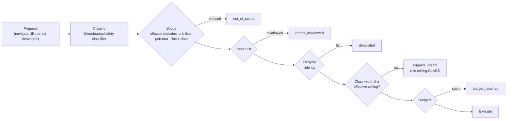
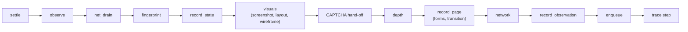
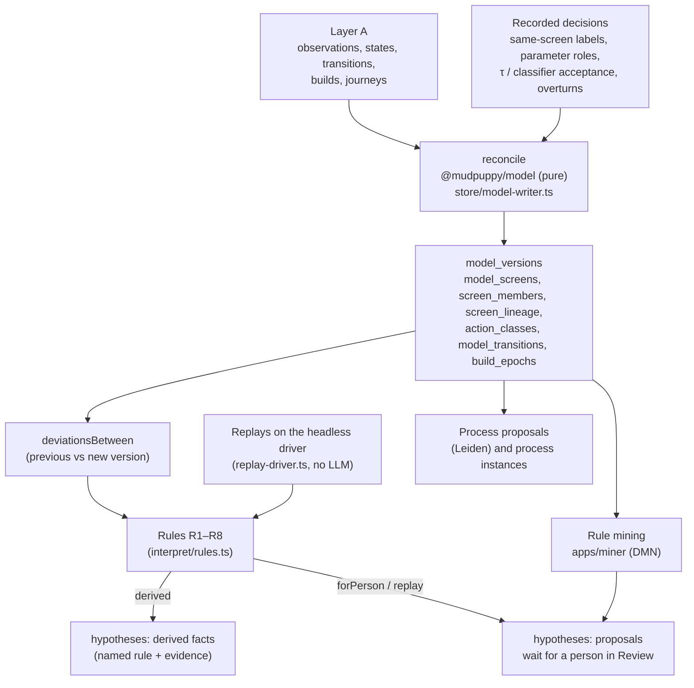
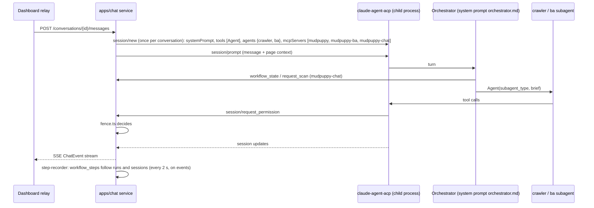

# The agent harness

How MudPuppy lets two LLM agents explore and document a portal while deterministic code keeps the
result safe, evidenced and repeatable. Overview and diagrams of the containers: [README.md](README.md).
Decisions behind it: [../adr/README.md](../adr/README.md).

## 1. The agent proposes, the server decides

The crawler is one non-deterministic LLM agent (constitution Principle III). It has **no shell,
file, web or browser tools**: its only tools are the `mcp__mudpuppy__*` tools listed in its
frontmatter (`.claude/agents/crawler.md`). The `mudpuppy` server owns the only browser, the database
and the evidence store (`README.md` "How the crawler works").

| The agent | The server |
| --- | --- |
| Chooses the next frontier item or URL, with a one-sentence `rationale` (map) or `intent` (trace) | Re-derives the action's safety class and re-checks scope, robots, denylist, ceiling and budget before executing (`runtime/pipeline/act-gate.ts`: "nothing the agent says is trusted") |
| Uses only `action_id`s the server issued | Validates the id against `actions` and the current state, else `UNKNOWN_ACTION` (`data/schema/README.md`) |
| Files hypotheses and open questions | Executes, waits for the page to settle, observes, fingerprints, records, and links evidence |
| Never sees credentials | Types stored credentials from the vault in `login`; re-logs in when a session expires |
| Reads results | Returns typed `ToolError` codes (G-24): `ACTION_REFUSED`, `RUN_STOPPED`, `TRACE_BOUNDARY_REACHED`, `REPLAY_DIVERGED`, `NO_PATH`, `FRONTIER_NOT_EMPTY`, ... |

Recording services and `complete_run` are deliberately not exposed as tools
(`apps/crawler/packages/mcp-server/src/tools/index.ts`, comment on `AGENT_TOOL_NAMES`). Tools are thin
wrappers; logic lives in `src/services/` (G-14). Every tool call is wrapped in a trace span
(`ctx.tracer.call`).

The BA agent works the same way on the evidence side: it never browses, reads only through
`mudpuppy-ba`, and record status is never an input of any write tool; only the status engine in
`@mudpuppy/docs` sets it (`data/schema/README.md` "Status only changes through the status engine").

## 2. Tool surfaces

### `mudpuppy` (crawler, 12 tools)

Source: `AGENT_TOOL_NAMES` in `apps/crawler/packages/mcp-server/src/tools/index.ts`.

| Tool | Purpose |
| --- | --- |
| `start_run` | Open a run for a portal + persona: `mode` (`map`, `trace`, `probe`), optional `focus`, `run_type` + `plan` (directed scans), `form_probing`, `resume_run_id`, `max_action_class` (narrows only) |
| `navigate` | Open a URL from the portal itself (gated like any action) |
| `act` | Perform an issued action (click, fill, submit); map results carry `next`, the next frontier item |
| `get_next_frontier_item` | Highest-priority pending frontier row, without mutating it |
| `drain_frontier` | The server acts on up to ten repetitive read-only links to visited templates in one call (spec 080, `services/drain-frontier.ts`) |
| `get_known_states` | States of the run, by cluster, to avoid revisits |
| `go_to_state` | Replay a recorded path to a known state (directed scans, `pipeline/go-to-state.ts`) |
| `probe_form` | Form-probing runs only: press a marked step's submit with happy values, then wrong data, other options, broken requests, within a budget (`pipeline/probe-form.ts`) |
| `login` | Type the persona's stored credentials; outcome `logged_in`, `failed` or `pending` |
| `add_open_question` | A question about why something is as it is |
| `add_hypothesis` | An inferred claim with a test that would refute it (builds the portal model first when none exists) |
| `finish_run` | End the run; refused with `FRONTIER_NOT_EMPTY` while items are pending; in trace mode carries `outcome` and `observed_result` |

### `mudpuppy-ba` (BA, 23 tools)

Source: `apps/crawler/packages/mcp-server/src/ba-tools/index.ts`, services in `src/services/ba/`.

| Group | Tools |
| --- | --- |
| Evidence reads | `list_runs`, `get_run_evidence`, `get_evidence`, `get_access_matrix` |
| Documentation reads | `list_records`, `get_record`, `list_processes`, `get_process`, `get_pending_feedback` |
| Portal model reads | `list_deviations`, `list_hypotheses`, `get_hypothesis` |
| Session | `start_session` (optional `scope_id`: one process), `record_pass` (one of the seven passes `inventory`, `capabilities`, `processes`, `rules`, `data`, `nfr`, `synthesis`; may return `warnings`), `finish_session` |
| Record writes | `create_record`, `revise_record` (refuses silent drops, `REVISION_DROPS`), `withdraw_record`, `address_crawler_question`, `open_process_update` |
| Proposals | `propose_probe_suite`, `propose_hypothesis`, `add_hypothesis_test` |

Record checks before a write (`services/ba/record-checks.ts`): evidence must resolve and belong to the
portal/run, relation triples must be allowed (`RELATION_NOT_ALLOWED`, backed by a DB trigger), a
scoped session refuses evidence off the scope's states (`OUT_OF_SCOPE`). The BA's method is the skill
`.claude/skills/ba-practice/SKILL.md`.

### `mudpuppy-chat` (orchestrator)

Source: `apps/chat/CLAUDE.md`, `apps/chat/src/fence.ts`, `apps/chat/agents/orchestrator.md`. Started only
by the chat service, per conversation (it needs `MUDPUPPY_CHAT_CONVERSATION`), never from `.mcp.json`.

| Group | Tools |
| --- | --- |
| Workflow | `workflow_state`, `list_process_candidates`, `set_process_scope`, `request_documentation`, `list_amendments`, `propose_change` |
| Personas and data | `save_persona`, `save_test_data`, `request_credential` |
| Scans | `request_scan`, `request_sample_scans`, `stop_scan`, `start_check_run` |
| Page | `page_context`, `highlight_element`, `open_page` |
| Grouping | `list_grouping_inputs`, `suggest_grouping` |
| Portal model | `list_process_proposals`, `name_proposal`, `reconcile_model`, `model_actions` |

The orchestrator also gets a read-only subset of the BA tools and the `Agent` tool to start the
`crawler` and `ba` subagents (`apps/chat/agents/orchestrator.md` frontmatter).

## 3. Safety

### Classification and the gate

Every proposed action passes `decide()` in `apps/crawler/packages/crawler/src/action-gate.ts`, in this
order; the first refusal wins and is recorded (frontier status + `decision_log` + skipped transition):

| Mechanism | How it works | Source |
| --- | --- | --- |
| Safety classes | `read` < `mutating` < `destructive` < `external-side-effect`, from label, role, target URL and HTTP method (GET/HEAD read, DELETE destructive, other methods mutating); built-in keywords in Polish, English, German; portal `action_rules` add more; ambiguity is unsafe | `safety/src/classifier.ts`, `rules.ts`, `rule-set.ts`; constitution V |
| Effective ceiling | `min(portal max_action_class, persona max_action_class)`; a persona or a `start_run` can only narrow. No portal ceiling means no limit | `config/src/effective.ts` |
| Environment | `production` / `staging` / `sandbox` is a label on the run; it changes no behaviour | constitution V (6.0.1), `docs/portal-config.md`, spec 021 |
| Compliance block | `compliance.robots_checked_on`, `terms_reviewed_on`, `terms_reviewed_by` are validated fields, notes only: nothing enforces them since spec 021 | `config/src/portal-schema.ts`, `docs/portal-config.md` |
| Scope | `scope.allowed_domains`, `urls.allowed` / `urls.disallowed` (path globs, URL globs, regexes; disallowed wins), persona `scope_restrictions.urls`, scan `focus`; external links recorded, not followed; browser-initiated navigations go through the same check | `safety/src/scope.ts`, `url-lists.ts`; `docs/portal-config.md` |
| Denylist | Rule ids only (`logout`, `payment`, ...) | `safety/src/denylist.ts` |
| robots.txt | Obeyed by default (`robots: respect`), fetched and stored per host per run (`robots_policies`); `robots: ignore` per portal is the BA's choice | constitution V; `crawler/src/robots-registry.ts` |
| Rate limit | `requests_per_second`, `max_concurrency`, identifiable `user_agent` | `crawler/src/rate-limiter.ts`, `request-gate.ts` |
| Budgets | `max_depth`, `max_states`, `max_actions_per_state`, `max_run_time_minutes`, `max_steps`; list cap `scope.max_items_per_template` (default 5) | `docs/portal-config.md`; `services/list-cap.ts` |
| Trace boundary | In trace mode an action above the ceiling ends the trace with `TRACE_BOUNDARY_REACHED`; the process is recorded `boundary_reached` with what could not be observed | `pipeline/trace-boundary.ts`; `processes` CHECK in the schema |
| Hooks | Owner code in `portals/<id>/hooks.ts` runs time-boxed at fixed points; a failing hook never stops the crawl; the agent never writes hooks | `@mudpuppy/hooks`, `docs/portal-config.md` "Hooks" |

### Stop on a block

`detectBlock` (`safety/src/block-detector.ts`) stops the run only on a 403 or 429 of the **main
document** or a portal-specific block signature. The run becomes `stopped_warning` with a warning and
a decision-log entry; every later call returns `RUN_STOPPED`; there is no resume past a block
(`runtime/pipeline/stop.ts`). A **CAPTCHA** does not stop the run: the page is handed to a human as an
open question ("Human needed: CAPTCHA on ...", `runtime/handoff.ts`) and the crawl goes on elsewhere
(constitution V).

### The chat fence

When the console's assistant drives the agents, the chat service adds three layers
(`specs/010-acp-chat-orchestrator/research.md` R2, `apps/chat/src/fence.ts`):

1. SDK options per session: `tools: ['Agent']` plus the MCP servers, `disallowedTools` (Bash, Edit,
   Write, WebFetch, ...), `settingSources: []` so no user settings, hooks or CLAUDE.md leak in
   (`session-config.ts`).
2. `fence.ts`: a deny-by-default permission policy; a `mudpuppy` / `mudpuppy-ba` tool is allowed only
   inside a `crawler` / `ba` subagent call; the `ba` Read rule is enforced here too.
3. The MCP servers' own gates (above).

A Workbench conversation writes only through command cards a person confirms; commands run only on
`MUDPUPPY_WORKBENCH_COMMAND_ENVS` (default `local-dev,sandbox`) (`apps/chat/CLAUDE.md`).

## 4. Evidence recording

Each observed page runs one ordered pipeline (`runtime/pipeline/process-page.ts`, order locked by
`tests/pipeline-golden.e2e.test.ts`):

| Evidence | Stored as | Source |
| --- | --- | --- |
| ARIA snapshot of every observation | evidence file, `state_observations.evidence_ref`, `states.evidence_ref` | `crawler/src/observer.ts` |
| Screenshot (full page, unmasked) and layout (element keys with page-coordinate boxes) | `<sha256>.png`, `<sha256>.json`; `states.screenshot_ref`, `layout_ref`, set once when the state is first recorded | `pipeline/visuals.ts`, spec 008 |
| Wireframe | `.svg` + `.excalidraw` from the ARIA snapshot, `state_wireframes` (`generator_version` marks stale rows) | `@mudpuppy/wireframe` |
| Fingerprint | Route template + two-level fingerprint (`states.fingerprint`, unique per portal); 2.0 components (structure, content, overlay, calls, mounts hashes, minhash, element keys) in `state_components`, per fingerprint profile | `@mudpuppy/fingerprint`, `pipeline/fingerprint-step.ts`, migrations 0029, 0033 |
| Network | `network_calls`: method, `url_template`, status, request/response JSON **schemas**, `schema_hash`, console errors, and since 0027 capped samples (`req_sample`, `res_sample`, at most 4096 chars) | `crawler/src/network-recorder.ts`, `shape.ts` |
| Actions and locators | `actions` (role, accessible name, descriptor JSON, safety class, allowed / skip reason) | constitution III (locator descriptors for QA) |
| Forms, form steps, probe outcomes | `forms`, `form_steps`, `probe_outcomes` (each with `evidence_ref`) | spec 032 |
| Builds | Signatures of content-hashed assets per scope (`builds`, `observation_builds`) | `@mudpuppy/model` `capture/` |
| Journeys | Continuous paths of a run, attribute writes (typed inputs, shown values) | `journeys`, `attribute_writes` |
| Decisions | Every skip, refuse, merge, split, warning, note in `decision_log` (mirrored to pino) | `@mudpuppy/store` `decision-log.ts` |
| Trace | One `trace_boots` row per server process, `trace_spans` per call / phase / event; optional per-call Playwright trace zips in `data/traces/`; agent transcripts imported into `agent_turns` (`pnpm trace:import-agent`) | spec 005 |

Text evidence passes the secret redactor; PII scrubbing of text is optional per portal
(`pii_scrub: true`); screenshots are stored unmasked on every environment (constitution V,
`core/src/evidence.ts`).

## 5. Portal model 2.0

Spec 039 (`specs/039-mudpuppy-2-portal-model/design.md`). Scans are never rewritten; the model is
rebuilt from them plus recorded human decisions.

| Part | What | Where |
| --- | --- | --- |
| Reconcile | Clusters page versions into screens (`SC-nnnn`), with stable ids through a registry, action classes and model transitions; statuses `active`, `not_seen_since`, `untested`, `retired` (action classes / transitions), `active`, `merged`, `retired` (screens). Runs after every `finish_run` and with `pnpm model:reconcile <portal>` | `model/src/model/`, `store/src/model-writer.ts`, `mcp-server/src/services/complete-run.ts` |
| Same screen? | A person labels two page versions as one screen or two; every answer is kept (`state_pair_label_history`); labels calibrate the grouping threshold τ or a similarity classifier a person accepts | `model:pairs`, `model:classify`; migrations 0038, 0045 |
| Findings R1–R8 | R1 error (replay twice: flaky or deterministic error), R2 structural drift (a build changed), R3 backend drift (schema changed, same build), R4 context variant (persona/attribute), R5 randomness (A/B test or nondeterministic), R6 absence (removed, replaced, other audience), R7 decision point (same action, other target), R8 decision drift (a rule's boundary test mismatched). A rule either derives a fact, asks for a replay, or leaves it for a person | `model/src/interpret/rules.ts`; constitution VI "Derived facts" |
| Hypotheses | Every testable claim (`H-nnnn`), kinds from `same_as` to `decision_rule` and `process_boundary`; status derived from `hypothesis_events` (`proposed`, `testing`, `supported`, `refuted`, `confirmed`, `rejected`, `superseded`); Undo and Reword keep history | migrations 0031, 0046 |
| Rules | `model:mine` mines decision rules (inputs → next screen) with the miner; `model:replay` tests boundaries on the headless driver; `model:regress` re-runs confirmed rules after a release; `model:sweep` finds band edges of a number input; `model:rules-export` writes DMN, Markdown, CSV | `README.md` "MudPuppy 2.0"; `mcp-server/src/replay-portal.ts`, `sweep-portal.ts` |
| Processes | `model:propose` suggests processes; a person names, splits, merges them; a process has triggers, process instances (journeys from a trigger to an outcome), A/B process models, and exactly one `PROC` record | migrations 0036, 0051; `apps/chat/src/process-*.ts` |
| Planner | After each rebuild, what the model does not know becomes `marks` of origin `planner` | `store/src/planner-marks.ts` |

## 6. The chat service orchestrates agents per conversation

- `acp-client.ts` launches `@agentclientprotocol/claude-agent-acp` as a child process (ndjson over
  stdio); it uses the user's Claude Code login (`CLAUDE.md` "Running the apps").
- `session-config.ts` reads `crawler` and `ba` from `.claude/agents/*.md` (single source) and appends
  their skills' text, because `settingSources: []` turns skill discovery off.
- `workflow_state` (pure, `packages/workflow`) is the only truth the orchestrator may report:
  steps scan, map, narrow process, document, amend (`research.md` R4).
- Writes the console makes (processes, amendments, proposals, model decisions, marks, personas) go
  through the chat service's HTTP routes (`api-*.ts`); review decisions on records go through
  `pnpm docs:review`, which the dashboard runs (`apps/dashboard/src/mudpuppy_dashboard/review.py`).
- Live Workbench (spec 075): a confirmed scan runs in a separate ACP session, the scan runner
  (`scan-runner.ts`), so the conversation stays responsive; the console talks to it over a WebSocket
  in the dashboard (`web/api_workbench_live.py`).
- Errors get an `ERR-…` reference; details in `data/logs/chat/<date>.jsonl` (30 days).

## 7. Evals, gates and test tiers

### Evals (tier 2, paid)

Eval code uses Anthropic's vocabulary (guideline G-33, `apps/crawler/evals/README.md`); ground truth
is YAML (G-34). How to build one: skill `.claude/skills/create-eval/`.

| Term | In MudPuppy |
| --- | --- |
| Task | A portal in `apps/crawler/evals/tasks.ts` with its persona |
| Evaluation suite | `SUITE` in `tasks.ts` (`reference-insurer`, proving-ground portals, scar-maker crawler-only, ...) |
| Trial | One `pnpm eval <portal>` run; one JSON in `data/evals/<portal>/` |
| Grader | `evals/graders/code/` (goal, guardrails, diagnostics), `graders/model/` (LLM judges, trusted only after agreeing with hand labels), `graders/human/` (labels) |
| Transcript | The `claude` session transcripts of a trial (`pnpm eval:transcript`) |
| Outcome | The workspace store and documentation after the trial |
| Evaluation harness | `apps/crawler/evals/` (`harness/`: clean workspace, portal server, agent sessions, cost) |
| Agent harness | The `mudpuppy` MCP servers + Claude Code |
| Reference solution | `evals/reference-solutions/` (the approved export of PROC-001) |
| Ground truth | `apps/crawler/packages/reference-portal/ground-truth.yaml`, `apps/proving-ground/ground-truth/*.yaml`, `apps/scar-maker/ground-truth.yaml` |

Baselines and tolerances in `data/evals/<portal>/` are regression checks; `--promote` sets a new
baseline; exit code 1 means a regression. One eval runs at a time (lock file), with its own portal
server, under a budget cap (`--budget-usd`, default 5). `apps/chat/evals/` holds the grouping eval
and the Workbench golden prompts.

### Gates (tier 1, deterministic)

`apps/crawler/packages/gates`: one `gate('<id>', …)` per catalogued legacy obstacle (`LO-nn`,
`docs/legacy-obstacles.md`), logged finding (`F-nn@spec`) or scar (`SC-nn`, `apps/scar-maker/scars.yaml`);
a known unfixed case is a `gap()` (G-17). `src/global-setup.ts` starts the proving ground on 4200/4201
and scar-maker on 4400. The report `data/gates/report.json` lists uncovered catalogue entries.

### Test tiers

| Tier | Command | What runs | When |
| --- | --- | --- | --- |
| Fast | `pnpm test:fast` (`apps/crawler`) | Tests affected by uncommitted changes, no `*.e2e.test.ts`, no gates (`scripts/test-tier.ts`) | Every commit (hook) |
| Slow | `pnpm test:slow` | Browser `*.e2e.test.ts` files and the whole gate set (`MUDPUPPY_SLOW_GATES=1`) | Before committing `mcp-server/src/runtime/**`, `crawler/src/**`, `gates/**`, `apps/proving-ground/**` |
| Perf | `pnpm test:perf` | Wall-clock budget tests alone (`MUDPUPPY_PERF=1`) | End of `test:slow` and `test` |
| Full | `pnpm test` | Everything | Close-out before merge |
| Mutation | `pnpm mutate`, `uv run mutmut run` | Mutation testing (G-32) | On demand |
| Eval | `pnpm eval …` | Real agents, graded | On demand, never in a test tier |

Other apps: `pnpm check` (`apps/web`), `pnpm typecheck && pnpm lint && pnpm test` (`apps/chat`,
`packages/workflow`), `pnpm --dir apps/chat test:e2e`, `uv run ruff check && uv run pytest`
(dashboard, miner, proving-ground backend), `pnpm --dir apps/dashboard cls:ci` (layout shift, when
`apps/web` changed). See [workflow.md](workflow.md).
