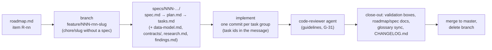

# Development workflow

How changes are made in this repository. Architecture: [README.md](README.md). Decisions:
[../adr/README.md](../adr/README.md).

## Spec-driven development

| Piece | Where | Notes |
| --- | --- | --- |
| Constitution | `.specify/memory/constitution.md` (6.0.1) | Seven principles (observed vs intent, evidence, role separation, replay verification, safety, human-in-the-loop, deterministic core), technical constraints, workflow. It wins over every other guideline; every plan has a Constitution Check |
| Roadmap | `roadmap.md` | Items `R-nn` with status `todo` / `in progress` / `done` and their spec folder; kept by the `po` agent |
| Specs | `specs/NNN-<slug>/` (77 folders, 001 → 080) | `spec.md`, `plan.md`, `tasks.md`, often `data-model.md`, `contracts/`, `research.md`, `quickstart.md`, `findings.md` |
| Spec Kit | `.specify/templates/`, `.specify/scripts/`, skills `speckit-*` in `.claude/skills/` | `speckit-specify`, `-clarify`, `-plan`, `-tasks`, `-analyze`, `-implement`, `-converge` |
| Changelog | `CHANGELOG.md` | Keep a Changelog format, one entry per closed roadmap item, written before the merge |
| Glossary | `docs/glossary/glossary.yaml` | Synced with `uv run mudpuppy-glossary --write` in `apps/dashboard` for terms an item added or changed |
| Session dumps | `session_dump/` | Done / uncommitted / blocked tasks when work stops mid-way |

Branch naming and the git flow are gated by the `po` agent (`.claude/agents/po.md`):
`feature/<NNN>-<item-id>-<slug>`, e.g. `feature/001-r04-core-crawler-map-mode`. Steps from
`CLAUDE.md` "Feature Workflow (SDD)".

## Code guidelines

`docs/code-guidelines.md`, rules G-01 … G-34, each with a reason and how it is checked; the
`code-reviewer` agent cites the ids. Precedence: constitution and `CLAUDE.md` > guidelines >
existing habits.

| Section | Rules |
| --- | --- |
| A. Size and shape | G-01 file ≤ 400 lines, G-02 function ≤ 80 lines, G-03 complexity ≤ 15 / nesting ≤ 4, G-04 ≤ 5 positional params, G-05 one concern per file, G-06 split large files when touched |
| B. Layers and boundaries | G-07 layers from `apps/crawler/layers.json`, G-08 kernel depends on nothing, G-09 / G-10 schemas in their model package, G-11 no re-export shims, G-12 import folders through `index.ts`, G-13 dashboard routers never import each other |
| C. Patterns for adding things | G-14 MCP tool, G-15 console page, G-16 table or column (via `db-admin`), G-17 gate case, G-18 pipeline step |
| D. Code style | G-19 comments say why, G-20 no dead code, G-21 every promise handled, G-22 no `any`, G-23 justified suppressions, G-24 typed errors at boundaries, G-33 Anthropic eval terms, G-34 ground truth in YAML |
| E. Tests | G-25 tier by kind, G-26 fast file < 2 s, G-27 assert behaviour, G-28 no sleeps / no realistic secrets, G-29 refactors lock behaviour first |
| F. Agent notes and process | G-30 every package has a short `CLAUDE.md` (and a `LAYOUT.md` file map when large), G-31 code review before the changelog, G-32 mutation testing on demand |

Front-end code in `apps/web` also follows skills `frontend-architecture` (atomic layers, state
placement, token-only styling) and `mudpuppy-react-ui`.

## The commit hook

Install once per clone: `git config core.hooksPath .githooks`. `.githooks/pre-commit` runs
`.githooks/checks.sh`, which picks suites by changed paths (staged, unstaged, untracked; Markdown-only
changes run nothing) and blocks the commit (exit 2) when one fails. Where the git hook is not
installed, Claude Code runs the same script through `.claude/hooks/pre-commit-check.sh`.

| Changed paths | Suite |
| --- | --- |
| `apps/crawler/`, `data/migrations/`, `portals/`, `personas/`, `apps/proving-ground/` | `pnpm typecheck && pnpm lint && pnpm test:fast` in `apps/crawler` |
| `apps/web/` | `pnpm check` (typecheck, ESLint layer and styling rules, stylelint, knip, jscpd, tests) |
| `apps/dashboard/`, `data/migrations/`, `docs/glossary/` | `uv run ruff check && uv run pytest -n auto -m 'not perf and not serial' && uv run pytest -m 'perf or serial'` |
| `apps/crawler/scripts/` only | the dashboard's review tests (it shells out to `docs:review`) |
| `.claude/hooks/`, `.githooks/` | `python3 -m unittest discover -s .claude/hooks` |
| `apps/chat/`, `packages/workflow/`, crawler `core`, `store`, `trace`, `docs-model`, `chat-model` | `pnpm typecheck && pnpm lint && pnpm test` in `apps/chat` |
| `packages/workflow/` | the same in `packages/workflow` |
| `apps/proving-ground/backend/` | `uv run ruff check && uv run pytest` |

## Test tiers

| Tier | Run | Contents |
| --- | --- | --- |
| Fast (every commit) | the hook above | Unit and service tests affected by the change; no browser end-to-end files, no gates |
| Slow | `pnpm test:slow` in `apps/crawler` | `*.e2e.test.ts` browser files and every gate (proving ground on 4200/4201, scar-maker on 4400); required before committing `mcp-server/src/runtime/**`, `crawler/src/**`, `gates/**` or `apps/proving-ground/**` |
| Close-out | `pnpm test` in `apps/crawler` plus every app's suite; `pnpm --dir apps/dashboard cls:ci` when `apps/web` changed; `pnpm --dir apps/chat test:e2e` for chat/drawer changes | Everything, before merge |
| Evals | `pnpm eval <portal>` | Real agents and real tokens; on demand, never in a test tier ([harness.md](harness.md#7-evals-gates-and-test-tiers)) |

Repository rules worth knowing (`CLAUDE.md`): one root pnpm workspace and lockfile (the proving
ground keeps its own); Python apps use uv; every app lives under `apps/`, shared code under
`packages/`; no edits of tracked files by `sed -i` or Python scripts (blocked for Claude Code by
`.claude/hooks/no-script-edits.py`);
fake secret values only in tests.
