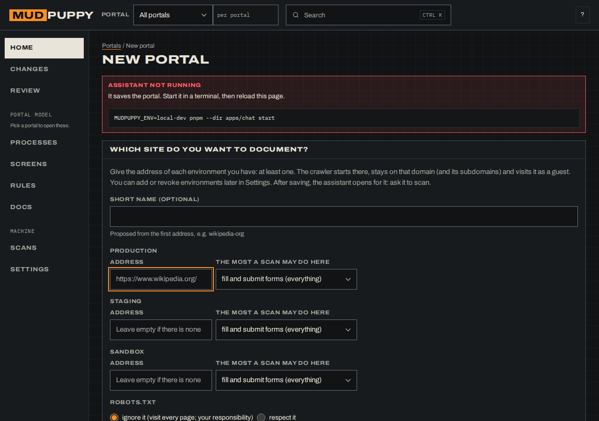
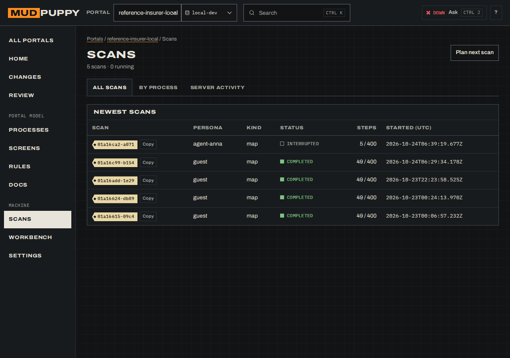
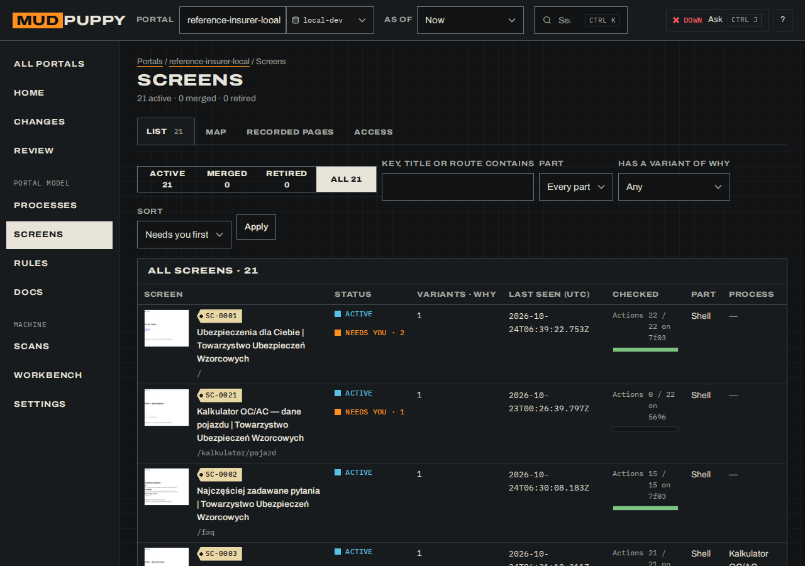
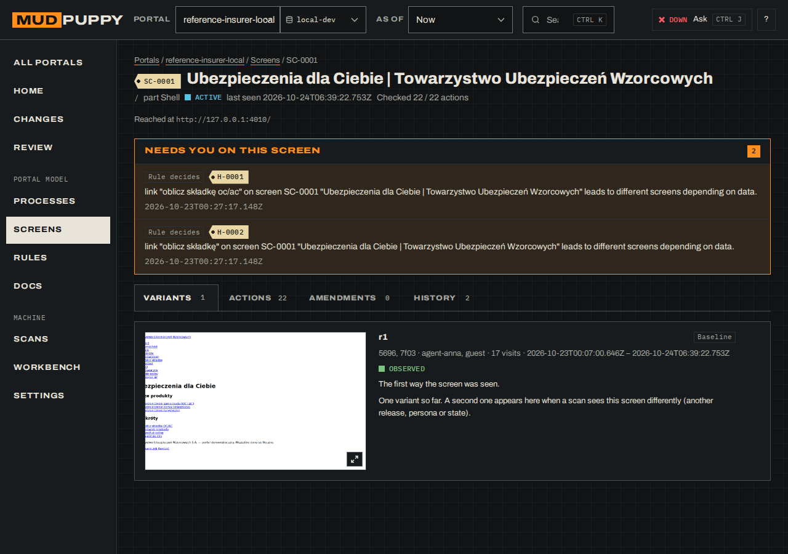
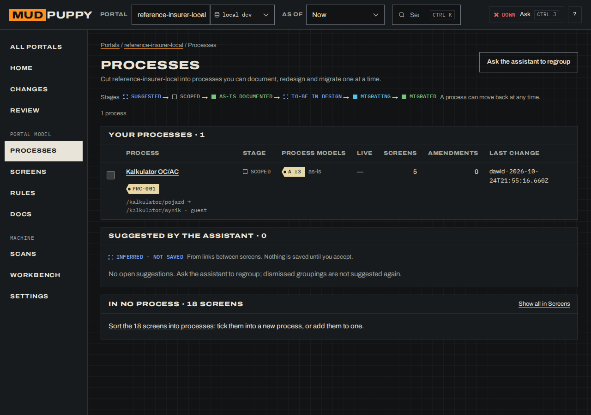
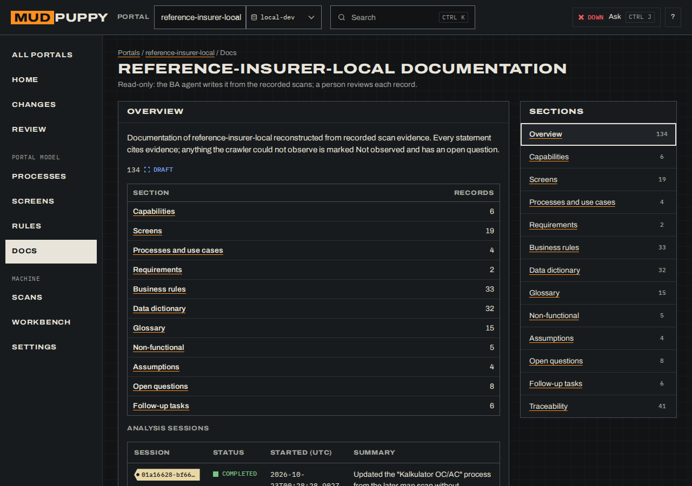
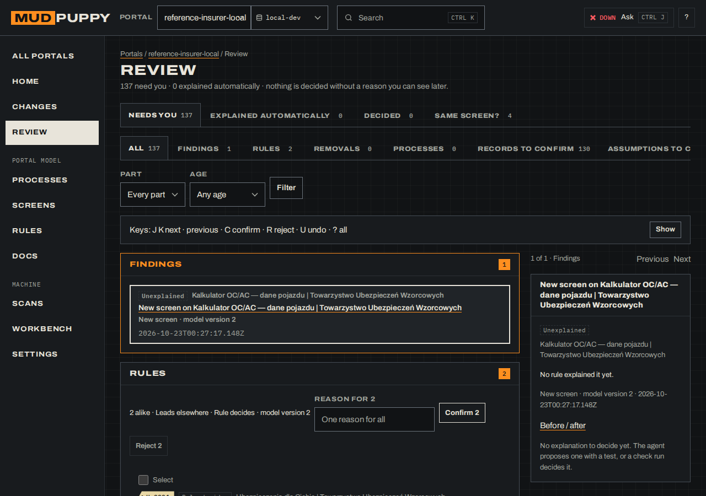

# How to use MudPuppy

A walkthrough for business analysts (BAs) and the developer who sets things up. It covers the
full path: start the tools, scan a portal, group its screens into processes, get the as-is
documentation, draw the to-be, and hand it all over.

The screenshots come from the local reference portal (`reference-insurer`) in the `sandbox`
environment, taken on 2026-10-14. The assistant was not running when they were taken, so the
chat is described in words.

## Contents

1. [What you work with](#1-what-you-work-with)
2. [One-time setup (developer)](#2-one-time-setup-developer)
3. [Start the tools](#3-start-the-tools)
4. [Find your way around](#4-find-your-way-around)
5. [Choose or add a portal](#5-choose-or-add-a-portal)
6. [The assistant](#6-the-assistant)
7. [Scan a portal](#7-scan-a-portal)
8. [Stop and resume a scan](#8-stop-and-resume-a-scan)
9. [Screens and their revisions](#9-screens-and-their-revisions)
10. [Processes: as-is, to-be, compare](#10-processes-as-is-to-be-compare)
11. [Get the as-is documentation](#11-get-the-as-is-documentation)
12. [Write down the changes you want (amendments)](#12-write-down-the-changes-you-want-amendments)
13. [Review: everything that waits for you](#13-review-everything-that-waits-for-you)
14. [When something fails (error references)](#14-when-something-fails-error-references)
15. [Hand the documentation over (export)](#15-hand-the-documentation-over-export)
16. [Stop everything](#16-stop-everything)
17. [Troubleshooting](#17-troubleshooting)

## 1. What you work with

| Piece | What it is | Address |
| --- | --- | --- |
| Dashboard | The web app you use: home, processes, screens, docs, review, scans, settings, glossary. | http://127.0.0.1:8765 |
| Chat service | Runs the assistant and saves your changes. | 127.0.0.1:4310 (no page of its own) |
| Assistant | Guides you. It calls the **crawler** (scans the portal) and the **BA agent** (writes the documentation). | the Chat page and the drawer |
| Reference portal | A fake Polish insurer for practice. | http://127.0.0.1:4010 |

The assistant can not change the tool itself (agents, code, safety settings). If you ask, it
says that this is a developer task. Passwords never go through the chat text. When it needs
one, it shows a field that goes straight to the encrypted vault.

## 2. One-time setup (developer)

From the repo root:

```bash
pnpm install                                                     # all JS/TS apps, at the root only
pnpm --dir apps/crawler exec playwright install --with-deps chromium   # browser for the crawler
cd apps/dashboard && uv sync && cd ../..                          # dashboard (Python)
```

The assistant uses your Claude Code login, so be logged in to Claude Code on this machine.

Portals are files in `portals/<portal>/portal.yaml` (see [portal-config.md](portal-config.md)).
A portal that needs a logged-in user also needs the vault key; the first
`pnpm --dir apps/crawler vault …` call creates it (`~/.config/pathfinder/vault.key`).

## 3. Start the tools

Use three terminals (the third only for practice), all from the repo root:

```bash
# 1. dashboard: pick the environment whose data you want to see
cd apps/dashboard && uv run pathfinder-dashboard --env sandbox
#    changes you make are signed "unknown"; add PATHFINDER_REVIEWER="Your Name" in front to sign them

# 2. chat service (the assistant needs it)
PATHFINDER_ENV=sandbox pnpm --dir apps/chat start   # required: the environment to work on

# 3. only for practice: the reference portal
pnpm --dir apps/crawler reference-portal    # http://127.0.0.1:4010
```

Open http://127.0.0.1:8765. If the header says **Assistant down**, start terminal 2 and reload.

## 4. Find your way around

The **header** holds the portal you work on, the **Data store** it reads (only the stores that
hold scans of that portal are listed; switching the portal moves to one that has its data), a
search box (**Ctrl K**), the assistant status and **Ask the assistant** (**Ctrl J**). Long lists
show 25 rows a page with **← Previous** / **Next →**; Screens has a filter that searches every
screen. A screen or record opened from a list has **← Prev** / **Next →** at the top to walk the
same list without going back. The **side menu** has nine places in three groups:

| Place | What you do there |
| --- | --- |
| **Home** | The portal now: the latest release of each portal part and the last scan, **Needs you** with the top five, what changed by process, and the counts of processes and rules. |
| **Changes** | What changed between scans, grouped by process and screen, with Before / after (section 13). |
| **Review** | One inbox for every open decision (section 13). |
| *Portal model:* **Processes** | Group screens into business processes, draw the to-be, compare, see history. |
| **Screens** | Every screen the scans saw, with its revisions and your amendments. |
| **Rules** | Business rules found in the cases, as decision tables with their tests. |
| **Docs** | The as-is documentation the BA agent wrote, by record kind. |
| *Machine:* **Scans** | The live view of a running scan, the history of scans, and **Server activity**. |
| **Settings** | Environments, credentials, personas, crawl rules, hints, screen identity and the data store of the chosen portal. |

Every status is a shape plus a word, never colour alone. Filled means it happened, hollow
means it did not (yet), dashed corners mean unconfirmed, a cross means it broke.

## 5. Choose or add a portal

The portal in the header decides what every page shows. Open the list there to switch. The
**data store** at the bottom of the side menu says which local database the dashboard reads
(normally `sandbox`).

To work on a site that is not in the list (for example wikipedia.org), choose **new portal**:



- **Short name**: proposed from the first address when left empty.
- **production / staging / sandbox**: the address of each environment. Fill at least one. The
  crawler starts there and stays on that domain and its subdomains. A public site is
  **production**.
- **How far the crawler may go**, per environment: by default up to filling in and submitting
  forms. It is a ceiling. Choose **only look, never submit** to rule edits out.
- **robots.txt**: **ignore it** (default) or **respect it**. Ignoring it, and checking the
  site's terms, is your responsibility.

Saving the form opens the Home page for the new portal. If the name is taken or an address is
wrong, the form says why and keeps what you typed.

### Settings: environments, credentials and more

**Settings** (side menu) has five parts for the chosen portal. The settings read and save
through the chat service, so it has to be running.

- **Environments**: address and limit for each one. Pick an environment, give the address and
  the limit, save. Picking one that exists changes it. **Revoke** removes it; recorded scans
  stay. The last environment cannot be revoked.
- **Credentials** (collapsed): test-user logins by environment. Values are never shown again.
- **Personas**: the ways of visiting the portal (anonymous or logged in), each with its
  attributes (tariff, contract, feature flags…) when it has any. Many test users at once: a
  developer runs `pnpm --dir apps/crawler personas:import <portal> users.csv` (columns
  `persona_id,login,password` and then one column per attribute; see `personas/README.md`).
- **Crawl rules**: allowed domains and paths, disallowed paths, robots.txt. Ask the assistant to
  change a rule.
- **Hints**: what the portal model is told about the portal: the release marker, the A/B cookies
  and the texts that mean a business refusal. When you confirm an A/B test in Review, its cookie
  is added here, so later scans record which arm they saw. Ask the assistant to change a hint.
- **Data store**: which database file the dashboard reads.

## 6. The assistant

The assistant has its own page, **Chat** (Home's **Open the chat**), and sits beside every other
page in a drawer: press **Ask the assistant** or **Ctrl J**. The drawer has two contexts:

- **This page** sends what you are looking at: the screen and its revision, the process, its
  process model and step, or the item selected in Review. You can say "this step" or "that
  amendment".
- **Whole yard** sends only the portal.

Type in the box. **Enter** sends; **Shift+Enter** starts a new line. While the assistant works
you see the tool it runs, and **Stop** appears next to **Send**.

What it does for you:

- It starts scans and process traces, and shows their progress.
- It **suggests groupings**: sets of screens that look like one process (section 10).
- It **proposes changes**: a new amendment, an edit to a process, a to-be step. A proposal
  changes nothing until you press **Apply**. After applying, **Undo** puts the old content
  back (as a new revision). **Discard** drops it.
- It asks for a **credential** with a field in the chat. The value goes to the vault and is
  not shown again.
- If the page changed while you talked (a scan saw a new revision), it says so.

Ask **"what can I do?"** at any time. **Reset context** gives the assistant a fresh memory in
the same conversation; **New conversation** starts from zero.

Scans started from the chat may fill in and submit forms, up to the environment's limit, on
production too, where that really happens on the live site. To keep one scan read-only, say so:
*"scan it, only look"*.

## 7. Scan a portal

A scan visits the portal as one **persona** and records every screen, link and form, and what
happens behind the forms.

1. Name the portal: *"Scan reference-insurer as the guest persona."*
2. If no persona fits, the assistant asks a few questions, one at a time, and saves one.
3. If the persona logs in, the assistant asks for the credentials in a field. Fill it in; it
   goes to the vault.
4. Before the scan it asks one thing: load images or skip them. Images load by default.
   Skipping them maps image-heavy sites much faster; each skipped image shows a box saying so.
5. The crawler starts. Watch it on **Scans**.



The page shows the running scan: steps used of the limit, pages recorded, links still queued,
and the pages in the order they were seen. Below it, **All scans** lists every scan with its
status, persona, mode, environment and what changed since the last scan. The **Server
activity** tab shows what the dashboard's own server did.

The crawler keeps going until every queued link is visited. A full scan of the reference
portal takes 20 to 30 minutes. You can work elsewhere meanwhile.

If nothing is recorded for 5 minutes, the crawler may be stuck. Stop it and resume (section 8).

### Scan only part of a portal (focus)

A scan maps the whole portal unless you say otherwise. Tell the assistant which part, in your
own words: *"only the English site, leave out the Special: pages for now"*. It says back what
the scan will and will not open, then passes a **focus** to the crawler: where to start, which
addresses to stay on, which paths to stay in and which never to open (`*` matches anything,
for example `/wiki/Special:*`).

A focus only narrows what the portal allows. It applies to this scan only (a resume keeps it).
Links outside it show as skipped, with the reason.

When a scan is stopped and you ask for a scan, the assistant asks once: resume the stopped
one, or start a new one? A new one starts from the start page; the stopped one keeps what it
recorded.

### Map one process directly

To record just one thing a visitor does, say it: *"map searching for a pickle on English
Wikipedia"*. The assistant starts a **process trace**: the crawler walks that one process
toward its goal. It asks the same question as for a scan, follows "only look" and takes a
focus too. A stopped trace is started again, not resumed.

### Every state of a form (probes)

A scan presses each form once with test values (the happy path) and records the steps it
reaches. Probing goes further, and happens only when you ask for it:
1. Scan the portal first and look at what it has.
2. Open a form step's screen (Screens) and press **Mark for probing**. The step gets an orange
   **Probe** tag. Screens lists every form step as marked, probed (with the number of outcomes)
   or **Not probed**.
3. Ask the assistant to *"probe the marked forms"*. That starts a form-probing scan: it visits only the
   marked steps and does not map. Once a step has been probed, its mark goes away; **Remove the
   mark** drops it before that.

On each marked step the crawler tries the step on purpose:
- required fields left empty;
- a wrong e-mail, number, date or postal code;
- values just outside the limits;
- every other option of a radio button or a list;
- the step's request breaking: blocked, a server error, slow, or offline. This happens in the
  crawler's own browser; nothing broken is sent to the portal.

Every result is recorded as a **state of that step**:
- **validation**: the form refused, with the message it showed;
- **branch**: an option leads somewhere else, maybe another process;
- **technical error**: what a user sees when the request fails;
- **blocked**: a one-time code, a CAPTCHA, or the action limit.

Several steps on one address (a wizard drawn by script) are numbered as steps 1, 2, 3. A
screen's page shows **States of this step**, with every probe and what it did.

Probes need test data that passes the step. When the persona has none for a field, the assistant
asks you once (*"A valid start date for the quote form?"*) and keeps your answer in the persona.
Probes run where the scan may fill in and submit forms (a scan that only looks cannot probe),
and stop at 12 tries per step and 60 per scan; the portal file can change both (`probes`).

### See what was mapped (the map)

**Screens → Map** draws the portal model: one box per screen, its links in their state (dashed
when not seen since or not checked yet; **Layers** show or hide them, Retired links too). The menu
links on every page are bundled into one line unless one of them changed. **Since previous
release** marks the screens the latest rebuild found changed and fades the rest; **Overlay a
process** numbers its steps and fades the other screens. Click a screen for its variants, actions,
links and changes; **Same screen?** there asks about its variants.

**One scan's path** (the third view, and the only map of a portal without a model yet) draws every
screen the portal's scans recorded as a node, from the start page down:
the lines show the first move into each screen (tick **All links** for the rest). Several states
of one screen stack as a deck ("5 states"); a page's queued, failed and blocked items are chips on
its node ("+3 queued"). Pick one scan or persona and **Apply** to grey out what it did not see;
**List** shows the same screens as a table (the view on a phone). Click a node, or reach it with
**Tab** and **Enter**, and the side shows its states, the scans that saw it, where its actions lead
and what was left there; arrows move along the lines. On a form step, **Mark for probing** sets the
Probe mark from here too.

### Scan from a screen you choose

In the map's side panel, **Next scan** marks the screen: **Start here** (the next focused scan
starts there), **Focus** (explore deeper from there), **Recheck** (record what it shows now),
**Retry** (press its failed action again) or **Skip** (leave it out of every scan while marked).
**Next scan plan** (above the map) or **Plan the next scan** opens the plan: pick the kind of scan,
see how each marked screen will be reached (*"replays 1 step"*, *"opens by its URL"*), pick the
persona and the depth, and press **Start scan**. The assistant starts it in this portal's chat.
The crawler reaches each screen by repeating the clicks a scan recorded, so a screen deep in a
form is reached without mapping everything before it; if a page on the way looks different, it
says at which step and goes on with the next screen.

**Scans → By process** lists which scans belong to which documented process, the scans in no
process (kept, not forgotten) and groups of them that look like one process nobody documented.

## 8. Stop and resume a scan

- **Stop** next to **Send** stops everything this conversation started: the answer in progress
  and any scan. Use it when the assistant is stuck or busy with the wrong thing.
- The scan's own **Stop scan** button (on Chat and in Scans) stops only the scan. Confirm it.

A stopped scan shows as **Interrupted**, not failed, and keeps everything it recorded. To
continue, press **Resume with the assistant** on the scan in **Scans**, or say *"resume the
scan"*. The crawler picks up the queued pages with the same choices (read-only or not, images
or not) and does not repeat recorded work.

If the crawler ends before the queue is empty, the scan is marked stopped, the assistant tells
you and you can resume it.

**A scan's graph.** A scan that stopped or had something fail opens on its **Graph** tab; the
scan history links it as **Where it stopped** or **N failed**. The graph shows the screens this
scan saw and the moves it made, from its first screen down. Red screens are where an action
failed or a control could not be found again, red lines are moves that failed, and the screen
it stopped on carries **Stopped here**. Above the graph: the counts, why it stopped, the path
from the start to that screen and **Resume** (a new scan, linked to this one, that replays to
the screens with queued items and carries on without redoing anything). Pick a screen to see
what failed on it, each with **Retry this path** (with a variation: wait longer, other input,
don't submit) and **Skip it in the next scans**, and **Mark Start here** to explore from that
screen in the next focused scan. On a phone the graph gives way to the list of screens in the
order seen. The older recovery page (**Recovery page with attempts**) still lists the attempts
so far with their result.

## 9. Screens and their revisions

**Screens** lists the portal model's screens (`SC-0001` …), what needs you first. Each row shows
its status (**Active**, **Merged**, **Retired**: retired screens are kept), how many variants it
has and why they differ (Release, Another persona, Flaky error…), when it was last seen, how many
of its actions were checked, its portal part and its process. Filter by status or by text.

A screen's page (`/screens/SC-0001`) starts with what needs you on it, then its **Variants** side
by side (r1 is the baseline; each later one says why it differs), its **Actions** with where each
leads, and its **History** of changes, each with Before / after.

The pages the model is built from are on the **Recorded pages** tab, the list described below (and
the only list for a portal without a model yet).



Open one to see its page:



- The **observed revision** strip shows **r1**, **r2** and so on, and which scans saw each. When
  a scan sees the same screen changed, it adds the next revision; it does not make a new
  screen. A page that moves to another route is a new screen.
- Tabs: **Screenshot** and **Wireframe** on the left; **Amendments**, **Cited by**,
  **History** and **Access** on the right.
- **Access** (when the portal was scanned as several personas): who reached the screen, the
  variant each one saw, and the elements only some of them see ("seen by" / "not seen by"). Only
  finished scans count as "not seen". **Access by persona** on the Screens page shows the same for
  the whole portal: screens down, personas across.
  - Each difference shows the record that explains it (a tag such as `BR-004`) or
    **Unexplained**. A business rule explains an element when it cites the element on the screen
    of a persona who sees it and the screen of one who does not; until then the difference waits
    in Review under **Unexplained differences** (section 13).
  - **Side by side** puts two personas' variants next to each other: their screenshots and
    attributes, what only one of them shows, what is the same element with other text (a price,
    a count) and how many elements are the same. Pick the left and right persona above it.
- **Reached under** lists every address the screen was seen under, with redirects and
  parameters.

## 10. Processes: as-is, to-be, compare

A **process** is a business flow you care about, made of screens in order, for example
"Oblicz składkę OC/AC". **Processes** lists them.



### Make a process

- The assistant **suggests groupings** from the scans. Each suggestion shows its screens and
  why they belong together. Accept it, change it or ignore it.
- Or tell the assistant: *"I want to document the product comparison."* It proposes the
  screens; you confirm start, end and the rest. It never invents screens that were not
  recorded.
- Or pick the screens yourself under **In no process**. Each screen has a thumbnail: click it
  to see the screen large, switch between **Screenshot** and **Wireframe**, or open its page
  (clicking the picture never ticks the screen). Tick the screens in the order a person walks
  them: they appear as numbered steps on the right, where **↑**, **↓** and **Remove** fix the
  order. **New process from these** creates it in that order.
- Or, on a BA process record in Docs (`PROC-…`), choose **Open in Processes**: the process
  gets the record's screens in walking order and links back to it ("documented as
  PROC-001"). A second click opens the same process.

A process has a key such as `PRC-001`, a persona and a stage (suggested, scoped, as-is
documented, to-be in design, migrating, migrated).

### The as-is first

While a process is **scoped** or **as-is documented**, its page opens on **A** as
documentation: per step the picture, the title and route, and the records citing that screen
(requirements, business rules, fields, NFRs, terms, open questions). **Select** a step to see
everything about it in the side panel, with each record's status. Above the steps, **As-is
documentation** says what is still open on these screens (open questions, records to confirm,
amendments to re-anchor).

- **Mark as-is documented** signs the as-is off: the stage moves and the sign-off remembers
  which revision of A it covered. If a rescan or an edit changes A later, the page says **As-is
  changed since documented (A r2 → r3)** until you sign off again.
- **Stage** and **Set stage** move the process to any stage, forward or back. Every move is
  signed and shows in History.
- You can fix A by hand: **↑**, **↓**, **Remove** on a step, or **Add screen** below the steps.
  Each change is a new revision of A with your name; the screens, their scans and records stay.
  Rescans keep adding their revisions on top.
- **Archive** takes a process you made by mistake out of the list; its screens count as in no
  process again. Nothing is deleted: **Processes → Archived** lists it with **Restore**.
- **Documentation** downloads the whole as-is (steps, requirements, contracts, gaps).

### Process models: A and B

Each process has **process models**:

- **A, as-is**: what the scans observed, fixed by hand where needed. It is the reference.
- **B, to-be**: what you want. Start one with **Start a to-be design** (later **Process model
  from A**) and draw it. From **to-be in design** on, the page opens on the to-be.

A process model has revisions: **r1**, **r2**. Every save is a new revision with your name and
the time. Nothing is overwritten or deleted. ("Variant" means a screen variant only: one way a
screen looked.)

### Draw the to-be

Open process model B. Your work is a **draft** until you save it.


- Each step is a plate: select it, move it up or down, **Merge** it with the next one, or add
  a **new step** with a name and a route.
- A step marked **Designed, not observed** exists only in the to-be.
- Steps show what changed since the last revision: **Unchanged**, **Changed**, **Merged**,
  **Added**. Steps taken out of A are listed under **Removed from A**.
- The draft saves itself, and only you see it. **Save as r2** makes it a revision.
  **Discard draft** keeps the last revision.
- If someone saved a revision while you drew, saving shows **Someone saved first** and the
  two versions wait in Review so you can compare them. Nothing is lost.

### Compare and the change spec

**Compare A and B** puts the two process models side by side.


It also builds the **change spec**: scope, as-is, to-be, the difference step by step,
affected records and open questions. Edit any section; each save is a spec revision. Export it
as **Markdown** for the people who build the new portal.

### History and live

**History** shows the process models and revisions, who saved what and when, and a scan-by-scan
timeline. **Restore** brings an older revision back as a new revision.

**Mark live** says which process model runs in which environment (for example B r2 is live in
sandbox). Each environment has its own marker. Until you mark one, the environment shows
**Not marked**.

## 11. Get the as-is documentation

Ask: *"Produce the documentation for this process."* The assistant starts the BA agent on the
process. The records cite only screens in the process.

Read the result in **Docs** for the portal. Records are grouped by kind: screens,
requirements, business rules, data items, glossary and open questions. Each cites the screens
and regions it comes from.



When a process is documented already and new scans came in, ask *"Update PROC-001 with what is
new."* The BA starts from the process as it stands and every scan of it, revises the records with
what the new scans show and adds records for screens nobody documented. It does not rebuild the
process from fewer scans: the server refuses a revision that silently drops evidence.

Records start as drafts. You confirm or reject them in **Review** (section 13). A rejection,
with its reason, goes back to the BA agent the next time it runs. Confirming and rejecting
are signed with `PATHFINDER_REVIEWER` ("unknown" when it is not set).

## 12. Write down the changes you want (amendments)

Amendments are **to-be** notes on a screen: what the business wants different. They are kept
apart from what was observed.

1. Open a screen (section 9).
2. In the right column, open **Amendments**. Under **Add an amendment**, choose **Applies to**:
   the whole screen or one element (from the wireframe).
3. Write the **Note**: what should be different, and why. You can attach a file up to 8 MB.
4. Press **Add amendment**. It gets a key such as `AMD-001`.

Every edit or withdrawal is a new revision. The **History** tab lists them. You can also ask
the assistant to propose an amendment from the drawer.

### When a new scan changes the screen

When a scan sees a new revision of a screen, each amendment on it is checked. If its element
is still there, the amendment **carries forward** to the new revision, and nothing is lost. If
the element is gone, the amendment is flagged **Re-anchor** and waits in Review. It is never
deleted.

## 13. Review: everything that waits for you

**Review** is the one inbox. The side menu shows how many decisions wait. It has three tabs:
**Needs you** (the inbox), **Explained automatically** (changes a rule explained; reviewing them
is optional) and **Decided** (every confirmation and rejection you made on the portal model, with
its reason). In **All**, only the kinds with something waiting are shown; the empty ones are one
line of links. Filter by kind:



| Kind | What to do |
| --- | --- |
| **Findings** | A change of the portal model no rule explained (see **Changes**). Open its **Before / after**. When it has a proposed explanation, **Confirm** or **Reject** it; a reject needs a reason. |
| **Rules** | A business rule mined from the cases (proposed or tested), or one that broke or changed. **Confirm** or **Reject** it, or open the rule's decision table first. |
| **Removals** | Actions gone while the release stayed the same. **Confirm N** in the group decides them all at once. |
| **Processes** | Processes the portal model proposes after a scan. Accept or dismiss them on **Processes**. |
| **Records to confirm** | Read the record and its evidence. **Confirm**, **Reject** (a reason is required) or **Comment**. |
| **Assumptions to check** | Every assumption the BA wrote, until you confirm it (same buttons as records). A rule or use case that rests on an unchecked assumption shows it as **To check**. |
| **Unexplained differences** | Something only some personas see (or a screen only some reach). See who sees it, compare two personas side by side, then have the BA write the rule (or, for a screen, a rule or an open question) that cites both sides. It leaves Review when that record exists. |
| **Amendments to re-anchor** | Pick the element or screen the amendment belongs to now, or dismiss it. |
| **Assistant proposals** | Changes the assistant suggested that you have not applied or discarded. |
| **Probe suites to approve** | After a scan with form probes, the BA proposes one suite per form: the tries worth repeating every time, each with why. For each variant:
<ul>
  <li>keep or drop it, and change what it should do;</li>
  <li>open <b>Steps</b> to change a value, drop a step, or add one in the empty row;</li>
  <li>use <b>Add a variant</b> to copy one under a new id.</li>
</ul>
<b>Save changes</b> keeps the suite waiting. <b>Approve the suite</b> writes it into the portal's <code>traces.yaml</code>, and <code>pnpm portal:trace</code> runs it. <b>Dismiss</b> drops it. Nothing runs before you approve. |
| **Edit conflicts** | Two saves on the same process or amendment. Compare them and keep one. |

Things leave the inbox when you decide. Nothing in it is deleted behind your back.

**Same screen?** (a tab when pairs wait) shows two recorded versions of a page side by side and
asks whether they are one screen: press **1** Same screen, **2** Same, different data or **3**
Different screens, **W** to add why, **Enter** to save, **S** to skip. A pair where your earlier
label and the automatic grouping disagree comes first. The next model rebuild groups the screens
by your answer.

### What changed between scans, and business rules (MudPuppy 2.0)

After every scan MudPuppy rebuilds its **portal model**: one set of screens (`SC-0001` …) across
all scans, with the actions on them and where they lead. It then compares the new model with the
one before. **Changes** (in the menu) lists the differences in a range: pick **From** and **To**
(a model version is built after each scan; Now is the latest) and press **Show**. Above the list,
each portal part's releases are drawn as lanes with the scans under them and the range as a
bracket. The list is grouped by process, then screen; in each group what needs you comes first.
Every change has a status:

| Status | Meaning |
| --- | --- |
| **Needs you** | No rule could explain it. Decide, or have the BA look at it. |
| **Explained automatically** | A published rule explained it from the evidence, such as "Release" (the screen changed with a new release) or "Part of a rename". Each one names its rule (R1–R8). |
| **Waiting for a check** | MudPuppy will repeat the path itself to decide, such as an error that may or may not come back. |

**Before / after** on a row opens the two recorded pages side by side, what differs between them
(the release of each portal part, the persona, the scan), the explanation with its tests and
where the change shows. `J` / `K` step through the changes that need you; `Esc` goes back.

Business rules have their own page, **Rules**: where one button leads to different screens
depending on what was typed, MudPuppy finds the rule ("drivers under 18 are refused") and tests it
just below, at and above its threshold. Once a BA's business rule record cites it, the rule goes
by that record's `BR-` key.

Until the designed pages arrive, a developer runs these steps from `apps/crawler` (each takes the
portal and `--env`):

| Command | What it does |
| --- | --- |
| `pnpm model:reconcile <portal>` | Rebuild the model (also runs after every scan). |
| `pnpm model:mine <portal>` | Find decision rules (needs `uv`; Python, no LLM). |
| `pnpm model:replay <portal>` | Repeat paths to decide what waits for a check and to test new rules (headless, no LLM; 20 runs at most). |
| `pnpm model:regress <portal>` | Re-test every confirmed rule; a rule that no longer holds is replaced and mined again. |
| `pnpm model:decide <portal> --by "Your Name" confirm H-0002 --reason "…"` | Confirm, reject or overturn a claim, with your reason. |
| `pnpm model:dmn <portal>` | Write confirmed and supported rules as DMN files with an index. |
| `pnpm model:propose <portal>` | Propose processes from the model; they appear in **Processes** for you to accept or dismiss. |

## 14. When something fails (error references)

When something goes wrong, the chat shows a reference like `ERR-01M480P5EMJSW94233H14WHWZ4` with
a **Copy** button. Ask the assistant what to do, or give the reference to a developer. A
developer opens `/chat/errors/<reference>` in the dashboard to see where it happened. The
details never contain passwords. The log lines are in `data/logs/chat/<date>.jsonl` and are
kept for 30 days.

## 15. Hand the documentation over (export)

For a team (or an agent) that rebuilds a process, open the process record in **Docs** (or the
process in **Processes**) and choose **Documentation**: the steps with their states, screenshots,
wireframes and fields, the business and functional requirements, the EARS statements, the APIs
each step calls (with samples recorded outside production) and the gaps, one tab per file.
**Download the folder (zip)** hands it over. From `apps/crawler` the same folder, or the whole
portal as a folder of process folders:

```bash
pnpm docs:process-export reference-insurer PROC-001 --env sandbox
pnpm docs:process-export reference-insurer --portal --env sandbox
```

The older SRS export, by record kind, from `apps/crawler`:

```bash
pnpm docs:export reference-insurer --env sandbox                     # everything
pnpm docs:export reference-insurer --env sandbox --confirmed-only    # only confirmed records
pnpm docs:export reference-insurer --env sandbox --scope <process scope id>   # one process
```

It writes Markdown chapters with diagrams, a traceability matrix, `records.json` and the
images to `data/exports/<portal>-<env>-srs/`. Active amendments are in a separate to-be
chapter; amendments that wait to be re-anchored are listed in an appendix. The change spec of
a process exports from its page as Markdown (section 10).

## 16. Stop everything

Press **Ctrl+C** in each terminal. A scan the chat started ends with it and becomes
*Interrupted*, so it can be resumed later. The chat's `pathfinder` servers stop with the chat
service, however it is stopped: each one closes its browser, marks its own running scan
interrupted and exits. After a crash or a hard kill, check that nothing was left behind:

```bash
pgrep -af "mcp-server|chrome-headless-shell"
```

A leftover `pathfinder` server from the chat (its parent is gone) can be stopped with
`kill <pid>`. Servers started by other Claude Code sessions belong to those sessions; leave
them alone.

## 17. Troubleshooting

| You see | What to do |
| --- | --- |
| **Assistant down** in the header, or "Assistant not running" | Start `PATHFINDER_ENV=sandbox pnpm --dir apps/chat start` (your environment), reload the page. Read-only pages keep working. |
| "The assistant has used up its Claude usage limit. It resets …" | The Claude account behind the chat is out of usage. Wait until the time shown, then send again. |
| Nothing recorded for 5 minutes | The assistant or the crawler may be stuck. Press **Stop**, then ask to resume the scan. |
| The assistant seems confused | Press **Reset context**: fresh memory, same portal. |
| A scan stays queued with no run for 10 minutes | It fails with an error reference. Read the assistant's last message (often a safety refusal or missing compliance data in the portal file). |
| A scan shows **Stopped** and the assistant says the crawler ended early | Ask the assistant to resume the scan. |
| "test-user credentials are missing" | Fill the credential field the assistant shows, or **Settings** → **Credentials**, for that environment. |
| `ROBOTS_UNAVAILABLE` or another refusal in capitals | A safety gate refused. The assistant quotes it; a developer fixes the portal configuration. |
| **Someone saved first** on a process | Open **Review** → **Edit conflicts** and compare both versions. |
| `sh: tsx: not found` when starting the reference portal | Start it with `pnpm --dir apps/crawler reference-portal` (not from its own folder), after `pnpm install` at the root. |

More terms are explained in the dashboard's **Glossary** and in
[glossary/README.md](glossary/README.md).
