# 2. Capabilities

```mermaid
flowchart TB
  subgraph CAP_001["CAP-001: Manage portals and their settings"]
    CAP_001__PROC_001["PROC-001: New portal"]
    CAP_001__PROC_007["PROC-007: Save an environment"]
    CAP_001__SCR_001["SCR-001: All portals (portals list)"]
    CAP_001__SCR_006["SCR-006: New portal"]
    CAP_001__SCR_030["SCR-030: Settings"]
  end
  subgraph CAP_002["CAP-002: Monitor a portal (portal home)"]
    CAP_002__SCR_011["SCR-011: Portal home"]
  end
  subgraph CAP_003["CAP-003: Review findings, rules and records"]
    CAP_003__PROC_002["PROC-002: Review"]
    CAP_003__PROC_003["PROC-003: Same screen?"]
    CAP_003__SCR_012["SCR-012: Review"]
    CAP_003__SCR_013["SCR-013: Same screen?"]
    CAP_003__SCR_023["SCR-023: Documentation record"]
  end
  subgraph CAP_004["CAP-004: Track changes between scans"]
    CAP_004__SCR_014["SCR-014: What changed (Changes)"]
  end
  subgraph CAP_005["CAP-005: Explore the screen model"]
    CAP_005__SCR_015["SCR-015: Screens (list)"]
    CAP_005__SCR_016["SCR-016: Screen (detail)"]
    CAP_005__SCR_017["SCR-017: Screens map"]
    CAP_005__SCR_018["SCR-018: Recorded pages"]
    CAP_005__SCR_019["SCR-019: Access by persona"]
  end
  subgraph CAP_006["CAP-006: Organise processes for documentation and migration"]
    CAP_006__PROC_005["PROC-005: Set a process's stage"]
    CAP_006__PROC_006["PROC-006: Mark a process model live"]
    CAP_006__SCR_007["SCR-007: Processes (list)"]
    CAP_006__SCR_008["SCR-008: Process (detail)"]
    CAP_006__SCR_009["SCR-009: Process history"]
    CAP_006__SCR_010["SCR-010: Process documentation (export)"]
  end
  subgraph CAP_007["CAP-007: Read the documentation and mined rules"]
    CAP_007__SCR_020["SCR-020: Business rules (Rules)"]
    CAP_007__SCR_021["SCR-021: Docs (documentation overview)"]
    CAP_007__SCR_022["SCR-022: Analysis session"]
    CAP_007__SCR_023["SCR-023: Documentation record"]
  end
  subgraph CAP_008["CAP-008: Plan and inspect scans"]
    CAP_008__PROC_004["PROC-004: Plan next scan"]
    CAP_008__SCR_024["SCR-024: Scans (list)"]
    CAP_008__SCR_025["SCR-025: Scan (graph and summary)"]
    CAP_008__SCR_026["SCR-026: Scan section (States, Actions, Frontier, Forms, Network, Decisions, Trace)"]
    CAP_008__SCR_027["SCR-027: Plan next scan"]
    CAP_008__SCR_028["SCR-028: Scans by process"]
    CAP_008__SCR_029["SCR-029: Server activity"]
  end
  subgraph CAP_009["CAP-009: Search and help"]
    CAP_009__SCR_002["SCR-002: Help and glossary"]
    CAP_009__SCR_003["SCR-003: BA wiki"]
    CAP_009__SCR_004["SCR-004: Search results"]
    CAP_009__SCR_005["SCR-005: Not found"]
  end
  subgraph CAP_010["CAP-010: Work with the assistant"]
    CAP_010__PROC_008["PROC-008: Ask the assistant"]
    CAP_010__SCR_011["SCR-011: Portal home"]
    CAP_010__SCR_031["SCR-031: Workbench"]
  end
```

### CAP-001 — Manage portals and their settings

**CAP-001** · rev 2 · draft · observed

> DRAFT — not confirmed by a reviewer

Register the sites to document and configure each one.

The BA sees all portals of the current environment on "All portals" with their last scan and review counts, registers a new site with "+ New portal" (one address per environment, a crawl limit per environment and the robots.txt policy) and configures a portal under "Settings": environments ("Save an environment"), credentials, personas ("Add persona", "Remove <persona>"), crawl rules, hints, budgets, screen identity and the data store. Saving a portal or settings goes through the assistant (chat service), which was not running in the scanned copy.

**Contains:**

- [PROC-001](04-processes-and-use-cases.md#PROC-001) New portal
- [PROC-007](04-processes-and-use-cases.md#PROC-007) Save an environment
- [SCR-001](03-screens.md#SCR-001) All portals (portals list)
- [SCR-006](03-screens.md#SCR-006) New portal
- [SCR-030](03-screens.md#SCR-030) Settings

Evidence:

- state `01a1753d-ba74-7000-a2d2-3da8da9e7760` — MudPuppy (/app) (run `01a1753d-a8da-7000-85d2-b19d666d3587`, map, 2026-10-25)
- state `01a17540-ecac-7000-9714-39aba77839c5` — MudPuppy (/app/portals/reference-insurer-local/settings) (run `01a1753d-a8da-7000-85d2-b19d666d3587`, map, 2026-10-25)
- state `01a17541-b0b3-7000-b23a-7b9ba885ff54` — MudPuppy (/app/portals/new) (run `01a1753d-a8da-7000-85d2-b19d666d3587`, map, 2026-10-25)

### CAP-002 — Monitor a portal (portal home)

**CAP-002** · rev 1 · draft · observed

> DRAFT — not confirmed by a reviewer

See at a glance what needs the BA, the last scan, the model, releases and changes by process.

"Portal home" summarises one portal: "Needs you" items, "Last scan", "The model" (version, processes, proposed, rules), "Releases" by part and "Changes by process", and offers the assistant panel. It is the landing page after picking a portal.

**Contains:**

- [SCR-011](03-screens.md#SCR-011) Portal home

Evidence:

- state `01a1753d-debd-7000-b943-374405412ad9` — MudPuppy (/app/portals/reference-insurer-local) (run `01a1753d-a8da-7000-85d2-b19d666d3587`, map, 2026-10-25)

### CAP-003 — Review findings, rules and records

**CAP-003** · rev 2 · draft · observed

> DRAFT — not confirmed by a reviewer

Decide on everything the scans, the BA agent and the assistant produced, with a visible reason.

"Review" gathers what waits for the BA by kind ("Findings", "Rules", "Removals", "Processes", "Records to confirm", "Assumptions to check", "Unexplained differences", "Amendments to re-anchor", "Assistant proposals", "Probe suites to approve", "Edit conflicts"), with filters, keyboard shortcuts and group decisions ("Confirm 2" / "Reject 2" with "Reason for 2"). "Same screen?" asks the BA to label pairs of recorded page versions. Single documentation records are confirmed, rejected or commented on their record page.

**Contains:**

- [PROC-002](04-processes-and-use-cases.md#PROC-002) Review
- [PROC-003](04-processes-and-use-cases.md#PROC-003) Same screen?
- [SCR-012](03-screens.md#SCR-012) Review
- [SCR-013](03-screens.md#SCR-013) Same screen?
- [SCR-023](03-screens.md#SCR-023) Documentation record

Evidence:

- state `01a1753e-be7a-7000-95e6-7606fb6ebc6e` — MudPuppy (/app/portals/reference-insurer-local/review) (run `01a1753d-a8da-7000-85d2-b19d666d3587`, map, 2026-10-25)
- state `01a1753f-f23f-7000-9333-d142f8824a10` — MudPuppy (/app/portals/:portal/docs/:key) (run `01a1753d-a8da-7000-85d2-b19d666d3587`, map, 2026-10-25)
- state `01a17541-107a-7000-8bc5-38e73949e5be` — MudPuppy (/app/portals/reference-insurer-local/same-screen) (run `01a1753d-a8da-7000-85d2-b19d666d3587`, map, 2026-10-25)

### CAP-004 — Track changes between scans

**CAP-004** · rev 1 · draft · observed

> DRAFT — not confirmed by a reviewer

See what changed in the portal model between model versions, releases or scans.

"What changed" lists the changes first seen in a chosen range ("From" / "To" model versions, "Or from a date", "Or from a scan", release links), grouped by process and screen and filtered by "Kind" ("New screen", "Variant", "New action", "Removed", "Leads elsewhere", "Result changed", "Rule broke") and "Process". A screen's "History" tab lists the changes on that screen.

**Contains:**

- [SCR-014](03-screens.md#SCR-014) What changed (Changes)

Evidence:

- state `01a1753e-d243-7000-ba0d-fae46a006f7b` — MudPuppy (/app/portals/reference-insurer-local/changes) (run `01a1753d-a8da-7000-85d2-b19d666d3587`, map, 2026-10-25)
- state `01a1753f-1099-7000-b1ae-03ec2f5b52bb` — MudPuppy (/app/portals/:portal/screens/:screen) (run `01a1753d-a8da-7000-85d2-b19d666d3587`, map, 2026-10-25)

### CAP-005 — Explore the screen model

**CAP-005** · rev 1 · draft · observed

> DRAFT — not confirmed by a reviewer

Browse the screens the scans found, their variants, actions, links and access by persona.

"Screens" offers four views ("List", "Map", "Recorded pages", "Access"). The list filters and sorts screens; a screen page shows its variants, actions (where each leads), amendments and history; the map draws the screens and links with views, layers and a process overlay; recorded pages list every recorded state with probe status; access shows which persona reached which screen and which elements differ.

**Contains:**

- [SCR-015](03-screens.md#SCR-015) Screens (list)
- [SCR-016](03-screens.md#SCR-016) Screen (detail)
- [SCR-017](03-screens.md#SCR-017) Screens map
- [SCR-018](03-screens.md#SCR-018) Recorded pages
- [SCR-019](03-screens.md#SCR-019) Access by persona

Evidence:

- state `01a1753e-e513-7001-9d79-59990eea7c3e` — MudPuppy (/app/portals/reference-insurer-local/screens) (run `01a1753d-a8da-7000-85d2-b19d666d3587`, map, 2026-10-25)
- state `01a1753f-43e8-7000-ac2e-51e68ab95975` — MudPuppy (/app/portals/:portal/screens/:screen) (run `01a1753d-a8da-7000-85d2-b19d666d3587`, map, 2026-10-25)
- state `01a1753f-6776-7000-a694-c3729d0f132f` — MudPuppy (/app/portals/:portal/screens/:screen) (run `01a1753d-a8da-7000-85d2-b19d666d3587`, map, 2026-10-25)

### CAP-006 — Organise processes for documentation and migration

**CAP-006** · rev 2 · draft · observed

> DRAFT — not confirmed by a reviewer

Cut a portal into processes, keep their models and move each through its stages.

"Processes" lists the BA's processes with stage, process models, live marks, screens and amendments, the assistant's suggested groupings and the screens in no process. A process page shows its facts from the portal model, its paths, the as-is documentation status with the stage control ("Stage", "Set stage", "Mark as-is documented"), and the steps of the selected process model (reorder, remove, "Add screen"); it offers "Merge with…", "Archive" and "Start a to-be design". "History" marks which model is live per environment and lists every revision; "Documentation" shows the rebuild-grade export.

**Contains:**

- [PROC-005](04-processes-and-use-cases.md#PROC-005) Set a process's stage
- [PROC-006](04-processes-and-use-cases.md#PROC-006) Mark a process model live
- [SCR-007](03-screens.md#SCR-007) Processes (list)
- [SCR-008](03-screens.md#SCR-008) Process (detail)
- [SCR-009](03-screens.md#SCR-009) Process history
- [SCR-010](03-screens.md#SCR-010) Process documentation (export)

Evidence:

- state `01a1753d-f0de-7001-94e6-0e4cf819f4b8` — MudPuppy (/app/portals/reference-insurer-local/processes) (run `01a1753d-a8da-7000-85d2-b19d666d3587`, map, 2026-10-25)
- state `01a1753e-01fe-7000-91d8-152388d28304` — MudPuppy (/app/portals/:portal/processes/:key) (run `01a1753d-a8da-7000-85d2-b19d666d3587`, map, 2026-10-25)
- state `01a1753e-122f-7000-ac31-15f9bbe7957d` — MudPuppy (/app/portals/reference-insurer-local/processes/PRC-001/history) (run `01a1753d-a8da-7000-85d2-b19d666d3587`, map, 2026-10-25)

### CAP-007 — Read the documentation and mined rules

**CAP-007** · rev 1 · draft · observed

> DRAFT — not confirmed by a reviewer

Read the BA agent's documentation by section, session and record, and the rules mined from behaviour.

"Docs" shows the read-only documentation of a portal by section with status counts and the analysis sessions; a session page lists its input scans, passes, records written and gaps; a record page shows content, screenshots with marked elements, evidence, relations, revisions and the review panel. "Rules" lists the decision-table rules mined from the portal's behaviour and offers "Run the rule tests".

**Contains:**

- [SCR-020](03-screens.md#SCR-020) Business rules (Rules)
- [SCR-021](03-screens.md#SCR-021) Docs (documentation overview)
- [SCR-022](03-screens.md#SCR-022) Analysis session
- [SCR-023](03-screens.md#SCR-023) Documentation record

Evidence:

- state `01a1753f-772d-7000-80bb-2be92ae58bc4` — MudPuppy (/app/portals/reference-insurer-local/rules) (run `01a1753d-a8da-7000-85d2-b19d666d3587`, map, 2026-10-25)
- state `01a1753f-88ed-7000-8899-2ac9d81c7464` — MudPuppy (/app/portals/reference-insurer-local/docs) (run `01a1753d-a8da-7000-85d2-b19d666d3587`, map, 2026-10-25)
- state `01a1753f-e0df-7000-a288-35e0110648bb` — MudPuppy (/app/portals/reference-insurer-local/docs/sessions/:param) (run `01a1753d-a8da-7000-85d2-b19d666d3587`, map, 2026-10-25)

### CAP-008 — Plan and inspect scans

**CAP-008** · rev 2 · draft · observed

> DRAFT — not confirmed by a reviewer

See every scan and its recorded evidence, and plan the next focused, recheck or retry scan.

"Scans" lists the scans with persona, kind, status and steps, groups them "By process" and shows "Server activity" outside scans. A scan page shows its summary, where it stopped ("Resume", recovery page), the graph of its screens and "Mark Start here"; its sections show states, actions, frontier, forms, network, robots, decisions, trace and docs. "Plan next scan" chooses a scan type, the marks, persona, environment, depth and retry variation and starts the scan through the assistant.

**Contains:**

- [PROC-004](04-processes-and-use-cases.md#PROC-004) Plan next scan
- [SCR-024](03-screens.md#SCR-024) Scans (list)
- [SCR-025](03-screens.md#SCR-025) Scan (graph and summary)
- [SCR-026](03-screens.md#SCR-026) Scan section (States, Actions, Frontier, Forms, Network, Decisions, Trace)
- [SCR-027](03-screens.md#SCR-027) Plan next scan
- [SCR-028](03-screens.md#SCR-028) Scans by process
- [SCR-029](03-screens.md#SCR-029) Server activity

Evidence:

- state `01a17540-1543-7000-9e27-e769fa4b9dd9` — MudPuppy (/app/portals/reference-insurer-local/scans) (run `01a1753d-a8da-7000-85d2-b19d666d3587`, map, 2026-10-25)
- state `01a17540-2772-7000-8cc1-140f21e49c72` — MudPuppy (/app/scans/:scan) (run `01a1753d-a8da-7000-85d2-b19d666d3587`, map, 2026-10-25)
- state `01a17540-b6ab-7000-aa4c-46fedc8a36c3` — MudPuppy (/app/portals/reference-insurer-local/scans/plan) (run `01a1753d-a8da-7000-85d2-b19d666d3587`, map, 2026-10-25)

### CAP-009 — Search and help

**CAP-009** · rev 1 · draft · observed

> DRAFT — not confirmed by a reviewer

Find records, screens and scans across portals, and read the glossary and BA wiki.

The banner's "Search" field (Ctrl K) opens "Search" results across portals grouped by kind. "Help and glossary" explains the console's terms with a "Filter terms" field, and the "BA wiki" explains the business-analysis concepts behind the documentation with cited sources. Unknown addresses show "Not found" with a way back to the portals list.

**Contains:**

- [SCR-002](03-screens.md#SCR-002) Help and glossary
- [SCR-003](03-screens.md#SCR-003) BA wiki
- [SCR-004](03-screens.md#SCR-004) Search results
- [SCR-005](03-screens.md#SCR-005) Not found

Evidence:

- state `01a1753d-cef0-7000-935b-db03378d928b` — MudPuppy (/app/glossary) (run `01a1753d-a8da-7000-85d2-b19d666d3587`, map, 2026-10-25)
- state `01a17541-6569-7000-9a25-e725ff936105` — MudPuppy (/app/glossary/wiki) (run `01a1753d-a8da-7000-85d2-b19d666d3587`, map, 2026-10-25)
- state `01a17541-d5d8-7000-bc63-ab757f9c7158` — MudPuppy (/app/search) (run `01a1753d-a8da-7000-85d2-b19d666d3587`, map, 2026-10-25)

### CAP-010 — Work with the assistant

**CAP-010** · rev 2 · draft · observed

> DRAFT — not confirmed by a reviewer

Ask the assistant about a portal and let it propose commands (scans, regrouping) that the BA confirms.

The assistant is reachable from the "Assistant" panel on Portal home (form "Ask the assistant", suggestion buttons), the banner button "down Ask Ctrl J", "Ask the assistant to regroup" on Processes, "Start scan" on Plan next scan, and the "Workbench" conversation screen with command cards. In the scanned copy the chat service was deliberately down, so no answer, proposal or command result of the assistant was observed; only the earlier conversation stored in the Workbench was shown.

**Contains:**

- [PROC-008](04-processes-and-use-cases.md#PROC-008) Ask the assistant
- [SCR-011](03-screens.md#SCR-011) Portal home
- [SCR-031](03-screens.md#SCR-031) Workbench

Evidence:

- network call `01a17541-8e26-7000-a236-205d16042827` — GET /api/workbench/portals/reference-insurer-local (run `01a1753d-a8da-7000-85d2-b19d666d3587`, map, 2026-10-25)
- state `01a1753d-debd-7000-b943-374405412ad9` — MudPuppy (/app/portals/reference-insurer-local) (run `01a1753d-a8da-7000-85d2-b19d666d3587`, map, 2026-10-25)
- state `01a17541-8dad-7000-8cd1-09927b9bdaf7` — MudPuppy (/app/portals/reference-insurer-local/workbench) (run `01a1753d-a8da-7000-85d2-b19d666d3587`, map, 2026-10-25)
