# 3. Screens

## Navigation

```mermaid
flowchart LR
  SCR_001["SCR-001: All portals (portals list)"]
  SCR_002["SCR-002: Help and glossary"]
  SCR_003["SCR-003: BA wiki"]
  SCR_004["SCR-004: Search results"]
  SCR_005["SCR-005: Not found"]
  SCR_006["SCR-006: New portal"]
  SCR_007["SCR-007: Processes (list)"]
  SCR_008["SCR-008: Process (detail)"]
  SCR_009["SCR-009: Process history"]
  SCR_010["SCR-010: Process documentation (export)"]
  SCR_011["SCR-011: Portal home"]
  SCR_012["SCR-012: Review"]
  SCR_013["SCR-013: Same screen?"]
  SCR_014["SCR-014: What changed (Changes)"]
  SCR_015["SCR-015: Screens (list)"]
  SCR_016["SCR-016: Screen (detail)"]
  SCR_017["SCR-017: Screens map"]
  SCR_018["SCR-018: Recorded pages"]
  SCR_019["SCR-019: Access by persona"]
  SCR_020["SCR-020: Business rules (Rules)"]
  SCR_021["SCR-021: Docs (documentation overview)"]
  SCR_022["SCR-022: Analysis session"]
  SCR_023["SCR-023: Documentation record"]
  SCR_024["SCR-024: Scans (list)"]
  SCR_025["SCR-025: Scan (graph and summary)"]
  SCR_026["SCR-026: Scan section (States, Actions, Frontier, Forms, Network, Decisions, Trace)"]
  SCR_027["SCR-027: Plan next scan"]
  SCR_028["SCR-028: Scans by process"]
  SCR_029["SCR-029: Server activity"]
  SCR_030["SCR-030: Settings"]
  SCR_031["SCR-031: Workbench"]
  SCR_001 -->|"Help and glossary"| SCR_002
  SCR_001 -->|"+ New portal"| SCR_006
  SCR_001 -->|"reference-insurer-local"| SCR_011
  SCR_001 -->|"0"| SCR_012
  SCR_002 -->|"BA wiki"| SCR_003
  SCR_004 -->|"BR-016"| SCR_023
  SCR_007 -->|"Kalkulator OC/AC"| SCR_008
  SCR_008 -->|"History"| SCR_009
  SCR_009 -->|"View"| SCR_008
  SCR_011 -->|"All portals"| SCR_001
  SCR_011 -->|"Processes"| SCR_007
  SCR_011 -->|"Docs"| SCR_021
  SCR_011 -->|"Scans"| SCR_024
  SCR_011 -->|"Workbench"| SCR_031
  SCR_012 -->|"Same screen? 4"| SCR_013
  SCR_012 -->|"Changes"| SCR_014
  SCR_014 -->|"Screens"| SCR_015
  SCR_015 -->|"SC-0001"| SCR_016
  SCR_015 -->|"Map"| SCR_017
  SCR_017 -->|"Recorded pages"| SCR_018
  SCR_018 -->|"Access"| SCR_019
  SCR_019 -->|"Rules"| SCR_020
  SCR_020 -->|"Docs"| SCR_021
  SCR_021 -->|"01a16628-bf66…"| SCR_022
  SCR_022 -->|"BR-001"| SCR_023
  SCR_024 -->|"01a16ca2-a071"| SCR_025
  SCR_024 -->|"Plan next scan"| SCR_027
  SCR_024 -->|"By process"| SCR_028
  SCR_025 -->|"States 5"| SCR_026
  SCR_028 -->|"Server activity"| SCR_029
  SCR_029 -->|"Settings"| SCR_030
  SCR_031 -->|"All portals"| SCR_001
```

### SCR-001 — All portals (portals list)

**SCR-001** · rev 1 · draft · observed

> DRAFT — not confirmed by a reviewer

Start page of the console: every portal of the current environment with its scan and review counts.

**Purpose:** Lists the portals of the current environment (heading "All portals", paragraph "12 portals · environment local-dev") in the table "Portals of this environment" with the columns "Portal", "Release", "Last scan", "Changes", "Need you", "In Review" and "Processes explored". Each portal name links to that portal's home; the "In Review" count links to the portal's Review; the "Last scan" cell links to the scan. The region "Review across portals 137" lists the newest items waiting in Review (list "Newest in Review"), and "Other environments" names the environments not shown. "+ New portal" opens the New portal form. The page also shows the console shell present on every page: the banner ("MUD PUPPY" home link, group "Portal" with the buttons "Portal: All portals" and "Data store: per portal" (disabled), the global searchbox "Search" with the hint "Ctrl K", the link "Help and glossary") and the navigation "Portal sections" ("Home", "Changes", "Review", "Processes", "Screens", "Rules", "Docs", "Scans", "Settings"), whose portal links are disabled here with the note "Pick a portal to open these." A "Skip to content" link precedes the banner.

**Route templates:**

- `/app`

**Elements** (labels verbatim):

| Role | Label |
| --- | --- |
| link | Skip to content |
| link | MUD PUPPY |
| button | Portal: All portals |
| button | Data store: per portal |
| searchbox | Search |
| link | Help and glossary |
| navigation | Portal sections |
| link | Home |
| link | Changes |
| link | Review |
| link | Processes |
| link | Screens |
| link | Rules |
| link | Docs |
| link | Scans |
| link | Settings |
| heading | All portals |
| link | + New portal |
| region | This environment |
| table | Portals of this environment |
| region | Review across portals 137 |
| list | Newest in Review |
| region | Other environments |

**Data items shown:**

- [DI-001](07-data-dictionary.md#DI-001) Search (global search field)

**Entry points:**

- /app/ (start URL of the map run, same-document navigation from "All portals" and the "MUD PUPPY" / "Home" links)
- link "All portals" in "Portal sections" on any portal page
- link "Open Portals" on the Not found page

**URLs observed** (verbatim):

- `http://127.0.0.1:8790/app/` (3 visits; via same_document)

**Business rules on this screen:**

- [BR-001](06-business-rules.md#BR-001) Portal sections open only after a portal is picked
- [BR-002](06-business-rules.md#BR-002) Workbench and Ask appear only for a selected portal
- [BR-003](06-business-rules.md#BR-003) Data store button disabled without a portal
- [BR-004](06-business-rules.md#BR-004) The console remembers the last opened portal

**Terms shown:**

- [GL-001](08-glossary.md#GL-001) Portal
- [GL-002](08-glossary.md#GL-002) Environment
- [GL-009](08-glossary.md#GL-009) Release
- [GL-012](08-glossary.md#GL-012) Needs you
- [GL-013](08-glossary.md#GL-013) Finding
- [GL-025](08-glossary.md#GL-025) Data store

**Open questions about this:**

- [OQ-004](10-assumptions-and-questions.md#OQ-004) Which console pages were not reached?
- [OQ-005](10-assumptions-and-questions.md#OQ-005) Is the remembered-portal redirect intended?

**Screenshot:**

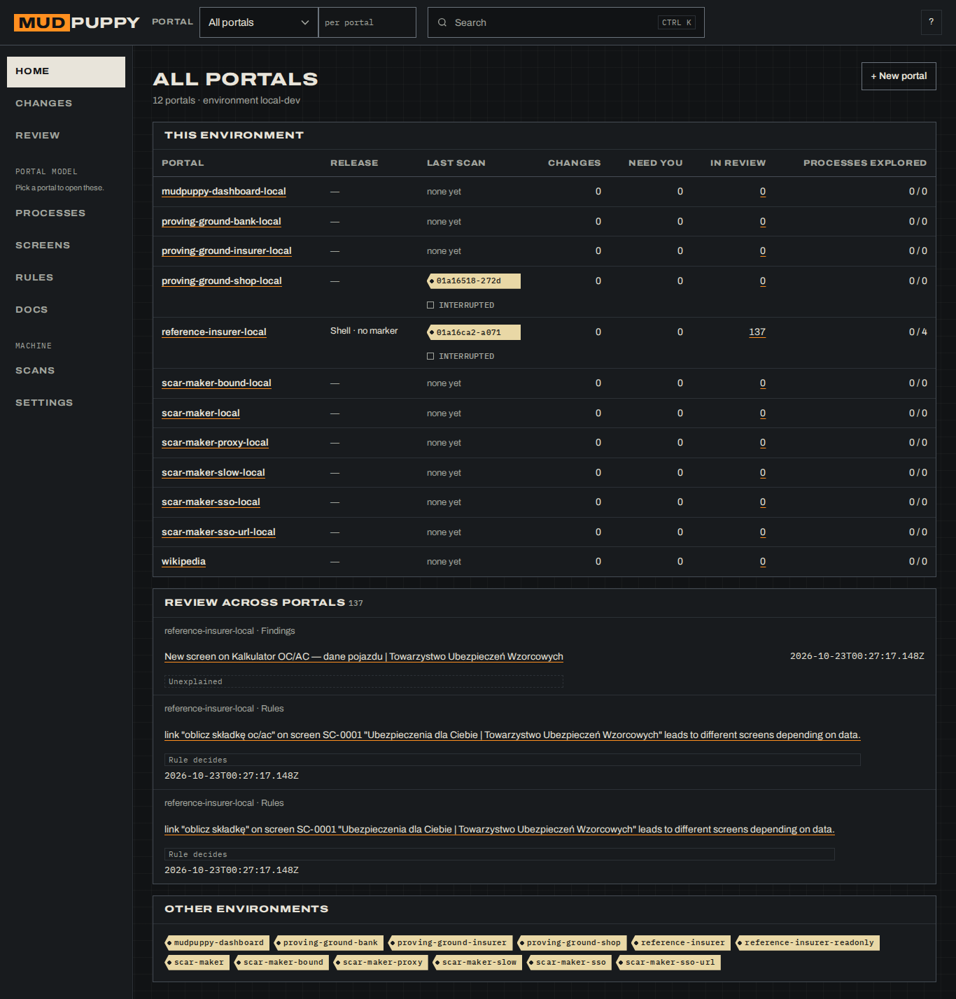

**Wireframe:**

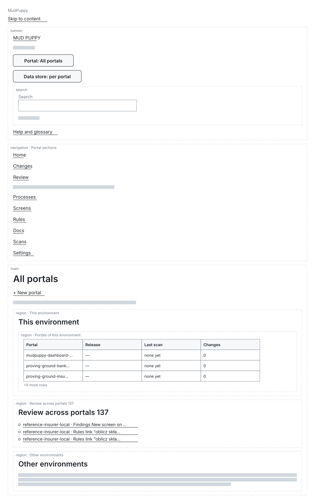

[edit in Excalidraw](images/wireframes/SCR-001.excalidraw)

**On screen:** MudPuppy (/app)

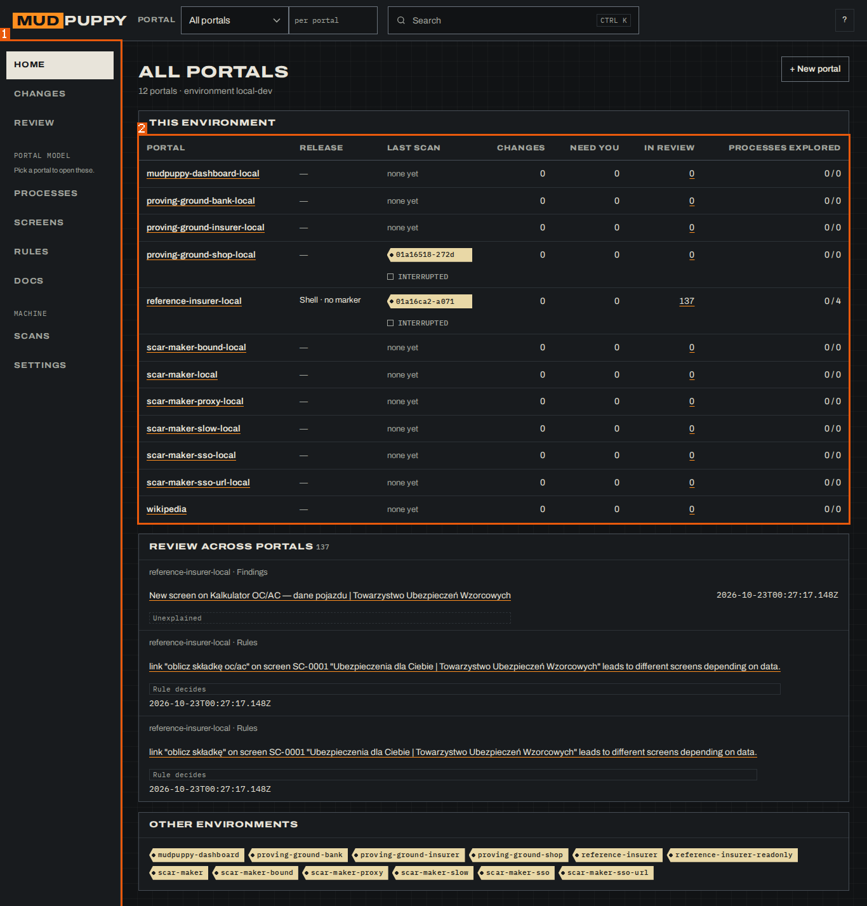

1. `navigation "Portal sections"`
2. `table "Portals of this environment"`

Evidence:

- network call `01a1753d-bae9-7000-b0d4-c1b2254d1a92` — GET /api/portals/overview (run `01a1753d-a8da-7000-85d2-b19d666d3587`, map, 2026-10-25) — note: GET /api/portals/overview feeds the table
- observation `01a1753d-baec-7000-8c5a-7fc06a2835ef` — http://127.0.0.1:8790/app/ (run `01a1753d-a8da-7000-85d2-b19d666d3587`, map, 2026-10-25) — note: start URL /app/
- screen region `01a1753d-ba74-7000-a2d2-3da8da9e7760` `navigation "Portal sections"` — MudPuppy (/app) (run `01a1753d-a8da-7000-85d2-b19d666d3587`, map, 2026-10-25)
- screen region `01a1753d-ba74-7000-a2d2-3da8da9e7760` `table "Portals of this environment"` — MudPuppy (/app) (run `01a1753d-a8da-7000-85d2-b19d666d3587`, map, 2026-10-25)
- state `01a1753d-ba74-7000-a2d2-3da8da9e7760` — MudPuppy (/app) (run `01a1753d-a8da-7000-85d2-b19d666d3587`, map, 2026-10-25) — note: ARIA snapshot of the portals list

### SCR-002 — Help and glossary

**SCR-002** · rev 1 · draft · observed

> DRAFT — not confirmed by a reviewer

The console's glossary of terms, with a filter and a link to the BA wiki.

**Purpose:** Explains the terms the console uses. It is opened from the "Help and glossary" link (shown as "?") in the banner of every page. The page offers the search field "Filter terms" and a link "BA wiki". It was recorded twice in the map run (the same screen structure); its content was too large to be read in this analysis session, so its terms and their definitions are not listed here.

**Route templates:**

- `/app/glossary`

**Elements** (labels verbatim):

| Role | Label |
| --- | --- |
| searchbox | Filter terms |
| link | BA wiki |
| searchbox | Search |

**Data items shown:**

- [DI-002](07-data-dictionary.md#DI-002) Filter terms

**Entry points:**

- link "Help and glossary" in the banner (same-document navigation to /app/glossary)
- direct address /app/glossary
- breadcrumb link "Glossary" on the BA wiki

**URLs observed** (verbatim):

- `http://127.0.0.1:8790/app/glossary` (2 visits; via same_document)

**Terms shown:**

- [GL-002](08-glossary.md#GL-002) Environment
- [GL-003](08-glossary.md#GL-003) Persona
- [GL-004](08-glossary.md#GL-004) Scan (run)
- [GL-005](08-glossary.md#GL-005) Mode (map, trace)

**Screenshot:**

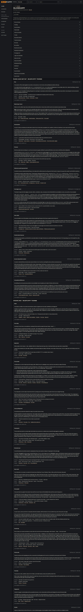

**Wireframe:**

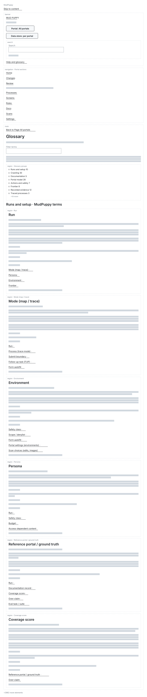

[edit in Excalidraw](images/wireframes/SCR-002.excalidraw)

Evidence:

- form `01a1753d-d35b-7001-b5a0-ab1feae76946` — form: _r_7_ (run `01a1753d-a8da-7000-85d2-b19d666d3587`, map, 2026-10-25) — note: field "Filter terms"
- network call `01a1753d-d35f-7000-9eab-4b6ea0c70561` — GET /api/glossary (run `01a1753d-a8da-7000-85d2-b19d666d3587`, map, 2026-10-25) — note: GET /api/glossary?q=
- state `01a1753d-cef0-7000-935b-db03378d928b` — MudPuppy (/app/glossary) (run `01a1753d-a8da-7000-85d2-b19d666d3587`, map, 2026-10-25)
- state `01a17541-4f19-7000-b272-148e15b6797f` — MudPuppy (/app/glossary) (run `01a1753d-a8da-7000-85d2-b19d666d3587`, map, 2026-10-25)
- transition `01a1753d-d35e-7000-bb1b-c51ab41976a6` — transition: "Help and glossary" (run `01a1753d-a8da-7000-85d2-b19d666d3587`, map, 2026-10-25) — note: "Help and glossary" from the portals list
- transition `01a17541-65b9-7001-bb40-94e6380dfdb5` — transition: "BA wiki" (run `01a1753d-a8da-7000-85d2-b19d666d3587`, map, 2026-10-25) — note: "BA wiki" link

### SCR-003 — BA wiki

**SCR-003** · rev 1 · draft · observed

> DRAFT — not confirmed by a reviewer

Index of business-analysis concept pages behind the documentation, with the glossary terms each explains.

**Purpose:** Heading "BA wiki", subtitle "Business-analysis concepts behind the documentation · cited sources". The table "BA wiki pages" (columns "Page", "Glossary terms", "Sources") lists pages such as "Acceptance criteria", "As-is process modelling", "Assumption", "Business capability", "Business rule", "Data dictionary", "Decision table", "Glossary (as a BA deliverable)", "Non-functional requirement", "Requirement", "Requirements review and validation", "Software requirements specification (SRS)", "Traceability" and "Use case"; each page links to /app/glossary/wiki/<slug> and its terms link to anchors of the glossary (/app/glossary#<term>). The page states that the pages are local so they stay readable when a source link breaks, and cites IREB CPRE glossary, IIBA BABOK Guide and ISO/IEC/IEEE 29148.

**Route templates:**

- `/app/glossary/wiki`

**Elements** (labels verbatim):

| Role | Label |
| --- | --- |
| heading | BA wiki |
| navigation | Breadcrumb |
| link | Glossary |
| table | BA wiki pages |
| link | Acceptance criteria |
| link | Traceability |
| link | Use case |

**Data items shown:**

_none recorded_

**Entry points:**

- link "BA wiki" on Help and glossary (same-document navigation to /app/glossary/wiki)

**URLs observed** (verbatim):

- `http://127.0.0.1:8790/app/glossary/wiki` (1 visit; via same_document)

**Business rules on this screen:**

- [BR-001](06-business-rules.md#BR-001) Portal sections open only after a portal is picked

**Terms shown:**

- [GL-016](08-glossary.md#GL-016) As-is documentation

**Screenshot:**

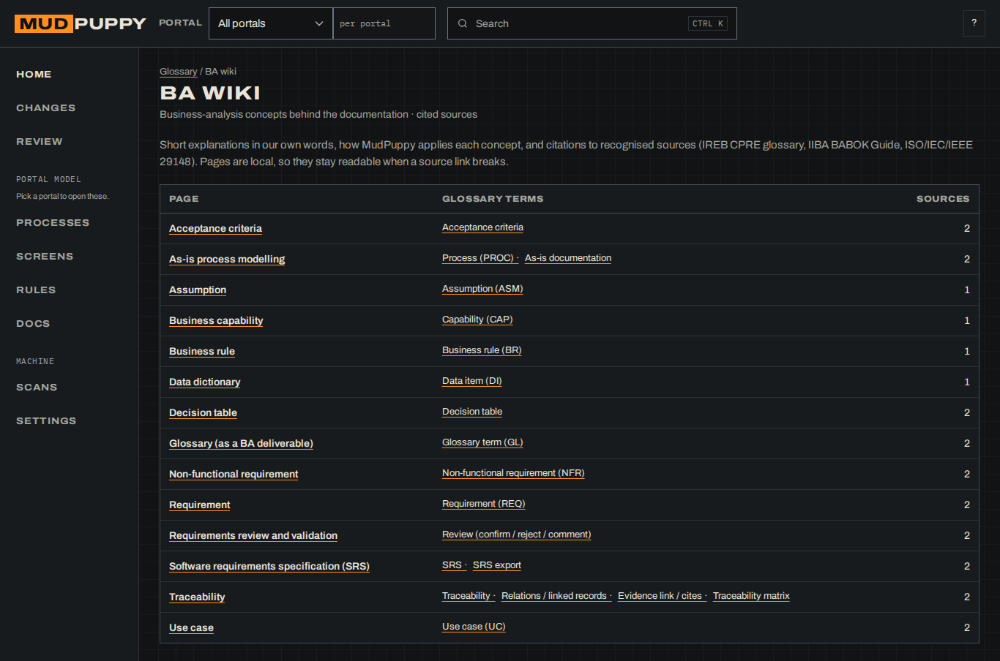

**Wireframe:**

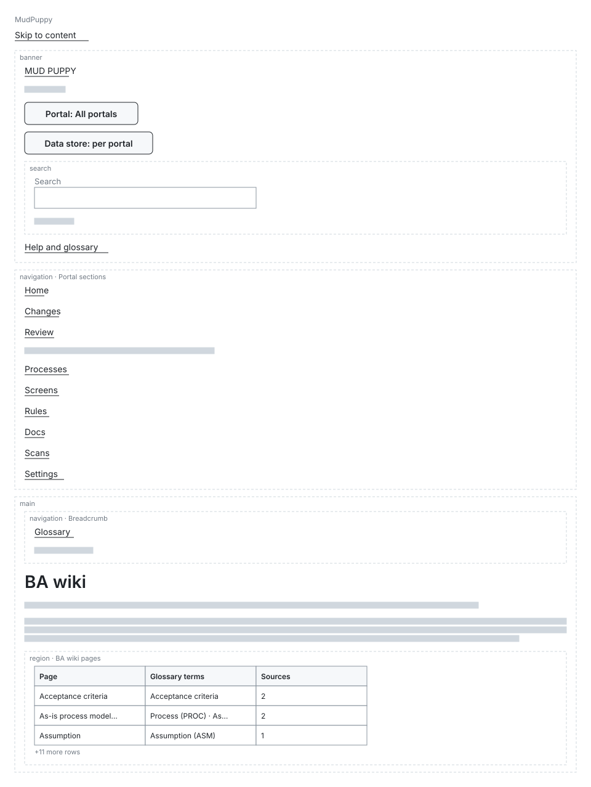

[edit in Excalidraw](images/wireframes/SCR-003.excalidraw)

**On screen:** MudPuppy (/app/glossary/wiki)

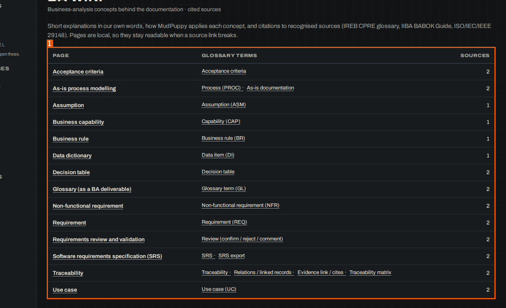

1. `table "BA wiki pages"`

Evidence:

- network call `01a17541-65ba-7001-ba0f-ca0c3460c4eb` — GET /api/glossary/wiki (run `01a1753d-a8da-7000-85d2-b19d666d3587`, map, 2026-10-25) — note: GET /api/glossary/wiki
- screen region `01a17541-6569-7000-9a25-e725ff936105` `table "BA wiki pages"` — MudPuppy (/app/glossary/wiki) (run `01a1753d-a8da-7000-85d2-b19d666d3587`, map, 2026-10-25)
- state `01a17541-6569-7000-9a25-e725ff936105` — MudPuppy (/app/glossary/wiki) (run `01a1753d-a8da-7000-85d2-b19d666d3587`, map, 2026-10-25)

### SCR-004 — Search results

**SCR-004** · rev 1 · draft · observed

> DRAFT — not confirmed by a reviewer

Results of the global search across portals, grouped by kind.

**Purpose:** Heading "Search" with a count line ("11 parts for “premium”"). Results are grouped in regions by kind; the run saw the region "Records · 11" with the list "Records": each item links the record key (e.g. "BR-016") to the record page and names its title, kind and portal. The searchbox "Search" in the banner keeps the query. The search API also returns screens and scans groups (empty in the run).

**Route templates:**

- `/app/search`

**Elements** (labels verbatim):

| Role | Label |
| --- | --- |
| heading | Search |
| searchbox | Search |
| region | Records · 11 |
| list | Records |
| link | BR-016 |

**Data items shown:**

- [DI-001](07-data-dictionary.md#DI-001) Search (global search field)

**Entry points:**

- /app/search?q={text} (opened directly with q=premium)
- the global searchbox "Search" (shortcut Ctrl K) in the banner

**URLs observed** (verbatim):

- `http://127.0.0.1:8790/app/search?q=premium` (1 visit)

**URL parameters:**

| Name | In | Values seen | Distinct |
| --- | --- | --- | --- |
| `q` | query | `premium` | 1 |

**Business rules on this screen:**

- [BR-001](06-business-rules.md#BR-001) Portal sections open only after a portal is picked

**Screenshot:**

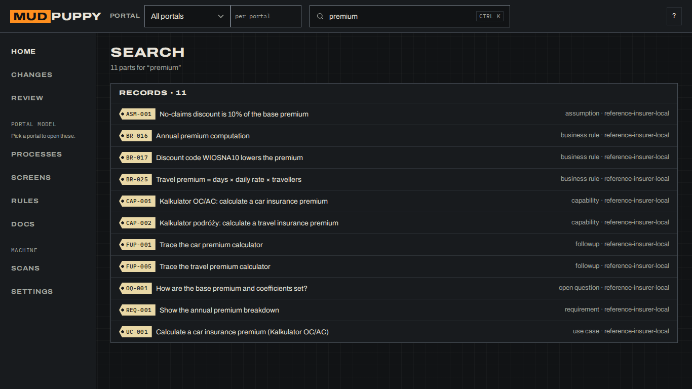

**Wireframe:**

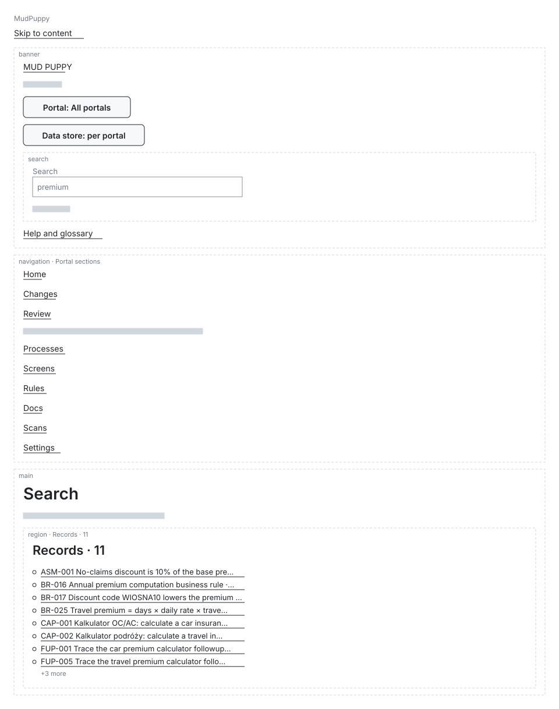

[edit in Excalidraw](images/wireframes/SCR-004.excalidraw)

**On screen:** MudPuppy (/app/search)

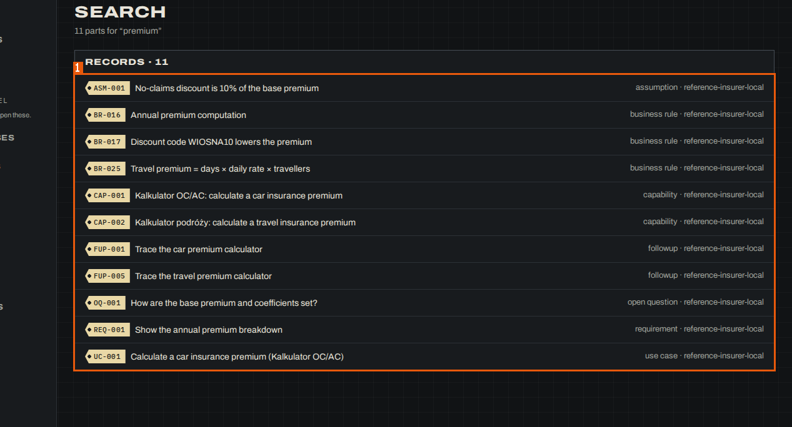

1. `list "Records"`

Evidence:

- network call `01a17541-d611-7001-905d-9aeb75c5135c` — GET /api/search (run `01a1753d-a8da-7000-85d2-b19d666d3587`, map, 2026-10-25) — note: GET /api/search?q=premium returns screens, records, scans
- observation `01a17541-d612-7001-bfc1-a52f494b0d2e` — http://127.0.0.1:8790/app/search?q=premium (run `01a1753d-a8da-7000-85d2-b19d666d3587`, map, 2026-10-25) — note: /app/search?q=premium
- screen region `01a17541-d5d8-7000-bc63-ab757f9c7158` `list "Records"` — MudPuppy (/app/search) (run `01a1753d-a8da-7000-85d2-b19d666d3587`, map, 2026-10-25)
- state `01a17541-d5d8-7000-bc63-ab757f9c7158` — MudPuppy (/app/search) (run `01a1753d-a8da-7000-85d2-b19d666d3587`, map, 2026-10-25)
- transition `01a17541-e9cf-7000-b71c-b40a301deeff` — transition: "BR-016" (run `01a1753d-a8da-7000-85d2-b19d666d3587`, map, 2026-10-25) — note: result link BR-016 opens the record page

### SCR-005 — Not found

**SCR-005** · rev 1 · draft · observed

> DRAFT — not confirmed by a reviewer

Page shown for a console address that does not exist.

**Purpose:** Heading "Not found" with the text "This page does not exist The address may be from an older console, or mistyped. The portals list still works." and the link "Open Portals" back to the portals list. The shell is shown with no portal selected ("Portal: All portals", portal sections disabled). Recorded when the address /app/portals/reference-insurer-local/search?q=premium was opened directly.

**Route templates:**

- `/app/portals/reference-insurer-local/:param`

**Elements** (labels verbatim):

| Role | Label |
| --- | --- |
| heading | Not found |
| link | Open Portals |

**Data items shown:**

_none recorded_

**Entry points:**

- /app/portals/reference-insurer-local/search?q=premium (opened directly; not a console route)

**URLs observed** (verbatim):

- `http://127.0.0.1:8790/app/portals/reference-insurer-local/search?q=premium` (1 visit)

**URL parameters:**

| Name | In | Values seen | Distinct |
| --- | --- | --- | --- |
| `q` | query | `premium` | 1 |

**Business rules on this screen:**

- [BR-001](06-business-rules.md#BR-001) Portal sections open only after a portal is picked

**Screenshot:**

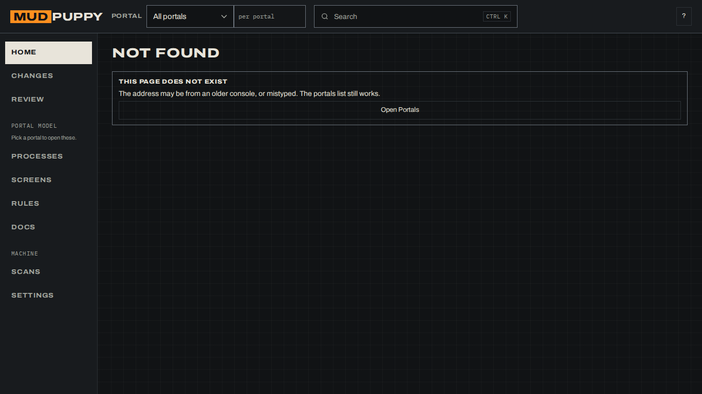

**Wireframe:**

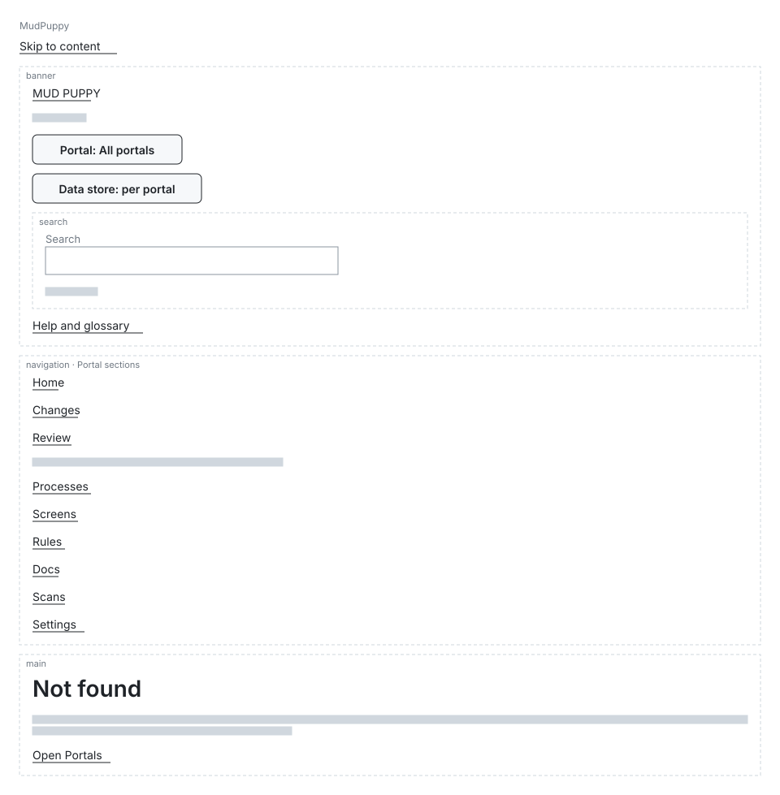

[edit in Excalidraw](images/wireframes/SCR-005.excalidraw)

**On screen:** MudPuppy (/app/portals/reference-insurer-local/:param)

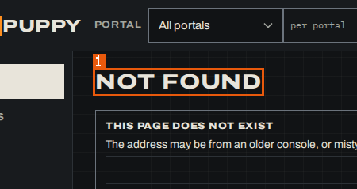

1. `heading "Not found"`

Evidence:

- observation `01a17541-c380-7003-8369-e9e523576c14` — http://127.0.0.1:8790/app/portals/reference-insurer-local/search?q=premium (run `01a1753d-a8da-7000-85d2-b19d666d3587`, map, 2026-10-25)
- screen region `01a17541-c349-7000-8e17-ea196a8e2b6b` `heading "Not found"` — MudPuppy (/app/portals/reference-insurer-local/:param) (run `01a1753d-a8da-7000-85d2-b19d666d3587`, map, 2026-10-25)
- state `01a17541-c349-7000-8e17-ea196a8e2b6b` — MudPuppy (/app/portals/reference-insurer-local/:param) (run `01a1753d-a8da-7000-85d2-b19d666d3587`, map, 2026-10-25)

### SCR-006 — New portal

**SCR-006** · rev 1 · draft · observed

> DRAFT — not confirmed by a reviewer

Form to register a new site to document, with one address per environment.

**Purpose:** Heading "New portal", region "Which site do you want to document?" with the form "New portal". The form explains: "Give the address of each environment you have: at least one. The crawler starts there, stays on that domain (and its subdomains) and visits it as a guest. You can add or revoke environments later in Settings. After saving, the assistant opens for it: ask it to scan." Fields: "Short name (optional)" (hint "Proposed from the first address, e.g. wikipedia-org"); groups "production", "staging" and "sandbox", each with "Address" and "The most a scan may do here"; the radio group "robots.txt" ("ignore it (visit every page; your responsibility)", "respect it"). Note under the form: "Every scan only looks unless you allow more: before each scan the assistant asks whether it may fill in and submit forms (up to the limit above). On production that really happens on the live site." The button "Save portal" was disabled and an alert said "Assistant not running It saves the portal. Start it in a terminal, then reload this page." with the command "MUDPUPPY_ENV=local-dev pnpm --dir apps/chat start".

**Route templates:**

- `/app/portals/new`

**Elements** (labels verbatim):

| Role | Label |
| --- | --- |
| heading | New portal |
| alert | Assistant not running |
| form | New portal |
| textbox | Short name (optional) |
| group | production |
| group | staging |
| group | sandbox |
| textbox | Address |
| combobox | The most a scan may do here |
| group | robots.txt |
| radio | ignore it (visit every page; your responsibility) |
| radio | respect it |
| button | Save portal |

**Data items shown:**

- [DI-071](07-data-dictionary.md#DI-071) Short name (optional)
- [DI-072](07-data-dictionary.md#DI-072) Address (New portal, production)
- [DI-073](07-data-dictionary.md#DI-073) Address (New portal, staging)
- [DI-074](07-data-dictionary.md#DI-074) Address (New portal, sandbox)
- [DI-075](07-data-dictionary.md#DI-075) The most a scan may do here (production)
- [DI-076](07-data-dictionary.md#DI-076) The most a scan may do here (staging)
- [DI-077](07-data-dictionary.md#DI-077) The most a scan may do here (sandbox)
- [DI-078](07-data-dictionary.md#DI-078) robots.txt (New portal)

**Entry points:**

- link "+ New portal" on All portals (same-document navigation to /app/portals/new)

**URLs observed** (verbatim):

- `http://127.0.0.1:8790/app/portals/new` (1 visit; via same_document)

**Business rules on this screen:**

- [BR-001](06-business-rules.md#BR-001) Portal sections open only after a portal is picked
- [BR-022](06-business-rules.md#BR-022) Saving and asking need the chat service; reading does not
- [BR-030](06-business-rules.md#BR-030) A new portal needs at least one environment address
- [BR-031](06-business-rules.md#BR-031) Crawl limit per environment and consent before each scan
- [BR-032](06-business-rules.md#BR-032) The crawler stays on the portal's domain and starts as a guest

**Terms shown:**

- [GL-001](08-glossary.md#GL-001) Portal
- [GL-002](08-glossary.md#GL-002) Environment
- [GL-023](08-glossary.md#GL-023) Assistant

**Processes through this screen:**

- [PROC-001](04-processes-and-use-cases.md#PROC-001) New portal

**Open questions about this:**

- [OQ-001](10-assumptions-and-questions.md#OQ-001) What do the assistant-backed actions do when the chat service runs?

**Screenshot:**

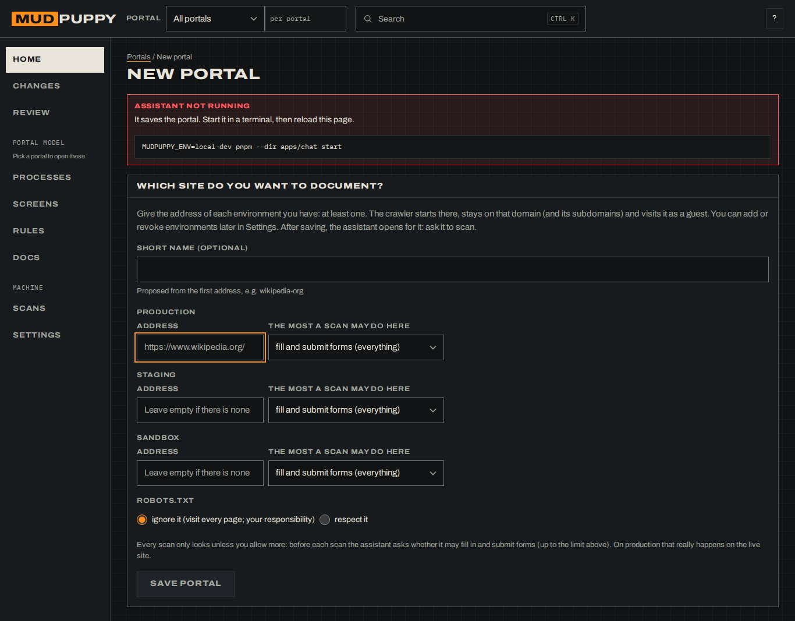

**Wireframe:**

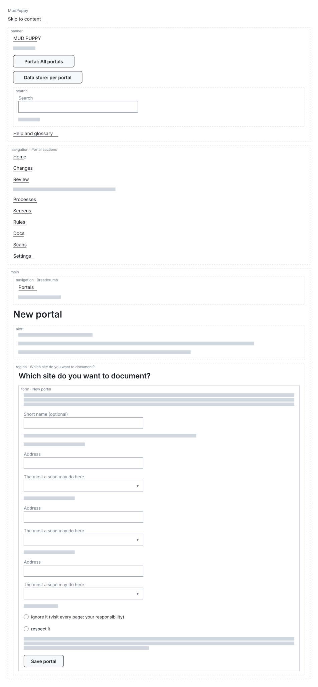

[edit in Excalidraw](images/wireframes/SCR-006.excalidraw)

**On screen:** MudPuppy (/app/portals/new)

1. `alert`
2. `button "Save portal"`

Evidence:

- form `01a17541-b138-7000-8307-39202088586d` — form: id, envs.0.base_url, envs.0.limit, envs.1.base_url (run `01a1753d-a8da-7000-85d2-b19d666d3587`, map, 2026-10-25)
- network call `01a17541-b13a-7000-83f3-4a05944f7e21` — GET /api/portals/new (run `01a1753d-a8da-7000-85d2-b19d666d3587`, map, 2026-10-25) — note: GET /api/portals/new returns service_up, start_hint, environments, limits
- screen region `01a17541-b0b3-7000-b23a-7b9ba885ff54` `alert` — MudPuppy (/app/portals/new) (run `01a1753d-a8da-7000-85d2-b19d666d3587`, map, 2026-10-25)
- screen region `01a17541-b0b3-7000-b23a-7b9ba885ff54` `button "Save portal"` — MudPuppy (/app/portals/new) (run `01a1753d-a8da-7000-85d2-b19d666d3587`, map, 2026-10-25)
- state `01a17541-b0b3-7000-b23a-7b9ba885ff54` — MudPuppy (/app/portals/new) (run `01a1753d-a8da-7000-85d2-b19d666d3587`, map, 2026-10-25)
- transition `01a17541-b139-7000-8214-7dda468203e1` — transition: "+ New portal" (run `01a1753d-a8da-7000-85d2-b19d666d3587`, map, 2026-10-25)

### SCR-007 — Processes (list)

**SCR-007** · rev 1 · draft · observed

> DRAFT — not confirmed by a reviewer

The BA's processes of a portal with their stage, models and screens, the assistant's suggestions and the screens in no process.

**Purpose:** Heading "Processes", button "Ask the assistant to regroup", text "Cut reference-insurer-local into processes you can document, redesign and migrate one at a time." and the stage line "Stages Suggested → Scoped → As-is documented → To-be in design → Migrating → Migrated A process can move back at any time." Region "Your processes · 1" holds the table "The BA's processes of reference-insurer-local" with the columns "Tick", "Process", "Stage", "Process models", "Live", "Screens", "Amendments", "Last change"; each row has a checkbox "Tick <process name>", the process link, key, start and end route and persona, and a link to each process model (e.g. "A r3" to ?model=A). Region "Suggested by the assistant · 0" ("Inferred · not saved From links between screens. Nothing is saved until you accept."; "No open suggestions. Ask the assistant to regroup; dismissed groupings are not suggested again."). Region "In no process · 18 screens" with the links "Show all in Screens" and "Sort the 18 screens into processes" (to /processes/loose). An "As of" group with the button "As of: Now" appears in the banner.

**Route templates:**

- `/app/portals/reference-insurer-local/processes`

**Elements** (labels verbatim):

| Role | Label |
| --- | --- |
| heading | Processes |
| button | As of: Now |
| button | Ask the assistant to regroup |
| region | Your processes · 1 |
| table | The BA's processes of reference-insurer-local |
| checkbox | Tick Kalkulator OC/AC |
| link | A r3 |
| region | Suggested by the assistant · 0 |
| region | In no process · 18 screens |
| link | Show all in Screens |
| link | Sort the 18 screens into processes |

**Data items shown:**

- [DI-004](07-data-dictionary.md#DI-004) Tick <process> (process selection checkbox)

**Entry points:**

- link "Processes" in "Portal sections" (same-document navigation)
- breadcrumb link "Processes" on a process page

**URLs observed** (verbatim):

- `http://127.0.0.1:8790/app/portals/reference-insurer-local/processes` (1 visit; via same_document)

**Business rules on this screen:**

- [BR-010](06-business-rules.md#BR-010) Process stages and their order
- [BR-034](06-business-rules.md#BR-034) Assistant suggestions are not saved until accepted

**Terms shown:**

- [GL-014](08-glossary.md#GL-014) Process model
- [GL-015](08-glossary.md#GL-015) Stage
- [GL-023](08-glossary.md#GL-023) Assistant
- [GL-029](08-glossary.md#GL-029) Amendment

**Screenshot:**

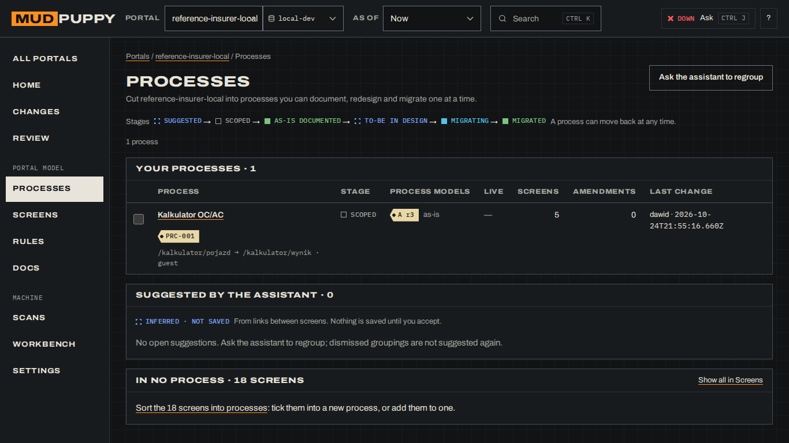

**Wireframe:**

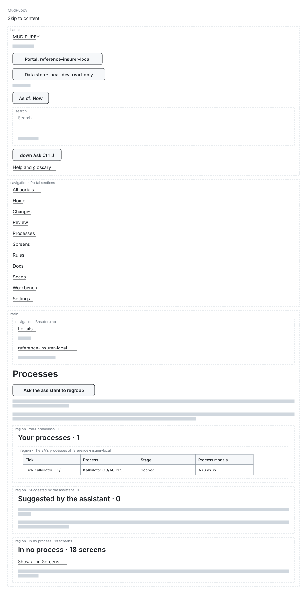

[edit in Excalidraw](images/wireframes/SCR-007.excalidraw)

**On screen:** MudPuppy (/app/portals/reference-insurer-local/processes)

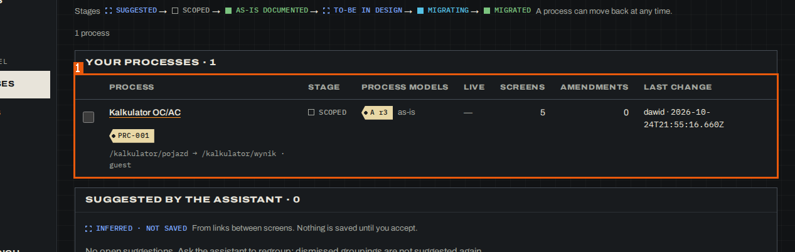

1. `table "The BA's processes of reference-insurer-local"`

Evidence:

- form `01a1753d-f117-7001-a90b-6dfba9ef6d48` — form: Tick Kalkulator OC/AC (run `01a1753d-a8da-7000-85d2-b19d666d3587`, map, 2026-10-25)
- network call `01a1753d-f119-7001-9b46-b5edfabdc573` — GET /api/portals/reference-insurer-local/processes (run `01a1753d-a8da-7000-85d2-b19d666d3587`, map, 2026-10-25) — note: GET /api/portals/{portal}/processes
- screen region `01a1753d-f0de-7001-94e6-0e4cf819f4b8` `table "The BA's processes of reference-insurer-local"` — MudPuppy (/app/portals/reference-insurer-local/processes) (run `01a1753d-a8da-7000-85d2-b19d666d3587`, map, 2026-10-25)
- state `01a1753d-f0de-7001-94e6-0e4cf819f4b8` — MudPuppy (/app/portals/reference-insurer-local/processes) (run `01a1753d-a8da-7000-85d2-b19d666d3587`, map, 2026-10-25)
- transition `01a1753d-f118-7001-8f74-79bbd90dfeb6` — transition: "Processes" (run `01a1753d-a8da-7000-85d2-b19d666d3587`, map, 2026-10-25)

### SCR-008 — Process (detail)

**SCR-008** · rev 1 · draft · observed

> DRAFT — not confirmed by a reviewer

One process: its facts from the portal model, paths, as-is documentation stage and the steps of the selected process model.

**Purpose:** Heading with the process name (e.g. "Kalkulator OC/AC") and the line "PRC-001 Scoped persona guest 5 screens". Actions: links "History" and "Documentation", buttons "Merge with…", "Archive", the group "Process model" with one pressed button per model ("A · As-is r3"), "Start a to-be design". Region "In the portal model" ("model version 4"; terms "Triggers", "Outcomes", "Explored" with button "Explore now", "Checked", "Business rules"). Region "Paths" with the table "Paths through the process, the most walked first" ("Path", "Screens walked", "Outcome", "Cases"). Region "As-is documentation": stage, the line "Still open on these screens: 6 open questions · 51 records to confirm · 0 amendments to re-anchor." with a "Review" link, button "Mark as-is documented", combobox "Stage" ("Scoped", "As-is documented", "To-be in design", "Migrating", "Migrated") and button "Set stage" (disabled while the current stage is selected). Region "A · As-is r3" ("Observed screens, documented per step") with the list "Steps in A": per step a picture button ("…, enlarge"), step number ("1 · Start" … "5 · End"), a link to the recorded state, the route, the records per kind ("Requirements", "Business rules", "Fields", "NFRs", "Terms", "Open questions", "Assumptions", "Follow-ups") linking to Docs, and buttons "Select", "Move step N up", "Move step N down", "Remove step N from A". Form "Add a screen to A" with combobox "Add a recorded screen at the end" (recorded screens as "<route> · <title>") and button "Add screen". Region "No step selected" ("Select a step to see everything documented on its screen."). Opening a model link adds ?model=A; that variant looks the same.

**Route templates:**

- `/app/portals/:portal/processes/:key`

**Elements** (labels verbatim):

| Role | Label |
| --- | --- |
| heading | Kalkulator OC/AC |
| link | History |
| link | Documentation |
| button | Merge with… |
| button | Archive |
| button | A · As-is r3 |
| button | Start a to-be design |
| region | In the portal model |
| button | Explore now |
| table | Paths through the process, the most walked first |
| region | As-is documentation |
| button | Mark as-is documented |
| combobox | Stage |
| button | Set stage |
| list | Steps in A |
| button | Select |
| button | Move step 1 down |
| button | Remove step 1 from A |
| form | Add a screen to A |
| combobox | Add a recorded screen at the end |
| button | Add screen |
| region | No step selected |

**Data items shown:**

- [DI-005](07-data-dictionary.md#DI-005) Add a recorded screen at the end
- [DI-006](07-data-dictionary.md#DI-006) Stage (process)

**Entry points:**

- process link (e.g. "Kalkulator OC/AC") in the Processes table, /app/portals/reference-insurer-local/processes/PRC-001
- link "View" of a model revision on History, /app/portals/reference-insurer-local/processes/PRC-001?model=A
- breadcrumb link with the process name on History

**URLs observed** (verbatim):

- `http://127.0.0.1:8790/app/portals/reference-insurer-local/processes/PRC-001` (1 visit; via same_document)
- `http://127.0.0.1:8790/app/portals/reference-insurer-local/processes/PRC-001?model=A` (1 visit; via same_document)

**URL parameters:**

| Name | In | Values seen | Distinct |
| --- | --- | --- | --- |
| `model` | query | `A` | 1 |

**Business rules on this screen:**

- [BR-009](06-business-rules.md#BR-009) "Set stage" needs a different stage
- [BR-010](06-business-rules.md#BR-010) Process stages and their order
- [BR-029](06-business-rules.md#BR-029) The model parameter selects the process model

**Terms shown:**

- [GL-011](08-glossary.md#GL-011) Model version
- [GL-014](08-glossary.md#GL-014) Process model
- [GL-015](08-glossary.md#GL-015) Stage
- [GL-016](08-glossary.md#GL-016) As-is documentation
- [GL-028](08-glossary.md#GL-028) Mined business rule (decision table)
- [GL-031](08-glossary.md#GL-031) Triggers and Outcomes (process facts)
- [GL-032](08-glossary.md#GL-032) Explored and Checked

**Processes through this screen:**

- [PROC-005](04-processes-and-use-cases.md#PROC-005) Set a process's stage

**Open questions about this:**

- [OQ-002](10-assumptions-and-questions.md#OQ-002) What do the console's write actions do?
- [OQ-004](10-assumptions-and-questions.md#OQ-004) Which console pages were not reached?

**Screenshot:**

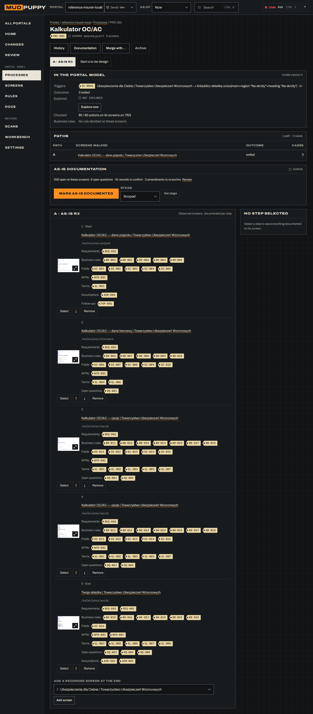

**Wireframe:**

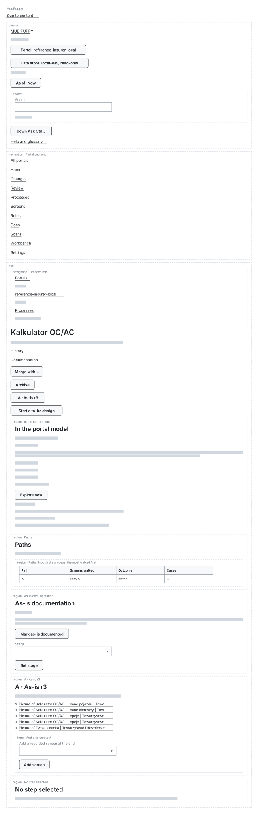

[edit in Excalidraw](images/wireframes/SCR-008.excalidraw)

**On screen:** MudPuppy (/app/portals/:portal/processes/:key)

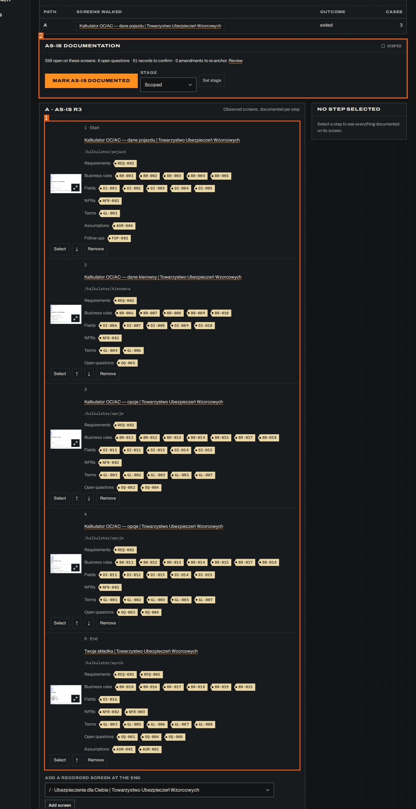

1. `list "Steps in A"`
2. `region "As-is documentation"`

Evidence:

- form `01a1753e-02b2-7000-a11d-0fe7e21b0946` — form: _r_q_ (run `01a1753d-a8da-7000-85d2-b19d666d3587`, map, 2026-10-25)
- form `01a1753e-02b2-7001-9aec-5e0d9d3d0fab` — form: _r_o_ (run `01a1753d-a8da-7000-85d2-b19d666d3587`, map, 2026-10-25)
- network call `01a1753e-02b5-7001-ad3c-0d0b9517868f` — GET /api/portals/reference-insurer-local/processes/PRC-001 (run `01a1753d-a8da-7000-85d2-b19d666d3587`, map, 2026-10-25)
- screen region `01a1753e-01fe-7000-91d8-152388d28304` `list "Steps in A"` — MudPuppy (/app/portals/:portal/processes/:key) (run `01a1753d-a8da-7000-85d2-b19d666d3587`, map, 2026-10-25)
- screen region `01a1753e-01fe-7000-91d8-152388d28304` `region "As-is documentation"` — MudPuppy (/app/portals/:portal/processes/:key) (run `01a1753d-a8da-7000-85d2-b19d666d3587`, map, 2026-10-25)
- state `01a1753e-01fe-7000-91d8-152388d28304` — MudPuppy (/app/portals/:portal/processes/:key) (run `01a1753d-a8da-7000-85d2-b19d666d3587`, map, 2026-10-25)
- state `01a1753e-1eca-7000-9131-ac7ce564bba9` — MudPuppy (/app/portals/:portal/processes/:key) (run `01a1753d-a8da-7000-85d2-b19d666d3587`, map, 2026-10-25) — note: ?model=A variant, same cluster
- transition `01a1753e-02b4-7000-8cca-4d7a9d49c1db` — transition: "Kalkulator OC/AC" (run `01a1753d-a8da-7000-85d2-b19d666d3587`, map, 2026-10-25)
- transition `01a1753e-1f63-7000-9a2b-d438c71dc989` — transition: "View" (run `01a1753d-a8da-7000-85d2-b19d666d3587`, map, 2026-10-25)

### SCR-009 — Process history

**SCR-009** · rev 1 · draft · observed

> DRAFT — not confirmed by a reviewer

Which process model is live in which environment, and every revision of the models, the process and its change spec.

**Purpose:** Heading "History" with the line "Kalkulator OC/AC · 1 process model · 3 revisions · not marked live anywhere". Region "Which process model runs where" with a table ("Environment", "Live now", "How we know", "Mark live"): one row each for "sandbox", "staging" and "production", each with a combobox "Process model to mark live in <environment>" (option "A r3"), a textbox "Reason (optional)" and a button "Mark live in <environment>". The note "Restoring adds a new revision. A rescan adds revisions to A and never edits a to-be model." Region "A · As-is" ("3 revisions") with the list "Revisions of A": each revision with label, status ("Latest", "superseded"), change kind ("scope", "create"), author, time, note and a "View" link. Region "The process itself" (list "Revisions of the process"). Region "Change spec" ("No change spec saved yet. Compare generates one; save it there.").

**Route templates:**

- `/app/portals/reference-insurer-local/processes/PRC-001/history`

**Elements** (labels verbatim):

| Role | Label |
| --- | --- |
| heading | History |
| table | Which process model runs where |
| combobox | Process model to mark live in sandbox |
| textbox | Reason (optional) |
| button | Mark live in sandbox |
| combobox | Process model to mark live in staging |
| button | Mark live in staging |
| combobox | Process model to mark live in production |
| button | Mark live in production |
| list | Revisions of A |
| link | View |
| list | Revisions of the process |
| region | Change spec |

**Data items shown:**

- [DI-007](07-data-dictionary.md#DI-007) Process model to mark live in sandbox
- [DI-008](07-data-dictionary.md#DI-008) Process model to mark live in staging
- [DI-009](07-data-dictionary.md#DI-009) Process model to mark live in production
- [DI-010](07-data-dictionary.md#DI-010) Reason (optional) for marking a model live

**Entry points:**

- link "History" on the process page (same-document navigation to /processes/PRC-001/history)

**URLs observed** (verbatim):

- `http://127.0.0.1:8790/app/portals/reference-insurer-local/processes/PRC-001/history` (1 visit; via same_document)

**Business rules on this screen:**

- [BR-011](06-business-rules.md#BR-011) Process model revisions are only added

**Terms shown:**

- [GL-014](08-glossary.md#GL-014) Process model
- [GL-030](08-glossary.md#GL-030) Change spec

**Processes through this screen:**

- [PROC-006](04-processes-and-use-cases.md#PROC-006) Mark a process model live

**Open questions about this:**

- [OQ-002](10-assumptions-and-questions.md#OQ-002) What do the console's write actions do?

**Screenshot:**

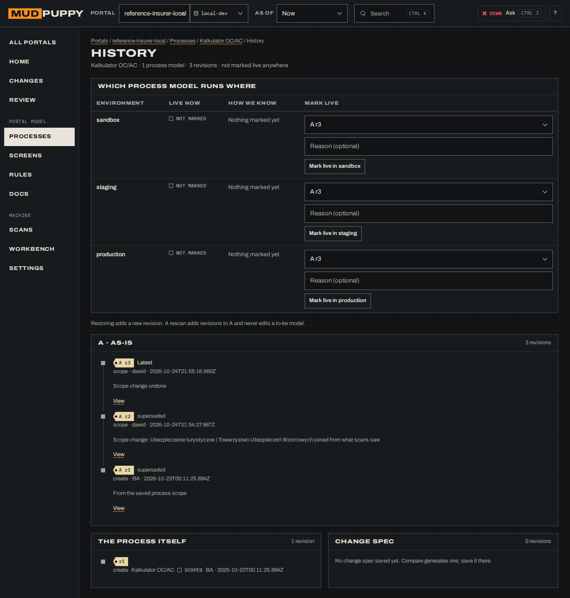

**Wireframe:**

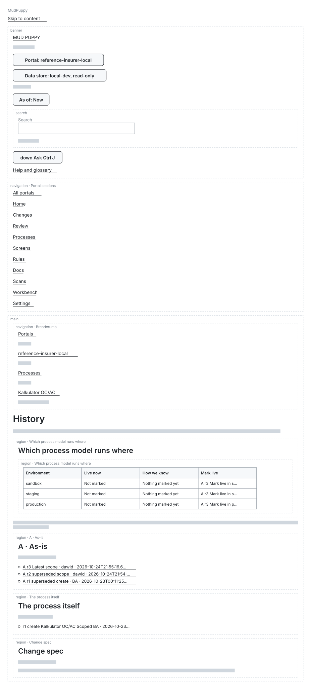

[edit in Excalidraw](images/wireframes/SCR-009.excalidraw)

**On screen:** MudPuppy (/app/portals/reference-insurer-local/processes/PRC-001/history)

1. `table "Which process model runs where"`

Evidence:

- form `01a1753e-127d-7001-a77a-9dfda1eac68e` — form: Process model to mark live in sandbox, Reason (optional) (run `01a1753d-a8da-7000-85d2-b19d666d3587`, map, 2026-10-25)
- network call `01a1753e-1280-7000-8c66-fbef5c6241cb` — GET /api/portals/reference-insurer-local/processes/PRC-001/history (run `01a1753d-a8da-7000-85d2-b19d666d3587`, map, 2026-10-25)
- screen region `01a1753e-122f-7000-ac31-15f9bbe7957d` `table "Which process model runs where"` — MudPuppy (/app/portals/reference-insurer-local/processes/PRC-001/history) (run `01a1753d-a8da-7000-85d2-b19d666d3587`, map, 2026-10-25)
- state `01a1753e-122f-7000-ac31-15f9bbe7957d` — MudPuppy (/app/portals/reference-insurer-local/processes/PRC-001/history) (run `01a1753d-a8da-7000-85d2-b19d666d3587`, map, 2026-10-25)
- transition `01a1753e-127e-7001-80c4-7098b1d9348f` — transition: "History" (run `01a1753d-a8da-7000-85d2-b19d666d3587`, map, 2026-10-25)

### SCR-010 — Process documentation (export)

**SCR-010** · rev 1 · draft · observed

> DRAFT — not confirmed by a reviewer

The rebuild-grade export of one process, shown in the console.

**Purpose:** Breadcrumb "PRC-001 / Documentation", heading "PRC-001 documentation", text "The rebuild-grade export of this process: the same files the download holds, built from the recorded scans and the BA's records." In the run the export could not be built and the page showed "No documentation export for PRC-001 The export could not be built: ╰─▶ No such file or directory (os error 2)"; the export API answered 200 with an error field, a tab list and a zip link. The page was reached only by typing its address.

**Route templates:**

- `/app/portals/reference-insurer-local/:param/PRC-001/documentation`

**Elements** (labels verbatim):

| Role | Label |
| --- | --- |
| heading | PRC-001 documentation |
| link | PRC-001 |

**Data items shown:**

_none recorded_

**Entry points:**

- /app/portals/reference-insurer-local/processes/PRC-001/documentation (opened directly)
- link "Documentation" on the process page (seen, not followed)

**URLs observed** (verbatim):

- `http://127.0.0.1:8790/app/portals/reference-insurer-local/processes/PRC-001/documentation` (1 visit)

**Open questions about this:**

- [OQ-003](10-assumptions-and-questions.md#OQ-003) Why could the process documentation export not be built?

**Screenshot:**

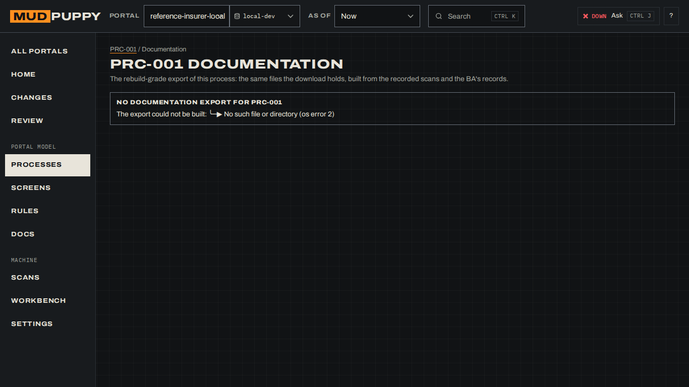

**Wireframe:**

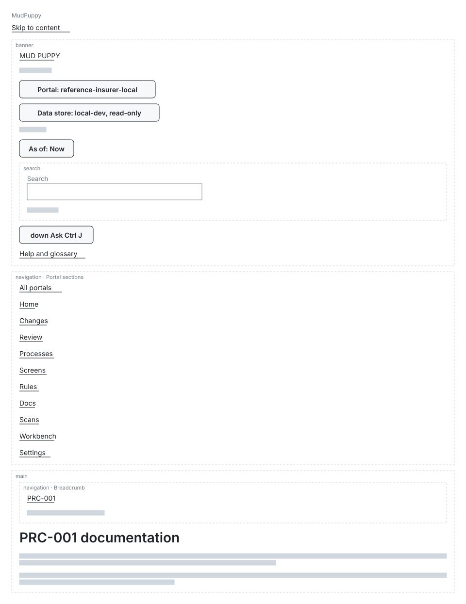

[edit in Excalidraw](images/wireframes/SCR-010.excalidraw)

Evidence:

- network call `01a17542-0d96-7001-b22e-982b17486c61` — GET /api/portals/reference-insurer-local/processes/PRC-001/export (run `01a1753d-a8da-7000-85d2-b19d666d3587`, map, 2026-10-25) — note: GET /api/portals/{portal}/processes/PRC-001/export?tab=README.md
- observation `01a17542-0d97-7002-999f-0c307364fe69` — http://127.0.0.1:8790/app/portals/reference-insurer-local/processes/PRC-001/documentation (run `01a1753d-a8da-7000-85d2-b19d666d3587`, map, 2026-10-25)
- open question `01a17542-59d7-7001-ba24-01576d0e199a` — Not reached: no rule rows on the Rules list (only 'Run the rule tests'), so no single-rule page there (BR-001/BR-016 reached via Docs/Search); process Compare page not found (no link seen); process Documentation only by guessed URL .../processes/PRC-001/documentation, recorded as nearly empty; item_view_cap 18 stopped further item pages; assistant/chat buttons skipped. (run `01a1753d-a8da-7000-85d2-b19d666d3587`, map, 2026-10-25) — note: crawler: Documentation only by guessed URL, recorded as nearly empty
- state `01a17542-0d6a-7001-993f-14da3ff639c8` — MudPuppy (/app/portals/reference-insurer-local/:param/PRC-001/documentation) (run `01a1753d-a8da-7000-85d2-b19d666d3587`, map, 2026-10-25)

### SCR-011 — Portal home

**SCR-011** · rev 1 · draft · observed

> DRAFT — not confirmed by a reviewer

Overview of one portal: what needs the BA, the last scan, the model, releases, changes by process and the assistant.

**Purpose:** Heading with the portal id (e.g. "reference-insurer-local") and "environment local-dev". Regions: "Needs you" (count and list "What needs you", each item with a chip such as "Rule decides" or "Unexplained", the claim, the screen and a timestamp); "Last scan" (kind "AI scan", the short scan id as a link, a "Copy" button whose accessible name is "Copy the full scan id" followed by the id, date and step count); "The model" (terms "Version", "Processes", "Proposed", "Rules"); "Releases" (list "Releases by part", e.g. part "Shell" with release and previous release); "Changes by process" (table with "Process", "Changes", "Need you", "Explained"); "Assistant" (scope "whole portal", text "Ask what changed, or have it explain a finding, start a check run or rebuild the model.", suggestion buttons "What changed since the last scan?", "What can I do here?", "Sort screens into processes", "Follow one process start to end", note "Its proposals land in Review and Processes, marked as the assistant's.", form "Ask the assistant" with textbox "Message" (placeholder "Ask about this portal"), hint "Enter sends · Ctrl+J opens the full chat" and button "Send", disabled in the run). With a portal selected the shell shows "Portal: <id>", "Data store: local-dev, read-only", the button "down Ask Ctrl J", and the sections "All portals", "Home", "Changes", "Review", "Processes", "Screens", "Rules", "Docs", "Scans", "Workbench", "Settings" as links; a breadcrumb starts with "Portals".

**Route templates:**

- `/app/portals/reference-insurer-local`

**Elements** (labels verbatim):

| Role | Label |
| --- | --- |
| button | Portal: reference-insurer-local |
| button | Data store: local-dev, read-only |
| button | down Ask Ctrl J |
| link | All portals |
| link | Workbench |
| navigation | Breadcrumb |
| region | Needs you |
| list | What needs you |
| region | Last scan |
| region | The model |
| region | Releases |
| list | Releases by part |
| region | Changes by process |
| table | Changes on reference-insurer-local by process |
| region | Assistant |
| button | What changed since the last scan? |
| button | What can I do here? |
| button | Sort screens into processes |
| button | Follow one process start to end |
| form | Ask the assistant |
| textbox | Message |
| button | Send |

**Data items shown:**

- [DI-003](07-data-dictionary.md#DI-003) Message (Ask the assistant on Portal home)

**Entry points:**

- portal link (e.g. "reference-insurer-local") in the table on All portals
- link "Home" in "Portal sections"
- breadcrumb link with the portal id
- /app/ when a portal was visited before (see the rule on the remembered portal)

**URLs observed** (verbatim):

- `http://127.0.0.1:8790/app/portals/reference-insurer-local` (6 visits; via same_document)

**Business rules on this screen:**

- [BR-002](06-business-rules.md#BR-002) Workbench and Ask appear only for a selected portal
- [BR-003](06-business-rules.md#BR-003) Data store button disabled without a portal
- [BR-004](06-business-rules.md#BR-004) The console remembers the last opened portal
- [BR-034](06-business-rules.md#BR-034) Assistant suggestions are not saved until accepted

**Terms shown:**

- [GL-001](08-glossary.md#GL-001) Portal
- [GL-004](08-glossary.md#GL-004) Scan (run)
- [GL-009](08-glossary.md#GL-009) Release
- [GL-010](08-glossary.md#GL-010) Part
- [GL-011](08-glossary.md#GL-011) Model version
- [GL-012](08-glossary.md#GL-012) Needs you
- [GL-023](08-glossary.md#GL-023) Assistant
- [GL-024](08-glossary.md#GL-024) Workbench
- [GL-025](08-glossary.md#GL-025) Data store

**Processes through this screen:**

- [PROC-008](04-processes-and-use-cases.md#PROC-008) Ask the assistant

**Open questions about this:**

- [OQ-001](10-assumptions-and-questions.md#OQ-001) What do the assistant-backed actions do when the chat service runs?
- [OQ-006](10-assumptions-and-questions.md#OQ-006) Why was "Send" disabled on Portal home?

**Screenshot:**

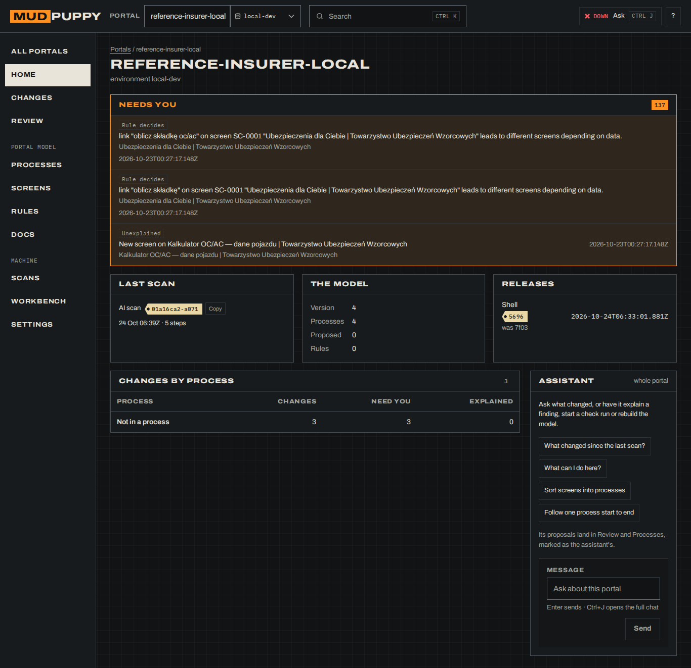

**Wireframe:**

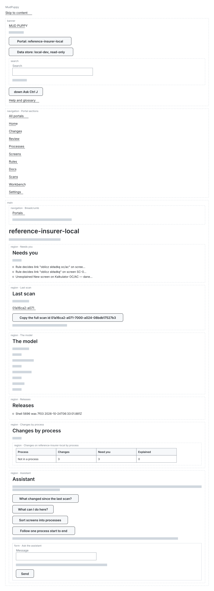

[edit in Excalidraw](images/wireframes/SCR-011.excalidraw)

**On screen:** MudPuppy (/app/portals/reference-insurer-local)

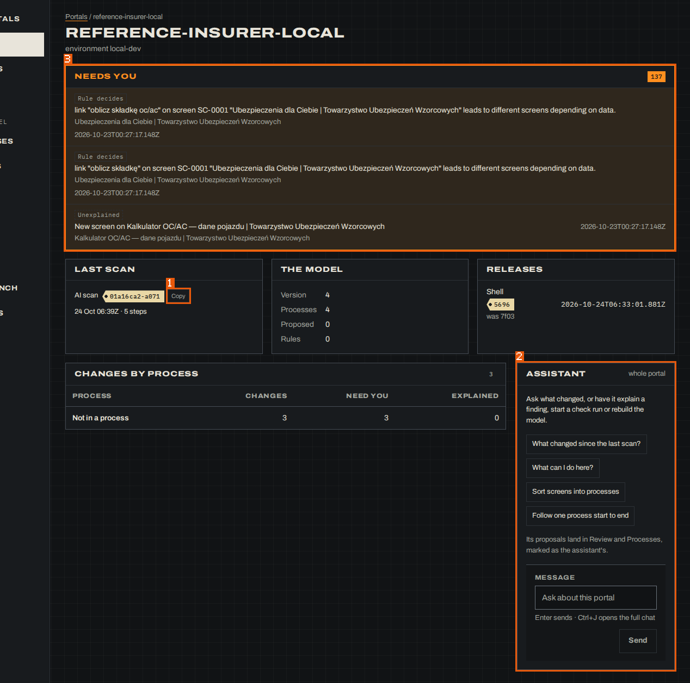

1. `button "Copy the full scan id 01a16ca2-a071-7000-a024-08bdb17527b3"`
2. `region "Assistant"`
3. `region "Needs you"`

Evidence:

- form `01a1753d-df16-7000-9458-ac12f9966852` — form: _r_d_ (run `01a1753d-a8da-7000-85d2-b19d666d3587`, map, 2026-10-25)
- network call `01a1753d-df1a-7000-9745-29cdfbfa9822` — GET /api/portals/reference-insurer-local/home (run `01a1753d-a8da-7000-85d2-b19d666d3587`, map, 2026-10-25) — note: GET /api/portals/{portal}/home
- screen region `01a1753d-debd-7000-b943-374405412ad9` `button "Copy the full scan id 01a16ca2-a071-7000-a024-08bdb17527b3"` — MudPuppy (/app/portals/reference-insurer-local) (run `01a1753d-a8da-7000-85d2-b19d666d3587`, map, 2026-10-25)
- screen region `01a1753d-debd-7000-b943-374405412ad9` `region "Assistant"` — MudPuppy (/app/portals/reference-insurer-local) (run `01a1753d-a8da-7000-85d2-b19d666d3587`, map, 2026-10-25)
- screen region `01a1753d-debd-7000-b943-374405412ad9` `region "Needs you"` — MudPuppy (/app/portals/reference-insurer-local) (run `01a1753d-a8da-7000-85d2-b19d666d3587`, map, 2026-10-25)
- state `01a1753d-debd-7000-b943-374405412ad9` — MudPuppy (/app/portals/reference-insurer-local) (run `01a1753d-a8da-7000-85d2-b19d666d3587`, map, 2026-10-25)
- transition `01a1753d-df18-7000-9e5d-514163c69f33` — transition: "reference-insurer-local" (run `01a1753d-a8da-7000-85d2-b19d666d3587`, map, 2026-10-25)

### SCR-012 — Review

**SCR-012** · rev 1 · draft · observed

> DRAFT — not confirmed by a reviewer

The BA's inbox: everything that waits for a decision, grouped by kind, with a detail pane for the selected item.

**Purpose:** Heading "Review" with a count line ("137 need you · 0 explained automatically · nothing is decided without a reason you can see later."). Navigation "Review views": "Needs you <n>", "Explained automatically <n>" (?tab=explained), "Decided <n>" (?tab=decided) and, when there are pairs, "Same screen? <n>". Navigation "Kinds of decision": "All", "Findings", "Rules", "Removals", "Processes", "Records to confirm", "Assumptions to check", "Unexplained differences", "Amendments to re-anchor", "Assistant proposals", "Probe suites to approve", "Edit conflicts", each with a count and a ?show=<kind> link. Filters: comboboxes "Part" and "Age" with button "Filter". The group "Keys: J K next · previous · C confirm · R reject · U undo · ? all Show" and the checkbox "Single-key shortcuts in this browser". One region per non-empty kind: "Findings" (chip such as "Unexplained", claim link, kind and model version), "Rules" (alike items grouped: "2 alike · Leads elsewhere · Rule decides · model version 2", textbox "Reason for 2" with placeholder "One reason for all", buttons "Confirm 2" and "Reject 2", a checkbox "Select" per item), "Records to confirm" (record key, status, revision and kind, title link, "Show all 130"), "Assumptions to check". "Nothing waits in" lists links to the empty kinds. A pager ("1 of 1 · Findings Previous Next") and a detail region for the selected item (heading with its claim, "No rule explained it yet.", link "Before / after"). Selecting an item adds ?select=<kind>:<id>. For a portal with nothing waiting the page shows "Nothing waits for you. Decisions land here as scans, the BA agent and the assistant work." and no "Same screen?" link.

**Route templates:**

- `/app/portals/reference-insurer-local/review`
- `/app/portals/mudpuppy-dashboard-local/review`

**Elements** (labels verbatim):

| Role | Label |
| --- | --- |
| heading | Review |
| navigation | Review views |
| link | Needs you 137 |
| link | Explained automatically 0 |
| link | Decided 0 |
| link | Same screen? 4 |
| navigation | Kinds of decision |
| link | Findings 1 |
| link | Rules 2 |
| link | Records to confirm 130 |
| link | Assumptions to check 4 |
| combobox | Part |
| combobox | Age |
| button | Filter |
| checkbox | Single-key shortcuts in this browser |
| region | Findings |
| region | Rules |
| textbox | Reason for 2 |
| button | Confirm 2 |
| button | Reject 2 |
| checkbox | Select |
| region | Records to confirm |
| link | Show all 130 |
| region | Assumptions to check |
| link | Before / after |

**Data items shown:**

- [DI-011](07-data-dictionary.md#DI-011) Single-key shortcuts in this browser
- [DI-012](07-data-dictionary.md#DI-012) Part (Review filter)
- [DI-013](07-data-dictionary.md#DI-013) Age (Review filter)
- [DI-014](07-data-dictionary.md#DI-014) Reason for <n> (group decision in Review)
- [DI-015](07-data-dictionary.md#DI-015) Select (item of a Review group)

**Entry points:**

- link "Review" in "Portal sections"
- the "In Review" count link (e.g. "0", "137") on All portals, e.g. /app/portals/mudpuppy-dashboard-local/review
- item link in "Review across portals" on All portals
- /app/portals/reference-insurer-local/review?select=assumptions%3AASM-001 (item link)
- ?tab=explained, ?tab=decided, ?show=<kind> links on the page
- link "Back to Review Esc" on Same screen?

**URLs observed** (verbatim):

- `http://127.0.0.1:8790/app/portals/reference-insurer-local/review` (3 visits)
- `http://127.0.0.1:8790/app/portals/mudpuppy-dashboard-local/review` (1 visit; via same_document)
- `http://127.0.0.1:8790/app/portals/reference-insurer-local/review?select=assumptions%3AASM-001` (1 visit; via same_document)

**URL parameters:**

| Name | In | Values seen | Distinct |
| --- | --- | --- | --- |
| `select` | query | `assumptions:ASM-001` | 1 |

**Business rules on this screen:**

- [BR-005](06-business-rules.md#BR-005) A group in Review is rejected only with a reason
- [BR-028](06-business-rules.md#BR-028) Review address parameters
- [BR-034](06-business-rules.md#BR-034) Assistant suggestions are not saved until accepted
- [BR-036](06-business-rules.md#BR-036) Nothing in Review is decided without a visible reason
- [BR-037](06-business-rules.md#BR-037) "Same screen?" appears only when pairs wait

**Terms shown:**

- [GL-010](08-glossary.md#GL-010) Part
- [GL-012](08-glossary.md#GL-012) Needs you
- [GL-013](08-glossary.md#GL-013) Finding
- [GL-022](08-glossary.md#GL-022) Form probe
- [GL-028](08-glossary.md#GL-028) Mined business rule (decision table)
- [GL-029](08-glossary.md#GL-029) Amendment

**Processes through this screen:**

- [PROC-002](04-processes-and-use-cases.md#PROC-002) Review

**Open questions about this:**

- [OQ-002](10-assumptions-and-questions.md#OQ-002) What do the console's write actions do?
- [OQ-004](10-assumptions-and-questions.md#OQ-004) Which console pages were not reached?

**Screenshot:**

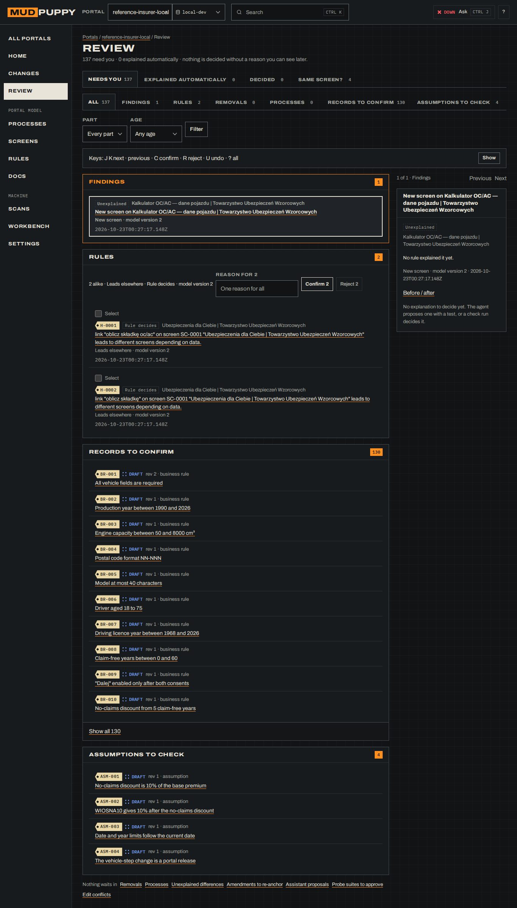

**Wireframe:**

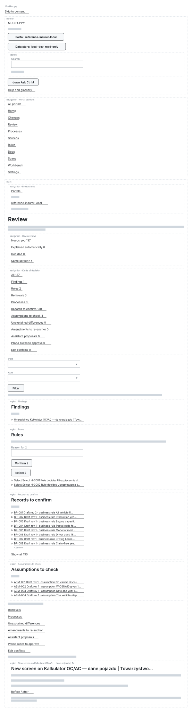

[edit in Excalidraw](images/wireframes/SCR-012.excalidraw)

**On screen:** MudPuppy (/app/portals/reference-insurer-local/review)

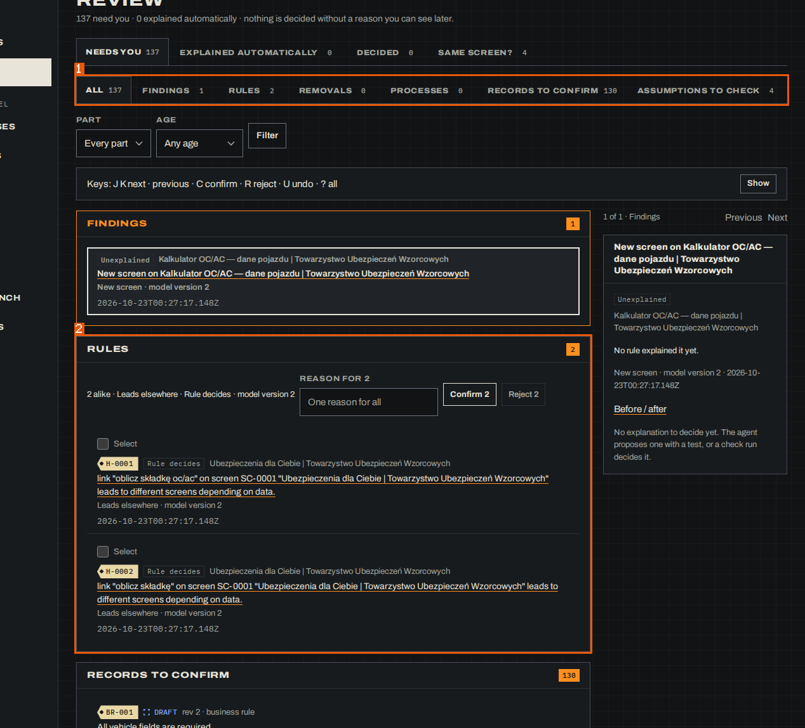

1. `navigation "Kinds of decision"`
2. `region "Rules"`

Evidence:

- network call `01a1753e-bef2-7003-a8b0-ce371914a219` — GET /api/portals/reference-insurer-local/review (run `01a1753d-a8da-7000-85d2-b19d666d3587`, map, 2026-10-25)
- network call `01a17541-38a0-7001-b5bc-4409201a4fdc` — GET /api/portals/reference-insurer-local/review (run `01a1753d-a8da-7000-85d2-b19d666d3587`, map, 2026-10-25) — note: review?select=assumptions:ASM-001
- screen region `01a1753e-be7a-7000-95e6-7606fb6ebc6e` `navigation "Kinds of decision"` — MudPuppy (/app/portals/reference-insurer-local/review) (run `01a1753d-a8da-7000-85d2-b19d666d3587`, map, 2026-10-25)
- screen region `01a1753e-be7a-7000-95e6-7606fb6ebc6e` `region "Rules"` — MudPuppy (/app/portals/reference-insurer-local/review) (run `01a1753d-a8da-7000-85d2-b19d666d3587`, map, 2026-10-25)
- state `01a1753e-a32f-7000-8071-a4b29979685b` — MudPuppy (/app/portals/mudpuppy-dashboard-local/review) (run `01a1753d-a8da-7000-85d2-b19d666d3587`, map, 2026-10-25) — note: empty variant for a portal with nothing waiting
- state `01a1753e-be7a-7000-95e6-7606fb6ebc6e` — MudPuppy (/app/portals/reference-insurer-local/review) (run `01a1753d-a8da-7000-85d2-b19d666d3587`, map, 2026-10-25)
- state `01a17541-381d-7000-89a5-270bc9ed695b` — MudPuppy (/app/portals/reference-insurer-local/review) (run `01a1753d-a8da-7000-85d2-b19d666d3587`, map, 2026-10-25) — note: variant with an assumption selected
- transition `01a1753e-a36b-7000-bdf8-e81a2dde74cc` — transition: "0" (run `01a1753d-a8da-7000-85d2-b19d666d3587`, map, 2026-10-25)
- transition `01a17541-389f-7000-b1ef-0024ad054792` — transition: "No-claims discount is 10% of the base premium" (run `01a1753d-a8da-7000-85d2-b19d666d3587`, map, 2026-10-25)

### SCR-013 — Same screen?

**SCR-013** · rev 1 · draft · observed

> DRAFT — not confirmed by a reviewer

Pair-labelling page: the BA says whether two recorded page versions are one screen.

**Purpose:** Breadcrumb "Review / Same screen?", link "Back to Review Esc", line "1 of 4 Conflicts first, then the pairs nearest the threshold τ 0.90 (within ±0.05): those answers move τ most. Then each screen's variants against its first." A heading names the pair (e.g. "…: r1 and r1") with the similarity ("88% alike (MinHash)"). Two side regions (one per version) show the screen key link, a picture, "Open the recorded page", and the terms "Title", "Route", "Last visit"; below them the differences ("Release · Shell", "Scan", each marked "(differs)"). Region "Your answer" ("Press 1, 2 or 3") with three radios: "Same screen 1 Keep one screen; the two stay variants of it.", "Same, different data 2 Keep one screen; what differs is content that depends on data, documented once.", "Different screens 3 Two screens: the next rebuild splits them apart." (marked "Automatic grouping" for the model's own answer); textbox "Why (optional) W" (placeholder "One line", "Shown with the label."), link "Skip S" (to ?a=<state>&b=<state>), button "Save" (disabled with no answer chosen). "What happens: your answer is saved as a label for these two page versions. The next model rebuild groups them by it; the process … walks this screen. Skip leaves this pair in the queue." Key hints: "1 2 3 answer W why Enter save S skip Esc back to Review".

**Route templates:**

- `/app/portals/reference-insurer-local/same-screen`

**Elements** (labels verbatim):

| Role | Label |
| --- | --- |
| heading | Same screen? |
| link | Back to Review Esc |
| link | Open the recorded page |
| region | Your answer |
| radio | Same screen 1 Keep one screen; the two stay variants of it. |
| radio | Same, different data 2 Keep one screen; what differs is content that depends on data, documented once. |
| radio | Different screens 3 Two screens: the next rebuild splits them apart. Automatic grouping |
| textbox | Why (optional) W |
| link | Skip S |
| button | Save |

**Data items shown:**

- [DI-068](07-data-dictionary.md#DI-068) Your answer (Same screen?)
- [DI-069](07-data-dictionary.md#DI-069) Why (optional) W

**Entry points:**

- link "Same screen? 4" in "Review views" (same-document navigation)
- link "Skip S" opens the next pair as same-screen?a=<state>&b=<state>

**URLs observed** (verbatim):

- `http://127.0.0.1:8790/app/portals/reference-insurer-local/same-screen` (1 visit; via same_document)

**Business rules on this screen:**

- [BR-024](06-business-rules.md#BR-024) "Save" on Same screen? needs an answer
- [BR-025](06-business-rules.md#BR-025) Order of the Same screen? queue

**Terms shown:**

- [GL-007](08-glossary.md#GL-007) Recorded page
- [GL-017](08-glossary.md#GL-017) Threshold τ
- [GL-036](08-glossary.md#GL-036) Pair labels and Classifier

**Processes through this screen:**

- [PROC-003](04-processes-and-use-cases.md#PROC-003) Same screen?

**Open questions about this:**

- [OQ-002](10-assumptions-and-questions.md#OQ-002) What do the console's write actions do?

**Screenshot:**

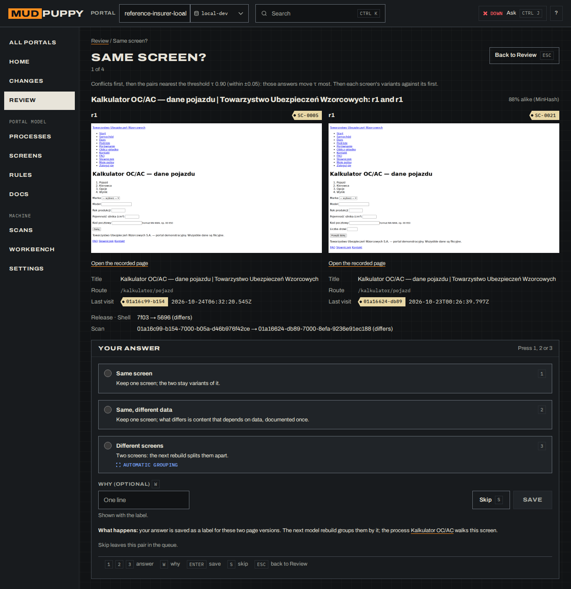

**Wireframe:**

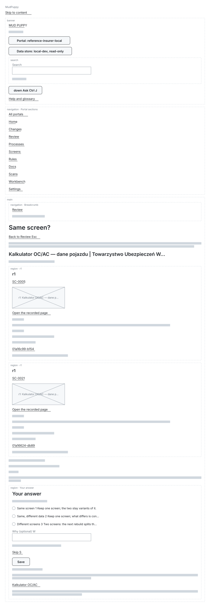

[edit in Excalidraw](images/wireframes/SCR-013.excalidraw)

**On screen:** MudPuppy (/app/portals/reference-insurer-local/same-screen)

1. `region "Your answer"`

Evidence:

- form `01a17541-10d4-7001-bef7-ce6452bfa668` — form: answer (run `01a1753d-a8da-7000-85d2-b19d666d3587`, map, 2026-10-25)
- network call `01a17541-10d7-7000-820d-edf753763279` — GET /api/portals/reference-insurer-local/same-screen (run `01a1753d-a8da-7000-85d2-b19d666d3587`, map, 2026-10-25)
- screen region `01a17541-107a-7000-8bc5-38e73949e5be` `region "Your answer"` — MudPuppy (/app/portals/reference-insurer-local/same-screen) (run `01a1753d-a8da-7000-85d2-b19d666d3587`, map, 2026-10-25)
- state `01a17541-107a-7000-8bc5-38e73949e5be` — MudPuppy (/app/portals/reference-insurer-local/same-screen) (run `01a1753d-a8da-7000-85d2-b19d666d3587`, map, 2026-10-25)
- transition `01a17541-10d6-7000-ad1b-fa4d4187e39e` — transition: "Same screen? 4" (run `01a1753d-a8da-7000-85d2-b19d666d3587`, map, 2026-10-25)

### SCR-014 — What changed (Changes)

**SCR-014** · rev 1 · draft · observed

> DRAFT — not confirmed by a reviewer

Changes the portal model found between model versions, filtered by range, kind and process, with a release and scan timeline.

**Purpose:** Breadcrumb "… / Changes", heading "What changed", link "Open Review", count line ("0 changes · 0 need you · 0 explained automatically"). Region "Range": combobox "From" ("Since the previous release", "The first scan", "Model version N · <time>"), text "Changes first seen after this point. A model version is built after each scan.", combobox "To" ("Now · Model version 4 · …" and older versions), button "Show"; textbox "Or from a date" (date) with button "From this date" (disabled with no date); combobox "Or from a scan" with button "From this scan". A release timeline per part ("Shell") links each release to ?from_date=<time> ("Changes from release <name> of Shell") and each scan ("AI scan <id>, <time>, completed|interrupted") to the scan; legend "Scans ■ AI · ◇ check". Heading "<n> changes", "Grouped by process, then screen. In each group, what needs you comes first.", navigation "Show" ("Needs you" ?show=needs, "Explained automatically" ?show=explained, "All"), comboboxes "Kind" ("Any kind", "New screen", "Variant", "New action", "Removed", "Leads elsewhere", "Result changed", "Rule broke") and "Process" ("All processes"), button "Filter". Empty state: "No change in this range. Changes start after the second scan."

**Route templates:**

- `/app/portals/reference-insurer-local/changes`

**Elements** (labels verbatim):

| Role | Label |
| --- | --- |
| heading | What changed |
| link | Open Review |
| region | Range |
| combobox | From |
| combobox | To |
| button | Show |
| textbox | Or from a date |
| button | From this date |
| combobox | Or from a scan |
| button | From this scan |
| link | Changes from release 7f03 of Shell |
| navigation | Show |
| combobox | Kind |
| combobox | Process |
| button | Filter |

**Data items shown:**

- [DI-016](07-data-dictionary.md#DI-016) From (Changes range start)
- [DI-017](07-data-dictionary.md#DI-017) To (Changes range end)
- [DI-018](07-data-dictionary.md#DI-018) Or from a date
- [DI-019](07-data-dictionary.md#DI-019) Or from a scan
- [DI-020](07-data-dictionary.md#DI-020) Kind (Changes filter)
- [DI-021](07-data-dictionary.md#DI-021) Process (Changes filter)

**Entry points:**

- link "Changes" in "Portal sections" (same-document navigation)
- ?from_date=<ISO time> links from the release timeline
- ?show=needs and ?show=explained links

**URLs observed** (verbatim):

- `http://127.0.0.1:8790/app/portals/reference-insurer-local/changes` (1 visit; via same_document)

**Business rules on this screen:**

- [BR-012](06-business-rules.md#BR-012) "From this date" needs a date
- [BR-013](06-business-rules.md#BR-013) Changes start after the second scan

**Terms shown:**

- [GL-008](08-glossary.md#GL-008) Variant
- [GL-009](08-glossary.md#GL-009) Release
- [GL-011](08-glossary.md#GL-011) Model version
- [GL-012](08-glossary.md#GL-012) Needs you
- [GL-021](08-glossary.md#GL-021) Check run

**Screenshot:**

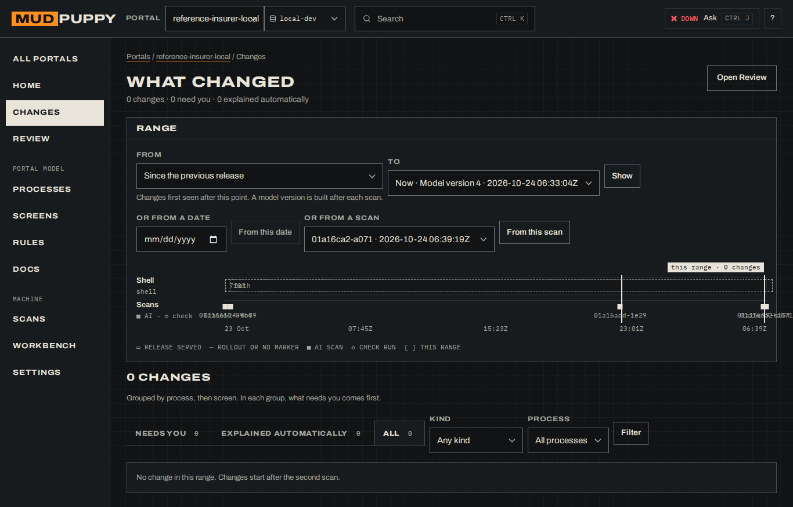

**Wireframe:**

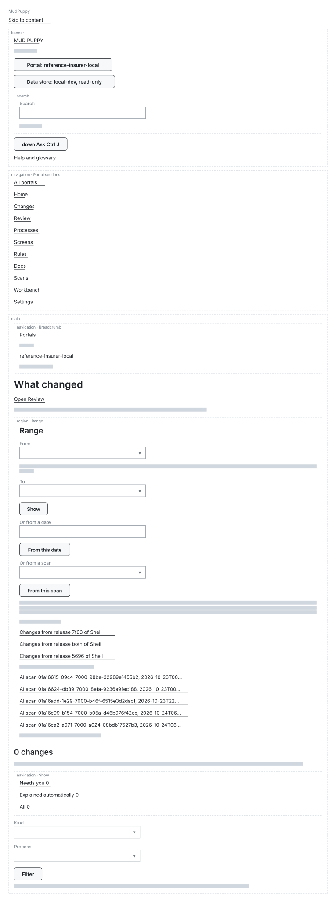

[edit in Excalidraw](images/wireframes/SCR-014.excalidraw)

**On screen:** MudPuppy (/app/portals/reference-insurer-local/changes)

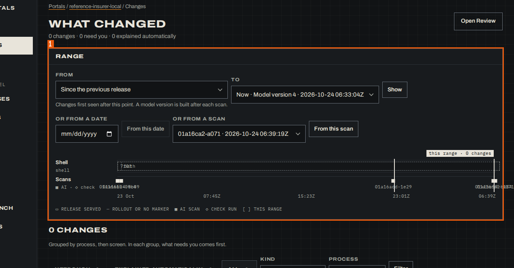

1. `region "Range"`

Evidence:

- form `01a1753e-d28c-7002-b104-aa10a48b549e` — form: _r_e_, _r_f_ (run `01a1753d-a8da-7000-85d2-b19d666d3587`, map, 2026-10-25)
- form `01a1753e-d28d-7000-82a7-3344e0a81e39` — form: _r_g_, _r_h_ (run `01a1753d-a8da-7000-85d2-b19d666d3587`, map, 2026-10-25)
- form `01a1753e-d28d-7001-9943-fd7669f61b5f` — form: _r_j_, _r_k_ (run `01a1753d-a8da-7000-85d2-b19d666d3587`, map, 2026-10-25)
- network call `01a1753e-d28f-7001-ab1c-af97196a82fc` — GET /api/portals/reference-insurer-local/changes (run `01a1753d-a8da-7000-85d2-b19d666d3587`, map, 2026-10-25)
- screen region `01a1753e-d243-7000-ba0d-fae46a006f7b` `region "Range"` — MudPuppy (/app/portals/reference-insurer-local/changes) (run `01a1753d-a8da-7000-85d2-b19d666d3587`, map, 2026-10-25)
- state `01a1753e-d243-7000-ba0d-fae46a006f7b` — MudPuppy (/app/portals/reference-insurer-local/changes) (run `01a1753d-a8da-7000-85d2-b19d666d3587`, map, 2026-10-25)
- transition `01a1753e-d28e-7000-bfe2-808bb4e20136` — transition: "Changes" (run `01a1753d-a8da-7000-85d2-b19d666d3587`, map, 2026-10-25)

### SCR-015 — Screens (list)

**SCR-015** · rev 1 · draft · observed

> DRAFT — not confirmed by a reviewer

Every screen of the portal model with status, variants, last seen, checked actions, part and process; filterable and sortable.

**Purpose:** Heading "Screens", count line ("21 active · 0 merged · 0 retired"), navigation "Screens views" ("List 21", "Map", "Recorded pages", "Access"). Form "Filter screens": group "Status" with toggle buttons "Active 21", "Merged 0", "Retired 0", "All 21"; searchbox "Key, title or route contains"; comboboxes "Part" ("Every part", "Shell"), "Has a variant of why" ("Any", "Release", "Persona", "Error", "A/B test", "Data", "Unknown") and "Sort" ("Needs you first", "Key", "Last seen", "Most variants", "Least checked"); button "Apply". Region "All screens · 21" with the table "All screens of reference-insurer-local" ("Screen", "Status", "Variants · why", "Last seen (UTC)", "Checked", "Part", "Process"): each row has a picture button ("…, enlarge"), the screen key link (e.g. "SC-0001" to the screen page with ?list=), title and route, status ("Active", optionally "Needs you · n"), variant count, last seen time, "Actions <checked> / <total> on <release>" with a progressbar, part and process.

**Route templates:**

- `/app/portals/reference-insurer-local/screens`

**Elements** (labels verbatim):

| Role | Label |
| --- | --- |
| heading | Screens |
| navigation | Screens views |
| link | List 21 |
| link | Map |
| link | Recorded pages |
| link | Access |
| form | Filter screens |
| button | Active 21 |
| button | Merged 0 |
| button | Retired 0 |
| button | All 21 |
| searchbox | Key, title or route contains |
| combobox | Part |
| combobox | Has a variant of why |
| combobox | Sort |
| button | Apply |
| table | All screens of reference-insurer-local |
| link | SC-0001 |

**Data items shown:**

- [DI-022](07-data-dictionary.md#DI-022) Key, title or route contains
- [DI-023](07-data-dictionary.md#DI-023) Part (Screens filter)
- [DI-024](07-data-dictionary.md#DI-024) Has a variant of why
- [DI-025](07-data-dictionary.md#DI-025) Sort (Screens)

**Entry points:**

- link "Screens" in "Portal sections" (same-document navigation)
- breadcrumb link "Screens" on the screen pages
- link "List" in "Screens views"

**URLs observed** (verbatim):

- `http://127.0.0.1:8790/app/portals/reference-insurer-local/screens` (2 visits; via same_document)

**Terms shown:**

- [GL-006](08-glossary.md#GL-006) Screen
- [GL-008](08-glossary.md#GL-008) Variant
- [GL-010](08-glossary.md#GL-010) Part
- [GL-032](08-glossary.md#GL-032) Explored and Checked
- [GL-034](08-glossary.md#GL-034) A/B cookies

**Screenshot:**

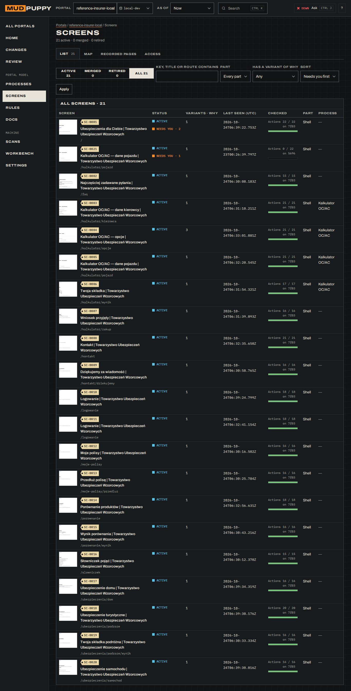

**Wireframe:**

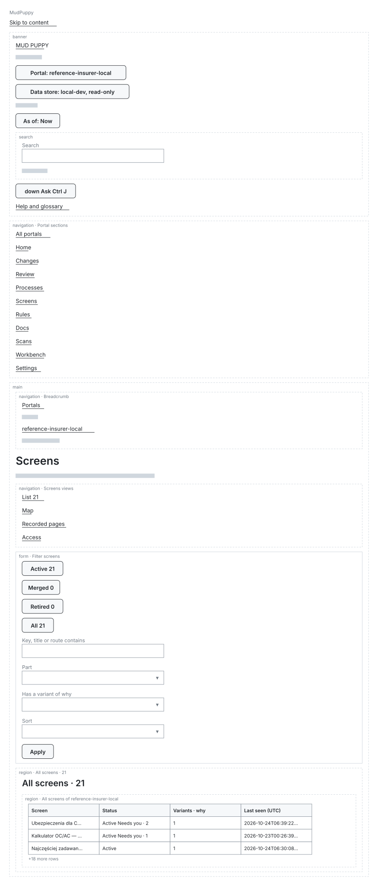

[edit in Excalidraw](images/wireframes/SCR-015.excalidraw)

**On screen:** MudPuppy (/app/portals/reference-insurer-local/screens)

1. `form "Filter screens"`

Evidence:

- form `01a1753e-e5c1-7001-9774-00d2070618b6` — form: q, _r_n_, _r_o_, _r_p_ (run `01a1753d-a8da-7000-85d2-b19d666d3587`, map, 2026-10-25)
- network call `01a1753e-e5c3-7001-9f60-4c300bcfcc60` — GET /api/portals/reference-insurer-local/screens (run `01a1753d-a8da-7000-85d2-b19d666d3587`, map, 2026-10-25) — note: GET /api/portals/{portal}/screens?status=&q=&process=&part=&why=&sort=
- screen region `01a1753e-e513-7001-9d79-59990eea7c3e` `form "Filter screens"` — MudPuppy (/app/portals/reference-insurer-local/screens) (run `01a1753d-a8da-7000-85d2-b19d666d3587`, map, 2026-10-25)
- state `01a1753e-e513-7001-9d79-59990eea7c3e` — MudPuppy (/app/portals/reference-insurer-local/screens) (run `01a1753d-a8da-7000-85d2-b19d666d3587`, map, 2026-10-25)
- transition `01a1753e-e5c2-7000-b47d-f8d4b191666d` — transition: "Screens" (run `01a1753d-a8da-7000-85d2-b19d666d3587`, map, 2026-10-25)

### SCR-016 — Screen (detail)

**SCR-016** · rev 1 · draft · observed

> DRAFT — not confirmed by a reviewer

One screen of the portal model with what needs the BA there and the tabs Variants, Actions, Amendments and History.

**Purpose:** Breadcrumb "… / Screens / <key>", heading "<key> <title>" (e.g. "SC-0001 …"). When opened from the list (?list=) the navigation "Screens in this list" shows "← Previous" (disabled on the first), the position ("1 of 21") and "Next: <title>" ("Next →"). A line gives route, part, status, last seen, "Checked 22 / 22 actions" and "Reached at <address>". Region "Needs you on this screen" (list "What needs you on this screen"). Tablist "Screen sections": "Variants 1" (region "Variants": per variant a region "r1" with heading, reason ("Baseline"), picture button, releases, personas, visits, period, status "Observed" and explanation "The first way the screen was seen."; "One variant so far. A second one appears here when a scan sees this screen differently (another release, persona or state)."), "Actions 22" (table "Actions on SC-0001": "Action", "Kind", "Status", "Leads to"; leads-to cells link target screens or say "not tried yet" / "inside this screen"; menu actions are marked "on every page"), "Amendments 0", "History 2" (region "Changes", list "Changes on this screen": kind, status, model version, time, claim). Choosing a tab sets ?tab=actions or ?tab=history.

**Route templates:**

- `/app/portals/:portal/screens/:screen`

**Elements** (labels verbatim):

| Role | Label |
| --- | --- |
| heading | SC-0001 Ubezpieczenia dla Ciebie \| Towarzystwo Ubezpieczeń Wzorcowych |
| navigation | Screens in this list |
| link | ← Previous |
| region | Needs you on this screen |
| tablist | Screen sections |
| tab | Variants 1 |
| tab | Actions 22 |
| tab | Amendments 0 |
| tab | History 2 |
| region | Variants |
| table | Actions on SC-0001 |
| list | Changes on this screen |

**Data items shown:**

_none recorded_

**Entry points:**

- screen key link in the Screens table, e.g. /app/portals/reference-insurer-local/screens/SC-0001?list=
- tab "Actions 22": /screens/SC-0001?tab=actions
- tab "History 2": /screens/SC-0001?tab=history
- screen key links ("SC-0005" …) in the Actions tab and on Same screen?

**URLs observed** (verbatim):

- `http://127.0.0.1:8790/app/portals/reference-insurer-local/screens/SC-0001?list=` (1 visit; via same_document)
- `http://127.0.0.1:8790/app/portals/reference-insurer-local/screens/SC-0001?tab=actions` (1 visit; via same_document)
- `http://127.0.0.1:8790/app/portals/reference-insurer-local/screens/SC-0001?tab=history` (1 visit; via same_document)

**URL parameters:**

| Name | In | Values seen | Distinct |
| --- | --- | --- | --- |
| `list` | query | `` | 1 |
| `tab` | query | `actions`, `history` | 2 |

**Business rules on this screen:**

- [BR-027](06-business-rules.md#BR-027) Screen pages step through the list they came from

**Terms shown:**

- [GL-006](08-glossary.md#GL-006) Screen
- [GL-008](08-glossary.md#GL-008) Variant
- [GL-012](08-glossary.md#GL-012) Needs you
- [GL-029](08-glossary.md#GL-029) Amendment
- [GL-032](08-glossary.md#GL-032) Explored and Checked

**Screenshot:**

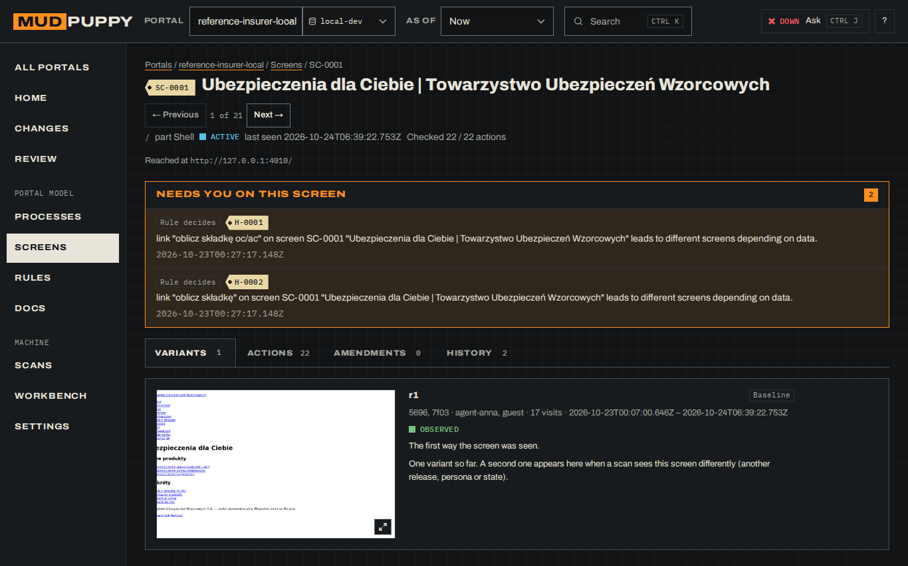

**Wireframe:**

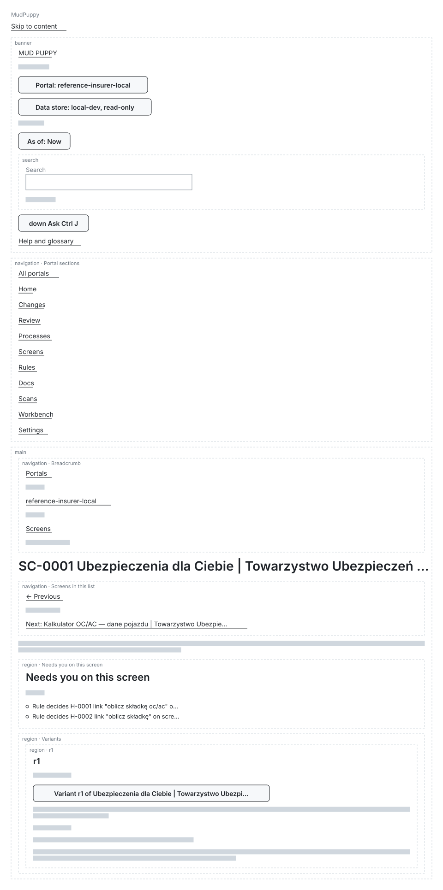

[edit in Excalidraw](images/wireframes/SCR-016.excalidraw)

**On screen:** MudPuppy (/app/portals/:portal/screens/:screen)

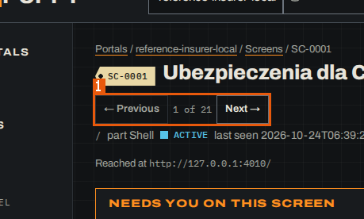

1. `navigation "Screens in this list"`

Evidence:

- network call `01a1753e-f875-7000-85db-48752d2b0190` — GET /api/portals/reference-insurer-local/screens/SC-0001 (run `01a1753d-a8da-7000-85d2-b19d666d3587`, map, 2026-10-25)
- network call `01a1753e-f875-7001-a801-d6ce20815c08` — GET /api/portals/reference-insurer-local/screens/SC-0001/recordings (run `01a1753d-a8da-7000-85d2-b19d666d3587`, map, 2026-10-25)
- screen region `01a1753e-f830-7000-9785-ac5128aa7dbb` `navigation "Screens in this list"` — MudPuppy (/app/portals/:portal/screens/:screen) (run `01a1753d-a8da-7000-85d2-b19d666d3587`, map, 2026-10-25)
- state `01a1753e-f830-7000-9785-ac5128aa7dbb` — MudPuppy (/app/portals/:portal/screens/:screen) (run `01a1753d-a8da-7000-85d2-b19d666d3587`, map, 2026-10-25) — note: Variants tab
- state `01a1753f-03a2-7000-8f11-81d64244d7fe` — MudPuppy (/app/portals/:portal/screens/:screen) (run `01a1753d-a8da-7000-85d2-b19d666d3587`, map, 2026-10-25) — note: Actions tab
- state `01a1753f-1099-7000-b1ae-03ec2f5b52bb` — MudPuppy (/app/portals/:portal/screens/:screen) (run `01a1753d-a8da-7000-85d2-b19d666d3587`, map, 2026-10-25) — note: History tab
- transition `01a1753e-f873-7000-9c8f-4223c3d7860d` — transition: "SC-0001" (run `01a1753d-a8da-7000-85d2-b19d666d3587`, map, 2026-10-25)
- transition `01a1753f-0442-7000-8b1d-132689c5be98` — transition: "Actions 22" (run `01a1753d-a8da-7000-85d2-b19d666d3587`, map, 2026-10-25)
- transition `01a1753f-10cb-7000-b4c6-02e7f40ee419` — transition: "History 2" (run `01a1753d-a8da-7000-85d2-b19d666d3587`, map, 2026-10-25)

### SCR-017 — Screens map

**SCR-017** · rev 1 · draft · observed

> DRAFT — not confirmed by a reviewer

Graph of the portal's screens and the links between them, with views, process overlay, layers and zoom.

**Purpose:** Breadcrumb "… / Screens / Map", heading "Map", line "21 active screens · 23 links · now", navigation "Screens views". Group "View": buttons "Now" (pressed), "Since previous release", "One scan's path". Combobox "Overlay a process" ("None", process names). Group "Layers": checkboxes "Retired links", "Not seen since" (checked), "Not checked" (checked). Group "Show as": "Graph" (pressed), "List". Group "Bundled links" ("Menu on every page · 10 links · bundled"). Toolbar "Zoom the map": "Zoom out", "Zoom 80%, reset to 100%", "Zoom in", "Fit", "Full screen". Region "Map of reference-insurer-local now" with one button per screen (route, title, "<n> actions inside"). List "Link states": "Active", "Process overlay", "Changed link", "Not seen since", "Not checked", "Retired", "Error". Legend text: "Not seen since: the link was missing on later visits. Not checked: not followed yet on the part's current release. Retired links are kept; the Retired links layer shows them. Bold boxes are the overlaid process's screens, faint boxes are outside it. Actions inside a screen are counted on its box, never drawn as links." Hint "Click a screen to inspect · arrows move along links". Region "Inspector" ("Select a screen to see its variants, actions, links and changes.").

**Route templates:**

- `/app/portals/:portal/screens/:screen`

**Elements** (labels verbatim):

| Role | Label |
| --- | --- |
| heading | Map |
| button | Now |
| button | Since previous release |
| button | One scan's path |
| combobox | Overlay a process |
| checkbox | Retired links |
| checkbox | Not seen since |
| checkbox | Not checked |
| button | Graph |
| button | List |
| button | Zoom out |
| button | Zoom in |
| button | Fit |
| button | Full screen |
| region | Map of reference-insurer-local now |
| list | Link states |
| region | Inspector |

**Data items shown:**

- [DI-026](07-data-dictionary.md#DI-026) Overlay a process (Map)
- [DI-027](07-data-dictionary.md#DI-027) Retired links (Map layer)
- [DI-028](07-data-dictionary.md#DI-028) Not seen since (Map layer)
- [DI-029](07-data-dictionary.md#DI-029) Not checked (Map layer)

**Entry points:**

- link "Map" in "Screens views": /app/portals/reference-insurer-local/screens/map
- link "One scan's path" on Plan next scan: /screens/map?view=path (seen, not followed)

**URLs observed** (verbatim):

- `http://127.0.0.1:8790/app/portals/reference-insurer-local/screens/map` (1 visit; via same_document)

**Terms shown:**

- [GL-006](08-glossary.md#GL-006) Screen
- [GL-027](08-glossary.md#GL-027) Link states (Not seen since, Not checked, Retired)

**Screenshot:**

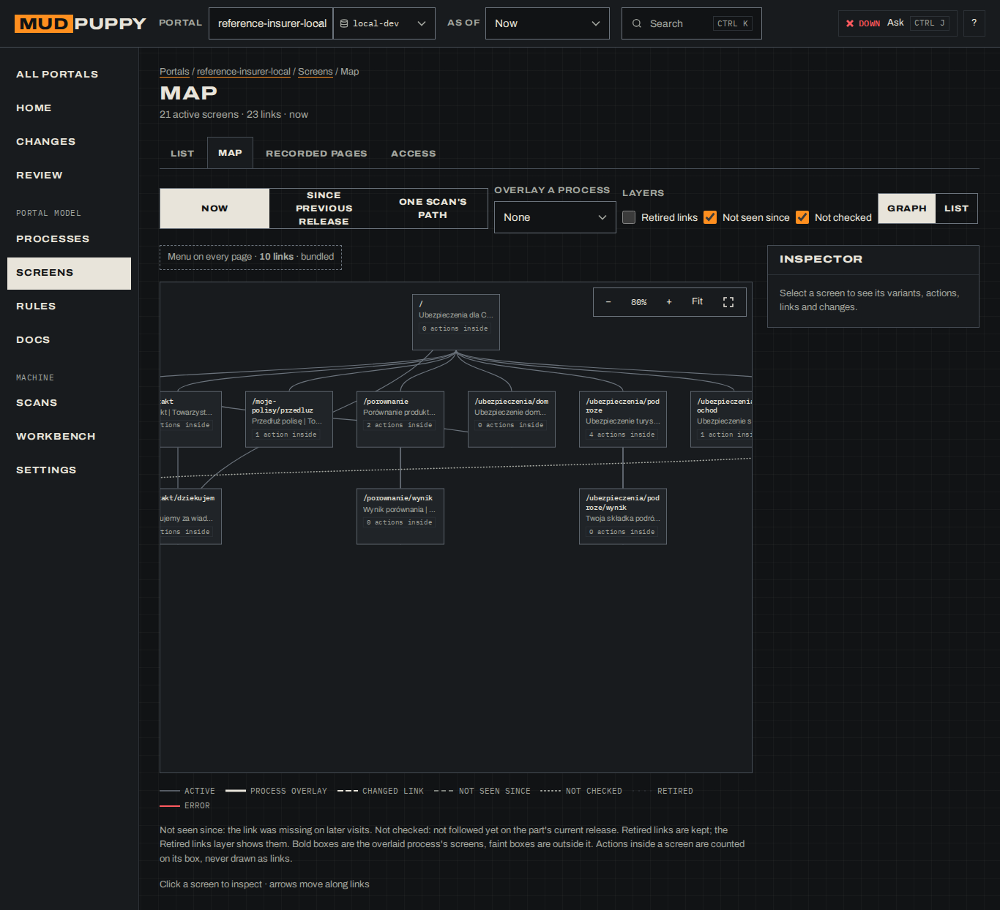

**Wireframe:**

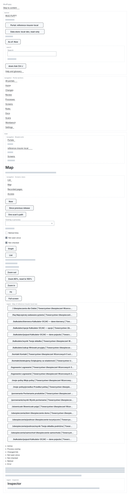

[edit in Excalidraw](images/wireframes/SCR-017.excalidraw)

**On screen:** MudPuppy (/app/portals/:portal/screens/:screen)

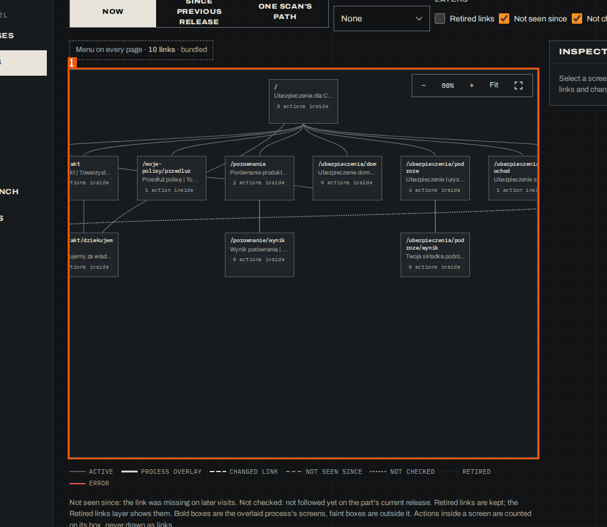

1. `region "Map of reference-insurer-local now"`

Evidence:

- form `01a1753f-4445-7001-88ad-d23c76be9ab6` — form: _r_b_, Retired links, Not seen since, Not checked (run `01a1753d-a8da-7000-85d2-b19d666d3587`, map, 2026-10-25)
- network call `01a1753f-4449-7000-bebf-d0b4c1bb61a9` — GET /api/portals/reference-insurer-local/map (run `01a1753d-a8da-7000-85d2-b19d666d3587`, map, 2026-10-25)
- screen region `01a1753f-43e8-7000-ac2e-51e68ab95975` `region "Map of reference-insurer-local now"` — MudPuppy (/app/portals/:portal/screens/:screen) (run `01a1753d-a8da-7000-85d2-b19d666d3587`, map, 2026-10-25)
- state `01a1753f-43e8-7000-ac2e-51e68ab95975` — MudPuppy (/app/portals/:portal/screens/:screen) (run `01a1753d-a8da-7000-85d2-b19d666d3587`, map, 2026-10-25)
- transition `01a1753f-4447-7000-9fbb-4c966155632d` — transition: "Map" (run `01a1753d-a8da-7000-85d2-b19d666d3587`, map, 2026-10-25)

### SCR-018 — Recorded pages

**SCR-018** · rev 1 · draft · observed

> DRAFT — not confirmed by a reviewer

Every recorded page (state) of the portal with confidence, form-probe status, scans, personas and last seen.

**Purpose:** Link "Back to Screens Map", breadcrumb "… / Screens / Recorded pages", heading "Recorded pages", line "23 recorded pages · 7 form steps: 0 marked for probing, 7 not probed", navigation "Screens views". Search "Filter recorded pages" with searchbox "Title or route contains" and button "Filter". Region "Recorded pages · 23" with the table "Recorded pages of reference-insurer-local" ("Picture", "Title", "Confidence", "Form probes", "Scans", "Personas", "Last seen (UTC)"): picture button, title link to the recorded state (/app/states/<id>) and route, "Observed", "Not probed" or "—", scan count, persona names, time.

**Route templates:**

- `/app/portals/:portal/screens/:screen`

**Elements** (labels verbatim):

| Role | Label |
| --- | --- |
| link | Back to Screens Map |
| heading | Recorded pages |
| search | Filter recorded pages |
| searchbox | Title or route contains |
| button | Filter |
| table | Recorded pages of reference-insurer-local |

**Data items shown:**

- [DI-030](07-data-dictionary.md#DI-030) Title or route contains (Recorded pages)

**Entry points:**

- link "Recorded pages" in "Screens views": /app/portals/reference-insurer-local/screens/recorded
- link "Show all in Screens" on Processes

**URLs observed** (verbatim):

- `http://127.0.0.1:8790/app/portals/reference-insurer-local/screens/recorded` (1 visit; via same_document)

**Terms shown:**

- [GL-007](08-glossary.md#GL-007) Recorded page
- [GL-022](08-glossary.md#GL-022) Form probe

**Screenshot:**

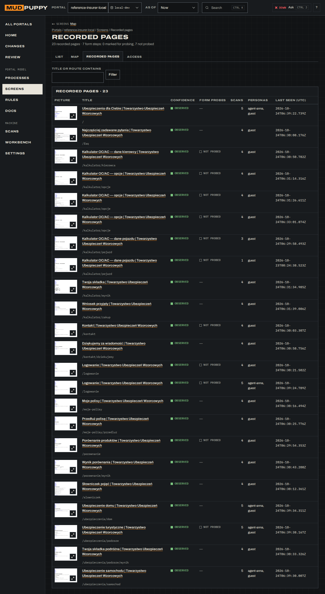

**Wireframe:**

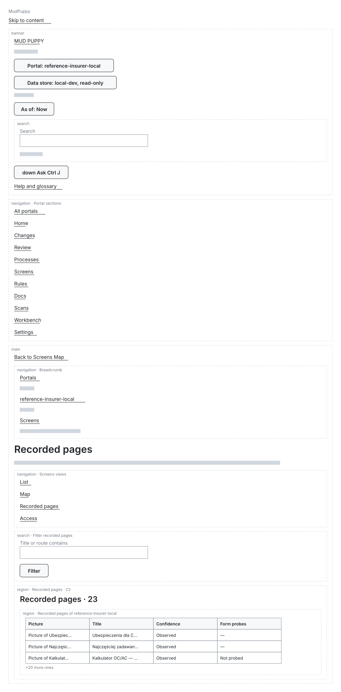

[edit in Excalidraw](images/wireframes/SCR-018.excalidraw)

**On screen:** MudPuppy (/app/portals/:portal/screens/:screen)

1. `table "Recorded pages of reference-insurer-local"`

Evidence:

- form `01a1753f-5850-7000-bb6b-21145c928e6a` — form: q (run `01a1753d-a8da-7000-85d2-b19d666d3587`, map, 2026-10-25)
- network call `01a1753f-5852-7000-ad88-822d861f30e5` — GET /api/portals/reference-insurer-local/screens/recorded (run `01a1753d-a8da-7000-85d2-b19d666d3587`, map, 2026-10-25)
- screen region `01a1753f-57a7-7000-8873-02b7af26db70` `table "Recorded pages of reference-insurer-local"` — MudPuppy (/app/portals/:portal/screens/:screen) (run `01a1753d-a8da-7000-85d2-b19d666d3587`, map, 2026-10-25)
- state `01a1753f-57a7-7000-8873-02b7af26db70` — MudPuppy (/app/portals/:portal/screens/:screen) (run `01a1753d-a8da-7000-85d2-b19d666d3587`, map, 2026-10-25)
- transition `01a1753f-5851-7000-87bc-12e53bf3a3d8` — transition: "Recorded pages" (run `01a1753d-a8da-7000-85d2-b19d666d3587`, map, 2026-10-25)

### SCR-019 — Access by persona

**SCR-019** · rev 1 · draft · observed

> DRAFT — not confirmed by a reviewer

Matrix of which persona reached which screen and which elements differ between personas.

**Purpose:** Link "Back to Screens Recorded pages", breadcrumb "Screens / Access", heading "Access by persona", line "reference-insurer-local · 21 screens · 2 personas", navigation "Screens views". Region with the table "Which persona reached which screen of reference-insurer-local": columns "Screen", one column per persona with its attributes ("agent-anna no attributes", "guest no attributes"), "Elements that differ" ("0 of 19") and "Access" ("Same for all"). A cell is "Reached" (link to the persona's state), "Reached trace only" or "—".

**Route templates:**

- `/app/portals/:portal/screens/:screen`

**Elements** (labels verbatim):

| Role | Label |
| --- | --- |
| link | Back to Screens Recorded pages |
| heading | Access by persona |
| table | Which persona reached which screen of reference-insurer-local |
| link | Reached |

**Data items shown:**

_none recorded_

**Entry points:**

- link "Access" in "Screens views": /app/portals/reference-insurer-local/screens/access

**URLs observed** (verbatim):

- `http://127.0.0.1:8790/app/portals/reference-insurer-local/screens/access` (1 visit; via same_document)

**Terms shown:**

- [GL-003](08-glossary.md#GL-003) Persona

**Screenshot:**

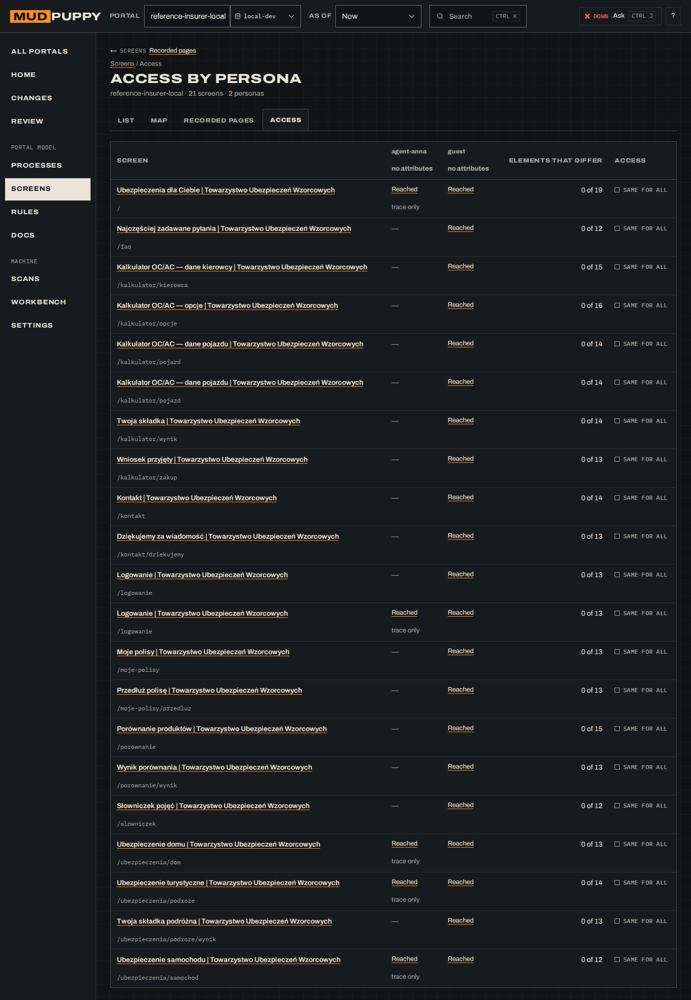

**Wireframe:**

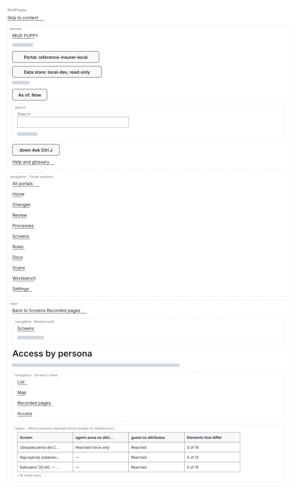

[edit in Excalidraw](images/wireframes/SCR-019.excalidraw)

**On screen:** MudPuppy (/app/portals/:portal/screens/:screen)

1. `table "Which persona reached which screen of reference-insurer-local"`

Evidence:

- network call `01a1753f-67df-7001-934e-527499224826` — GET /api/portals/reference-insurer-local/access (run `01a1753d-a8da-7000-85d2-b19d666d3587`, map, 2026-10-25)
- screen region `01a1753f-6776-7000-a694-c3729d0f132f` `table "Which persona reached which screen of reference-insurer-local"` — MudPuppy (/app/portals/:portal/screens/:screen) (run `01a1753d-a8da-7000-85d2-b19d666d3587`, map, 2026-10-25)
- state `01a1753f-6776-7000-a694-c3729d0f132f` — MudPuppy (/app/portals/:portal/screens/:screen) (run `01a1753d-a8da-7000-85d2-b19d666d3587`, map, 2026-10-25)
- transition `01a1753f-67de-7000-9ec8-390898841648` — transition: "Access" (run `01a1753d-a8da-7000-85d2-b19d666d3587`, map, 2026-10-25)

### SCR-020 — Business rules (Rules)

**SCR-020** · rev 1 · draft · observed

> DRAFT — not confirmed by a reviewer

Decision-table rules the system mined from the portal's behaviour, with a button to run their tests.

**Purpose:** Breadcrumb "… / Rules", heading "Business rules", count "0 rules", text "Each rule is a decision table the system found from the portal's behaviour. Check runs test it at its boundaries.", button "Run the rule tests". Empty state: "No business rule yet. Where an action leads to different screens depending on what was typed, mining finds the rule: pnpm model:mine reference-insurer-local . Check runs then test it: pnpm model:replay reference-insurer-local ." The rules API also returns export links (zip, csv) and a writes flag.

**Route templates:**

- `/app/portals/reference-insurer-local/rules`

**Elements** (labels verbatim):

| Role | Label |
| --- | --- |
| heading | Business rules |
| button | Run the rule tests |

**Data items shown:**

_none recorded_

**Entry points:**

- link "Rules" in "Portal sections" (same-document navigation)

**URLs observed** (verbatim):

- `http://127.0.0.1:8790/app/portals/reference-insurer-local/rules` (1 visit; via same_document)

**Terms shown:**

- [GL-021](08-glossary.md#GL-021) Check run
- [GL-028](08-glossary.md#GL-028) Mined business rule (decision table)

**Open questions about this:**

- [OQ-004](10-assumptions-and-questions.md#OQ-004) Which console pages were not reached?

**Screenshot:**

**Wireframe:**

[edit in Excalidraw](images/wireframes/SCR-020.excalidraw)

**On screen:** MudPuppy (/app/portals/reference-insurer-local/rules)

1. `button "Run the rule tests"`

Evidence:

- network call `01a1753f-7760-7000-afb7-41043d436301` — GET /api/portals/reference-insurer-local/rules (run `01a1753d-a8da-7000-85d2-b19d666d3587`, map, 2026-10-25)
- screen region `01a1753f-772d-7000-80bb-2be92ae58bc4` `button "Run the rule tests"` — MudPuppy (/app/portals/reference-insurer-local/rules) (run `01a1753d-a8da-7000-85d2-b19d666d3587`, map, 2026-10-25)
- state `01a1753f-772d-7000-80bb-2be92ae58bc4` — MudPuppy (/app/portals/reference-insurer-local/rules) (run `01a1753d-a8da-7000-85d2-b19d666d3587`, map, 2026-10-25)
- transition `01a1753f-775f-7000-a28a-4a1d15778f7c` — transition: "Rules" (run `01a1753d-a8da-7000-85d2-b19d666d3587`, map, 2026-10-25)

### SCR-021 — Docs (documentation overview)

**SCR-021** · rev 1 · draft · observed

> DRAFT — not confirmed by a reviewer

Read-only overview of a portal's documentation: records by section, status counts and the analysis sessions that wrote them.

**Purpose:** Breadcrumb "… / Docs", heading "<portal> documentation", text "Read-only: the BA agent writes it from the recorded scans; a person reviews each record." Region "Overview" ("Documentation of … reconstructed from recorded scan evidence. Every statement cites evidence; anything the crawler could not observe is marked Not observed and has an open question."), a status count ("134 Draft"), the table "Records by section" ("Section", "Records") with links per section (?section=capabilities, screens, processes, requirements, rules, data, glossary, nfr, assumptions, questions, followups), heading "Analysis sessions" with the table "Analysis sessions" ("Session", "Status", "Started (UTC)", "Summary"; the session link is the shortened session id). Region "Sections" with the list "Documentation sections" ("Overview", "Capabilities", "Screens", "Processes and use cases", "Requirements", "Business rules", "Data dictionary", "Glossary", "Non-functional", "Assumptions", "Open questions", "Follow-up tasks", "Traceability"), each with a count.

**Route templates:**

- `/app/portals/reference-insurer-local/docs`

**Elements** (labels verbatim):

| Role | Label |
| --- | --- |
| heading | reference-insurer-local documentation |
| region | Overview |
| table | Records by section |
| link | Capabilities |
| link | Business rules |
| link | Data dictionary |
| table | Analysis sessions |
| list | Documentation sections |
| link | Traceability |

**Data items shown:**

_none recorded_

**Entry points:**

- link "Docs" in "Portal sections" (same-document navigation, also opened directly)
- breadcrumb link "Docs" on a session or record page
- ?section=<section> links (seen, not followed)

**URLs observed** (verbatim):

- `http://127.0.0.1:8790/app/portals/reference-insurer-local/docs` (3 visits; via same_document)

**Business rules on this screen:**

- [BR-033](06-business-rules.md#BR-033) Documentation is written by the BA agent and reviewed by a person

**Terms shown:**

- [GL-026](08-glossary.md#GL-026) Analysis session

**Screenshot:**

**Wireframe:**

[edit in Excalidraw](images/wireframes/SCR-021.excalidraw)

**On screen:** MudPuppy (/app/portals/reference-insurer-local/docs)

1. `table "Records by section"`

Evidence:

- network call `01a1753f-8950-7000-b7dd-4ad6d9e9ed71` — GET /api/portals/reference-insurer-local/docs (run `01a1753d-a8da-7000-85d2-b19d666d3587`, map, 2026-10-25)
- screen region `01a1753f-88ed-7000-8899-2ac9d81c7464` `table "Records by section"` — MudPuppy (/app/portals/reference-insurer-local/docs) (run `01a1753d-a8da-7000-85d2-b19d666d3587`, map, 2026-10-25)
- state `01a1753f-88ed-7000-8899-2ac9d81c7464` — MudPuppy (/app/portals/reference-insurer-local/docs) (run `01a1753d-a8da-7000-85d2-b19d666d3587`, map, 2026-10-25)
- transition `01a1753f-894f-7000-b970-1bea013ed5ae` — transition: "Docs" (run `01a1753d-a8da-7000-85d2-b19d666d3587`, map, 2026-10-25)
- transition `01a1753f-d13a-7000-a2a0-56b8e8e2d3ba` — transition: "Docs" (run `01a1753d-a8da-7000-85d2-b19d666d3587`, map, 2026-10-25)

### SCR-022 — Analysis session

**SCR-022** · rev 1 · draft · observed

> DRAFT — not confirmed by a reviewer

One BA analysis session: its input scans, the passes with their summaries, the records it wrote and its gaps.

**Purpose:** Breadcrumb "… / Docs / Session", heading "Analysis session". Region "Session": status ("Completed"), terms "Id", "Portal", "Started (UTC)", "Ended (UTC)" and the session summary. Region "Input scans · 2" with the table "Scans this session read" ("Scan", "Mode", "Persona", "Status", "Started (UTC)"). Region "Passes · 7" with the table "Analysis passes completed" ("Pass", "Summary", "Completed (UTC)"; passes inventory, capabilities, processes, rules, data, nfr, synthesis). Region "Records written · 81" with the table "Records this session created or revised" ("Record", "Change", "Status now", "Confidence"), paged by the navigation "Pages" ("Page 1 · 81 in all", button "Next"). Region "Gaps · 9" with one paragraph per gap.

**Route templates:**

- `/app/portals/reference-insurer-local/docs/sessions/:param`

**Elements** (labels verbatim):

| Role | Label |
| --- | --- |
| heading | Analysis session |
| region | Session |
| table | Scans this session read |
| table | Analysis passes completed |
| table | Records this session created or revised |
| navigation | Pages |
| button | Next |
| region | Gaps · 9 |

**Data items shown:**

- [DI-079](07-data-dictionary.md#DI-079) Analysis session id in the Docs address

**Entry points:**

- session link in the table "Analysis sessions" on Docs (/docs/sessions/<session id>)
- link "Back to Session Analysis session" on a record page

**URLs observed** (verbatim):

- `http://127.0.0.1:8790/app/portals/reference-insurer-local/docs/sessions/01a16628-bf66-7000-9d7c-e731b752c3df` (1 visit; via same_document)

**Terms shown:**

- [GL-026](08-glossary.md#GL-026) Analysis session

**Screenshot:**

**Wireframe:**

[edit in Excalidraw](images/wireframes/SCR-022.excalidraw)

**On screen:** MudPuppy (/app/portals/reference-insurer-local/docs/sessions/:param)

1. `table "Records this session created or revised"`

Evidence:

- network call `01a1753f-e18c-7001-ab4c-84a8fb498575` — GET /api/portals/reference-insurer-local/docs/sessions/:param (run `01a1753d-a8da-7000-85d2-b19d666d3587`, map, 2026-10-25)
- screen region `01a1753f-e0df-7000-a288-35e0110648bb` `table "Records this session created or revised"` — MudPuppy (/app/portals/reference-insurer-local/docs/sessions/:param) (run `01a1753d-a8da-7000-85d2-b19d666d3587`, map, 2026-10-25)
- state `01a1753f-e0df-7000-a288-35e0110648bb` — MudPuppy (/app/portals/reference-insurer-local/docs/sessions/:param) (run `01a1753d-a8da-7000-85d2-b19d666d3587`, map, 2026-10-25)
- transition `01a1753f-e18b-7000-a37d-8086b5d43068` — transition: "01a16628-bf66…" (run `01a1753d-a8da-7000-85d2-b19d666d3587`, map, 2026-10-25)

### SCR-023 — Documentation record

**SCR-023** · rev 1 · draft · observed

> DRAFT — not confirmed by a reviewer

One documentation record: content, screenshots with marked elements, evidence, relations, revisions and the review panel.

**Purpose:** Link "Back to Session Analysis session" (when opened from a session), breadcrumb "… / Docs / <key>", heading "<key> <title>" (e.g. "BR-001 All vehicle fields are required"). Region "Content" (statement and kind-specific terms such as "Rule type"), a group "Screens <n> Hide" with screenshot figures whose numbered marks match the cited elements. Region "Evidence · <n>" with the table "Evidence cited by revision <n>" ("Target", "What it supports", "Scan"). Region "Relations" with the table "Relations of <key>" ("Direction", "Type", "Record", "Status"). Region "Revision history · <n>" with the table "Every revision of <key>, newest first" ("Rev", "Status", "Confidence", "Change", "Session", "Reviews"; older revisions link to ?rev=<n>). Region "Record" (status, confidence, "Id", "Kind", "Revision", "Change", "Analysis session", "Written (UTC)", change note). Region "Review": "Reviews apply to the latest revision, <n> (draft).", button "Confirm rev <n>", textbox "Reason (required to reject)", button "Reject rev <n>" (disabled while the reason is empty), textbox "Comment (required)", button "Comment" (disabled while the comment is empty), heading "Decisions on revision <n>" ("No review yet. Confirm, reject with a reason, or comment; the decision is recorded with your name.").

**Route templates:**

- `/app/portals/:portal/docs/:key`

**Elements** (labels verbatim):

| Role | Label |
| --- | --- |
| link | Back to Session Analysis session |
| heading | BR-001 All vehicle fields are required |
| region | Content |
| table | Evidence cited by revision 2 |
| table | Relations of BR-001 |
| table | Every revision of BR-001, newest first |
| link | rev 1 |
| region | Record |
| region | Review |
| button | Confirm rev 2 |
| textbox | Reason (required to reject) |
| button | Reject rev 2 |
| textbox | Comment (required) |
| button | Comment |

**Data items shown:**

- [DI-031](07-data-dictionary.md#DI-031) Reason (required to reject)
- [DI-032](07-data-dictionary.md#DI-032) Comment (required)

**Entry points:**

- record key link on an Analysis session, e.g. /app/portals/reference-insurer-local/docs/BR-001
- record link in Search results, e.g. /docs/BR-016
- record links on the process steps
- ?rev=<n> for an older revision

**URLs observed** (verbatim):

- `http://127.0.0.1:8790/app/portals/reference-insurer-local/docs/BR-001` (1 visit; via same_document)
- `http://127.0.0.1:8790/app/portals/reference-insurer-local/docs/BR-016` (1 visit; via same_document)

**Business rules on this screen:**

- [BR-006](06-business-rules.md#BR-006) Rejecting a record needs a reason
- [BR-007](06-business-rules.md#BR-007) A comment needs text
- [BR-008](06-business-rules.md#BR-008) Reviews apply to the latest revision
- [BR-033](06-business-rules.md#BR-033) Documentation is written by the BA agent and reviewed by a person

**Processes through this screen:**

- [PROC-002](04-processes-and-use-cases.md#PROC-002) Review

**Open questions about this:**

- [OQ-002](10-assumptions-and-questions.md#OQ-002) What do the console's write actions do?

**Screenshot:**

**Wireframe:**

[edit in Excalidraw](images/wireframes/SCR-023.excalidraw)

**On screen:** MudPuppy (/app/portals/:portal/docs/:key)

1. `region "Review"`

Evidence:

- form `01a1753f-f2b4-7001-b5b5-44935a4bdc77` — form: _r_p_, _r_q_ (run `01a1753d-a8da-7000-85d2-b19d666d3587`, map, 2026-10-25)
- network call `01a1753f-f2b6-7001-9003-7839b398106d` — GET /api/portals/reference-insurer-local/docs/BR-001 (run `01a1753d-a8da-7000-85d2-b19d666d3587`, map, 2026-10-25)
- screen region `01a1753f-f23f-7000-9333-d142f8824a10` `region "Review"` — MudPuppy (/app/portals/:portal/docs/:key) (run `01a1753d-a8da-7000-85d2-b19d666d3587`, map, 2026-10-25)
- state `01a1753f-f23f-7000-9333-d142f8824a10` — MudPuppy (/app/portals/:portal/docs/:key) (run `01a1753d-a8da-7000-85d2-b19d666d3587`, map, 2026-10-25)
- state `01a17541-e95b-7000-b533-607be7fc1be5` — MudPuppy (/app/portals/:portal/docs/:key) (run `01a1753d-a8da-7000-85d2-b19d666d3587`, map, 2026-10-25) — note: second record opened from Search, same cluster
- transition `01a1753f-f2b5-7000-b364-13bf609d9018` — transition: "BR-001" (run `01a1753d-a8da-7000-85d2-b19d666d3587`, map, 2026-10-25)

### SCR-024 — Scans (list)

**SCR-024** · rev 1 · draft · observed

> DRAFT — not confirmed by a reviewer

Scans of the portal, newest first, with persona, kind, status, steps and start time.

**Purpose:** Breadcrumb "… / Scans", heading "Scans", link "Plan next scan", line "5 scans · 0 running", navigation "Scans views" ("All scans", "By process", "Server activity"). Region "Newest scans" with the table "Scans of reference-insurer-local" ("Scan", "Persona", "Kind", "Status", "Steps", "Started (UTC)"): the short scan id links to the scan, a "Copy" button copies the full id; status values seen "Interrupted" and "Completed"; steps as "<used> / <max>" (e.g. "49 / 400").

**Route templates:**

- `/app/portals/reference-insurer-local/scans`

**Elements** (labels verbatim):

| Role | Label |
| --- | --- |
| heading | Scans |
| link | Plan next scan |
| navigation | Scans views |
| link | All scans |
| link | By process |
| link | Server activity |
| table | Scans of reference-insurer-local |

**Data items shown:**

- [DI-080](07-data-dictionary.md#DI-080) Scan id in the scan address

**Entry points:**

- link "Scans" in "Portal sections" (same-document navigation, also opened directly)
- link "All scans" in "Scans views"
- breadcrumb link "Scans"

**URLs observed** (verbatim):

- `http://127.0.0.1:8790/app/portals/reference-insurer-local/scans` (3 visits; via same_document)

**Terms shown:**

- [GL-003](08-glossary.md#GL-003) Persona
- [GL-004](08-glossary.md#GL-004) Scan (run)
- [GL-005](08-glossary.md#GL-005) Mode (map, trace)

**Screenshot:**

**Wireframe:**

[edit in Excalidraw](images/wireframes/SCR-024.excalidraw)

**On screen:** MudPuppy (/app/portals/reference-insurer-local/scans)

1. `table "Scans of reference-insurer-local"`

Evidence:

- network call `01a17540-1574-7000-868a-fea0f64f7a01` — GET /api/portals/reference-insurer-local/scans (run `01a1753d-a8da-7000-85d2-b19d666d3587`, map, 2026-10-25)
- screen region `01a17540-1543-7000-9e27-e769fa4b9dd9` `table "Scans of reference-insurer-local"` — MudPuppy (/app/portals/reference-insurer-local/scans) (run `01a1753d-a8da-7000-85d2-b19d666d3587`, map, 2026-10-25)
- state `01a17540-1543-7000-9e27-e769fa4b9dd9` — MudPuppy (/app/portals/reference-insurer-local/scans) (run `01a1753d-a8da-7000-85d2-b19d666d3587`, map, 2026-10-25)
- transition `01a17540-1573-7000-a984-8bedd0fc8c47` — transition: "Scans" (run `01a1753d-a8da-7000-85d2-b19d666d3587`, map, 2026-10-25)

### SCR-025 — Scan (graph and summary)

**SCR-025** · rev 1 · draft · observed

> DRAFT — not confirmed by a reviewer

One scan: summary facts, its sections, where it stopped, and the graph of the screens it saw.

**Purpose:** Breadcrumb "… / Scans / Scan", heading "Scan <short id>", line "<persona> · read-only". Region "Summary": status ("Interrupted"), full id with a "Copy" button, terms "Portal", "Persona", "Kind", "Mode · environment", "Browser" (e.g. "chromium · 1366x768 · pl-PL"), "Started (UTC)", "Ended (UTC)", "Duration", "Steps · max depth", "Transitions", "Open questions", "Continues". Navigation "Scan sections": "Graph", "States", "Actions", "Frontier", "Forms", "Network", "Robots", "Decisions", "Trace", "Docs", each with a count. Region "Where it stopped" (status, "5 steps · 5 screens · 0 failed actions · 84 queued. Stopped on …: stopped by the BA or the session.", button "Resume", link "Recovery page with attempts"). Toolbar "Zoom the map". Region "Graph of this scan, from its first screen" with one button per screen (route, title, "Observed", "+<n> queued"; the stop node "Stopped here" pressed), legend "Observed Failed Queued" and list "Moves" ("First move into a screen", "Failed move"). Region "Screens in the order seen · 5" with a table ("#", "Screen", "State", "Failed", "Queued"). A region for the selected screen with "Open the screen this scan recorded", "Failed here · 0", "<n> items still queued here.", heading "Scan from here", button "Mark Start here" and link "Plan the next scan".

**Route templates:**

- `/app/scans/:scan`

**Elements** (labels verbatim):

| Role | Label |
| --- | --- |
| heading | Scan 01a16ca2-a071 |
| region | Summary |
| navigation | Scan sections |
| link | Graph 5 |
| link | States 5 |
| link | Actions 87 |
| link | Frontier 87 |
| link | Forms 2 |
| link | Network 13 |
| link | Robots 1 |
| link | Decisions 7 |
| link | Trace 8 |
| link | Docs 0 |
| region | Where it stopped |
| button | Resume |
| link | Recovery page with attempts |
| region | Graph of this scan, from its first screen |
| list | Moves |
| region | Screens in the order seen · 5 |
| link | Open the screen this scan recorded |
| button | Mark Start here |
| link | Plan the next scan |

**Data items shown:**

- [DI-080](07-data-dictionary.md#DI-080) Scan id in the scan address

**Entry points:**

- short scan id link on Scans, All portals ("Last scan"), Portal home, Changes timeline, Same screen? and Analysis session
- link "Graph <n>" in "Scan sections"

**URLs observed** (verbatim):

- `http://127.0.0.1:8790/app/scans/01a16ca2-a071-7000-a024-08bdb17527b3` (1 visit; via same_document)

**Terms shown:**

- [GL-004](08-glossary.md#GL-004) Scan (run)
- [GL-005](08-glossary.md#GL-005) Mode (map, trace)
- [GL-018](08-glossary.md#GL-018) Frontier
- [GL-020](08-glossary.md#GL-020) Marks (Start here, Focus, Recheck, Retry, Skip)
- [GL-038](08-glossary.md#GL-038) Continues (scan)

**Open questions about this:**

- [OQ-002](10-assumptions-and-questions.md#OQ-002) What do the console's write actions do?
- [OQ-004](10-assumptions-and-questions.md#OQ-004) Which console pages were not reached?

**Screenshot:**

**Wireframe:**

[edit in Excalidraw](images/wireframes/SCR-025.excalidraw)

**On screen:** MudPuppy (/app/scans/:scan)

1. `navigation "Scan sections"`
2. `region "Where it stopped"`

Evidence:

- network call `01a17540-27db-7002-89a7-c5f1cf40998c` — GET /api/scans/:param (run `01a1753d-a8da-7000-85d2-b19d666d3587`, map, 2026-10-25)
- network call `01a17540-27dc-7000-830a-dd7c85a8555a` — GET /api/scans/:param/graph (run `01a1753d-a8da-7000-85d2-b19d666d3587`, map, 2026-10-25)
- screen region `01a17540-2772-7000-8cc1-140f21e49c72` `navigation "Scan sections"` — MudPuppy (/app/scans/:scan) (run `01a1753d-a8da-7000-85d2-b19d666d3587`, map, 2026-10-25)
- screen region `01a17540-2772-7000-8cc1-140f21e49c72` `region "Where it stopped"` — MudPuppy (/app/scans/:scan) (run `01a1753d-a8da-7000-85d2-b19d666d3587`, map, 2026-10-25)
- state `01a17540-2772-7000-8cc1-140f21e49c72` — MudPuppy (/app/scans/:scan) (run `01a1753d-a8da-7000-85d2-b19d666d3587`, map, 2026-10-25)
- transition `01a17540-27da-7000-83bd-555ad971e8e4` — transition: "01a16ca2-a071" (run `01a1753d-a8da-7000-85d2-b19d666d3587`, map, 2026-10-25)

### SCR-026 — Scan section (States, Actions, Frontier, Forms, Network, Decisions, Trace)

**SCR-026** · rev 1 · draft · observed

> DRAFT — not confirmed by a reviewer

One section of a scan's recorded evidence, under the same scan header and section navigation.

**Purpose:** Same header as the scan page (link "Back to Scan Scan <id>", breadcrumb, heading "Scan <short id>", region "Summary", navigation "Scan sections") followed by one section chosen by the last path segment. Seen sections: "States" (region "Screens observed · 5" with the table "Screens observed in this scan": "Picture", "Title", "Confidence", "Stabilization", "Cluster", "Evidence", "Observed (UTC)"); "Actions" (filters "Safety class": "Any class", "read", "mutating", "destructive", "external-side-effect"; "Decision": "Any decision", "Allowed", "Skipped"); "Frontier" (filter "Status": "Any status", "Queued", "Done", "Skipped · safety", "Skipped · scope", "Skipped · denylist", "Skipped · robots", "Skipped · budget", "Unreachable"); "Forms" (the scan's forms with fields, confidence and evidence); "Network" (calls with method, URL template, transition, code, status, request, response, console errors); "Decisions" (filters "Kind": "Any kind", "Skipped", "Refused", "merge", "split", "Warning", "note"; "Rule": "Any rule" and the rules of the scan); "Trace" (group "Tool" with checkboxes "act", "get_next_frontier_item", "login", "navigate", "start_run"; group "Status" with "Running", "OK", "Refused", "Stopped", "Failed", "Unfinished"; checkbox "Problems only"; region "Tool calls · 8" with a list of calls: number, tool, status, duration, rationale ("Agent-stated: …" or "No rationale recorded") and "Show"). The sections "Robots" and "Docs" were not opened.

**Route templates:**

- `/app/scans/:scan/:tab`

**Elements** (labels verbatim):

| Role | Label |
| --- | --- |
| link | Back to Scan Scan 01a16ca2-a071 |
| table | Screens observed in this scan |
| combobox | Safety class |
| combobox | Decision |
| combobox | Status |
| combobox | Kind |
| combobox | Rule |
| checkbox | act |
| checkbox | get_next_frontier_item |
| checkbox | login |
| checkbox | navigate |
| checkbox | start_run |
| checkbox | Running |
| checkbox | OK |
| checkbox | Refused |
| checkbox | Stopped |
| checkbox | Failed |
| checkbox | Unfinished |
| checkbox | Problems only |
| list | Tool calls |

**Data items shown:**

- [DI-033](07-data-dictionary.md#DI-033) Safety class (scan Actions filter)
- [DI-034](07-data-dictionary.md#DI-034) Decision (scan Actions filter)
- [DI-035](07-data-dictionary.md#DI-035) Status (scan Frontier filter)
- [DI-036](07-data-dictionary.md#DI-036) Kind (scan Decisions filter)
- [DI-037](07-data-dictionary.md#DI-037) Rule (scan Decisions filter)
- [DI-038](07-data-dictionary.md#DI-038) act (Trace tool filter)
- [DI-039](07-data-dictionary.md#DI-039) get_next_frontier_item (Trace tool filter)
- [DI-040](07-data-dictionary.md#DI-040) login (Trace tool filter)
- [DI-041](07-data-dictionary.md#DI-041) navigate (Trace tool filter)
- [DI-042](07-data-dictionary.md#DI-042) start_run (Trace tool filter)
- [DI-043](07-data-dictionary.md#DI-043) Running (Trace status filter)
- [DI-044](07-data-dictionary.md#DI-044) OK (Trace status filter)
- [DI-045](07-data-dictionary.md#DI-045) Refused (Trace status filter)
- [DI-046](07-data-dictionary.md#DI-046) Stopped (Trace status filter)
- [DI-047](07-data-dictionary.md#DI-047) Failed (Trace status filter)
- [DI-048](07-data-dictionary.md#DI-048) Unfinished (Trace status filter)
- [DI-049](07-data-dictionary.md#DI-049) Problems only (Trace filter)

**Entry points:**

- links "States 5", "Actions 87", "Frontier 87", "Forms 2", "Network 13", "Decisions 7", "Trace 8" in "Scan sections": /app/scans/<scan id>/states, /actions, /frontier, /forms, /network, /decisions, /trace

**URLs observed** (verbatim):

- `http://127.0.0.1:8790/app/scans/01a16ca2-a071-7000-a024-08bdb17527b3/states` (1 visit; via same_document)
- `http://127.0.0.1:8790/app/scans/01a16ca2-a071-7000-a024-08bdb17527b3/actions` (1 visit; via same_document)
- `http://127.0.0.1:8790/app/scans/01a16ca2-a071-7000-a024-08bdb17527b3/frontier` (1 visit; via same_document)
- `http://127.0.0.1:8790/app/scans/01a16ca2-a071-7000-a024-08bdb17527b3/forms` (1 visit; via same_document)
- `http://127.0.0.1:8790/app/scans/01a16ca2-a071-7000-a024-08bdb17527b3/network` (1 visit; via same_document)
- `http://127.0.0.1:8790/app/scans/01a16ca2-a071-7000-a024-08bdb17527b3/decisions` (1 visit; via same_document)
- `http://127.0.0.1:8790/app/scans/01a16ca2-a071-7000-a024-08bdb17527b3/trace` (1 visit; via same_document)

**Terms shown:**

- [GL-018](08-glossary.md#GL-018) Frontier
- [GL-019](08-glossary.md#GL-019) Safety class

**Screenshot:**

**Wireframe:**

[edit in Excalidraw](images/wireframes/SCR-026.excalidraw)

Evidence:

- form `01a17540-4a1c-7001-ba8b-088d3d2bdd48` — form: _r_m_, _r_n_ (run `01a1753d-a8da-7000-85d2-b19d666d3587`, map, 2026-10-25)
- form `01a17540-5b7f-7001-b532-64e3527bf64d` — form: _r_p_ (run `01a1753d-a8da-7000-85d2-b19d666d3587`, map, 2026-10-25)
- form `01a17540-849a-7001-aec5-bfed4f560a1e` — form: _r_u_, _r_v_ (run `01a1753d-a8da-7000-85d2-b19d666d3587`, map, 2026-10-25)
- form `01a17540-90f7-7001-aec7-359aafbf0dac` — form: act, get_next_frontier_item, login, navigate (run `01a1753d-a8da-7000-85d2-b19d666d3587`, map, 2026-10-25)
- state `01a17540-381b-7001-b243-9479b9970f92` — MudPuppy (/app/scans/:scan/:tab) (run `01a1753d-a8da-7000-85d2-b19d666d3587`, map, 2026-10-25) — note: States
- state `01a17540-49ac-7000-90a2-4f381d47fbb4` — MudPuppy (/app/scans/:scan/:tab) (run `01a1753d-a8da-7000-85d2-b19d666d3587`, map, 2026-10-25) — note: Actions
- state `01a17540-5b16-7000-a6d5-88196c70dbdf` — MudPuppy (/app/scans/:scan/:tab) (run `01a1753d-a8da-7000-85d2-b19d666d3587`, map, 2026-10-25) — note: Frontier
- state `01a17540-6971-7000-8359-4353ef9ead84` — MudPuppy (/app/scans/:scan/:tab) (run `01a1753d-a8da-7000-85d2-b19d666d3587`, map, 2026-10-25) — note: Forms
- state `01a17540-75e0-7000-acde-9607b40b0945` — MudPuppy (/app/scans/:scan/:tab) (run `01a1753d-a8da-7000-85d2-b19d666d3587`, map, 2026-10-25) — note: Network
- state `01a17540-8422-7000-b8bc-2f5e478716bf` — MudPuppy (/app/scans/:scan/:tab) (run `01a1753d-a8da-7000-85d2-b19d666d3587`, map, 2026-10-25) — note: Decisions
- state `01a17540-9091-7001-8be2-6a2ebaab8ead` — MudPuppy (/app/scans/:scan/:tab) (run `01a1753d-a8da-7000-85d2-b19d666d3587`, map, 2026-10-25) — note: Trace
- transition `01a17540-387e-7000-aeb1-166ec7c0247d` — transition: "States 5" (run `01a1753d-a8da-7000-85d2-b19d666d3587`, map, 2026-10-25)
- transition `01a17540-90f9-7000-ad8d-f03f6328f2a3` — transition: "Trace 8" (run `01a1753d-a8da-7000-85d2-b19d666d3587`, map, 2026-10-25)

### SCR-027 — Plan next scan

**SCR-027** · rev 1 · draft · observed

> DRAFT — not confirmed by a reviewer

Form to plan a focused, recheck or retry scan from the marks set on the map.

**Purpose:** Breadcrumb "Scans / Plan next scan", heading "Plan next scan", line "reference-insurer-local · 0 open marks from the map · nothing runs until you start it". Form "Plan next scan": group "1 · Scan type" with radios "Focused Replays to the Start here and Focus marks and explores from there." (checked), "Recheck Replays to the Recheck marks and records what each shows now.", "Retry a path Replays to a failed action and tries it again, with a variation." and the note "To continue a stopped scan, open it from Scans and choose Resume."; group "2 · Where it starts and what it leaves out" with headings "Start here 0", "Focus 0", "Recheck 0", "Retry 0", "Skip 0", each "None. Mark screens on the map’s One scan's path."; group "3 · Persona, environment, limits" with comboboxes "Persona" ("agent-anna", "guest") and "Environment" ("local-dev"), spinbutton "Depth from the start (focused)" (value 2, 0 to 10), combobox "Variation (retry)" ("As before", "Wait longer", "Other input", "Don't submit") and the note "A replay logs in first when the persona logs in. Skip marks apply to every scan while they are open; the other marks close when a scan uses them."; button "Start scan" with "Asks the assistant in this portal's chat; follow the scan there." Region "What will happen" lists four numbered steps (new run of the chosen type; reach each marked screen by replaying the recorded path or by its address; stop a start point if a page on the way looks different; Focused explores only as deep as set, Recheck only records, Retry presses the failed action once more).

**Route templates:**

- `/app/portals/reference-insurer-local/scans/plan`

**Elements** (labels verbatim):

| Role | Label |
| --- | --- |
| heading | Plan next scan |
| form | Plan next scan |
| radio | Focused Replays to the Start here and Focus marks and explores from there. |
| radio | Recheck Replays to the Recheck marks and records what each shows now. |
| radio | Retry a path Replays to a failed action and tries it again, with a variation. |
| link | One scan's path |
| combobox | Persona |
| combobox | Environment |
| spinbutton | Depth from the start (focused) |
| combobox | Variation (retry) |
| button | Start scan |
| region | What will happen |

**Data items shown:**

- [DI-050](07-data-dictionary.md#DI-050) 1 · Scan type
- [DI-051](07-data-dictionary.md#DI-051) Persona (Plan next scan)
- [DI-052](07-data-dictionary.md#DI-052) Environment (Plan next scan)
- [DI-053](07-data-dictionary.md#DI-053) Depth from the start (focused)
- [DI-054](07-data-dictionary.md#DI-054) Variation (retry)

**Entry points:**

- link "Plan next scan" on Scans (same-document navigation)
- link "Plan the next scan" on a scan's graph (seen, not followed)

**URLs observed** (verbatim):

- `http://127.0.0.1:8790/app/portals/reference-insurer-local/scans/plan` (1 visit; via same_document)

**Business rules on this screen:**

- [BR-014](06-business-rules.md#BR-014) Focused scan depth 0 to 10
- [BR-015](06-business-rules.md#BR-015) What each scan type does
- [BR-016](06-business-rules.md#BR-016) How long scan marks stay open

**Terms shown:**

- [GL-002](08-glossary.md#GL-002) Environment
- [GL-003](08-glossary.md#GL-003) Persona
- [GL-020](08-glossary.md#GL-020) Marks (Start here, Focus, Recheck, Retry, Skip)

**Processes through this screen:**

- [PROC-004](04-processes-and-use-cases.md#PROC-004) Plan next scan

**Open questions about this:**

- [OQ-001](10-assumptions-and-questions.md#OQ-001) What do the assistant-backed actions do when the chat service runs?

**Screenshot:**

**Wireframe:**

[edit in Excalidraw](images/wireframes/SCR-027.excalidraw)

**On screen:** MudPuppy (/app/portals/reference-insurer-local/scans/plan)

1. `form "Plan next scan"`

Evidence:

- form `01a17540-b704-7001-bd98-d0f36b161594` — form: run_type, persona, environment, depth (run `01a1753d-a8da-7000-85d2-b19d666d3587`, map, 2026-10-25)
- network call `01a17540-b706-7000-9f83-f22aee23aac2` — GET /api/portals/reference-insurer-local/scans/plan (run `01a1753d-a8da-7000-85d2-b19d666d3587`, map, 2026-10-25)
- screen region `01a17540-b6ab-7000-aa4c-46fedc8a36c3` `form "Plan next scan"` — MudPuppy (/app/portals/reference-insurer-local/scans/plan) (run `01a1753d-a8da-7000-85d2-b19d666d3587`, map, 2026-10-25)
- state `01a17540-b6ab-7000-aa4c-46fedc8a36c3` — MudPuppy (/app/portals/reference-insurer-local/scans/plan) (run `01a1753d-a8da-7000-85d2-b19d666d3587`, map, 2026-10-25)
- transition `01a17540-b705-7000-bddb-421e4d8fc3d8` — transition: "Plan next scan" (run `01a1753d-a8da-7000-85d2-b19d666d3587`, map, 2026-10-25)

### SCR-028 — Scans by process

**SCR-028** · rev 1 · draft · observed

> DRAFT — not confirmed by a reviewer

Scans grouped by the documented process they belong to, and the scans in no process.

**Purpose:** Breadcrumb "Scans / By process", heading "Scans by process", text "reference-insurer-local · a scan belongs to a documented process when the process's documentation cites it, or when it walked at least two of the process's screens (error pages don't count).", navigation "Scans views". One region per process (documented process records such as "PROC-001 Kalkulator OC/AC 4" linking to Docs, and workspace processes such as "PRC-001 Kalkulator OC/AC 4" linking to the process page) with a table "Scans of <key>" ("Status", "Scan", "Persona", "Mode", "Screens", "Started (UTC)"). Region "In no process 1" ("These scans walked no documented process. They are kept, not forgotten: ask the BA to document them, or group them below.") with the table "Scans in no process".

**Route templates:**

- `/app/portals/reference-insurer-local/scans/by-process`

**Elements** (labels verbatim):

| Role | Label |
| --- | --- |
| heading | Scans by process |
| region | PROC-001 Kalkulator OC/AC 4 |
| table | Scans of PROC-001 |
| region | In no process 1 |
| table | Scans in no process |

**Data items shown:**

_none recorded_

**Entry points:**

- link "By process" in "Scans views" (same-document navigation)
- link "Back to Page Scans by process" on Server activity

**URLs observed** (verbatim):

- `http://127.0.0.1:8790/app/portals/reference-insurer-local/scans/by-process` (1 visit; via same_document)

**Business rules on this screen:**

- [BR-026](06-business-rules.md#BR-026) When a scan belongs to a process

**Screenshot:**

**Wireframe:**

[edit in Excalidraw](images/wireframes/SCR-028.excalidraw)

**On screen:** MudPuppy (/app/portals/reference-insurer-local/scans/by-process)

1. `table "Scans in no process"`

Evidence:

- network call `01a17540-cdc1-7000-844f-83ec8b79c8ed` — GET /api/portals/reference-insurer-local/scans/by-process (run `01a1753d-a8da-7000-85d2-b19d666d3587`, map, 2026-10-25)
- screen region `01a17540-cd4b-7000-bd0b-34486f54a954` `table "Scans in no process"` — MudPuppy (/app/portals/reference-insurer-local/scans/by-process) (run `01a1753d-a8da-7000-85d2-b19d666d3587`, map, 2026-10-25)
- state `01a17540-cd4b-7000-bd0b-34486f54a954` — MudPuppy (/app/portals/reference-insurer-local/scans/by-process) (run `01a1753d-a8da-7000-85d2-b19d666d3587`, map, 2026-10-25)
- transition `01a17540-cdc0-7000-809d-36c9d8677240` — transition: "By process" (run `01a1753d-a8da-7000-85d2-b19d666d3587`, map, 2026-10-25)

### SCR-029 — Server activity

**SCR-029** · rev 1 · draft · observed

> DRAFT — not confirmed by a reviewer

Read-only list of tool calls made outside any scan.

**Purpose:** Link "Back to Page Scans by process", breadcrumb "Scans / Server activity", heading "Server activity", line "Tool calls made outside any scan (FR-016) · read-only", navigation "Scans views". Region "Calls outside a scan · 3" with the table "Tool calls outside a scan, newest first" ("Tool", "Status", "Summary", "Rationale", "Duration", "Started (UTC)"); the run saw three "start_run" calls with status "Failed" and summary "start_run error".

**Route templates:**

- `/app/portals/reference-insurer-local/scans/activity`

**Elements** (labels verbatim):

| Role | Label |
| --- | --- |
| link | Back to Page Scans by process |
| heading | Server activity |
| region | Calls outside a scan · 3 |
| table | Tool calls outside a scan, newest first |

**Data items shown:**

_none recorded_

**Entry points:**

- link "Server activity" in "Scans views" (same-document navigation)

**URLs observed** (verbatim):

- `http://127.0.0.1:8790/app/portals/reference-insurer-local/scans/activity` (1 visit; via same_document)

**Screenshot:**

**Wireframe:**

[edit in Excalidraw](images/wireframes/SCR-029.excalidraw)

**On screen:** MudPuppy (/app/portals/reference-insurer-local/scans/activity)

1. `table "Tool calls outside a scan, newest first"`

Evidence:

- network call `01a17540-dc13-7001-ad80-9c27c060bd57` — GET /api/activity (run `01a1753d-a8da-7000-85d2-b19d666d3587`, map, 2026-10-25)
- screen region `01a17540-dbe5-7000-87ca-146e001d6d2d` `table "Tool calls outside a scan, newest first"` — MudPuppy (/app/portals/reference-insurer-local/scans/activity) (run `01a1753d-a8da-7000-85d2-b19d666d3587`, map, 2026-10-25)
- state `01a17540-dbe5-7000-87ca-146e001d6d2d` — MudPuppy (/app/portals/reference-insurer-local/scans/activity) (run `01a1753d-a8da-7000-85d2-b19d666d3587`, map, 2026-10-25)
- transition `01a17540-dc12-7001-b151-a1c4d1045498` — transition: "Server activity" (run `01a1753d-a8da-7000-85d2-b19d666d3587`, map, 2026-10-25)

### SCR-030 — Settings

**SCR-030** · rev 1 · draft · observed

> DRAFT — not confirmed by a reviewer

A portal's environments, credentials, personas, crawl rules, hints, budgets, screen identity and data store.

**Purpose:** Breadcrumb "… / Settings", heading "Settings". With the chat service down a notice says "Assistant not running It reads and saves portal settings. Start it in a terminal, then reload this page. Read-only parts keep working." with the region "Command that starts the chat service". Region "Environments" ("A scan names one; the assistant asks when there are several.") with the table "Environments of reference-insurer-local" ("Environment", "Address", "How far the crawler may go", "robots.txt", "Revoke"; rows production, staging, sandbox, "Not configured") and the form "Save an environment" (combobox "Environment", textbox "Address" with placeholder "https://", combobox "How far the crawler may go", button "Save environment", disabled in the run). Group "Credentials · 6 stored · values are never shown Show". Region "Personas" (count, list "Personas": persona id, the credential names it needs, segment and "logged-in" / "anonymous", button "Remove <persona>"), group "Add persona Show" (collapsed form with "Name", "Who this is", "Signs in with"). Region "Crawl rules" ("robots.txt", "Allowed domains", "Allowed URLs", "Disallowed URLs"; "Read from the portal file. Ask the assistant to change a rule."). Region "Hints" ("Release marker", "A/B cookies", "Business refusals"), group "Change the hints Show" (collapsed form with "Release marker: response header", "or meta name", "A/B cookies, one per line", "Business refusals, one per line"). Region "Budgets" with the form "Budgets": spinbuttons "Checks per scan" (20; "Replays on the headless driver after a scan (rules R1, R4, R5)."), "Probes per form step" (24), "Probes per scan" (120), "0 turns form probing off.", button "Save the budgets". Region "Screen identity" (fingerprint profile, threshold τ explanation, "Threshold τ", "Pair labels", "Classifier", buttons "Accept the calibrated τ" and "Accept the classifier" (disabled)). Region "Data store" (environment, "read-only", file path and size).

**Route templates:**

- `/app/portals/reference-insurer-local/settings`

**Elements** (labels verbatim):

| Role | Label |
| --- | --- |
| heading | Settings |
| region | Command that starts the chat service |
| region | Environments |
| table | Environments of reference-insurer-local |
| form | Save an environment |
| combobox | Environment |
| textbox | Address |
| combobox | How far the crawler may go |
| button | Save environment |
| region | Personas |
| list | Personas |
| button | Remove agent-anna |
| region | Crawl rules |
| region | Hints |
| region | Budgets |
| form | Budgets |
| spinbutton | Checks per scan |
| spinbutton | Probes per form step |
| spinbutton | Probes per scan |
| button | Save the budgets |
| region | Screen identity |
| button | Accept the calibrated τ |
| button | Accept the classifier |
| region | Data store |

**Data items shown:**

- [DI-055](07-data-dictionary.md#DI-055) Environment (Save an environment)
- [DI-056](07-data-dictionary.md#DI-056) Address (Save an environment)
- [DI-057](07-data-dictionary.md#DI-057) How far the crawler may go
- [DI-058](07-data-dictionary.md#DI-058) Name (Add persona)
- [DI-059](07-data-dictionary.md#DI-059) Who this is (Add persona)
- [DI-060](07-data-dictionary.md#DI-060) Signs in with (Add persona)
- [DI-061](07-data-dictionary.md#DI-061) Release marker: response header
- [DI-062](07-data-dictionary.md#DI-062) or meta name (release marker)
- [DI-063](07-data-dictionary.md#DI-063) A/B cookies, one per line
- [DI-064](07-data-dictionary.md#DI-064) Business refusals, one per line
- [DI-065](07-data-dictionary.md#DI-065) Checks per scan
- [DI-066](07-data-dictionary.md#DI-066) Probes per form step
- [DI-067](07-data-dictionary.md#DI-067) Probes per scan

**Entry points:**

- link "Settings" in "Portal sections" (same-document navigation)
- link "Check the address" on a refused command in the Workbench

**URLs observed** (verbatim):

- `http://127.0.0.1:8790/app/portals/reference-insurer-local/settings` (1 visit; via same_document)

**Business rules on this screen:**

- [BR-017](06-business-rules.md#BR-017) "Checks per scan" 0 to 1000
- [BR-018](06-business-rules.md#BR-018) "Probes per form step" 0 to 1000
- [BR-019](06-business-rules.md#BR-019) "Probes per scan" 0 to 10000
- [BR-020](06-business-rules.md#BR-020) A probe budget of 0 turns form probing off
- [BR-021](06-business-rules.md#BR-021) A persona needs a name of at most 24 characters
- [BR-022](06-business-rules.md#BR-022) Saving and asking need the chat service; reading does not
- [BR-023](06-business-rules.md#BR-023) The classifier can be accepted only once trained
- [BR-031](06-business-rules.md#BR-031) Crawl limit per environment and consent before each scan
- [BR-032](06-business-rules.md#BR-032) The crawler stays on the portal's domain and starts as a guest

**Terms shown:**

- [GL-002](08-glossary.md#GL-002) Environment
- [GL-003](08-glossary.md#GL-003) Persona
- [GL-017](08-glossary.md#GL-017) Threshold τ
- [GL-021](08-glossary.md#GL-021) Check run
- [GL-022](08-glossary.md#GL-022) Form probe
- [GL-023](08-glossary.md#GL-023) Assistant
- [GL-025](08-glossary.md#GL-025) Data store
- [GL-033](08-glossary.md#GL-033) Release marker
- [GL-034](08-glossary.md#GL-034) A/B cookies
- [GL-035](08-glossary.md#GL-035) Business refusals
- [GL-036](08-glossary.md#GL-036) Pair labels and Classifier
- [GL-037](08-glossary.md#GL-037) Crawl rules (Allowed domains, Allowed URLs, Disallowed URLs)

**Processes through this screen:**

- [PROC-007](04-processes-and-use-cases.md#PROC-007) Save an environment

**Open questions about this:**

- [OQ-001](10-assumptions-and-questions.md#OQ-001) What do the assistant-backed actions do when the chat service runs?
- [OQ-002](10-assumptions-and-questions.md#OQ-002) What do the console's write actions do?
- [OQ-007](10-assumptions-and-questions.md#OQ-007) When is "Save environment" enabled?

**Screenshot:**

**Wireframe:**

[edit in Excalidraw](images/wireframes/SCR-030.excalidraw)

**On screen:** MudPuppy (/app/portals/reference-insurer-local/settings)

1. `form "Budgets"`
2. `form "Save an environment"`

Evidence:

- form `01a17540-ed11-7000-85cd-4c336b5cba88` — form: name, url, limit (run `01a1753d-a8da-7000-85d2-b19d666d3587`, map, 2026-10-25)
- form `01a17540-ed11-7001-86f9-d7bea337ecf8` — form: name, about, signIn (run `01a1753d-a8da-7000-85d2-b19d666d3587`, map, 2026-10-25)
- form `01a17540-ed11-7002-8492-47b9fbf96fb6` — form: marker_header, marker_meta, ab_flags, refusals (run `01a1753d-a8da-7000-85d2-b19d666d3587`, map, 2026-10-25)
- form `01a17540-ed12-7000-94e3-79de59f15ce2` — form: checks_per_scan, probes_per_step, probes_per_scan (run `01a1753d-a8da-7000-85d2-b19d666d3587`, map, 2026-10-25)
- network call `01a17540-ed15-7000-a00b-f6c9470a97fd` — GET /api/portals/reference-insurer-local/settings (run `01a1753d-a8da-7000-85d2-b19d666d3587`, map, 2026-10-25)
- screen region `01a17540-ecac-7000-9714-39aba77839c5` `form "Budgets"` — MudPuppy (/app/portals/reference-insurer-local/settings) (run `01a1753d-a8da-7000-85d2-b19d666d3587`, map, 2026-10-25)
- screen region `01a17540-ecac-7000-9714-39aba77839c5` `form "Save an environment"` — MudPuppy (/app/portals/reference-insurer-local/settings) (run `01a1753d-a8da-7000-85d2-b19d666d3587`, map, 2026-10-25)
- state `01a17540-ecac-7000-9714-39aba77839c5` — MudPuppy (/app/portals/reference-insurer-local/settings) (run `01a1753d-a8da-7000-85d2-b19d666d3587`, map, 2026-10-25)
- transition `01a17540-ed13-7000-be63-5cac298c48db` — transition: "Settings" (run `01a1753d-a8da-7000-85d2-b19d666d3587`, map, 2026-10-25)

### SCR-031 — Workbench

**SCR-031** · rev 1 · draft · observed

> DRAFT — not confirmed by a reviewer

Beta conversation screen where the assistant composes cards for the BA's request and proposes commands to confirm.

**Purpose:** Heading "Workbench", line "Beta · the assistant composes this screen for what you are doing · reference-insurer-local · Now", link "Try the live Workbench (spike: scans in the background, live over a WebSocket)" (to /workbench/live). Group "Path" with buttons "Chat" (pressed) and "Mapping". Notice "Commands are paused. Use Scans for now." Region "Conversation" with a log of earlier turns: the BA's request, the assistant's answer, and command cards (region "Start a map scan", status "Didn't start", an alert with terms "Created", "Why", "Reference" linking to an error page /app/errors/<id>, button "Start again", link "Check the address"). Form "Write to the Workbench" with textbox "Message" (placeholder "Ask, or tell the crawler what to do") and button "Send"; in the run both were disabled with "Assistant unavailable — the live map still updates. Start the chat service." Group "Recent conversations (2) Show". The page was recorded as a validation state of its form step because the assistant was unavailable.

**Route templates:**

- `/app/portals/reference-insurer-local/workbench`

**Elements** (labels verbatim):

| Role | Label |
| --- | --- |
| heading | Workbench |
| link | Try the live Workbench (spike: scans in the background, live over a WebSocket) |
| button | Chat |
| button | Mapping |
| region | Conversation |
| region | Start a map scan |
| alert | alert |
| button | Start again |
| link | Check the address |
| form | Write to the Workbench |
| textbox | Message |
| button | Send |

**Data items shown:**

- [DI-070](07-data-dictionary.md#DI-070) Message (Write to the Workbench)

**Entry points:**

- link "Workbench" in "Portal sections" (same-document navigation)

**URLs observed** (verbatim):

- `http://127.0.0.1:8790/app/portals/reference-insurer-local/workbench` (1 visit; via same_document)

**Business rules on this screen:**

- [BR-022](06-business-rules.md#BR-022) Saving and asking need the chat service; reading does not
- [BR-035](06-business-rules.md#BR-035) A command proposed in the Workbench starts only after Confirm

**Terms shown:**

- [GL-023](08-glossary.md#GL-023) Assistant
- [GL-024](08-glossary.md#GL-024) Workbench

**Processes through this screen:**

- [PROC-008](04-processes-and-use-cases.md#PROC-008) Ask the assistant

**Open questions about this:**

- [OQ-001](10-assumptions-and-questions.md#OQ-001) What do the assistant-backed actions do when the chat service runs?

**Screenshot:**

**Wireframe:**

[edit in Excalidraw](images/wireframes/SCR-031.excalidraw)

**On screen:** MudPuppy (/app/portals/reference-insurer-local/workbench)

1. `form "Write to the Workbench"`

Evidence:

- form `01a17541-8e23-7001-bc6f-0930b1ea7d34` — form: _r_d_ (run `01a1753d-a8da-7000-85d2-b19d666d3587`, map, 2026-10-25)
- network call `01a17541-8e26-7000-a236-205d16042827` — GET /api/workbench/portals/reference-insurer-local (run `01a1753d-a8da-7000-85d2-b19d666d3587`, map, 2026-10-25) — note: GET /api/workbench/portals/{portal}; console error 503
- screen region `01a17541-8dad-7000-8cd1-09927b9bdaf7` `form "Write to the Workbench"` — MudPuppy (/app/portals/reference-insurer-local/workbench) (run `01a1753d-a8da-7000-85d2-b19d666d3587`, map, 2026-10-25)
- state `01a17541-8dad-7000-8cd1-09927b9bdaf7` — MudPuppy (/app/portals/reference-insurer-local/workbench) (run `01a1753d-a8da-7000-85d2-b19d666d3587`, map, 2026-10-25)
- transition `01a17541-8e25-7000-b77f-82e10c0f6c82` — transition: "Workbench" (run `01a1753d-a8da-7000-85d2-b19d666d3587`, map, 2026-10-25)
