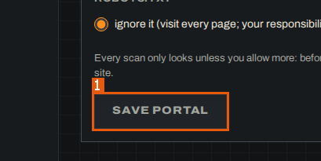
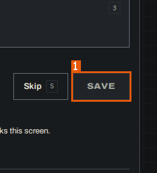
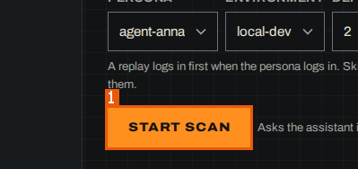
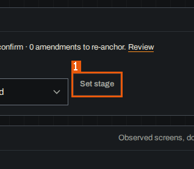
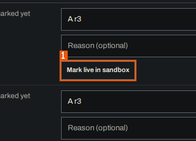
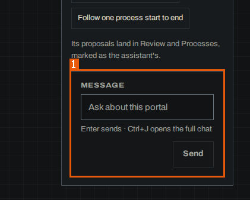

# 4. Processes and use cases

## 4.1 Processes

### PROC-001 — New portal

**PROC-001** · rev 1 · draft · needs_confirmation · not observable

> DRAFT — not confirmed by a reviewer

Register a new site to document.

**Goal:** Add a site to MudPuppy with the address and crawl limit of each environment so it can be scanned.

**Persona:** BA using the console (map run persona guest, no sign-in)

**Trigger:** The link "+ New portal" on "All portals" (the console start page) opens the form "New portal".

**Outcome:** Not observed. By the page's own text, after "Save portal" the portal is saved by the assistant and "the assistant opens for it: ask it to scan". In the scanned copy "Save portal" was disabled because the assistant was not running.

**Observed extent:** map only

_No trace recorded for this process._

**Follow-ups for this:**

- [FUP-001](11-unknowns.md#FUP-001) Trace "New portal" with the chat service running

**On screen:** MudPuppy (/app/portals/new)

1. `button "Save portal"`

Related: contains [SCR-006](03-screens.md#SCR-006)

Evidence:

- record [OQ-001](10-assumptions-and-questions.md#OQ-001) — What do the assistant-backed actions do when the chat service runs?
- screen region `01a17541-b0b3-7000-b23a-7b9ba885ff54` `button "Save portal"` — MudPuppy (/app/portals/new) (run `01a1753d-a8da-7000-85d2-b19d666d3587`, map, 2026-10-25)
- state `01a17541-b0b3-7000-b23a-7b9ba885ff54` — MudPuppy (/app/portals/new) (run `01a1753d-a8da-7000-85d2-b19d666d3587`, map, 2026-10-25)
- transition `01a17541-b139-7000-8214-7dda468203e1` — transition: "+ New portal" (run `01a1753d-a8da-7000-85d2-b19d666d3587`, map, 2026-10-25) — note: "+ New portal" opens /app/portals/new

### PROC-002 — Review

**PROC-002** · rev 1 · draft · needs_confirmation · not observable

> DRAFT — not confirmed by a reviewer

Decide on what waits for the BA: confirm, reject with a reason, or comment.

**Goal:** Confirm, reject (with a reason) or comment the findings, rules and documentation records that wait in Review, so that only reviewed documentation is treated as confirmed.

**Persona:** BA reviewer (map run persona guest)

**Trigger:** The link "Review" in "Portal sections" (or the "In Review" count on "All portals") opens "Review"; an item link (e.g. a record title under "Records to confirm") or a record key opens the record page.

**Outcome:** Not observed: the run did not press "Confirm 2", "Reject 2", "Confirm rev <n>", "Reject rev <n>" or "Comment". The record page says "the decision is recorded with your name".

**Observed extent:** map only

_No trace recorded for this process._

**Follow-ups for this:**

- [FUP-002](11-unknowns.md#FUP-002) Trace "Review": confirm, reject and comment a record

Related: contains [SCR-012](03-screens.md#SCR-012) · contains [SCR-023](03-screens.md#SCR-023)

Evidence:

- record [OQ-002](10-assumptions-and-questions.md#OQ-002) — What do the console's write actions do?
- state `01a1753e-be7a-7000-95e6-7606fb6ebc6e` — MudPuppy (/app/portals/reference-insurer-local/review) (run `01a1753d-a8da-7000-85d2-b19d666d3587`, map, 2026-10-25)
- state `01a1753f-f23f-7000-9333-d142f8824a10` — MudPuppy (/app/portals/:portal/docs/:key) (run `01a1753d-a8da-7000-85d2-b19d666d3587`, map, 2026-10-25)
- state `01a17541-381d-7000-89a5-270bc9ed695b` — MudPuppy (/app/portals/reference-insurer-local/review) (run `01a1753d-a8da-7000-85d2-b19d666d3587`, map, 2026-10-25)
- transition `01a1753e-a36b-7000-bdf8-e81a2dde74cc` — transition: "0" (run `01a1753d-a8da-7000-85d2-b19d666d3587`, map, 2026-10-25)
- transition `01a17541-389f-7000-b1ef-0024ad054792` — transition: "No-claims discount is 10% of the base premium" (run `01a1753d-a8da-7000-85d2-b19d666d3587`, map, 2026-10-25)

### PROC-003 — Same screen?

**PROC-003** · rev 1 · draft · needs_confirmation · not observable

> DRAFT — not confirmed by a reviewer

Label pairs of recorded page versions as the same screen, the same with different data, or different screens.

**Goal:** Answer whether two recorded page versions are one screen, so the next model rebuild groups them accordingly.

**Persona:** BA reviewer (map run persona guest)

**Trigger:** The link "Same screen? 4" in "Review views" on "Review" opens the first pair.

**Outcome:** Not observed: "Save" was not pressed. By the page's text the answer "is saved as a label for these two page versions. The next model rebuild groups them by it"; "Skip" leaves the pair in the queue.

**Observed extent:** map only

_No trace recorded for this process._

**Follow-ups for this:**

- [FUP-003](11-unknowns.md#FUP-003) Trace "Same screen?": answer and save a pair

**On screen:** MudPuppy (/app/portals/reference-insurer-local/same-screen)

1. `button "Save"`

Related: contains [SCR-013](03-screens.md#SCR-013)

Evidence:

- record [OQ-002](10-assumptions-and-questions.md#OQ-002) — What do the console's write actions do?
- screen region `01a17541-107a-7000-8bc5-38e73949e5be` `button "Save"` — MudPuppy (/app/portals/reference-insurer-local/same-screen) (run `01a1753d-a8da-7000-85d2-b19d666d3587`, map, 2026-10-25)
- state `01a17541-107a-7000-8bc5-38e73949e5be` — MudPuppy (/app/portals/reference-insurer-local/same-screen) (run `01a1753d-a8da-7000-85d2-b19d666d3587`, map, 2026-10-25)
- transition `01a17541-10d6-7000-ad1b-fa4d4187e39e` — transition: "Same screen? 4" (run `01a1753d-a8da-7000-85d2-b19d666d3587`, map, 2026-10-25)

### PROC-004 — Plan next scan

**PROC-004** · rev 1 · draft · needs_confirmation · not observable

> DRAFT — not confirmed by a reviewer

Plan and start a focused, recheck or retry scan from the marks on the map.

**Goal:** Start a new scan of the chosen type (Focused, Recheck, Retry a path) for a persona and environment, from the screens marked on the map.

**Persona:** BA (map run persona guest)

**Trigger:** The link "Plan next scan" on "Scans" opens the form "Plan next scan".

**Outcome:** Not observed: "Start scan" "Asks the assistant in this portal's chat; follow the scan there." and the chat service was down; no scan was started.

**Observed extent:** map only

_No trace recorded for this process._

**Follow-ups for this:**

- [FUP-004](11-unknowns.md#FUP-004) Trace "Plan next scan" with marks and the chat service running

**On screen:** MudPuppy (/app/portals/reference-insurer-local/scans/plan)

1. `button "Start scan"`

Related: contains [SCR-027](03-screens.md#SCR-027)

Evidence:

- record [OQ-001](10-assumptions-and-questions.md#OQ-001) — What do the assistant-backed actions do when the chat service runs?
- screen region `01a17540-b6ab-7000-aa4c-46fedc8a36c3` `button "Start scan"` — MudPuppy (/app/portals/reference-insurer-local/scans/plan) (run `01a1753d-a8da-7000-85d2-b19d666d3587`, map, 2026-10-25)
- state `01a17540-b6ab-7000-aa4c-46fedc8a36c3` — MudPuppy (/app/portals/reference-insurer-local/scans/plan) (run `01a1753d-a8da-7000-85d2-b19d666d3587`, map, 2026-10-25)
- transition `01a17540-b705-7000-bddb-421e4d8fc3d8` — transition: "Plan next scan" (run `01a1753d-a8da-7000-85d2-b19d666d3587`, map, 2026-10-25)

### PROC-005 — Set a process's stage

**PROC-005** · rev 1 · draft · needs_confirmation · not observable

> DRAFT — not confirmed by a reviewer

Move a process through Scoped, As-is documented, To-be in design, Migrating and Migrated.

**Goal:** Record how far a process is in its documentation and migration by setting its stage or marking it as-is documented.

**Persona:** BA (map run persona guest)

**Trigger:** A process link (e.g. "Kalkulator OC/AC") in the table on "Processes" opens the process page with its region "As-is documentation".

**Outcome:** Not observed: "Set stage" (disabled while the current stage is selected) and "Mark as-is documented" were not pressed.

**Observed extent:** map only

_No trace recorded for this process._

**Follow-ups for this:**

- [FUP-005](11-unknowns.md#FUP-005) Trace "Set a process's stage"

**On screen:** MudPuppy (/app/portals/:portal/processes/:key)

1. `button "Set stage"`

Related: contains [SCR-008](03-screens.md#SCR-008)

Evidence:

- record [OQ-002](10-assumptions-and-questions.md#OQ-002) — What do the console's write actions do?
- screen region `01a1753e-01fe-7000-91d8-152388d28304` `button "Set stage"` — MudPuppy (/app/portals/:portal/processes/:key) (run `01a1753d-a8da-7000-85d2-b19d666d3587`, map, 2026-10-25)
- state `01a1753e-01fe-7000-91d8-152388d28304` — MudPuppy (/app/portals/:portal/processes/:key) (run `01a1753d-a8da-7000-85d2-b19d666d3587`, map, 2026-10-25)
- transition `01a1753e-02b4-7000-8cca-4d7a9d49c1db` — transition: "Kalkulator OC/AC" (run `01a1753d-a8da-7000-85d2-b19d666d3587`, map, 2026-10-25)

### PROC-006 — Mark a process model live

**PROC-006** · rev 1 · draft · needs_confirmation · not observable

> DRAFT — not confirmed by a reviewer

Record which process model runs in sandbox, staging or production.

**Goal:** Mark the process model (e.g. "A r3") that is live in an environment, with an optional reason.

**Persona:** BA (map run persona guest)

**Trigger:** The link "History" on a process page opens the process history with the table "Which process model runs where".

**Outcome:** Not observed: "Mark live in sandbox", "Mark live in staging" and "Mark live in production" were not pressed; all three environments showed "Not marked".

**Observed extent:** map only

_No trace recorded for this process._

**Follow-ups for this:**

- [FUP-006](11-unknowns.md#FUP-006) Trace "Mark a process model live"

**On screen:** MudPuppy (/app/portals/reference-insurer-local/processes/PRC-001/history)

1. `button "Mark live in sandbox"`

Related: contains [SCR-009](03-screens.md#SCR-009)

Evidence:

- record [OQ-002](10-assumptions-and-questions.md#OQ-002) — What do the console's write actions do?
- screen region `01a1753e-122f-7000-ac31-15f9bbe7957d` `button "Mark live in sandbox"` — MudPuppy (/app/portals/reference-insurer-local/processes/PRC-001/history) (run `01a1753d-a8da-7000-85d2-b19d666d3587`, map, 2026-10-25)
- state `01a1753e-122f-7000-ac31-15f9bbe7957d` — MudPuppy (/app/portals/reference-insurer-local/processes/PRC-001/history) (run `01a1753d-a8da-7000-85d2-b19d666d3587`, map, 2026-10-25)
- transition `01a1753e-127e-7001-80c4-7098b1d9348f` — transition: "History" (run `01a1753d-a8da-7000-85d2-b19d666d3587`, map, 2026-10-25)

### PROC-007 — Save an environment

**PROC-007** · rev 1 · draft · needs_confirmation · not observable

> DRAFT — not confirmed by a reviewer

Configure a portal environment's address and crawl limit, and the portal's personas, hints and budgets.

**Goal:** Set the address and "How far the crawler may go" of a portal environment (and the other settings: personas, hints, budgets) so scans use them.

**Persona:** BA (map run persona guest)

**Trigger:** The link "Settings" in "Portal sections" opens "Settings" with the form "Save an environment".

**Outcome:** Not observed: "Save environment" was disabled while the assistant was not running ("It reads and saves portal settings."); "Save the budgets" was not pressed.

**Observed extent:** map only

_No trace recorded for this process._

**Follow-ups for this:**

- [FUP-007](11-unknowns.md#FUP-007) Trace "Save an environment" with the chat service running

**On screen:** MudPuppy (/app/portals/reference-insurer-local/settings)

1. `button "Save environment"`

Related: contains [SCR-030](03-screens.md#SCR-030)

Evidence:

- record [OQ-001](10-assumptions-and-questions.md#OQ-001) — What do the assistant-backed actions do when the chat service runs?
- screen region `01a17540-ecac-7000-9714-39aba77839c5` `button "Save environment"` — MudPuppy (/app/portals/reference-insurer-local/settings) (run `01a1753d-a8da-7000-85d2-b19d666d3587`, map, 2026-10-25)
- state `01a17540-ecac-7000-9714-39aba77839c5` — MudPuppy (/app/portals/reference-insurer-local/settings) (run `01a1753d-a8da-7000-85d2-b19d666d3587`, map, 2026-10-25)
- transition `01a17540-ed13-7000-be63-5cac298c48db` — transition: "Settings" (run `01a1753d-a8da-7000-85d2-b19d666d3587`, map, 2026-10-25)

### PROC-008 — Ask the assistant

**PROC-008** · rev 1 · draft · needs_confirmation · not observable

> DRAFT — not confirmed by a reviewer

Ask the portal's assistant a question or a task and confirm the commands it proposes.

**Goal:** Get an answer about the portal (what changed, what to do, sorting screens into processes, following a process) or have the assistant prepare a command such as a scan, which starts only after the BA confirms it.

**Persona:** BA (map run persona guest)

**Trigger:** The form "Ask the assistant" on Portal home (or a suggestion button there), the banner button "down Ask Ctrl J", or the link "Workbench" in "Portal sections" opening the Workbench conversation.

**Outcome:** Not observed: the chat service was deliberately down; "Send" was disabled on both screens. The Workbench showed an earlier conversation in which proposed "Start a map scan" commands "Didn't start".

**Observed extent:** map only

_No trace recorded for this process._

**Follow-ups for this:**

- [FUP-008](11-unknowns.md#FUP-008) Trace "Ask the assistant" with the chat service running

**On screen:** MudPuppy (/app/portals/reference-insurer-local)

1. `form "Ask the assistant"`

Related: contains [SCR-011](03-screens.md#SCR-011) · contains [SCR-031](03-screens.md#SCR-031)

Evidence:

- record [OQ-001](10-assumptions-and-questions.md#OQ-001) — What do the assistant-backed actions do when the chat service runs?
- screen region `01a1753d-debd-7000-b943-374405412ad9` `form "Ask the assistant"` — MudPuppy (/app/portals/reference-insurer-local) (run `01a1753d-a8da-7000-85d2-b19d666d3587`, map, 2026-10-25)
- state `01a1753d-debd-7000-b943-374405412ad9` — MudPuppy (/app/portals/reference-insurer-local) (run `01a1753d-a8da-7000-85d2-b19d666d3587`, map, 2026-10-25)
- state `01a17541-8dad-7000-8cd1-09927b9bdaf7` — MudPuppy (/app/portals/reference-insurer-local/workbench) (run `01a1753d-a8da-7000-85d2-b19d666d3587`, map, 2026-10-25)
- transition `01a17541-8e25-7000-b77f-82e10c0f6c82` — transition: "Workbench" (run `01a1753d-a8da-7000-85d2-b19d666d3587`, map, 2026-10-25)

## 4.2 Use cases not linked to a process

_none_
