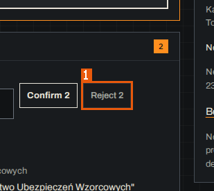
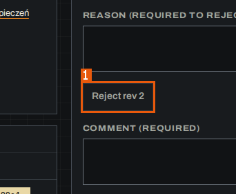

# 5. Functional requirements

### <a id="REQ-001"></a>REQ-001 — A rejection always carries a reason

**REQ-001** · rev 1 · draft · observed

> DRAFT — not confirmed by a reviewer

The console shall accept a rejection, of a single record or of a group in Review, only with a reason typed by the reviewer.

**Priority:** must

**Rationale:** Review states that nothing is decided without a reason that can be seen later. (observed)

**Acceptance criteria:**

```gherkin
Scenario: REQ-001 criterion 1
  Given a draft record is open on its record page
  And "Reason (required to reject)" is empty
  When the reviewer looks at "Reject rev <n>"
  Then "Reject rev <n>" is disabled

Scenario: REQ-001 criterion 2
  Given a group of alike rules in Review
  And "Reason for 2" is empty
  When the reviewer looks at "Reject 2"
  Then "Reject 2" is disabled and "Confirm 2" is enabled
```

**On screen:** MudPuppy (/app/portals/reference-insurer-local/review)



1. `button "Reject 2"`

**On screen:** MudPuppy (/app/portals/:portal/docs/:key)



1. `button "Reject rev 2"`

Related: enforces [BR-005](06-business-rules.md#BR-005) · enforces [BR-006](06-business-rules.md#BR-006) · enforces [BR-036](06-business-rules.md#BR-036) · refines [CAP-003](02-capabilities.md#CAP-003)

Evidence:

- screen region `01a1753e-be7a-7000-95e6-7606fb6ebc6e` `button "Reject 2"` — MudPuppy (/app/portals/reference-insurer-local/review) (run `01a1753d-a8da-7000-85d2-b19d666d3587`, map, 2026-10-25)
- screen region `01a1753f-f23f-7000-9333-d142f8824a10` `button "Reject rev 2"` — MudPuppy (/app/portals/:portal/docs/:key) (run `01a1753d-a8da-7000-85d2-b19d666d3587`, map, 2026-10-25)

### <a id="REQ-002"></a>REQ-002 — Read-only work continues without the chat service

**REQ-002** · rev 1 · draft · observed

> DRAFT — not confirmed by a reviewer

The console shall keep every read-only page working when the chat service is down, and on each page that needs it shall disable the action and show how to start the service.

**Priority:** must

**Rationale:** Settings states "Read-only parts keep working."; New portal and Settings show the start command. (observed)

**Acceptance criteria:**

```gherkin
Scenario: REQ-002 criterion 1
  Given the chat service is not running
  When the BA opens New portal
  Then the alert "Assistant not running" and the start command are shown
  And "Save portal" is disabled

Scenario: REQ-002 criterion 2
  Given the chat service is not running
  When the BA opens Settings
  Then "Save environment" is disabled
  And the read-only regions (Environments, Personas, Crawl rules, Hints, Budgets, Screen identity, Data store) are shown

Scenario: REQ-002 criterion 3
  Given the chat service is not running
  When the BA opens the Workbench
  Then "Message" and "Send" are disabled with "Assistant unavailable — the live map still updates. Start the chat service."
```

**On screen:** MudPuppy (/app/portals/reference-insurer-local/workbench)


1. `textbox "Message"`

**On screen:** MudPuppy (/app/portals/new)


1. `alert`

Related: enforces [BR-022](06-business-rules.md#BR-022) · refines [CAP-010](02-capabilities.md#CAP-010)

Evidence:

- screen region `01a17541-8dad-7000-8cd1-09927b9bdaf7` `textbox "Message"` — MudPuppy (/app/portals/reference-insurer-local/workbench) (run `01a1753d-a8da-7000-85d2-b19d666d3587`, map, 2026-10-25)
- screen region `01a17541-b0b3-7000-b23a-7b9ba885ff54` `alert` — MudPuppy (/app/portals/new) (run `01a1753d-a8da-7000-85d2-b19d666d3587`, map, 2026-10-25)
- state `01a17540-ecac-7000-9714-39aba77839c5` — MudPuppy (/app/portals/reference-insurer-local/settings) (run `01a1753d-a8da-7000-85d2-b19d666d3587`, map, 2026-10-25)
