# 6. Business rules

### BR-001 — Portal sections open only after a portal is picked

**BR-001** · rev 1 · draft · observed

> DRAFT — not confirmed by a reviewer

While no portal is selected ("Portal: All portals"), the links "Changes", "Review", "Processes", "Screens", "Rules", "Docs", "Scans" and "Settings" in the navigation "Portal sections" are disabled and the note "Pick a portal to open these." is shown; only "Home" is a link. Once a portal is selected they link to that portal's sections.

**Type:** action enabler

**On screen:** MudPuppy (/app)

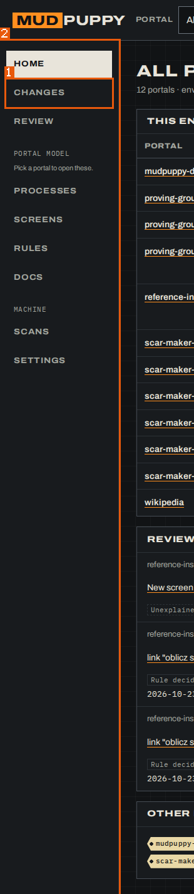

1. `link "Changes"`
2. `navigation "Portal sections"` — links disabled, note shown

**On screen:** MudPuppy (/app/portals/reference-insurer-local)

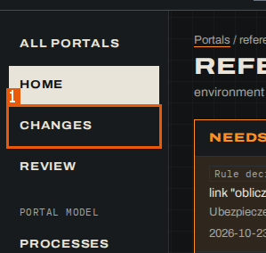

1. `link "Changes"` — with a portal selected the link has an address

Related: applies on [SCR-001](03-screens.md#SCR-001) · applies on [SCR-003](03-screens.md#SCR-003) · applies on [SCR-004](03-screens.md#SCR-004) · applies on [SCR-005](03-screens.md#SCR-005) · applies on [SCR-006](03-screens.md#SCR-006)

Evidence:

- screen region `01a1753d-ba74-7000-a2d2-3da8da9e7760` `link "Changes"` — MudPuppy (/app) (run `01a1753d-a8da-7000-85d2-b19d666d3587`, map, 2026-10-25)
- screen region `01a1753d-ba74-7000-a2d2-3da8da9e7760` `navigation "Portal sections"` — MudPuppy (/app) (run `01a1753d-a8da-7000-85d2-b19d666d3587`, map, 2026-10-25) — note: links disabled, note shown
- screen region `01a1753d-debd-7000-b943-374405412ad9` `link "Changes"` — MudPuppy (/app/portals/reference-insurer-local) (run `01a1753d-a8da-7000-85d2-b19d666d3587`, map, 2026-10-25) — note: with a portal selected the link has an address
- state `01a17541-d5d8-7000-bc63-ab757f9c7158` — MudPuppy (/app/search) (run `01a1753d-a8da-7000-85d2-b19d666d3587`, map, 2026-10-25) — note: also disabled on Search

### BR-002 — Workbench and Ask appear only for a selected portal

**BR-002** · rev 1 · draft · inferred

> DRAFT — not confirmed by a reviewer

The section link "Workbench", the link "All portals" in "Portal sections" and the banner button "down Ask Ctrl J" are shown when a portal is selected and absent while "Portal: All portals" is shown. Inferred from their presence on every portal page and absence on the portals list, Search, BA wiki, New portal and Not found.

**Type:** inference

**On screen:** MudPuppy (/app/portals/reference-insurer-local)

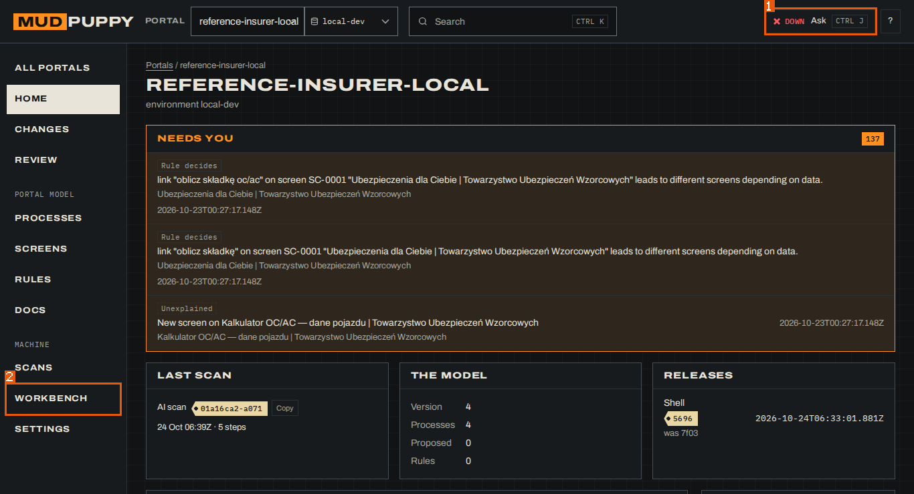

1. `button "down Ask Ctrl J"`
2. `link "Workbench"`

Related: applies on [SCR-001](03-screens.md#SCR-001) · applies on [SCR-011](03-screens.md#SCR-011)

Evidence:

- screen region `01a1753d-debd-7000-b943-374405412ad9` `button "down Ask Ctrl J"` — MudPuppy (/app/portals/reference-insurer-local) (run `01a1753d-a8da-7000-85d2-b19d666d3587`, map, 2026-10-25)
- screen region `01a1753d-debd-7000-b943-374405412ad9` `link "Workbench"` — MudPuppy (/app/portals/reference-insurer-local) (run `01a1753d-a8da-7000-85d2-b19d666d3587`, map, 2026-10-25)
- state `01a1753d-ba74-7000-a2d2-3da8da9e7760` — MudPuppy (/app) (run `01a1753d-a8da-7000-85d2-b19d666d3587`, map, 2026-10-25) — note: neither element on the portals list

### BR-003 — Data store button disabled without a portal

**BR-003** · rev 1 · draft · observed

> DRAFT — not confirmed by a reviewer

While no portal is selected the banner button "Data store: per portal" is disabled; with a portal selected it reads "Data store: <environment>, read-only" (e.g. "Data store: local-dev, read-only") and is enabled.

**Type:** action enabler

**On screen:** MudPuppy (/app)

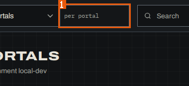

1. `button "Data store: per portal"`

**On screen:** MudPuppy (/app/portals/reference-insurer-local)

1. `button "Data store: local-dev, read-only"`

Related: applies on [SCR-001](03-screens.md#SCR-001) · applies on [SCR-011](03-screens.md#SCR-011)

Evidence:

- screen region `01a1753d-ba74-7000-a2d2-3da8da9e7760` `button "Data store: per portal"` — MudPuppy (/app) (run `01a1753d-a8da-7000-85d2-b19d666d3587`, map, 2026-10-25)
- screen region `01a1753d-debd-7000-b943-374405412ad9` `button "Data store: local-dev, read-only"` — MudPuppy (/app/portals/reference-insurer-local) (run `01a1753d-a8da-7000-85d2-b19d666d3587`, map, 2026-10-25)

### BR-004 — The console remembers the last opened portal

**BR-004** · rev 1 · draft · inferred

> DRAFT — not confirmed by a reviewer

After a portal was visited, opening /app/ again (the portals list address) brought the crawler to that portal's home instead of "All portals", so links of the portals list (the "In Review" count links "0") were no longer present. The "All portals" link itself still opened the list. Inferred from the crawler's report and its refused frontier items; the exact condition is not shown on screen.

**Type:** inference

**Open questions about this:**

- [OQ-005](10-assumptions-and-questions.md#OQ-005) Is the remembered-portal redirect intended?

Related: applies on [SCR-001](03-screens.md#SCR-001) · applies on [SCR-011](03-screens.md#SCR-011)

Evidence:

- decision `01a1753e-404c-7001-82b1-f9c80e85aa20` — refuse unreachable: link "0" is no longer present on http://127.0.0.1:8790/app/ (run `01a1753d-a8da-7000-85d2-b19d666d3587`, map, 2026-10-25) — note: link "0" no longer present on /app/
- observation `01a1753e-54cb-7002-96f3-2d3c48f08694` — http://127.0.0.1:8790/app/portals/reference-insurer-local (run `01a1753d-a8da-7000-85d2-b19d666d3587`, map, 2026-10-25) — note: navigate to /app/ landed on /app/portals/reference-insurer-local
- open question `01a17542-59df-7000-b667-5ec699b04fcb` — Opening /app/ after visiting a portal redirects to that portal's home instead of the Portals list, so pending frontier items of the portals list (count links of empty portals, proving-ground-shop-local) came back 'no longer present'; max_depth 10 also blocked docs sub-pages reached through long chains. A hook could reset the remembered portal. (run `01a1753d-a8da-7000-85d2-b19d666d3587`, map, 2026-10-25) — note: crawler: /app/ after visiting a portal redirects to that portal's home
- state `01a1753d-debd-7000-b943-374405412ad9` — MudPuppy (/app/portals/reference-insurer-local) (run `01a1753d-a8da-7000-85d2-b19d666d3587`, map, 2026-10-25)

### BR-005 — A group in Review is rejected only with a reason

**BR-005** · rev 1 · draft · inferred

> DRAFT — not confirmed by a reviewer

In the "Rules" group of Review, "Reject 2" is disabled while the textbox "Reason for 2" (placeholder "One reason for all") is empty, while "Confirm 2" is enabled. Inferred: the reason is needed to reject, not to confirm (the page says "nothing is decided without a reason you can see later").

**Type:** action enabler

**Assumptions resting on this:**

- [ASM-001](10-assumptions-and-questions.md#ASM-001) The scanned console ran on a read-only copy of its store — to check

**On screen:** MudPuppy (/app/portals/reference-insurer-local/review)

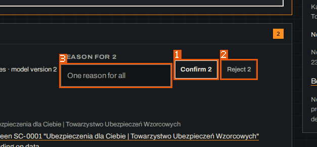

1. `button "Confirm 2"`
2. `button "Reject 2"`
3. `textbox "Reason for 2"`

Related: applies on [SCR-012](03-screens.md#SCR-012)

Evidence:

- form `01a1753e-bef1-7003-964d-63f65cc6de95` — form: _r_9_ (run `01a1753d-a8da-7000-85d2-b19d666d3587`, map, 2026-10-25)
- screen region `01a1753e-be7a-7000-95e6-7606fb6ebc6e` `button "Confirm 2"` — MudPuppy (/app/portals/reference-insurer-local/review) (run `01a1753d-a8da-7000-85d2-b19d666d3587`, map, 2026-10-25)
- screen region `01a1753e-be7a-7000-95e6-7606fb6ebc6e` `button "Reject 2"` — MudPuppy (/app/portals/reference-insurer-local/review) (run `01a1753d-a8da-7000-85d2-b19d666d3587`, map, 2026-10-25)
- screen region `01a1753e-be7a-7000-95e6-7606fb6ebc6e` `textbox "Reason for 2"` — MudPuppy (/app/portals/reference-insurer-local/review) (run `01a1753d-a8da-7000-85d2-b19d666d3587`, map, 2026-10-25)

### BR-006 — Rejecting a record needs a reason

**BR-006** · rev 1 · draft · observed

> DRAFT — not confirmed by a reviewer

On a documentation record, "Reject rev <n>" is disabled while "Reason (required to reject)" is empty; "Confirm rev <n>" needs no text.

**Type:** action enabler

**On screen:** MudPuppy (/app/portals/:portal/docs/:key)

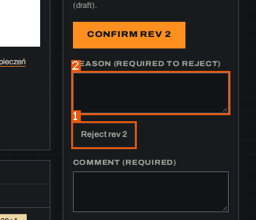

1. `button "Reject rev 2"`
2. `textbox "Reason (required to reject)"`

Related: applies on [SCR-023](03-screens.md#SCR-023)

Evidence:

- form `01a1753f-f2b4-7001-b5b5-44935a4bdc77` — form: _r_p_, _r_q_ (run `01a1753d-a8da-7000-85d2-b19d666d3587`, map, 2026-10-25)
- screen region `01a1753f-f23f-7000-9333-d142f8824a10` `button "Reject rev 2"` — MudPuppy (/app/portals/:portal/docs/:key) (run `01a1753d-a8da-7000-85d2-b19d666d3587`, map, 2026-10-25)
- screen region `01a1753f-f23f-7000-9333-d142f8824a10` `textbox "Reason (required to reject)"` — MudPuppy (/app/portals/:portal/docs/:key) (run `01a1753d-a8da-7000-85d2-b19d666d3587`, map, 2026-10-25)
- state `01a17541-e95b-7000-b533-607be7fc1be5` — MudPuppy (/app/portals/:portal/docs/:key) (run `01a1753d-a8da-7000-85d2-b19d666d3587`, map, 2026-10-25) — note: same on a second record

### BR-007 — A comment needs text

**BR-007** · rev 1 · draft · observed

> DRAFT — not confirmed by a reviewer

On a documentation record, the button "Comment" is disabled while "Comment (required)" is empty.

**Type:** action enabler

**On screen:** MudPuppy (/app/portals/:portal/docs/:key)

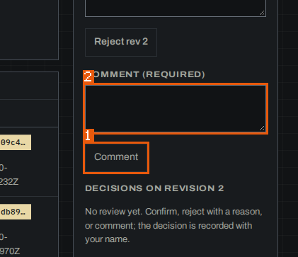

1. `button "Comment"`
2. `textbox "Comment (required)"`

Related: applies on [SCR-023](03-screens.md#SCR-023)

Evidence:

- form `01a1753f-f2b4-7001-b5b5-44935a4bdc77` — form: _r_p_, _r_q_ (run `01a1753d-a8da-7000-85d2-b19d666d3587`, map, 2026-10-25)
- screen region `01a1753f-f23f-7000-9333-d142f8824a10` `button "Comment"` — MudPuppy (/app/portals/:portal/docs/:key) (run `01a1753d-a8da-7000-85d2-b19d666d3587`, map, 2026-10-25)
- screen region `01a1753f-f23f-7000-9333-d142f8824a10` `textbox "Comment (required)"` — MudPuppy (/app/portals/:portal/docs/:key) (run `01a1753d-a8da-7000-85d2-b19d666d3587`, map, 2026-10-25)

### BR-008 — Reviews apply to the latest revision

**BR-008** · rev 1 · draft · observed

> DRAFT — not confirmed by a reviewer

The review panel of a record states "Reviews apply to the latest revision, <n> (draft)." and labels its buttons with that revision ("Confirm rev 2", "Reject rev 2"); a decision "is recorded with your name".

**Type:** constraint

**On screen:** MudPuppy (/app/portals/:portal/docs/:key)

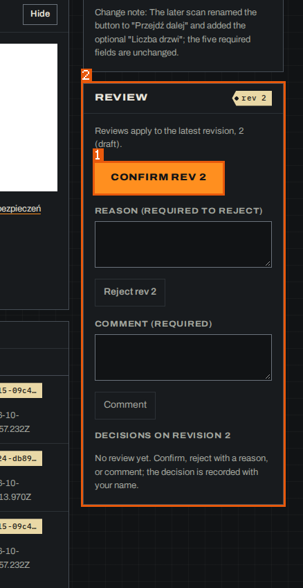

1. `button "Confirm rev 2"`
2. `region "Review"`

Related: applies on [SCR-023](03-screens.md#SCR-023)

Evidence:

- screen region `01a1753f-f23f-7000-9333-d142f8824a10` `button "Confirm rev 2"` — MudPuppy (/app/portals/:portal/docs/:key) (run `01a1753d-a8da-7000-85d2-b19d666d3587`, map, 2026-10-25)
- screen region `01a1753f-f23f-7000-9333-d142f8824a10` `region "Review"` — MudPuppy (/app/portals/:portal/docs/:key) (run `01a1753d-a8da-7000-85d2-b19d666d3587`, map, 2026-10-25)

### BR-009 — "Set stage" needs a different stage

**BR-009** · rev 1 · draft · inferred

> DRAFT — not confirmed by a reviewer

On a process page, "Set stage" is disabled while the combobox "Stage" shows the process's current stage ("Scoped" selected for a Scoped process). Inferred: choosing another stage enables it.

**Type:** action enabler

**Assumptions resting on this:**

- [ASM-001](10-assumptions-and-questions.md#ASM-001) The scanned console ran on a read-only copy of its store — to check

**On screen:** MudPuppy (/app/portals/:portal/processes/:key)

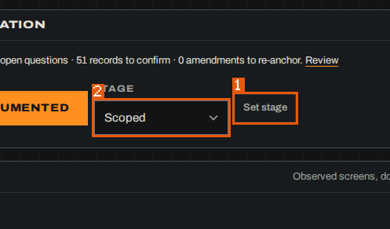

1. `button "Set stage"`
2. `combobox "Stage"`

Related: applies on [SCR-008](03-screens.md#SCR-008)

Evidence:

- form `01a1753e-02b2-7001-9aec-5e0d9d3d0fab` — form: _r_o_ (run `01a1753d-a8da-7000-85d2-b19d666d3587`, map, 2026-10-25)
- screen region `01a1753e-01fe-7000-91d8-152388d28304` `button "Set stage"` — MudPuppy (/app/portals/:portal/processes/:key) (run `01a1753d-a8da-7000-85d2-b19d666d3587`, map, 2026-10-25)
- screen region `01a1753e-01fe-7000-91d8-152388d28304` `combobox "Stage"` — MudPuppy (/app/portals/:portal/processes/:key) (run `01a1753d-a8da-7000-85d2-b19d666d3587`, map, 2026-10-25)

### BR-010 — Process stages and their order

**BR-010** · rev 1 · draft · observed

> DRAFT — not confirmed by a reviewer

A process has one of the stages "Suggested → Scoped → As-is documented → To-be in design → Migrating → Migrated"; "A process can move back at any time." The "Stage" combobox of a process offers "Scoped", "As-is documented", "To-be in design", "Migrating" and "Migrated" ("Suggested" is the stage of the assistant's unsaved groupings).

**Type:** constraint

**On screen:** MudPuppy (/app/portals/:portal/processes/:key)

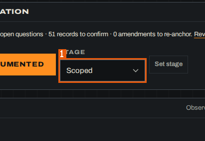

1. `combobox "Stage"`

Related: applies on [SCR-007](03-screens.md#SCR-007) · applies on [SCR-008](03-screens.md#SCR-008)

Evidence:

- form `01a1753e-02b2-7001-9aec-5e0d9d3d0fab` — form: _r_o_ (run `01a1753d-a8da-7000-85d2-b19d666d3587`, map, 2026-10-25) — note: options of Stage
- screen region `01a1753e-01fe-7000-91d8-152388d28304` `combobox "Stage"` — MudPuppy (/app/portals/:portal/processes/:key) (run `01a1753d-a8da-7000-85d2-b19d666d3587`, map, 2026-10-25)
- state `01a1753d-f0de-7001-94e6-0e4cf819f4b8` — MudPuppy (/app/portals/reference-insurer-local/processes) (run `01a1753d-a8da-7000-85d2-b19d666d3587`, map, 2026-10-25) — note: stage line on Processes

### BR-011 — Process model revisions are only added

**BR-011** · rev 1 · draft · observed

> DRAFT — not confirmed by a reviewer

Process history states: "Restoring adds a new revision. A rescan adds revisions to A and never edits a to-be model." Revisions of model A are listed with "Latest" or "superseded"; older revisions stay viewable ("View").

**Type:** constraint

**On screen:** MudPuppy (/app/portals/reference-insurer-local/processes/PRC-001/history)

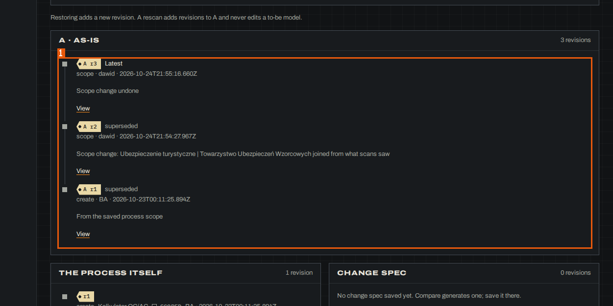

1. `list "Revisions of A"`

Related: applies on [SCR-009](03-screens.md#SCR-009)

Evidence:

- screen region `01a1753e-122f-7000-ac31-15f9bbe7957d` `list "Revisions of A"` — MudPuppy (/app/portals/reference-insurer-local/processes/PRC-001/history) (run `01a1753d-a8da-7000-85d2-b19d666d3587`, map, 2026-10-25)
- state `01a1753e-122f-7000-ac31-15f9bbe7957d` — MudPuppy (/app/portals/reference-insurer-local/processes/PRC-001/history) (run `01a1753d-a8da-7000-85d2-b19d666d3587`, map, 2026-10-25)

### BR-012 — "From this date" needs a date

**BR-012** · rev 1 · draft · inferred

> DRAFT — not confirmed by a reviewer

On What changed, "From this date" is disabled while "Or from a date" is empty; "From this scan" is enabled because "Or from a scan" always has a scan selected. Inferred from the disabled button next to the empty date field.

**Type:** action enabler

**On screen:** MudPuppy (/app/portals/reference-insurer-local/changes)

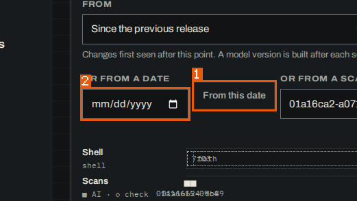

1. `button "From this date"`
2. `textbox "Or from a date"`

Related: applies on [SCR-014](03-screens.md#SCR-014)

Evidence:

- form `01a1753e-d28d-7000-82a7-3344e0a81e39` — form: _r_g_, _r_h_ (run `01a1753d-a8da-7000-85d2-b19d666d3587`, map, 2026-10-25)
- screen region `01a1753e-d243-7000-ba0d-fae46a006f7b` `button "From this date"` — MudPuppy (/app/portals/reference-insurer-local/changes) (run `01a1753d-a8da-7000-85d2-b19d666d3587`, map, 2026-10-25)
- screen region `01a1753e-d243-7000-ba0d-fae46a006f7b` `textbox "Or from a date"` — MudPuppy (/app/portals/reference-insurer-local/changes) (run `01a1753d-a8da-7000-85d2-b19d666d3587`, map, 2026-10-25)

### BR-013 — Changes start after the second scan

**BR-013** · rev 1 · draft · observed

> DRAFT — not confirmed by a reviewer

A model version is built after each scan, and a change is found by comparing versions: the range help reads "Changes first seen after this point. A model version is built after each scan." and the empty state "No change in this range. Changes start after the second scan."

**Type:** inference

**On screen:** MudPuppy (/app/portals/reference-insurer-local/changes)

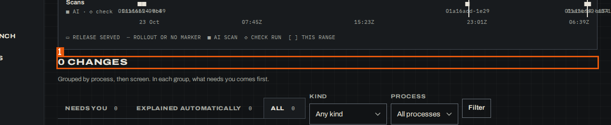

1. `heading "0 changes"`

Related: applies on [SCR-014](03-screens.md#SCR-014)

Evidence:

- screen region `01a1753e-d243-7000-ba0d-fae46a006f7b` `heading "0 changes"` — MudPuppy (/app/portals/reference-insurer-local/changes) (run `01a1753d-a8da-7000-85d2-b19d666d3587`, map, 2026-10-25)
- state `01a1753e-d243-7000-ba0d-fae46a006f7b` — MudPuppy (/app/portals/reference-insurer-local/changes) (run `01a1753d-a8da-7000-85d2-b19d666d3587`, map, 2026-10-25)

### BR-014 — Focused scan depth 0 to 10

**BR-014** · rev 1 · draft · observed

> DRAFT — not confirmed by a reviewer

"Depth from the start (focused)" accepts 0 to 10 (default 2) and applies to the scan type "Focused": "Focused: it explores from there, only as deep as you set."

**Type:** constraint

**On screen:** MudPuppy (/app/portals/reference-insurer-local/scans/plan)

1. `spinbutton "Depth from the start (focused)"`

Related: applies on [SCR-027](03-screens.md#SCR-027)

Evidence:

- form `01a17540-b704-7001-bd98-d0f36b161594` — form: run_type, persona, environment, depth (run `01a1753d-a8da-7000-85d2-b19d666d3587`, map, 2026-10-25) — note: number, min 0, max 10
- screen region `01a17540-b6ab-7000-aa4c-46fedc8a36c3` `spinbutton "Depth from the start (focused)"` — MudPuppy (/app/portals/reference-insurer-local/scans/plan) (run `01a1753d-a8da-7000-85d2-b19d666d3587`, map, 2026-10-25)

### BR-015 — What each scan type does

**BR-015** · rev 1 · draft · observed

> DRAFT — not confirmed by a reviewer

The "1 · Scan type" chosen on Plan next scan decides which marks are replayed and what the scan does there; "Depth from the start (focused)" applies to Focused and "Variation (retry)" to Retry. A stopped scan is continued with "Resume" on the scan, not here.

**Type:** inference

**Decision table:**

| "1 · Scan type" | marks replayed to | what it does there | setting used |
| --- | --- | --- | --- |
| "Focused" | "Start here" and "Focus" marks | explores from there, only as deep as set | "Depth from the start (focused)" |
| "Recheck" | "Recheck" marks | only records what the screen shows now | — |
| "Retry a path" | a failed action | presses the failed action once more, with a variation | "Variation (retry)": "As before", "Wait longer", "Other input", "Don't submit" |

**On screen:** MudPuppy (/app/portals/reference-insurer-local/scans/plan)

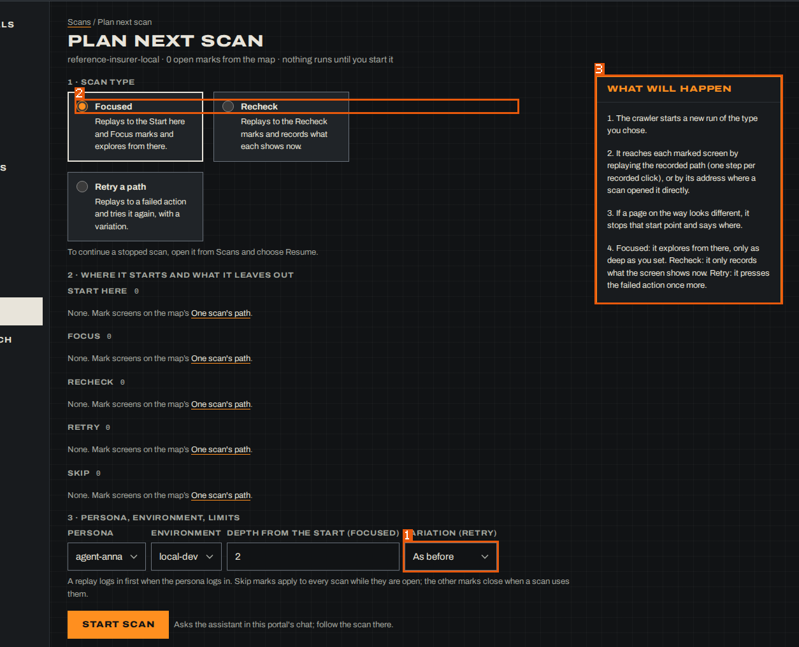

1. `combobox "Variation (retry)"`
2. `radio "Focused Replays to the Start here and Focus marks and explores from there."`
3. `region "What will happen"`

Related: applies on [SCR-027](03-screens.md#SCR-027)

Evidence:

- form `01a17540-b704-7001-bd98-d0f36b161594` — form: run_type, persona, environment, depth (run `01a1753d-a8da-7000-85d2-b19d666d3587`, map, 2026-10-25)
- screen region `01a17540-b6ab-7000-aa4c-46fedc8a36c3` `combobox "Variation (retry)"` — MudPuppy (/app/portals/reference-insurer-local/scans/plan) (run `01a1753d-a8da-7000-85d2-b19d666d3587`, map, 2026-10-25)
- screen region `01a17540-b6ab-7000-aa4c-46fedc8a36c3` `radio "Focused Replays to the Start here and Focus marks and explores from there."` — MudPuppy (/app/portals/reference-insurer-local/scans/plan) (run `01a1753d-a8da-7000-85d2-b19d666d3587`, map, 2026-10-25)
- screen region `01a17540-b6ab-7000-aa4c-46fedc8a36c3` `region "What will happen"` — MudPuppy (/app/portals/reference-insurer-local/scans/plan) (run `01a1753d-a8da-7000-85d2-b19d666d3587`, map, 2026-10-25)

### BR-016 — How long scan marks stay open

**BR-016** · rev 1 · draft · observed

> DRAFT — not confirmed by a reviewer

Plan next scan states: "Skip marks apply to every scan while they are open; the other marks close when a scan uses them." (marks "Start here", "Focus", "Recheck", "Retry", "Skip"). It also states "A replay logs in first when the persona logs in." and that a replay stops a start point "If a page on the way looks different".

**Type:** constraint

**On screen:** MudPuppy (/app/portals/reference-insurer-local/scans/plan)

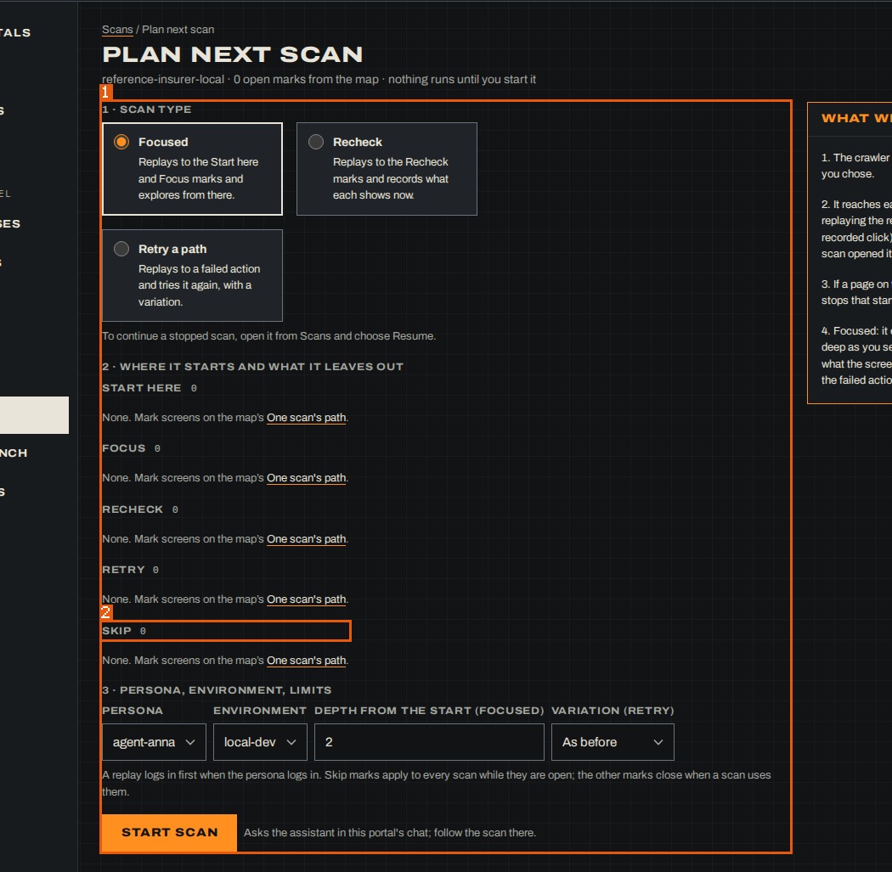

1. `form "Plan next scan"`
2. `heading "Skip 0"`

Related: applies on [SCR-027](03-screens.md#SCR-027)

Evidence:

- screen region `01a17540-b6ab-7000-aa4c-46fedc8a36c3` `form "Plan next scan"` — MudPuppy (/app/portals/reference-insurer-local/scans/plan) (run `01a1753d-a8da-7000-85d2-b19d666d3587`, map, 2026-10-25)
- screen region `01a17540-b6ab-7000-aa4c-46fedc8a36c3` `heading "Skip 0"` — MudPuppy (/app/portals/reference-insurer-local/scans/plan) (run `01a1753d-a8da-7000-85d2-b19d666d3587`, map, 2026-10-25)

### BR-017 — "Checks per scan" 0 to 1000

**BR-017** · rev 1 · draft · observed

> DRAFT — not confirmed by a reviewer

"Checks per scan" (Settings, form "Budgets") accepts 0 to 1000 (20 in the run); it is the number of "Replays on the headless driver after a scan (rules R1, R4, R5)."

**Type:** constraint

**On screen:** MudPuppy (/app/portals/reference-insurer-local/settings)

1. `spinbutton "Checks per scan"`

Related: applies on [SCR-030](03-screens.md#SCR-030)

Evidence:

- form `01a17540-ed12-7000-94e3-79de59f15ce2` — form: checks_per_scan, probes_per_step, probes_per_scan (run `01a1753d-a8da-7000-85d2-b19d666d3587`, map, 2026-10-25)
- screen region `01a17540-ecac-7000-9714-39aba77839c5` `spinbutton "Checks per scan"` — MudPuppy (/app/portals/reference-insurer-local/settings) (run `01a1753d-a8da-7000-85d2-b19d666d3587`, map, 2026-10-25)

### BR-018 — "Probes per form step" 0 to 1000

**BR-018** · rev 1 · draft · observed

> DRAFT — not confirmed by a reviewer

"Probes per form step" (Settings, form "Budgets") accepts 0 to 1000 (24 in the run).

**Type:** constraint

**On screen:** MudPuppy (/app/portals/reference-insurer-local/settings)

1. `spinbutton "Probes per form step"`

Related: applies on [SCR-030](03-screens.md#SCR-030)

Evidence:

- form `01a17540-ed12-7000-94e3-79de59f15ce2` — form: checks_per_scan, probes_per_step, probes_per_scan (run `01a1753d-a8da-7000-85d2-b19d666d3587`, map, 2026-10-25)
- screen region `01a17540-ecac-7000-9714-39aba77839c5` `spinbutton "Probes per form step"` — MudPuppy (/app/portals/reference-insurer-local/settings) (run `01a1753d-a8da-7000-85d2-b19d666d3587`, map, 2026-10-25)

### BR-019 — "Probes per scan" 0 to 10000

**BR-019** · rev 1 · draft · observed

> DRAFT — not confirmed by a reviewer

"Probes per scan" (Settings, form "Budgets") accepts 0 to 10000 (120 in the run).

**Type:** constraint

**On screen:** MudPuppy (/app/portals/reference-insurer-local/settings)

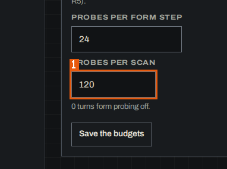

1. `spinbutton "Probes per scan"`

Related: applies on [SCR-030](03-screens.md#SCR-030)

Evidence:

- form `01a17540-ed12-7000-94e3-79de59f15ce2` — form: checks_per_scan, probes_per_step, probes_per_scan (run `01a1753d-a8da-7000-85d2-b19d666d3587`, map, 2026-10-25)
- screen region `01a17540-ecac-7000-9714-39aba77839c5` `spinbutton "Probes per scan"` — MudPuppy (/app/portals/reference-insurer-local/settings) (run `01a1753d-a8da-7000-85d2-b19d666d3587`, map, 2026-10-25)

### BR-020 — A probe budget of 0 turns form probing off

**BR-020** · rev 1 · draft · observed

> DRAFT — not confirmed by a reviewer

In the form "Budgets" the text "0 turns form probing off." applies to "Probes per form step" and "Probes per scan".

**Type:** inference

**On screen:** MudPuppy (/app/portals/reference-insurer-local/settings)

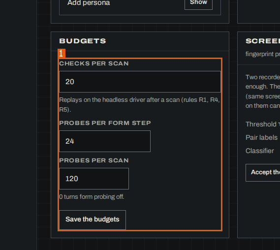

1. `form "Budgets"`

Related: applies on [SCR-030](03-screens.md#SCR-030)

Evidence:

- form `01a17540-ed12-7000-94e3-79de59f15ce2` — form: checks_per_scan, probes_per_step, probes_per_scan (run `01a1753d-a8da-7000-85d2-b19d666d3587`, map, 2026-10-25)
- screen region `01a17540-ecac-7000-9714-39aba77839c5` `form "Budgets"` — MudPuppy (/app/portals/reference-insurer-local/settings) (run `01a1753d-a8da-7000-85d2-b19d666d3587`, map, 2026-10-25)

### BR-021 — A persona needs a name of at most 24 characters

**BR-021** · rev 1 · draft · observed

> DRAFT — not confirmed by a reviewer

In the collapsed "Add persona" form on Settings, "Name" is required and at most 24 characters; the browser refuses an empty name with its own message "Please fill out this field." (from the field's required constraint). "Who this is" is optional (at most 140 characters) and "Signs in with" offers "Nothing: browses as a guest", the stored credential names and "Another credential name…".

**Type:** constraint

**On screen:** MudPuppy (/app/portals/reference-insurer-local/settings)

1. `region "Personas"`

Related: applies on [SCR-030](03-screens.md#SCR-030)

Evidence:

- form `01a17540-ed11-7001-86f9-d7bea337ecf8` — form: name, about, signIn (run `01a1753d-a8da-7000-85d2-b19d666d3587`, map, 2026-10-25) — note: name required, maxlength 24, validation message
- screen region `01a17540-ecac-7000-9714-39aba77839c5` `region "Personas"` — MudPuppy (/app/portals/reference-insurer-local/settings) (run `01a1753d-a8da-7000-85d2-b19d666d3587`, map, 2026-10-25)
- state `01a17540-ecac-7000-9714-39aba77839c5` — MudPuppy (/app/portals/reference-insurer-local/settings) (run `01a1753d-a8da-7000-85d2-b19d666d3587`, map, 2026-10-25) — note: group "Add persona Show"

### BR-022 — Saving and asking need the chat service; reading does not

**BR-022** · rev 1 · draft · observed

> DRAFT — not confirmed by a reviewer

When the assistant (chat service) is not running, the screens that save through it say so and disable the save: New portal shows the alert "Assistant not running It saves the portal. Start it in a terminal, then reload this page." and disables "Save portal"; Settings shows "Assistant not running It reads and saves portal settings. Start it in a terminal, then reload this page. Read-only parts keep working." and disables "Save environment"; the Workbench disables "Message" and "Send" with "Assistant unavailable — the live map still updates. Start the chat service." The start command "MUDPUPPY_ENV=local-dev pnpm --dir apps/chat start" is shown. All read-only pages kept working.

**Type:** action enabler

**Open questions about this:**

- [OQ-006](10-assumptions-and-questions.md#OQ-006) Why was "Send" disabled on Portal home?
- [OQ-007](10-assumptions-and-questions.md#OQ-007) When is "Save environment" enabled?

**On screen:** MudPuppy (/app/portals/reference-insurer-local/settings)

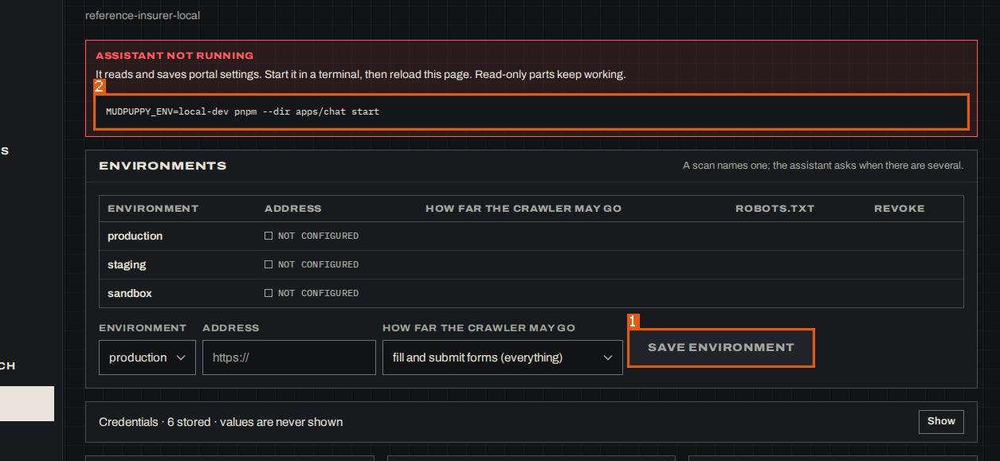

1. `button "Save environment"`
2. `region "Command that starts the chat service"`

**On screen:** MudPuppy (/app/portals/reference-insurer-local/workbench)

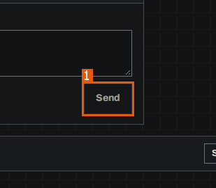

1. `button "Send"`

**On screen:** MudPuppy (/app/portals/new)

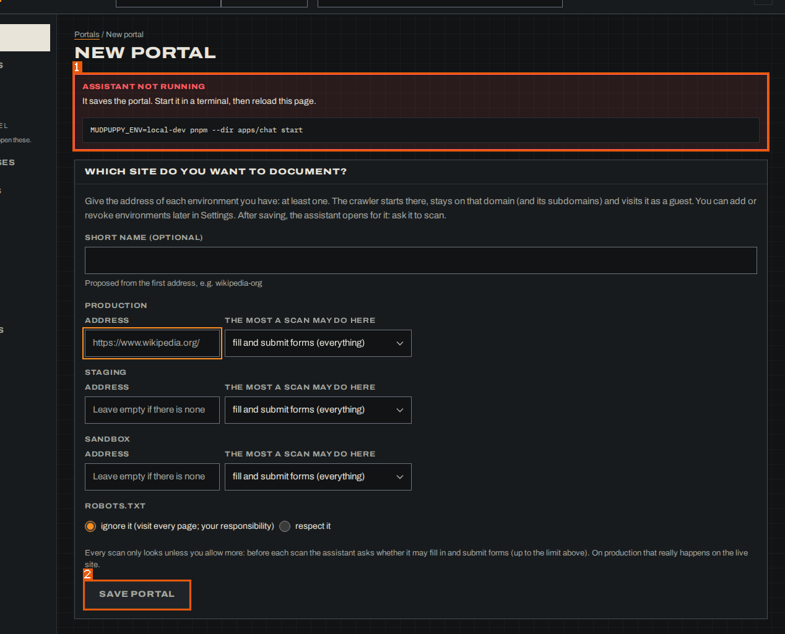

1. `alert`
2. `button "Save portal"`

Related: applies on [SCR-006](03-screens.md#SCR-006) · applies on [SCR-030](03-screens.md#SCR-030) · applies on [SCR-031](03-screens.md#SCR-031)

Evidence:

- network call `01a17540-ed15-7000-a00b-f6c9470a97fd` — GET /api/portals/reference-insurer-local/settings (run `01a1753d-a8da-7000-85d2-b19d666d3587`, map, 2026-10-25) — note: service_up and start_hint in settings
- network call `01a17541-b13a-7000-83f3-4a05944f7e21` — GET /api/portals/new (run `01a1753d-a8da-7000-85d2-b19d666d3587`, map, 2026-10-25) — note: service_up and start_hint in /api/portals/new
- screen region `01a17540-ecac-7000-9714-39aba77839c5` `button "Save environment"` — MudPuppy (/app/portals/reference-insurer-local/settings) (run `01a1753d-a8da-7000-85d2-b19d666d3587`, map, 2026-10-25)
- screen region `01a17540-ecac-7000-9714-39aba77839c5` `region "Command that starts the chat service"` — MudPuppy (/app/portals/reference-insurer-local/settings) (run `01a1753d-a8da-7000-85d2-b19d666d3587`, map, 2026-10-25)
- screen region `01a17541-8dad-7000-8cd1-09927b9bdaf7` `button "Send"` — MudPuppy (/app/portals/reference-insurer-local/workbench) (run `01a1753d-a8da-7000-85d2-b19d666d3587`, map, 2026-10-25)
- screen region `01a17541-b0b3-7000-b23a-7b9ba885ff54` `alert` — MudPuppy (/app/portals/new) (run `01a1753d-a8da-7000-85d2-b19d666d3587`, map, 2026-10-25)
- screen region `01a17541-b0b3-7000-b23a-7b9ba885ff54` `button "Save portal"` — MudPuppy (/app/portals/new) (run `01a1753d-a8da-7000-85d2-b19d666d3587`, map, 2026-10-25)

### BR-023 — The classifier can be accepted only once trained

**BR-023** · rev 1 · draft · inferred

> DRAFT — not confirmed by a reviewer

In "Screen identity" on Settings, "Accept the classifier" is disabled while "Classifier" reads "none trained yet"; "Accept the calibrated τ" is enabled. Inferred from the disabled button next to the empty classifier.

**Type:** action enabler

**Assumptions resting on this:**

- [ASM-001](10-assumptions-and-questions.md#ASM-001) The scanned console ran on a read-only copy of its store — to check

**On screen:** MudPuppy (/app/portals/reference-insurer-local/settings)

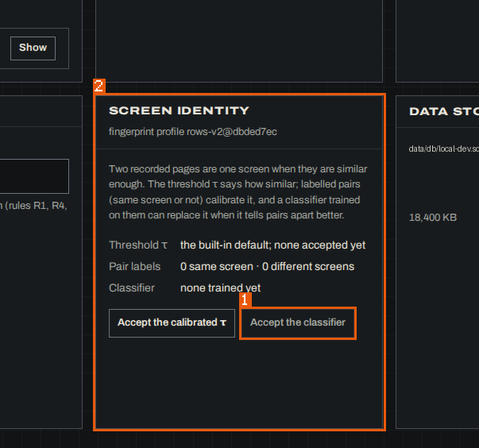

1. `button "Accept the classifier"`
2. `region "Screen identity"`

Related: applies on [SCR-030](03-screens.md#SCR-030)

Evidence:

- screen region `01a17540-ecac-7000-9714-39aba77839c5` `button "Accept the classifier"` — MudPuppy (/app/portals/reference-insurer-local/settings) (run `01a1753d-a8da-7000-85d2-b19d666d3587`, map, 2026-10-25)
- screen region `01a17540-ecac-7000-9714-39aba77839c5` `region "Screen identity"` — MudPuppy (/app/portals/reference-insurer-local/settings) (run `01a1753d-a8da-7000-85d2-b19d666d3587`, map, 2026-10-25)

### BR-024 — "Save" on Same screen? needs an answer

**BR-024** · rev 1 · draft · inferred

> DRAFT — not confirmed by a reviewer

On Same screen?, "Save" is disabled while none of the three answers ("Same screen", "Same, different data", "Different screens") is chosen; "Why (optional) W" may stay empty. Inferred from the disabled button with no radio checked.

**Type:** action enabler

**Assumptions resting on this:**

- [ASM-001](10-assumptions-and-questions.md#ASM-001) The scanned console ran on a read-only copy of its store — to check

**On screen:** MudPuppy (/app/portals/reference-insurer-local/same-screen)

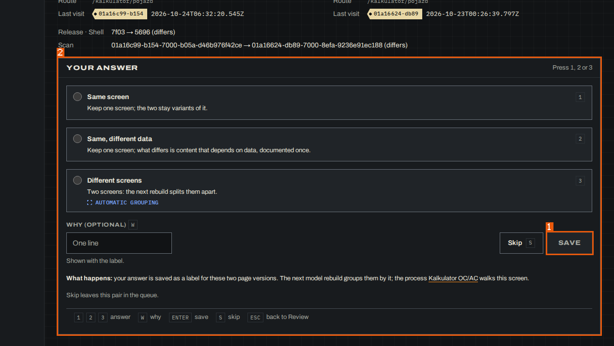

1. `button "Save"`
2. `region "Your answer"`

Related: applies on [SCR-013](03-screens.md#SCR-013)

Evidence:

- form `01a17541-10d4-7001-bef7-ce6452bfa668` — form: answer (run `01a1753d-a8da-7000-85d2-b19d666d3587`, map, 2026-10-25)
- screen region `01a17541-107a-7000-8bc5-38e73949e5be` `button "Save"` — MudPuppy (/app/portals/reference-insurer-local/same-screen) (run `01a1753d-a8da-7000-85d2-b19d666d3587`, map, 2026-10-25)
- screen region `01a17541-107a-7000-8bc5-38e73949e5be` `region "Your answer"` — MudPuppy (/app/portals/reference-insurer-local/same-screen) (run `01a1753d-a8da-7000-85d2-b19d666d3587`, map, 2026-10-25)

### BR-025 — Order of the Same screen? queue

**BR-025** · rev 1 · draft · observed

> DRAFT — not confirmed by a reviewer

Same screen? presents pairs in this order: "Conflicts first, then the pairs nearest the threshold τ 0.90 (within ±0.05): those answers move τ most. Then each screen's variants against its first." Each pair shows its similarity (e.g. "88% alike (MinHash)") and position ("1 of 4").

**Type:** computation

**On screen:** MudPuppy (/app/portals/reference-insurer-local/same-screen)

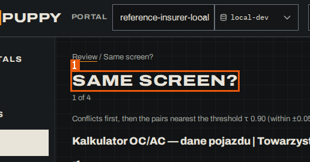

1. `heading "Same screen?"`

Related: applies on [SCR-013](03-screens.md#SCR-013)

Evidence:

- network call `01a17541-10d7-7000-820d-edf753763279` — GET /api/portals/reference-insurer-local/same-screen (run `01a1753d-a8da-7000-85d2-b19d666d3587`, map, 2026-10-25) — note: tau, window, similarity, position
- screen region `01a17541-107a-7000-8bc5-38e73949e5be` `heading "Same screen?"` — MudPuppy (/app/portals/reference-insurer-local/same-screen) (run `01a1753d-a8da-7000-85d2-b19d666d3587`, map, 2026-10-25)
- state `01a17541-107a-7000-8bc5-38e73949e5be` — MudPuppy (/app/portals/reference-insurer-local/same-screen) (run `01a1753d-a8da-7000-85d2-b19d666d3587`, map, 2026-10-25)

### BR-026 — When a scan belongs to a process

**BR-026** · rev 1 · draft · observed

> DRAFT — not confirmed by a reviewer

On Scans by process: "a scan belongs to a documented process when the process's documentation cites it, or when it walked at least two of the process's screens (error pages don't count)." Scans that belong to none are listed under "In no process" ("They are kept, not forgotten").

**Type:** inference

**Decision table:**

| the process's documentation cites the scan | screens of the process the scan walked (error pages excluded) | scan listed under the process |
| --- | --- | --- |
| yes | any | yes |
| no | 2 or more | yes |
| no | 0 or 1 | no ("In no process") |

**On screen:** MudPuppy (/app/portals/reference-insurer-local/scans/by-process)

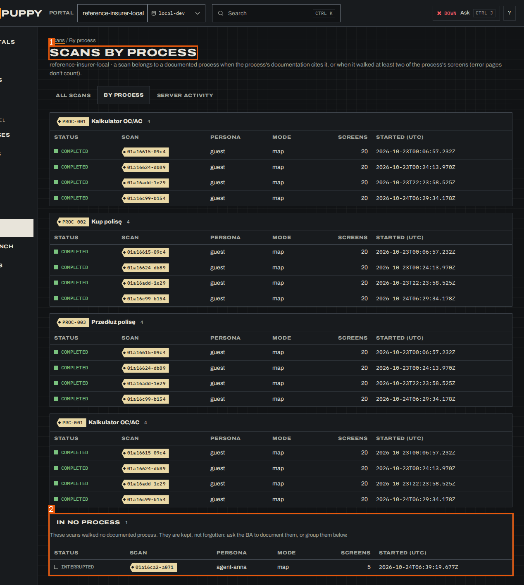

1. `heading "Scans by process"`
2. `region "In no process 1"`

Related: applies on [SCR-028](03-screens.md#SCR-028)

Evidence:

- screen region `01a17540-cd4b-7000-bd0b-34486f54a954` `heading "Scans by process"` — MudPuppy (/app/portals/reference-insurer-local/scans/by-process) (run `01a1753d-a8da-7000-85d2-b19d666d3587`, map, 2026-10-25)
- screen region `01a17540-cd4b-7000-bd0b-34486f54a954` `region "In no process 1"` — MudPuppy (/app/portals/reference-insurer-local/scans/by-process) (run `01a1753d-a8da-7000-85d2-b19d666d3587`, map, 2026-10-25)

### BR-027 — Screen pages step through the list they came from

**BR-027** · rev 1 · draft · observed

> DRAFT — not confirmed by a reviewer

A screen page opened from the Screens list (address parameter list=) shows the navigation "Screens in this list" with "← Previous", the position ("1 of 21") and "Next: <title>"; on the first screen "← Previous" is disabled. Opened with ?tab=actions or ?tab=history (from the tabs) the list navigation is not shown. The parameter tab selects the tab: actions gives "Actions", history gives "History"; without it "Variants" is selected.

**Type:** inference

**Decision table:**

| query parameter on the screen page | selected tab | "Screens in this list" shown |
| --- | --- | --- |
| list= (from the Screens list) | "Variants" | yes, "← Previous" disabled on the first |
| tab=actions | "Actions" | no |
| tab=history | "History" | no |

**On screen:** MudPuppy (/app/portals/:portal/screens/:screen)

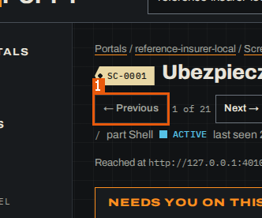

1. `link "← Previous"`

Related: applies on [SCR-016](03-screens.md#SCR-016)

Evidence:

- observation `01a1753e-f876-7002-a03c-c92ea52f913a` — http://127.0.0.1:8790/app/portals/reference-insurer-local/screens/SC-0001?list= (run `01a1753d-a8da-7000-85d2-b19d666d3587`, map, 2026-10-25) — note: ?list=
- observation `01a1753f-0444-7001-8ae1-eb8e7ba9efdb` — http://127.0.0.1:8790/app/portals/reference-insurer-local/screens/SC-0001?tab=actions (run `01a1753d-a8da-7000-85d2-b19d666d3587`, map, 2026-10-25) — note: ?tab=actions
- observation `01a1753f-10cc-7003-9863-d91adfca22c5` — http://127.0.0.1:8790/app/portals/reference-insurer-local/screens/SC-0001?tab=history (run `01a1753d-a8da-7000-85d2-b19d666d3587`, map, 2026-10-25) — note: ?tab=history
- screen region `01a1753e-f830-7000-9785-ac5128aa7dbb` `link "← Previous"` — MudPuppy (/app/portals/:portal/screens/:screen) (run `01a1753d-a8da-7000-85d2-b19d666d3587`, map, 2026-10-25)
- state `01a1753f-03a2-7000-8f11-81d64244d7fe` — MudPuppy (/app/portals/:portal/screens/:screen) (run `01a1753d-a8da-7000-85d2-b19d666d3587`, map, 2026-10-25) — note: Actions tab without list navigation

### BR-028 — Review address parameters

**BR-028** · rev 1 · draft · observed

> DRAFT — not confirmed by a reviewer

Review's address carries its view: select=<kind>:<id> selects one item and opens its detail (e.g. select=assumptions:ASM-001 from the link "No-claims discount is 10% of the base premium"); show=<kind> shows one kind (findings, rules, removals, processes, records, assumptions, differences, reanchor, proposals, suites, conflicts); tab=explained and tab=decided open "Explained automatically" and "Decided"; without parameters "Needs you" and all kinds are shown.

**Type:** inference

**Decision table:**

| query parameter on Review | what Review shows |
| --- | --- |
| none | "Needs you", all kinds |
| select=<kind>:<id> | the item selected, its detail and neighbours |
| show=<kind> | one kind of decision |
| tab=explained | "Explained automatically" |
| tab=decided | "Decided" |

**On screen:** MudPuppy (/app/portals/reference-insurer-local/review)

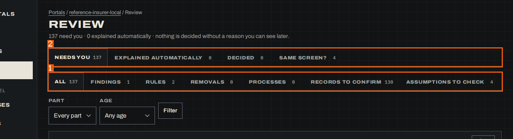

1. `navigation "Kinds of decision"` — ?show= links
2. `navigation "Review views"` — ?tab= links

Related: applies on [SCR-012](03-screens.md#SCR-012)

Evidence:

- network call `01a17541-38a0-7001-b5bc-4409201a4fdc` — GET /api/portals/reference-insurer-local/review (run `01a1753d-a8da-7000-85d2-b19d666d3587`, map, 2026-10-25)
- observation `01a17541-38a1-7003-9ede-ea9f5e23793f` — http://127.0.0.1:8790/app/portals/reference-insurer-local/review?select=assumptions%3AASM-001 (run `01a1753d-a8da-7000-85d2-b19d666d3587`, map, 2026-10-25) — note: ?select=assumptions:ASM-001
- screen region `01a1753e-be7a-7000-95e6-7606fb6ebc6e` `navigation "Kinds of decision"` — MudPuppy (/app/portals/reference-insurer-local/review) (run `01a1753d-a8da-7000-85d2-b19d666d3587`, map, 2026-10-25) — note: ?show= links
- screen region `01a1753e-be7a-7000-95e6-7606fb6ebc6e` `navigation "Review views"` — MudPuppy (/app/portals/reference-insurer-local/review) (run `01a1753d-a8da-7000-85d2-b19d666d3587`, map, 2026-10-25) — note: ?tab= links
- state `01a17541-381d-7000-89a5-270bc9ed695b` — MudPuppy (/app/portals/reference-insurer-local/review) (run `01a1753d-a8da-7000-85d2-b19d666d3587`, map, 2026-10-25)

### BR-029 — The model parameter selects the process model

**BR-029** · rev 1 · draft · observed

> DRAFT — not confirmed by a reviewer

A process page opened with model=<label> (e.g. model=A from "A r3" on Processes or "View" on History) shows that process model; the run saw only model A, pressed as "A · As-is r3". The process API is called with the same parameter.

**Type:** inference

**On screen:** MudPuppy (/app/portals/:portal/processes/:key)

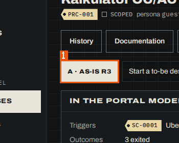

1. `button "A · As-is r3"`

Related: applies on [SCR-008](03-screens.md#SCR-008)

Evidence:

- network call `01a1753e-1f64-7000-9c75-c5edf6e63785` — GET /api/portals/reference-insurer-local/processes/PRC-001 (run `01a1753d-a8da-7000-85d2-b19d666d3587`, map, 2026-10-25) — note: processes/PRC-001?model=A
- observation `01a1753e-1f65-7002-8547-916b232a5f23` — http://127.0.0.1:8790/app/portals/reference-insurer-local/processes/PRC-001?model=A (run `01a1753d-a8da-7000-85d2-b19d666d3587`, map, 2026-10-25) — note: ?model=A
- screen region `01a1753e-01fe-7000-91d8-152388d28304` `button "A · As-is r3"` — MudPuppy (/app/portals/:portal/processes/:key) (run `01a1753d-a8da-7000-85d2-b19d666d3587`, map, 2026-10-25)

### BR-030 — A new portal needs at least one environment address

**BR-030** · rev 1 · draft · observed

> DRAFT — not confirmed by a reviewer

The form "New portal" asks for "the address of each environment you have: at least one" in the groups "production", "staging" and "sandbox" ("Address"; staging and sandbox say "Leave empty if there is none"). "Short name (optional)" is "Proposed from the first address, e.g. wikipedia-org". How the form enforces the minimum was not seen: "Save portal" was disabled for another reason (the assistant was not running).

**Type:** constraint

**On screen:** MudPuppy (/app/portals/new)

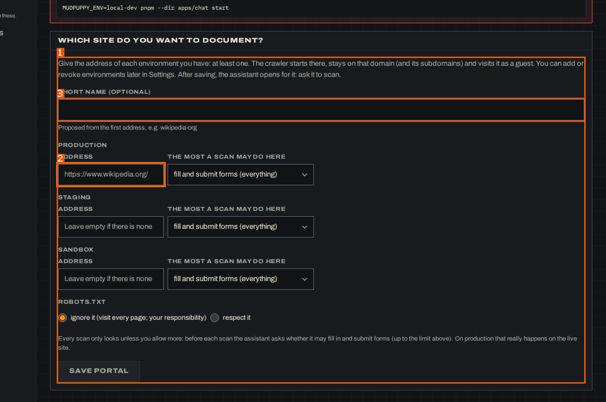

1. `form "New portal"`
2. `textbox "Address"`
3. `textbox "Short name (optional)"`

Related: applies on [SCR-006](03-screens.md#SCR-006)

Evidence:

- form `01a17541-b138-7000-8307-39202088586d` — form: id, envs.0.base_url, envs.0.limit, envs.1.base_url (run `01a1753d-a8da-7000-85d2-b19d666d3587`, map, 2026-10-25)
- screen region `01a17541-b0b3-7000-b23a-7b9ba885ff54` `form "New portal"` — MudPuppy (/app/portals/new) (run `01a1753d-a8da-7000-85d2-b19d666d3587`, map, 2026-10-25)
- screen region `01a17541-b0b3-7000-b23a-7b9ba885ff54` `textbox "Address"` — MudPuppy (/app/portals/new) (run `01a1753d-a8da-7000-85d2-b19d666d3587`, map, 2026-10-25)
- screen region `01a17541-b0b3-7000-b23a-7b9ba885ff54` `textbox "Short name (optional)"` — MudPuppy (/app/portals/new) (run `01a1753d-a8da-7000-85d2-b19d666d3587`, map, 2026-10-25)

### BR-031 — Crawl limit per environment and consent before each scan

**BR-031** · rev 1 · draft · observed

> DRAFT — not confirmed by a reviewer

Each environment has a limit chosen from four levels in "The most a scan may do here" (New portal) or "How far the crawler may go" (Settings): "fill and submit forms (everything)", "up to deleting things, no outside effects", "change data, never delete", "only look, never submit". New portal states: "Every scan only looks unless you allow more: before each scan the assistant asks whether it may fill in and submit forms (up to the limit above). On production that really happens on the live site."

**Type:** constraint

**Decision table:**

| environment limit | BA allows more before the scan | what the scan may do |
| --- | --- | --- |
| any | no | only look |
| "only look, never submit" | yes | only look |
| "change data, never delete" | yes | fill and submit forms that change data, never delete |
| "up to deleting things, no outside effects" | yes | up to deleting, no outside effects |
| "fill and submit forms (everything)" | yes | everything |

**On screen:** MudPuppy (/app/portals/reference-insurer-local/settings)

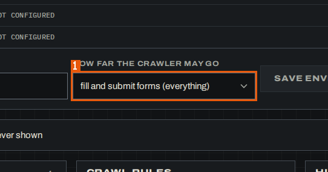

1. `combobox "How far the crawler may go"`

**On screen:** MudPuppy (/app/portals/new)

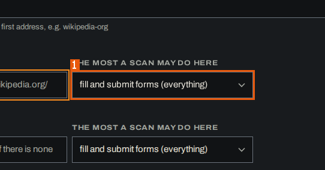

1. `combobox "The most a scan may do here"`

Related: applies on [SCR-006](03-screens.md#SCR-006) · applies on [SCR-030](03-screens.md#SCR-030)

Evidence:

- form `01a17540-ed11-7000-85cd-4c336b5cba88` — form: name, url, limit (run `01a1753d-a8da-7000-85d2-b19d666d3587`, map, 2026-10-25)
- form `01a17541-b138-7000-8307-39202088586d` — form: id, envs.0.base_url, envs.0.limit, envs.1.base_url (run `01a1753d-a8da-7000-85d2-b19d666d3587`, map, 2026-10-25)
- screen region `01a17540-ecac-7000-9714-39aba77839c5` `combobox "How far the crawler may go"` — MudPuppy (/app/portals/reference-insurer-local/settings) (run `01a1753d-a8da-7000-85d2-b19d666d3587`, map, 2026-10-25)
- screen region `01a17541-b0b3-7000-b23a-7b9ba885ff54` `combobox "The most a scan may do here"` — MudPuppy (/app/portals/new) (run `01a1753d-a8da-7000-85d2-b19d666d3587`, map, 2026-10-25)

### BR-032 — The crawler stays on the portal's domain and starts as a guest

**BR-032** · rev 1 · draft · observed

> DRAFT — not confirmed by a reviewer

New portal states: "The crawler starts there, stays on that domain (and its subdomains) and visits it as a guest." Settings shows the crawl rules read from the portal file ("robots.txt", "Allowed domains", "Allowed URLs", "Disallowed URLs"), changeable only through the assistant ("Ask the assistant to change a rule."). The "robots.txt" choice is "ignore it (visit every page; your responsibility)" (default) or "respect it".

**Type:** constraint

**On screen:** MudPuppy (/app/portals/reference-insurer-local/settings)

1. `region "Crawl rules"`

**On screen:** MudPuppy (/app/portals/new)

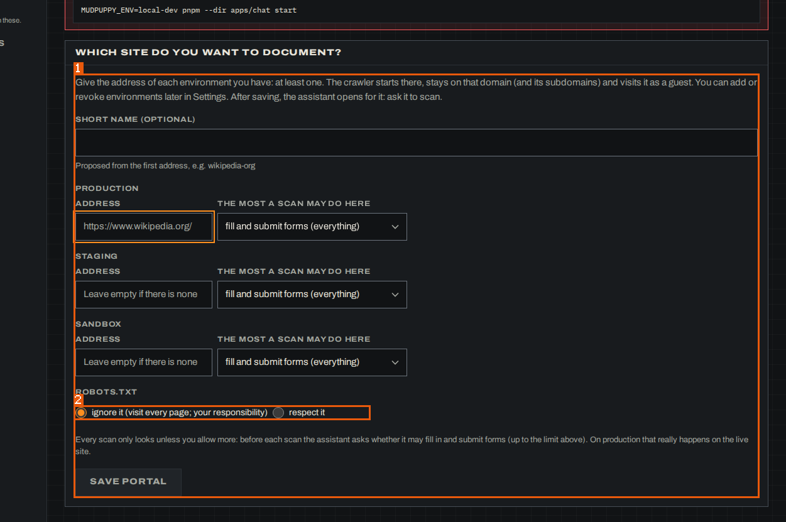

1. `form "New portal"`
2. `radio "ignore it (visit every page; your responsibility)"`

Related: applies on [SCR-006](03-screens.md#SCR-006) · applies on [SCR-030](03-screens.md#SCR-030)

Evidence:

- screen region `01a17540-ecac-7000-9714-39aba77839c5` `region "Crawl rules"` — MudPuppy (/app/portals/reference-insurer-local/settings) (run `01a1753d-a8da-7000-85d2-b19d666d3587`, map, 2026-10-25)
- screen region `01a17541-b0b3-7000-b23a-7b9ba885ff54` `form "New portal"` — MudPuppy (/app/portals/new) (run `01a1753d-a8da-7000-85d2-b19d666d3587`, map, 2026-10-25)
- screen region `01a17541-b0b3-7000-b23a-7b9ba885ff54` `radio "ignore it (visit every page; your responsibility)"` — MudPuppy (/app/portals/new) (run `01a1753d-a8da-7000-85d2-b19d666d3587`, map, 2026-10-25)

### BR-033 — Documentation is written by the BA agent and reviewed by a person

**BR-033** · rev 1 · draft · observed

> DRAFT — not confirmed by a reviewer

Docs is read-only: "Read-only: the BA agent writes it from the recorded scans; a person reviews each record." and "Every statement cites evidence; anything the crawler could not observe is marked Not observed and has an open question." Records are drafts until reviewed ("134 Draft").

**Type:** constraint

**On screen:** MudPuppy (/app/portals/reference-insurer-local/docs)

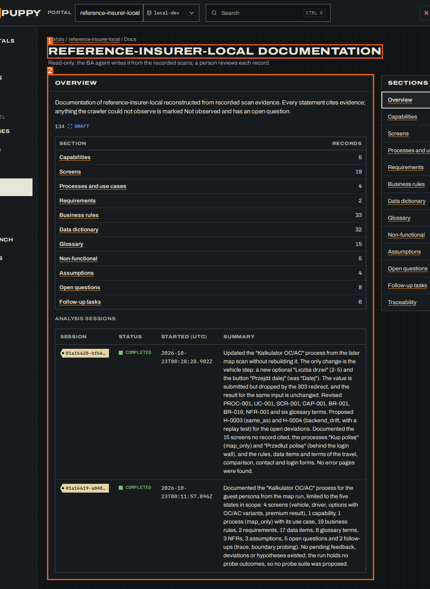

1. `heading "reference-insurer-local documentation"`
2. `region "Overview"`

Related: applies on [SCR-021](03-screens.md#SCR-021) · applies on [SCR-023](03-screens.md#SCR-023)

Evidence:

- screen region `01a1753f-88ed-7000-8899-2ac9d81c7464` `heading "reference-insurer-local documentation"` — MudPuppy (/app/portals/reference-insurer-local/docs) (run `01a1753d-a8da-7000-85d2-b19d666d3587`, map, 2026-10-25)
- screen region `01a1753f-88ed-7000-8899-2ac9d81c7464` `region "Overview"` — MudPuppy (/app/portals/reference-insurer-local/docs) (run `01a1753d-a8da-7000-85d2-b19d666d3587`, map, 2026-10-25)

### BR-034 — Assistant suggestions are not saved until accepted

**BR-034** · rev 1 · draft · observed

> DRAFT — not confirmed by a reviewer

The assistant's work is proposed, not applied: Portal home says "Its proposals land in Review and Processes, marked as the assistant's."; Processes says of "Suggested by the assistant": "Inferred · not saved From links between screens. Nothing is saved until you accept." and "dismissed groupings are not suggested again"; Review has the kind "Assistant proposals".

**Type:** constraint

**On screen:** MudPuppy (/app/portals/reference-insurer-local)

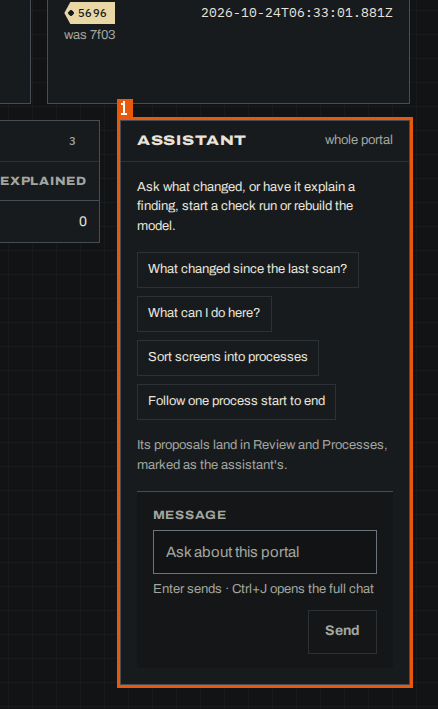

1. `region "Assistant"`

**On screen:** MudPuppy (/app/portals/reference-insurer-local/processes)

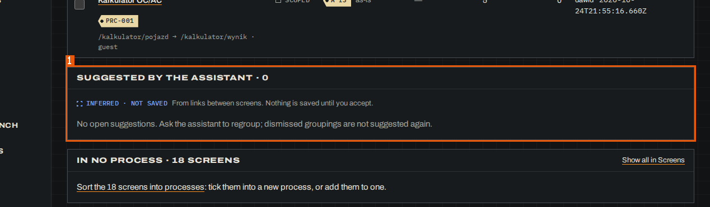

1. `region "Suggested by the assistant · 0"`

**On screen:** MudPuppy (/app/portals/reference-insurer-local/review)

1. `link "Assistant proposals 0"` _(not visible on the screenshot)_

Related: applies on [SCR-007](03-screens.md#SCR-007) · applies on [SCR-011](03-screens.md#SCR-011) · applies on [SCR-012](03-screens.md#SCR-012)

Evidence:

- screen region `01a1753d-debd-7000-b943-374405412ad9` `region "Assistant"` — MudPuppy (/app/portals/reference-insurer-local) (run `01a1753d-a8da-7000-85d2-b19d666d3587`, map, 2026-10-25)
- screen region `01a1753d-f0de-7001-94e6-0e4cf819f4b8` `region "Suggested by the assistant · 0"` — MudPuppy (/app/portals/reference-insurer-local/processes) (run `01a1753d-a8da-7000-85d2-b19d666d3587`, map, 2026-10-25)
- screen region `01a1753e-be7a-7000-95e6-7606fb6ebc6e` `link "Assistant proposals 0"` — MudPuppy (/app/portals/reference-insurer-local/review) (run `01a1753d-a8da-7000-85d2-b19d666d3587`, map, 2026-10-25)

### BR-035 — A command proposed in the Workbench starts only after Confirm

**BR-035** · rev 1 · draft · inferred

> DRAFT — not confirmed by a reviewer

In the stored Workbench conversation the assistant set up "Start a map scan" commands that were "waiting for you to press Confirm and won't start until you do"; after "You confirmed a command; the assistant starts it." A refused command card shows "Didn't start" with "Created" ("nothing: no scan, no pages, nothing in Scans"), "Why" and an error "Reference", plus "Start again" and "Check the address". The notice "Commands are paused. Use Scans for now." was shown. Inferred from the conversation text, not from a live command.

**Type:** action enabler

**On screen:** MudPuppy (/app/portals/reference-insurer-local/workbench)

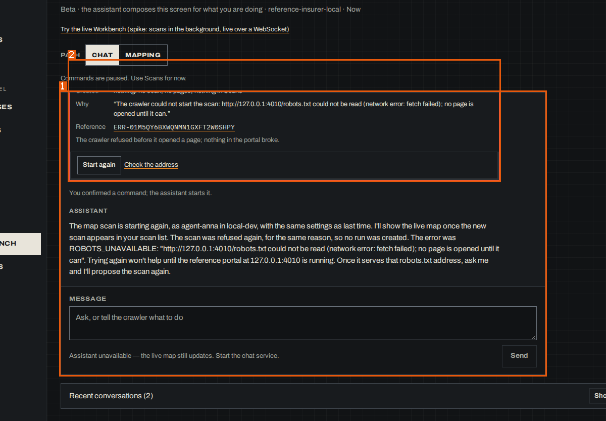

1. `region "Conversation"`
2. `region "Start a map scan"#2`

Related: applies on [SCR-031](03-screens.md#SCR-031)

Evidence:

- network call `01a17541-8e26-7000-a236-205d16042827` — GET /api/workbench/portals/reference-insurer-local (run `01a1753d-a8da-7000-85d2-b19d666d3587`, map, 2026-10-25) — note: statuses wb_cmd proposed/running/done/failed/undone
- screen region `01a17541-8dad-7000-8cd1-09927b9bdaf7` `region "Conversation"` — MudPuppy (/app/portals/reference-insurer-local/workbench) (run `01a1753d-a8da-7000-85d2-b19d666d3587`, map, 2026-10-25)
- screen region `01a17541-8dad-7000-8cd1-09927b9bdaf7` `region "Start a map scan"#2` — MudPuppy (/app/portals/reference-insurer-local/workbench) (run `01a1753d-a8da-7000-85d2-b19d666d3587`, map, 2026-10-25)

### BR-036 — Nothing in Review is decided without a visible reason

**BR-036** · rev 1 · draft · observed

> DRAFT — not confirmed by a reviewer

Review states "nothing is decided without a reason you can see later." and splits items into "Needs you", "Explained automatically" and "Decided"; items explained by a rule show the reason (chips such as "Rule decides"), unexplained ones show "No rule explained it yet."

**Type:** constraint

**On screen:** MudPuppy (/app/portals/reference-insurer-local/review)

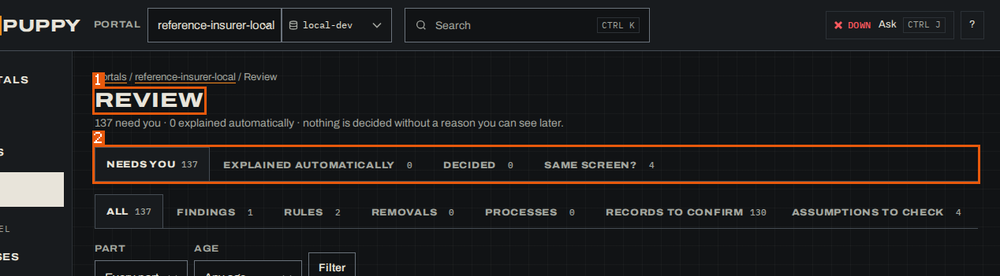

1. `heading "Review"`
2. `navigation "Review views"`

Related: applies on [SCR-012](03-screens.md#SCR-012)

Evidence:

- screen region `01a1753e-be7a-7000-95e6-7606fb6ebc6e` `heading "Review"` — MudPuppy (/app/portals/reference-insurer-local/review) (run `01a1753d-a8da-7000-85d2-b19d666d3587`, map, 2026-10-25)
- screen region `01a1753e-be7a-7000-95e6-7606fb6ebc6e` `navigation "Review views"` — MudPuppy (/app/portals/reference-insurer-local/review) (run `01a1753d-a8da-7000-85d2-b19d666d3587`, map, 2026-10-25)
- state `01a1753e-a32f-7000-8071-a4b29979685b` — MudPuppy (/app/portals/mudpuppy-dashboard-local/review) (run `01a1753d-a8da-7000-85d2-b19d666d3587`, map, 2026-10-25)

### BR-037 — "Same screen?" appears only when pairs wait

**BR-037** · rev 1 · draft · inferred

> DRAFT — not confirmed by a reviewer

The link "Same screen? <n>" in "Review views" was shown for a portal with 4 pairs and absent for a portal with nothing in Review. Inferred: the link is shown only when at least one pair waits (the review API returns same_screen_pairs).

**Type:** inference

**Assumptions resting on this:**

- [ASM-002](10-assumptions-and-questions.md#ASM-002) The data shown is test data and does not change the console's behaviour — to check

**On screen:** MudPuppy (/app/portals/mudpuppy-dashboard-local/review)

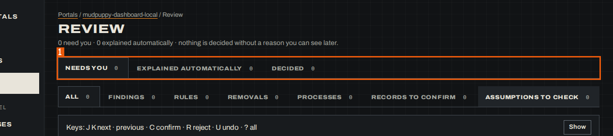

1. `navigation "Review views"` — no Same screen? link

**On screen:** MudPuppy (/app/portals/reference-insurer-local/review)

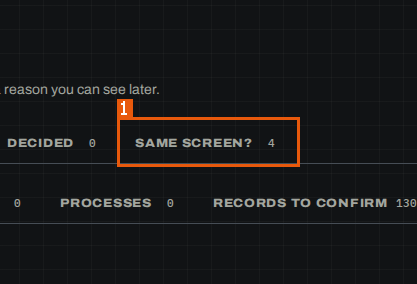

1. `link "Same screen? 4"`

Related: applies on [SCR-012](03-screens.md#SCR-012)

Evidence:

- network call `01a1753e-a36c-7002-8b19-73358b4c5868` — GET /api/portals/mudpuppy-dashboard-local/review (run `01a1753d-a8da-7000-85d2-b19d666d3587`, map, 2026-10-25)
- screen region `01a1753e-a32f-7000-8071-a4b29979685b` `navigation "Review views"` — MudPuppy (/app/portals/mudpuppy-dashboard-local/review) (run `01a1753d-a8da-7000-85d2-b19d666d3587`, map, 2026-10-25) — note: no Same screen? link
- screen region `01a1753e-be7a-7000-95e6-7606fb6ebc6e` `link "Same screen? 4"` — MudPuppy (/app/portals/reference-insurer-local/review) (run `01a1753d-a8da-7000-85d2-b19d666d3587`, map, 2026-10-25)
