# 7. Data dictionary

### DI-001 — Search (global search field)

**DI-001** · rev 1 · draft · observed

> DRAFT — not confirmed by a reviewer

**Name (verbatim):** Search (en)

**English name:** Global search query

**Type:** string (search)

**Constraints:** format: free text; sent as query parameter q to /app/search and /api/search (e.g. q=premium); shortcut Ctrl K; required: false

**Seen in:**

- form on /app (`01a1753d-bae6-7000-a5c1-a16020db7b9a`)
- form on /app/search (`01a17541-d60f-7001-b4d9-4b9b2e476902`)
- URL http://127.0.0.1:8790/app/search?q=premium (`01a17541-d612-7001-bfc1-a52f494b0d2e`)

**On screen:** MudPuppy (/app)

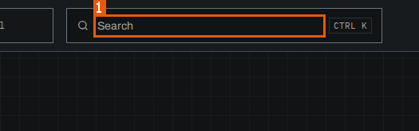

1. `searchbox "Search"`

**On screen:** MudPuppy (/app/search)

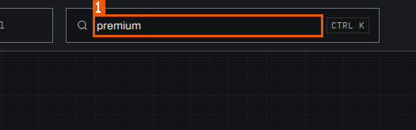

1. `searchbox "Search"`

Related: appears on [SCR-001](03-screens.md#SCR-001) · appears on [SCR-004](03-screens.md#SCR-004)

Evidence:

- form `01a1753d-bae6-7000-a5c1-a16020db7b9a` — form: q (run `01a1753d-a8da-7000-85d2-b19d666d3587`, map, 2026-10-25)
- screen region `01a1753d-ba74-7000-a2d2-3da8da9e7760` `searchbox "Search"` — MudPuppy (/app) (run `01a1753d-a8da-7000-85d2-b19d666d3587`, map, 2026-10-25)
- screen region `01a17541-d5d8-7000-bc63-ab757f9c7158` `searchbox "Search"` — MudPuppy (/app/search) (run `01a1753d-a8da-7000-85d2-b19d666d3587`, map, 2026-10-25)

### DI-002 — Filter terms

**DI-002** · rev 1 · draft · observed

> DRAFT — not confirmed by a reviewer

**Name (verbatim):** Filter terms (en)

**English name:** Glossary term filter

**Type:** string (search)

**Constraints:** required: false

**Seen in:**

- form on /app/glossary (`01a1753d-d35b-7001-b5a0-ab1feae76946`)
- form on /app/glossary (`01a17541-53b5-7000-a1e8-412286fde0c4`)

**On screen:** MudPuppy (/app/glossary)

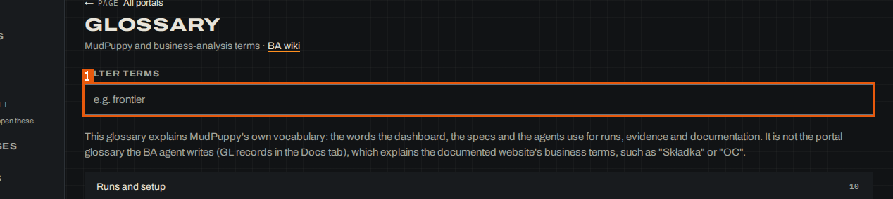

1. `searchbox "Filter terms"`

Related: appears on [SCR-002](03-screens.md#SCR-002)

Evidence:

- form `01a1753d-d35b-7001-b5a0-ab1feae76946` — form: _r_7_ (run `01a1753d-a8da-7000-85d2-b19d666d3587`, map, 2026-10-25)
- screen region `01a1753d-cef0-7000-935b-db03378d928b` `searchbox "Filter terms"` — MudPuppy (/app/glossary) (run `01a1753d-a8da-7000-85d2-b19d666d3587`, map, 2026-10-25)

### DI-003 — Message (Ask the assistant on Portal home)

**DI-003** · rev 1 · draft · observed

> DRAFT — not confirmed by a reviewer

**Name (verbatim):** Message (en)

**English name:** Question to the portal's assistant

**Type:** string (text)

**Constraints:** format: placeholder "Ask about this portal"; "Enter sends · Ctrl+J opens the full chat"; required: false

**Seen in:**

- form on /app/portals/reference-insurer-local (`01a1753d-df16-7000-9458-ac12f9966852`)

**On screen:** MudPuppy (/app/portals/reference-insurer-local)

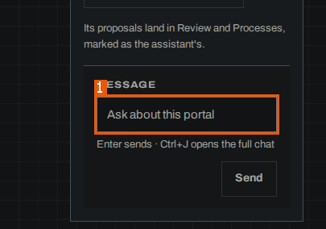

1. `textbox "Message"`

Related: appears on [SCR-011](03-screens.md#SCR-011)

Evidence:

- form `01a1753d-df16-7000-9458-ac12f9966852` — form: _r_d_ (run `01a1753d-a8da-7000-85d2-b19d666d3587`, map, 2026-10-25)
- screen region `01a1753d-debd-7000-b943-374405412ad9` `textbox "Message"` — MudPuppy (/app/portals/reference-insurer-local) (run `01a1753d-a8da-7000-85d2-b19d666d3587`, map, 2026-10-25)

### DI-004 — Tick <process> (process selection checkbox)

**DI-004** · rev 1 · draft · observed

> DRAFT — not confirmed by a reviewer

**Name (verbatim):** Tick Kalkulator OC/AC (en)

**English name:** Select a process row

**Type:** boolean (checkbox)

**Constraints:** format: one per process row, labelled "Tick <process name>"; required: false

**Seen in:**

- form on /app/portals/reference-insurer-local/processes (`01a1753d-f117-7001-a90b-6dfba9ef6d48`)

**On screen:** MudPuppy (/app/portals/reference-insurer-local/processes)

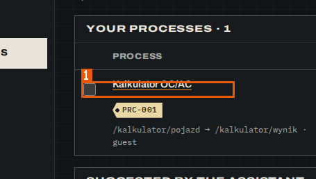

1. `checkbox "Tick Kalkulator OC/AC"`

Related: appears on [SCR-007](03-screens.md#SCR-007)

Evidence:

- form `01a1753d-f117-7001-a90b-6dfba9ef6d48` — form: Tick Kalkulator OC/AC (run `01a1753d-a8da-7000-85d2-b19d666d3587`, map, 2026-10-25)
- screen region `01a1753d-f0de-7001-94e6-0e4cf819f4b8` `checkbox "Tick Kalkulator OC/AC"` — MudPuppy (/app/portals/reference-insurer-local/processes) (run `01a1753d-a8da-7000-85d2-b19d666d3587`, map, 2026-10-25)

### DI-005 — Add a recorded screen at the end

**DI-005** · rev 1 · draft · observed

> DRAFT — not confirmed by a reviewer

**Name (verbatim):** Add a recorded screen at the end (en)

**English name:** Recorded screen to append to the process model

**Type:** enum (select)

**Constraints:** format: options "<route> · <page title>", one per recorded screen of the portal; first option selected by default; required: false

**Seen in:**

- form on /app/portals/:portal/processes/:key (`01a1753e-02b2-7000-a11d-0fe7e21b0946`)
- form on /app/portals/:portal/processes/:key (`01a1753e-1f61-7002-9d5d-5d5ffe03d3f5`)

**On screen:** MudPuppy (/app/portals/:portal/processes/:key)

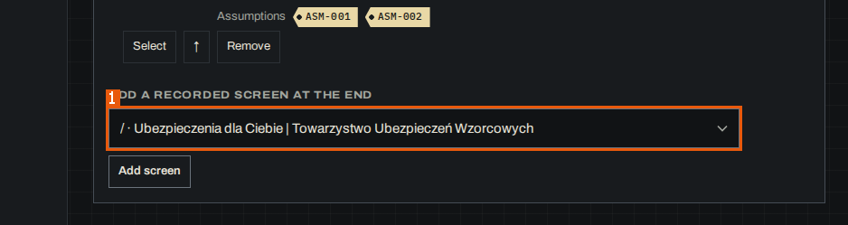

1. `combobox "Add a recorded screen at the end"`

Related: appears on [SCR-008](03-screens.md#SCR-008)

Evidence:

- form `01a1753e-02b2-7000-a11d-0fe7e21b0946` — form: _r_q_ (run `01a1753d-a8da-7000-85d2-b19d666d3587`, map, 2026-10-25)
- screen region `01a1753e-01fe-7000-91d8-152388d28304` `combobox "Add a recorded screen at the end"` — MudPuppy (/app/portals/:portal/processes/:key) (run `01a1753d-a8da-7000-85d2-b19d666d3587`, map, 2026-10-25)

### DI-006 — Stage (process)

**DI-006** · rev 1 · draft · observed

> DRAFT — not confirmed by a reviewer

**Name (verbatim):** Stage (en)

**English name:** Process stage

**Type:** enum (select)

**Constraints:** allowed values: Scoped, As-is documented, To-be in design, Migrating, Migrated; format: current stage preselected; required: false

**Seen in:**

- form on /app/portals/:portal/processes/:key (`01a1753e-02b2-7001-9aec-5e0d9d3d0fab`)
- form on /app/portals/:portal/processes/:key (`01a1753e-1f62-7000-a3d6-933175e16dea`)

**On screen:** MudPuppy (/app/portals/:portal/processes/:key)

1. `combobox "Stage"`

Related: appears on [SCR-008](03-screens.md#SCR-008)

Evidence:

- form `01a1753e-02b2-7001-9aec-5e0d9d3d0fab` — form: _r_o_ (run `01a1753d-a8da-7000-85d2-b19d666d3587`, map, 2026-10-25)
- screen region `01a1753e-01fe-7000-91d8-152388d28304` `combobox "Stage"` — MudPuppy (/app/portals/:portal/processes/:key) (run `01a1753d-a8da-7000-85d2-b19d666d3587`, map, 2026-10-25)

### DI-007 — Process model to mark live in sandbox

**DI-007** · rev 1 · draft · observed

> DRAFT — not confirmed by a reviewer

**Name (verbatim):** Process model to mark live in sandbox (en)

**English name:** Model to mark live in sandbox

**Type:** enum (select)

**Constraints:** format: one option per model revision, e.g. "A r3"; required: false

**Seen in:**

- form on /app/portals/reference-insurer-local/processes/PRC-001/history (`01a1753e-127d-7001-a77a-9dfda1eac68e`)

**On screen:** MudPuppy (/app/portals/reference-insurer-local/processes/PRC-001/history)

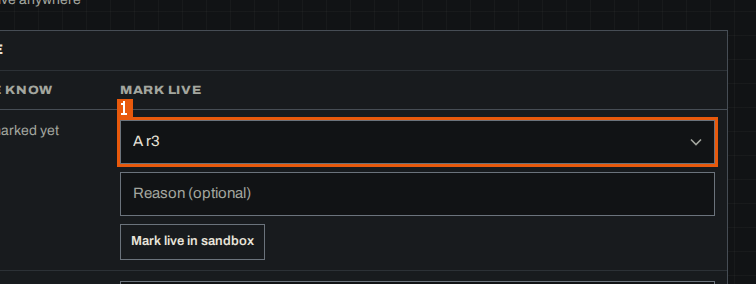

1. `combobox "Process model to mark live in sandbox"`

Related: appears on [SCR-009](03-screens.md#SCR-009)

Evidence:

- form `01a1753e-127d-7001-a77a-9dfda1eac68e` — form: Process model to mark live in sandbox, Reason (optional) (run `01a1753d-a8da-7000-85d2-b19d666d3587`, map, 2026-10-25)
- screen region `01a1753e-122f-7000-ac31-15f9bbe7957d` `combobox "Process model to mark live in sandbox"` — MudPuppy (/app/portals/reference-insurer-local/processes/PRC-001/history) (run `01a1753d-a8da-7000-85d2-b19d666d3587`, map, 2026-10-25)

### DI-008 — Process model to mark live in staging

**DI-008** · rev 1 · draft · observed

> DRAFT — not confirmed by a reviewer

**Name (verbatim):** Process model to mark live in staging (en)

**English name:** Model to mark live in staging

**Type:** enum (select)

**Constraints:** format: one option per model revision, e.g. "A r3"; required: false

**Seen in:**

- form on /app/portals/reference-insurer-local/processes/PRC-001/history (`01a1753e-127d-7002-a61b-da5c854adabc`)

**On screen:** MudPuppy (/app/portals/reference-insurer-local/processes/PRC-001/history)

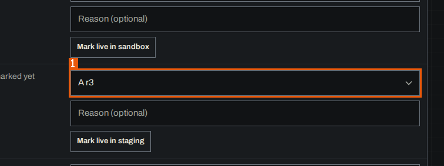

1. `combobox "Process model to mark live in staging"`

Related: appears on [SCR-009](03-screens.md#SCR-009)

Evidence:

- form `01a1753e-127d-7002-a61b-da5c854adabc` — form: Process model to mark live in staging, Reason (optional) (run `01a1753d-a8da-7000-85d2-b19d666d3587`, map, 2026-10-25)
- screen region `01a1753e-122f-7000-ac31-15f9bbe7957d` `combobox "Process model to mark live in staging"` — MudPuppy (/app/portals/reference-insurer-local/processes/PRC-001/history) (run `01a1753d-a8da-7000-85d2-b19d666d3587`, map, 2026-10-25)

### DI-009 — Process model to mark live in production

**DI-009** · rev 1 · draft · observed

> DRAFT — not confirmed by a reviewer

**Name (verbatim):** Process model to mark live in production (en)

**English name:** Model to mark live in production

**Type:** enum (select)

**Constraints:** format: one option per model revision, e.g. "A r3"; required: false

**Seen in:**

- form on /app/portals/reference-insurer-local/processes/PRC-001/history (`01a1753e-127d-7003-aef3-e51200e7a804`)

**On screen:** MudPuppy (/app/portals/reference-insurer-local/processes/PRC-001/history)

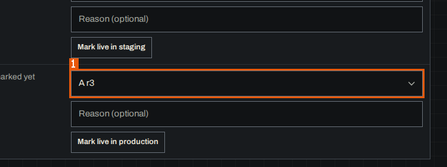

1. `combobox "Process model to mark live in production"`

Related: appears on [SCR-009](03-screens.md#SCR-009)

Evidence:

- form `01a1753e-127d-7003-aef3-e51200e7a804` — form: Process model to mark live in production, Reason (optional) (run `01a1753d-a8da-7000-85d2-b19d666d3587`, map, 2026-10-25)
- screen region `01a1753e-122f-7000-ac31-15f9bbe7957d` `combobox "Process model to mark live in production"` — MudPuppy (/app/portals/reference-insurer-local/processes/PRC-001/history) (run `01a1753d-a8da-7000-85d2-b19d666d3587`, map, 2026-10-25)

### DI-010 — Reason (optional) for marking a model live

**DI-010** · rev 1 · draft · observed

> DRAFT — not confirmed by a reviewer

**Name (verbatim):** Reason (optional) (en)

**English name:** Reason for the live mark

**Type:** string (text)

**Constraints:** format: one field per environment row (sandbox, staging, production); max length: 500; required: false

**Seen in:**

- form on /app/portals/reference-insurer-local/processes/PRC-001/history (`01a1753e-127d-7001-a77a-9dfda1eac68e`)
- form on /app/portals/reference-insurer-local/processes/PRC-001/history (`01a1753e-127d-7002-a61b-da5c854adabc`)
- form on /app/portals/reference-insurer-local/processes/PRC-001/history (`01a1753e-127d-7003-aef3-e51200e7a804`)

**On screen:** MudPuppy (/app/portals/reference-insurer-local/processes/PRC-001/history)

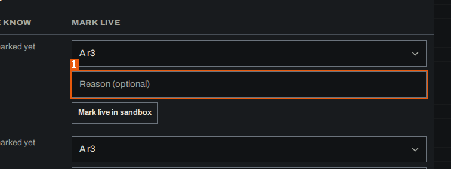

1. `textbox "Reason (optional)"`

Related: appears on [SCR-009](03-screens.md#SCR-009)

Evidence:

- form `01a1753e-127d-7001-a77a-9dfda1eac68e` — form: Process model to mark live in sandbox, Reason (optional) (run `01a1753d-a8da-7000-85d2-b19d666d3587`, map, 2026-10-25)
- form `01a1753e-127d-7002-a61b-da5c854adabc` — form: Process model to mark live in staging, Reason (optional) (run `01a1753d-a8da-7000-85d2-b19d666d3587`, map, 2026-10-25)
- form `01a1753e-127d-7003-aef3-e51200e7a804` — form: Process model to mark live in production, Reason (optional) (run `01a1753d-a8da-7000-85d2-b19d666d3587`, map, 2026-10-25)
- screen region `01a1753e-122f-7000-ac31-15f9bbe7957d` `textbox "Reason (optional)"` — MudPuppy (/app/portals/reference-insurer-local/processes/PRC-001/history) (run `01a1753d-a8da-7000-85d2-b19d666d3587`, map, 2026-10-25)

### DI-011 — Single-key shortcuts in this browser

**DI-011** · rev 1 · draft · observed

> DRAFT — not confirmed by a reviewer

**Name (verbatim):** Single-key shortcuts in this browser (en)

**English name:** Enable single-key review shortcuts

**Type:** boolean (checkbox)

**Constraints:** format: inside the collapsed group "Keys: J K next · previous · C confirm · R reject · U undo · ? all Show"; scope "in this browser"; required: false

**Seen in:**

- form on /app/portals/reference-insurer-local/review (`01a1753e-bef1-7002-8194-598939596eea`)
- form on /app/portals/mudpuppy-dashboard-local/review (`01a1753e-a36a-7000-84fe-599ed31ebcb6`)
- form on /app/portals/reference-insurer-local/review (`01a17541-389d-7000-bb0b-94a13162bbd2`)

Related: appears on [SCR-012](03-screens.md#SCR-012)

Evidence:

- form `01a1753e-a36a-7000-84fe-599ed31ebcb6` — form: Single-key shortcuts in this browser (run `01a1753d-a8da-7000-85d2-b19d666d3587`, map, 2026-10-25)
- form `01a1753e-bef1-7002-8194-598939596eea` — form: Single-key shortcuts in this browser (run `01a1753d-a8da-7000-85d2-b19d666d3587`, map, 2026-10-25)
- state `01a1753e-be7a-7000-95e6-7606fb6ebc6e` — MudPuppy (/app/portals/reference-insurer-local/review) (run `01a1753d-a8da-7000-85d2-b19d666d3587`, map, 2026-10-25) — note: the checkbox is in the collapsed Keys group, not outlined

### DI-012 — Part (Review filter)

**DI-012** · rev 1 · draft · observed

> DRAFT — not confirmed by a reviewer

**Name (verbatim):** Part (en)

**English name:** Portal part filter in Review

**Type:** enum (select)

**Constraints:** allowed values: Every part, Shell (3); format: "Every part" plus one option per part with its count; required: false

**Seen in:**

- form on /app/portals/reference-insurer-local/review (`01a1753e-bef1-7001-9b89-9f3d81a87f0e`)

**On screen:** MudPuppy (/app/portals/reference-insurer-local/review)

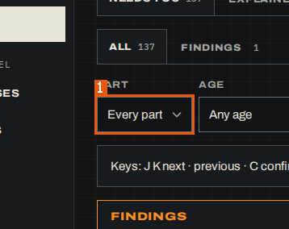

1. `combobox "Part"`

Related: appears on [SCR-012](03-screens.md#SCR-012)

Evidence:

- form `01a1753e-bef1-7001-9b89-9f3d81a87f0e` — form: _r_5_, _r_6_ (run `01a1753d-a8da-7000-85d2-b19d666d3587`, map, 2026-10-25)
- screen region `01a1753e-be7a-7000-95e6-7606fb6ebc6e` `combobox "Part"` — MudPuppy (/app/portals/reference-insurer-local/review) (run `01a1753d-a8da-7000-85d2-b19d666d3587`, map, 2026-10-25)

### DI-013 — Age (Review filter)

**DI-013** · rev 1 · draft · observed

> DRAFT — not confirmed by a reviewer

**Name (verbatim):** Age (en)

**English name:** Age filter in Review

**Type:** enum (select)

**Constraints:** allowed values: Any age, Today (0), This week (3), Older (0); format: counts in brackets per age band; required: false

**Seen in:**

- form on /app/portals/reference-insurer-local/review (`01a1753e-bef1-7001-9b89-9f3d81a87f0e`)

**On screen:** MudPuppy (/app/portals/reference-insurer-local/review)

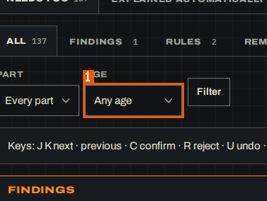

1. `combobox "Age"`

Related: appears on [SCR-012](03-screens.md#SCR-012)

Evidence:

- form `01a1753e-bef1-7001-9b89-9f3d81a87f0e` — form: _r_5_, _r_6_ (run `01a1753d-a8da-7000-85d2-b19d666d3587`, map, 2026-10-25)
- screen region `01a1753e-be7a-7000-95e6-7606fb6ebc6e` `combobox "Age"` — MudPuppy (/app/portals/reference-insurer-local/review) (run `01a1753d-a8da-7000-85d2-b19d666d3587`, map, 2026-10-25)

### DI-014 — Reason for <n> (group decision in Review)

**DI-014** · rev 1 · draft · observed

> DRAFT — not confirmed by a reviewer

**Name (verbatim):** Reason for 2 (en)

**English name:** One reason for a group decision

**Type:** string (text)

**Constraints:** format: placeholder "One reason for all"; the number is the size of the group of alike items; max length: 200; required: false

**Seen in:**

- form on /app/portals/reference-insurer-local/review (`01a1753e-bef1-7003-964d-63f65cc6de95`)
- form on /app/portals/reference-insurer-local/review (`01a17541-389d-7001-831a-6909e1a7de90`)

**On screen:** MudPuppy (/app/portals/reference-insurer-local/review)

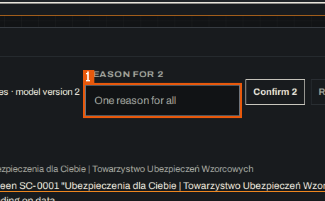

1. `textbox "Reason for 2"`

Related: appears on [SCR-012](03-screens.md#SCR-012)

Evidence:

- form `01a1753e-bef1-7003-964d-63f65cc6de95` — form: _r_9_ (run `01a1753d-a8da-7000-85d2-b19d666d3587`, map, 2026-10-25)
- screen region `01a1753e-be7a-7000-95e6-7606fb6ebc6e` `textbox "Reason for 2"` — MudPuppy (/app/portals/reference-insurer-local/review) (run `01a1753d-a8da-7000-85d2-b19d666d3587`, map, 2026-10-25)

### DI-015 — Select (item of a Review group)

**DI-015** · rev 1 · draft · observed

> DRAFT — not confirmed by a reviewer

**Name (verbatim):** Select (en)

**English name:** Select an item of a group

**Type:** boolean (checkbox)

**Constraints:** format: one per item of a group of alike items; required: false

**Seen in:**

- form on /app/portals/reference-insurer-local/review (`01a1753e-bef1-7004-b321-5415c69eea36`)
- form on /app/portals/reference-insurer-local/review (`01a17541-389d-7002-8519-0d9ee6e7d3cf`)

**On screen:** MudPuppy (/app/portals/reference-insurer-local/review)

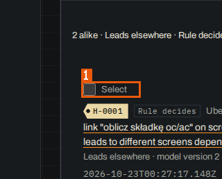

1. `checkbox "Select"`

Related: appears on [SCR-012](03-screens.md#SCR-012)

Evidence:

- form `01a1753e-bef1-7004-b321-5415c69eea36` — form: Select, Select (run `01a1753d-a8da-7000-85d2-b19d666d3587`, map, 2026-10-25)
- screen region `01a1753e-be7a-7000-95e6-7606fb6ebc6e` `checkbox "Select"` — MudPuppy (/app/portals/reference-insurer-local/review) (run `01a1753d-a8da-7000-85d2-b19d666d3587`, map, 2026-10-25)

### DI-016 — From (Changes range start)

**DI-016** · rev 1 · draft · observed

> DRAFT — not confirmed by a reviewer

**Name (verbatim):** From (en)

**English name:** Range start

**Type:** enum (select)

**Constraints:** allowed values: Since the previous release, The first scan, Model version <n> · <time>; format: default "Since the previous release"; required: false

**Seen in:**

- form on /app/portals/reference-insurer-local/changes (`01a1753e-d28c-7002-b104-aa10a48b549e`)

**On screen:** MudPuppy (/app/portals/reference-insurer-local/changes)

1. `combobox "From"`

Related: appears on [SCR-014](03-screens.md#SCR-014)

Evidence:

- form `01a1753e-d28c-7002-b104-aa10a48b549e` — form: _r_e_, _r_f_ (run `01a1753d-a8da-7000-85d2-b19d666d3587`, map, 2026-10-25)
- screen region `01a1753e-d243-7000-ba0d-fae46a006f7b` `combobox "From"` — MudPuppy (/app/portals/reference-insurer-local/changes) (run `01a1753d-a8da-7000-85d2-b19d666d3587`, map, 2026-10-25)

### DI-017 — To (Changes range end)

**DI-017** · rev 1 · draft · observed

> DRAFT — not confirmed by a reviewer

**Name (verbatim):** To (en)

**English name:** Range end

**Type:** enum (select)

**Constraints:** allowed values: Now · Model version <n> · <time>, Model version <n> · <time>; format: default the newest model version ("Now"); required: false

**Seen in:**

- form on /app/portals/reference-insurer-local/changes (`01a1753e-d28c-7002-b104-aa10a48b549e`)

**On screen:** MudPuppy (/app/portals/reference-insurer-local/changes)

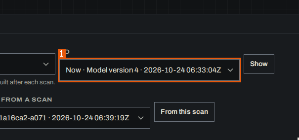

1. `combobox "To"`

Related: appears on [SCR-014](03-screens.md#SCR-014)

Evidence:

- form `01a1753e-d28c-7002-b104-aa10a48b549e` — form: _r_e_, _r_f_ (run `01a1753d-a8da-7000-85d2-b19d666d3587`, map, 2026-10-25)
- screen region `01a1753e-d243-7000-ba0d-fae46a006f7b` `combobox "To"` — MudPuppy (/app/portals/reference-insurer-local/changes) (run `01a1753d-a8da-7000-85d2-b19d666d3587`, map, 2026-10-25)

### DI-018 — Or from a date

**DI-018** · rev 1 · draft · observed

> DRAFT — not confirmed by a reviewer

**Name (verbatim):** Or from a date (en)

**English name:** Range start date

**Type:** date

**Constraints:** format: browser date input; release links pass it as from_date=<ISO time>; required: false

**Seen in:**

- form on /app/portals/reference-insurer-local/changes (`01a1753e-d28d-7000-82a7-3344e0a81e39`)

**On screen:** MudPuppy (/app/portals/reference-insurer-local/changes)

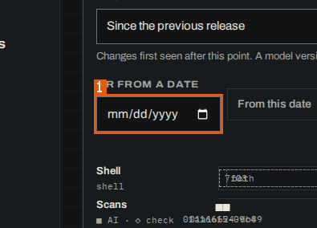

1. `textbox "Or from a date"`

Related: appears on [SCR-014](03-screens.md#SCR-014)

Evidence:

- form `01a1753e-d28d-7000-82a7-3344e0a81e39` — form: _r_g_, _r_h_ (run `01a1753d-a8da-7000-85d2-b19d666d3587`, map, 2026-10-25)
- screen region `01a1753e-d243-7000-ba0d-fae46a006f7b` `textbox "Or from a date"` — MudPuppy (/app/portals/reference-insurer-local/changes) (run `01a1753d-a8da-7000-85d2-b19d666d3587`, map, 2026-10-25)

### DI-019 — Or from a scan

**DI-019** · rev 1 · draft · observed

> DRAFT — not confirmed by a reviewer

**Name (verbatim):** Or from a scan (en)

**English name:** Range start scan

**Type:** enum (select)

**Constraints:** format: one option per scan as "<short scan id> · <start time>", newest first and selected; required: false

**Seen in:**

- form on /app/portals/reference-insurer-local/changes (`01a1753e-d28d-7000-82a7-3344e0a81e39`)

**On screen:** MudPuppy (/app/portals/reference-insurer-local/changes)

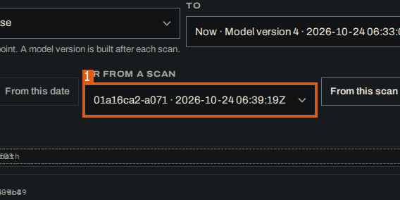

1. `combobox "Or from a scan"`

Related: appears on [SCR-014](03-screens.md#SCR-014)

Evidence:

- form `01a1753e-d28d-7000-82a7-3344e0a81e39` — form: _r_g_, _r_h_ (run `01a1753d-a8da-7000-85d2-b19d666d3587`, map, 2026-10-25)
- screen region `01a1753e-d243-7000-ba0d-fae46a006f7b` `combobox "Or from a scan"` — MudPuppy (/app/portals/reference-insurer-local/changes) (run `01a1753d-a8da-7000-85d2-b19d666d3587`, map, 2026-10-25)

### DI-020 — Kind (Changes filter)

**DI-020** · rev 1 · draft · observed

> DRAFT — not confirmed by a reviewer

**Name (verbatim):** Kind (en)

**English name:** Change kind filter

**Type:** enum (select)

**Constraints:** allowed values: Any kind, New screen, Variant, New action, Removed, Leads elsewhere, Result changed, Rule broke; required: false

**Seen in:**

- form on /app/portals/reference-insurer-local/changes (`01a1753e-d28d-7001-9943-fd7669f61b5f`)

**On screen:** MudPuppy (/app/portals/reference-insurer-local/changes)

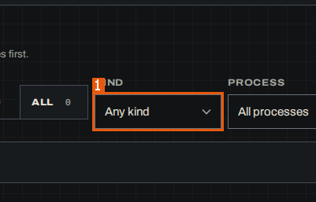

1. `combobox "Kind"`

Related: appears on [SCR-014](03-screens.md#SCR-014)

Evidence:

- form `01a1753e-d28d-7001-9943-fd7669f61b5f` — form: _r_j_, _r_k_ (run `01a1753d-a8da-7000-85d2-b19d666d3587`, map, 2026-10-25)
- screen region `01a1753e-d243-7000-ba0d-fae46a006f7b` `combobox "Kind"` — MudPuppy (/app/portals/reference-insurer-local/changes) (run `01a1753d-a8da-7000-85d2-b19d666d3587`, map, 2026-10-25)

### DI-021 — Process (Changes filter)

**DI-021** · rev 1 · draft · observed

> DRAFT — not confirmed by a reviewer

**Name (verbatim):** Process (en)

**English name:** Process filter

**Type:** enum (select)

**Constraints:** allowed values: All processes; format: "All processes" plus the portal's processes (none listed in the run); required: false

**Seen in:**

- form on /app/portals/reference-insurer-local/changes (`01a1753e-d28d-7001-9943-fd7669f61b5f`)

**On screen:** MudPuppy (/app/portals/reference-insurer-local/changes)

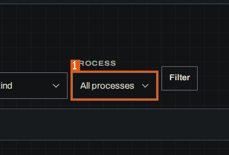

1. `combobox "Process"`

Related: appears on [SCR-014](03-screens.md#SCR-014)

Evidence:

- form `01a1753e-d28d-7001-9943-fd7669f61b5f` — form: _r_j_, _r_k_ (run `01a1753d-a8da-7000-85d2-b19d666d3587`, map, 2026-10-25)
- screen region `01a1753e-d243-7000-ba0d-fae46a006f7b` `combobox "Process"` — MudPuppy (/app/portals/reference-insurer-local/changes) (run `01a1753d-a8da-7000-85d2-b19d666d3587`, map, 2026-10-25)

### DI-022 — Key, title or route contains

**DI-022** · rev 1 · draft · observed

> DRAFT — not confirmed by a reviewer

**Name (verbatim):** Key, title or route contains (en)

**English name:** Screen text filter

**Type:** string (search)

**Constraints:** format: sent as q to /api/portals/<portal>/screens together with status, process, part, why and sort; required: false

**Seen in:**

- form on /app/portals/reference-insurer-local/screens (`01a1753e-e5c1-7001-9774-00d2070618b6`)
- GET /api/portals/reference-insurer-local/screens (`01a1753e-e5c3-7001-9f60-4c300bcfcc60`)

**On screen:** MudPuppy (/app/portals/reference-insurer-local/screens)

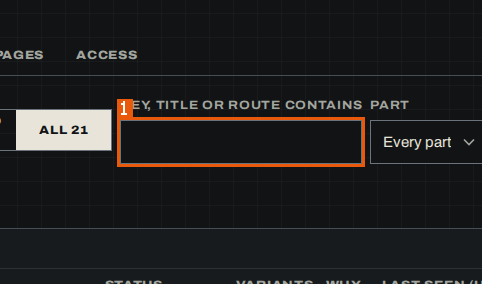

1. `searchbox "Key, title or route contains"`

Related: appears on [SCR-015](03-screens.md#SCR-015)

Evidence:

- form `01a1753e-e5c1-7001-9774-00d2070618b6` — form: q, _r_n_, _r_o_, _r_p_ (run `01a1753d-a8da-7000-85d2-b19d666d3587`, map, 2026-10-25)
- screen region `01a1753e-e513-7001-9d79-59990eea7c3e` `searchbox "Key, title or route contains"` — MudPuppy (/app/portals/reference-insurer-local/screens) (run `01a1753d-a8da-7000-85d2-b19d666d3587`, map, 2026-10-25)

### DI-023 — Part (Screens filter)

**DI-023** · rev 1 · draft · observed

> DRAFT — not confirmed by a reviewer

**Name (verbatim):** Part (en)

**English name:** Portal part filter in Screens

**Type:** enum (select)

**Constraints:** allowed values: Every part, Shell; required: false

**Seen in:**

- form on /app/portals/reference-insurer-local/screens (`01a1753e-e5c1-7001-9774-00d2070618b6`)

**On screen:** MudPuppy (/app/portals/reference-insurer-local/screens)

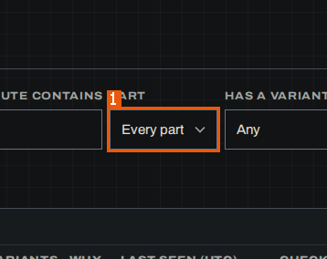

1. `combobox "Part"`

Related: appears on [SCR-015](03-screens.md#SCR-015)

Evidence:

- form `01a1753e-e5c1-7001-9774-00d2070618b6` — form: q, _r_n_, _r_o_, _r_p_ (run `01a1753d-a8da-7000-85d2-b19d666d3587`, map, 2026-10-25)
- screen region `01a1753e-e513-7001-9d79-59990eea7c3e` `combobox "Part"` — MudPuppy (/app/portals/reference-insurer-local/screens) (run `01a1753d-a8da-7000-85d2-b19d666d3587`, map, 2026-10-25)

### DI-024 — Has a variant of why

**DI-024** · rev 1 · draft · observed

> DRAFT — not confirmed by a reviewer

**Name (verbatim):** Has a variant of why (en)

**English name:** Variant reason filter

**Type:** enum (select)

**Constraints:** allowed values: Any, Release, Persona, Error, A/B test, Data, Unknown; required: false

**Seen in:**

- form on /app/portals/reference-insurer-local/screens (`01a1753e-e5c1-7001-9774-00d2070618b6`)

**On screen:** MudPuppy (/app/portals/reference-insurer-local/screens)

1. `combobox "Has a variant of why"`

Related: appears on [SCR-015](03-screens.md#SCR-015)

Evidence:

- form `01a1753e-e5c1-7001-9774-00d2070618b6` — form: q, _r_n_, _r_o_, _r_p_ (run `01a1753d-a8da-7000-85d2-b19d666d3587`, map, 2026-10-25)
- screen region `01a1753e-e513-7001-9d79-59990eea7c3e` `combobox "Has a variant of why"` — MudPuppy (/app/portals/reference-insurer-local/screens) (run `01a1753d-a8da-7000-85d2-b19d666d3587`, map, 2026-10-25)

### DI-025 — Sort (Screens)

**DI-025** · rev 1 · draft · observed

> DRAFT — not confirmed by a reviewer

**Name (verbatim):** Sort (en)

**English name:** Screen list order

**Type:** enum (select)

**Constraints:** allowed values: Needs you first, Key, Last seen, Most variants, Least checked; format: default "Needs you first"; required: false

**Seen in:**

- form on /app/portals/reference-insurer-local/screens (`01a1753e-e5c1-7001-9774-00d2070618b6`)

**On screen:** MudPuppy (/app/portals/reference-insurer-local/screens)

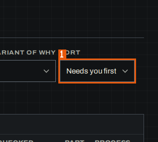

1. `combobox "Sort"`

Related: appears on [SCR-015](03-screens.md#SCR-015)

Evidence:

- form `01a1753e-e5c1-7001-9774-00d2070618b6` — form: q, _r_n_, _r_o_, _r_p_ (run `01a1753d-a8da-7000-85d2-b19d666d3587`, map, 2026-10-25)
- screen region `01a1753e-e513-7001-9d79-59990eea7c3e` `combobox "Sort"` — MudPuppy (/app/portals/reference-insurer-local/screens) (run `01a1753d-a8da-7000-85d2-b19d666d3587`, map, 2026-10-25)

### DI-026 — Overlay a process (Map)

**DI-026** · rev 1 · draft · observed

> DRAFT — not confirmed by a reviewer

**Name (verbatim):** Overlay a process (en)

**English name:** Process drawn over the map

**Type:** enum (select)

**Constraints:** allowed values: None, Kalkulator OC/AC; format: "None" plus one option per process; required: false

**Seen in:**

- form on /app/portals/:portal/screens/:screen (`01a1753f-4445-7001-88ad-d23c76be9ab6`)

**On screen:** MudPuppy (/app/portals/:portal/screens/:screen)

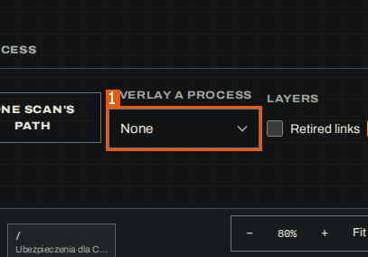

1. `combobox "Overlay a process"`

Related: appears on [SCR-017](03-screens.md#SCR-017)

Evidence:

- form `01a1753f-4445-7001-88ad-d23c76be9ab6` — form: _r_b_, Retired links, Not seen since, Not checked (run `01a1753d-a8da-7000-85d2-b19d666d3587`, map, 2026-10-25)
- screen region `01a1753f-43e8-7000-ac2e-51e68ab95975` `combobox "Overlay a process"` — MudPuppy (/app/portals/:portal/screens/:screen) (run `01a1753d-a8da-7000-85d2-b19d666d3587`, map, 2026-10-25)

### DI-027 — Retired links (Map layer)

**DI-027** · rev 1 · draft · observed

> DRAFT — not confirmed by a reviewer

**Name (verbatim):** Retired links (en)

**English name:** Show retired links

**Type:** boolean (checkbox)

**Constraints:** format: unchecked by default; required: false

**Seen in:**

- form on /app/portals/:portal/screens/:screen (`01a1753f-4445-7001-88ad-d23c76be9ab6`)

**On screen:** MudPuppy (/app/portals/:portal/screens/:screen)

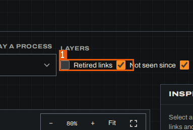

1. `checkbox "Retired links"`

Related: appears on [SCR-017](03-screens.md#SCR-017)

Evidence:

- form `01a1753f-4445-7001-88ad-d23c76be9ab6` — form: _r_b_, Retired links, Not seen since, Not checked (run `01a1753d-a8da-7000-85d2-b19d666d3587`, map, 2026-10-25)
- screen region `01a1753f-43e8-7000-ac2e-51e68ab95975` `checkbox "Retired links"` — MudPuppy (/app/portals/:portal/screens/:screen) (run `01a1753d-a8da-7000-85d2-b19d666d3587`, map, 2026-10-25)

### DI-028 — Not seen since (Map layer)

**DI-028** · rev 1 · draft · observed

> DRAFT — not confirmed by a reviewer

**Name (verbatim):** Not seen since (en)

**English name:** Show links missing on later visits

**Type:** boolean (checkbox)

**Constraints:** format: checked by default; required: false

**Seen in:**

- form on /app/portals/:portal/screens/:screen (`01a1753f-4445-7001-88ad-d23c76be9ab6`)

**On screen:** MudPuppy (/app/portals/:portal/screens/:screen)

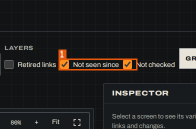

1. `checkbox "Not seen since"`

Related: appears on [SCR-017](03-screens.md#SCR-017)

Evidence:

- form `01a1753f-4445-7001-88ad-d23c76be9ab6` — form: _r_b_, Retired links, Not seen since, Not checked (run `01a1753d-a8da-7000-85d2-b19d666d3587`, map, 2026-10-25)
- screen region `01a1753f-43e8-7000-ac2e-51e68ab95975` `checkbox "Not seen since"` — MudPuppy (/app/portals/:portal/screens/:screen) (run `01a1753d-a8da-7000-85d2-b19d666d3587`, map, 2026-10-25)

### DI-029 — Not checked (Map layer)

**DI-029** · rev 1 · draft · observed

> DRAFT — not confirmed by a reviewer

**Name (verbatim):** Not checked (en)

**English name:** Show links not followed on the current release

**Type:** boolean (checkbox)

**Constraints:** format: checked by default; required: false

**Seen in:**

- form on /app/portals/:portal/screens/:screen (`01a1753f-4445-7001-88ad-d23c76be9ab6`)

**On screen:** MudPuppy (/app/portals/:portal/screens/:screen)

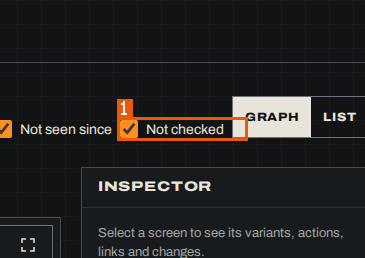

1. `checkbox "Not checked"`

Related: appears on [SCR-017](03-screens.md#SCR-017)

Evidence:

- form `01a1753f-4445-7001-88ad-d23c76be9ab6` — form: _r_b_, Retired links, Not seen since, Not checked (run `01a1753d-a8da-7000-85d2-b19d666d3587`, map, 2026-10-25)
- screen region `01a1753f-43e8-7000-ac2e-51e68ab95975` `checkbox "Not checked"` — MudPuppy (/app/portals/:portal/screens/:screen) (run `01a1753d-a8da-7000-85d2-b19d666d3587`, map, 2026-10-25)

### DI-030 — Title or route contains (Recorded pages)

**DI-030** · rev 1 · draft · observed

> DRAFT — not confirmed by a reviewer

**Name (verbatim):** Title or route contains (en)

**English name:** Recorded page text filter

**Type:** string (search)

**Constraints:** format: applied with the button "Filter"; required: false

**Seen in:**

- form on /app/portals/:portal/screens/:screen (`01a1753f-5850-7000-bb6b-21145c928e6a`)

**On screen:** MudPuppy (/app/portals/:portal/screens/:screen)

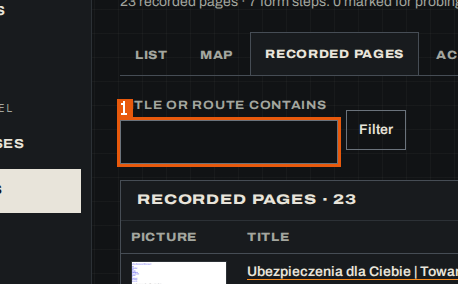

1. `searchbox "Title or route contains"`

Related: appears on [SCR-018](03-screens.md#SCR-018)

Evidence:

- form `01a1753f-5850-7000-bb6b-21145c928e6a` — form: q (run `01a1753d-a8da-7000-85d2-b19d666d3587`, map, 2026-10-25)
- screen region `01a1753f-57a7-7000-8873-02b7af26db70` `searchbox "Title or route contains"` — MudPuppy (/app/portals/:portal/screens/:screen) (run `01a1753d-a8da-7000-85d2-b19d666d3587`, map, 2026-10-25)

### DI-031 — Reason (required to reject)

**DI-031** · rev 1 · draft · observed

> DRAFT — not confirmed by a reviewer

**Name (verbatim):** Reason (required to reject) (en)

**English name:** Rejection reason

**Type:** string (textarea)

**Constraints:** format: needed to enable "Reject rev <n>" (BR-006); not marked required in the markup; required: false

**Seen in:**

- form on /app/portals/:portal/docs/:key (`01a1753f-f2b4-7001-b5b5-44935a4bdc77`)
- form on /app/portals/:portal/docs/:key (`01a17541-e9ce-7000-9ef9-0ce4411490d3`)

**On screen:** MudPuppy (/app/portals/:portal/docs/:key)

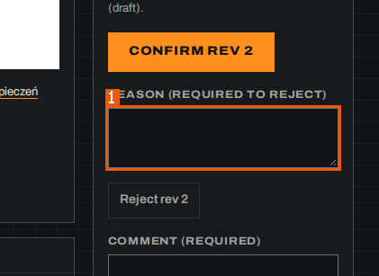

1. `textbox "Reason (required to reject)"`

Related: appears on [SCR-023](03-screens.md#SCR-023)

Evidence:

- form `01a1753f-f2b4-7001-b5b5-44935a4bdc77` — form: _r_p_, _r_q_ (run `01a1753d-a8da-7000-85d2-b19d666d3587`, map, 2026-10-25)
- screen region `01a1753f-f23f-7000-9333-d142f8824a10` `textbox "Reason (required to reject)"` — MudPuppy (/app/portals/:portal/docs/:key) (run `01a1753d-a8da-7000-85d2-b19d666d3587`, map, 2026-10-25)

### DI-032 — Comment (required)

**DI-032** · rev 1 · draft · observed

> DRAFT — not confirmed by a reviewer

**Name (verbatim):** Comment (required) (en)

**English name:** Review comment

**Type:** string (textarea)

**Constraints:** format: needed to enable "Comment" (BR-007); not marked required in the markup; required: false

**Seen in:**

- form on /app/portals/:portal/docs/:key (`01a1753f-f2b4-7001-b5b5-44935a4bdc77`)
- form on /app/portals/:portal/docs/:key (`01a17541-e9ce-7000-9ef9-0ce4411490d3`)

**On screen:** MudPuppy (/app/portals/:portal/docs/:key)

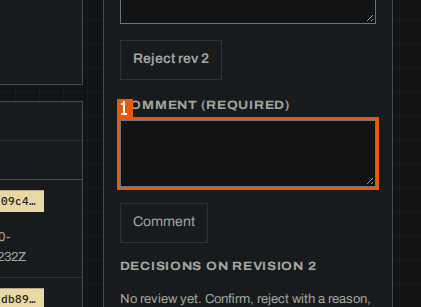

1. `textbox "Comment (required)"`

Related: appears on [SCR-023](03-screens.md#SCR-023)

Evidence:

- form `01a1753f-f2b4-7001-b5b5-44935a4bdc77` — form: _r_p_, _r_q_ (run `01a1753d-a8da-7000-85d2-b19d666d3587`, map, 2026-10-25)
- screen region `01a1753f-f23f-7000-9333-d142f8824a10` `textbox "Comment (required)"` — MudPuppy (/app/portals/:portal/docs/:key) (run `01a1753d-a8da-7000-85d2-b19d666d3587`, map, 2026-10-25)

### DI-033 — Safety class (scan Actions filter)

**DI-033** · rev 1 · draft · observed

> DRAFT — not confirmed by a reviewer

**Name (verbatim):** Safety class (en)

**English name:** Action safety class filter

**Type:** enum (select)

**Constraints:** allowed values: Any class, read, mutating, destructive, external-side-effect; required: false

**Seen in:**

- form on /app/scans/:scan/:tab (`01a17540-4a1c-7001-ba8b-088d3d2bdd48`)

**On screen:** MudPuppy (/app/scans/:scan/:tab)

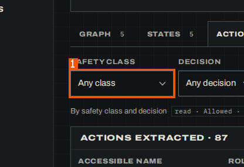

1. `combobox "Safety class"`

Related: appears on [SCR-026](03-screens.md#SCR-026)

Evidence:

- form `01a17540-4a1c-7001-ba8b-088d3d2bdd48` — form: _r_m_, _r_n_ (run `01a1753d-a8da-7000-85d2-b19d666d3587`, map, 2026-10-25)
- screen region `01a17540-49ac-7000-90a2-4f381d47fbb4` `combobox "Safety class"` — MudPuppy (/app/scans/:scan/:tab) (run `01a1753d-a8da-7000-85d2-b19d666d3587`, map, 2026-10-25)

### DI-034 — Decision (scan Actions filter)

**DI-034** · rev 1 · draft · observed

> DRAFT — not confirmed by a reviewer

**Name (verbatim):** Decision (en)

**English name:** Action decision filter

**Type:** enum (select)

**Constraints:** allowed values: Any decision, Allowed, Skipped; required: false

**Seen in:**

- form on /app/scans/:scan/:tab (`01a17540-4a1c-7001-ba8b-088d3d2bdd48`)

**On screen:** MudPuppy (/app/scans/:scan/:tab)

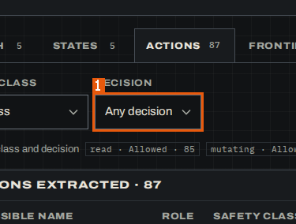

1. `combobox "Decision"`

Related: appears on [SCR-026](03-screens.md#SCR-026)

Evidence:

- form `01a17540-4a1c-7001-ba8b-088d3d2bdd48` — form: _r_m_, _r_n_ (run `01a1753d-a8da-7000-85d2-b19d666d3587`, map, 2026-10-25)
- screen region `01a17540-49ac-7000-90a2-4f381d47fbb4` `combobox "Decision"` — MudPuppy (/app/scans/:scan/:tab) (run `01a1753d-a8da-7000-85d2-b19d666d3587`, map, 2026-10-25)

### DI-035 — Status (scan Frontier filter)

**DI-035** · rev 1 · draft · observed

> DRAFT — not confirmed by a reviewer

**Name (verbatim):** Status (en)

**English name:** Frontier item status filter

**Type:** enum (select)

**Constraints:** allowed values: Any status, Queued, Done, Skipped · safety, Skipped · scope, Skipped · denylist, Skipped · robots, Skipped · budget, Unreachable; required: false

**Seen in:**

- form on /app/scans/:scan/:tab (`01a17540-5b7f-7001-b532-64e3527bf64d`)

**On screen:** MudPuppy (/app/scans/:scan/:tab)

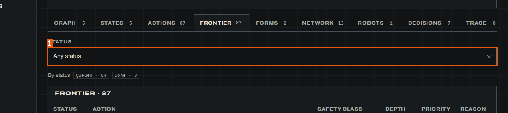

1. `combobox "Status"`

Related: appears on [SCR-026](03-screens.md#SCR-026)

Evidence:

- form `01a17540-5b7f-7001-b532-64e3527bf64d` — form: _r_p_ (run `01a1753d-a8da-7000-85d2-b19d666d3587`, map, 2026-10-25)
- screen region `01a17540-5b16-7000-a6d5-88196c70dbdf` `combobox "Status"` — MudPuppy (/app/scans/:scan/:tab) (run `01a1753d-a8da-7000-85d2-b19d666d3587`, map, 2026-10-25)

### DI-036 — Kind (scan Decisions filter)

**DI-036** · rev 1 · draft · observed

> DRAFT — not confirmed by a reviewer

**Name (verbatim):** Kind (en)

**English name:** Decision kind filter

**Type:** enum (select)

**Constraints:** allowed values: Any kind, Skipped, Refused, merge, split, Warning, note; required: false

**Seen in:**

- form on /app/scans/:scan/:tab (`01a17540-849a-7001-aec5-bfed4f560a1e`)

**On screen:** MudPuppy (/app/scans/:scan/:tab)

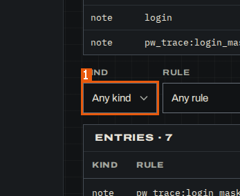

1. `combobox "Kind"`

Related: appears on [SCR-026](03-screens.md#SCR-026)

Evidence:

- form `01a17540-849a-7001-aec5-bfed4f560a1e` — form: _r_u_, _r_v_ (run `01a1753d-a8da-7000-85d2-b19d666d3587`, map, 2026-10-25)
- screen region `01a17540-8422-7000-b8bc-2f5e478716bf` `combobox "Kind"` — MudPuppy (/app/scans/:scan/:tab) (run `01a1753d-a8da-7000-85d2-b19d666d3587`, map, 2026-10-25)

### DI-037 — Rule (scan Decisions filter)

**DI-037** · rev 1 · draft · observed

> DRAFT — not confirmed by a reviewer

**Name (verbatim):** Rule (en)

**English name:** Decision rule filter

**Type:** enum (select)

**Constraints:** format: "Any rule" plus the rules the scan's decisions used (e.g. "fingerprint:identical-fingerprint", "login", "pw_trace:login_masked"); required: false

**Seen in:**

- form on /app/scans/:scan/:tab (`01a17540-849a-7001-aec5-bfed4f560a1e`)

**On screen:** MudPuppy (/app/scans/:scan/:tab)

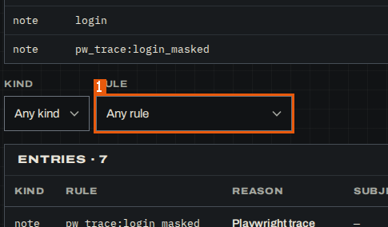

1. `combobox "Rule"`

Related: appears on [SCR-026](03-screens.md#SCR-026)

Evidence:

- form `01a17540-849a-7001-aec5-bfed4f560a1e` — form: _r_u_, _r_v_ (run `01a1753d-a8da-7000-85d2-b19d666d3587`, map, 2026-10-25)
- screen region `01a17540-8422-7000-b8bc-2f5e478716bf` `combobox "Rule"` — MudPuppy (/app/scans/:scan/:tab) (run `01a1753d-a8da-7000-85d2-b19d666d3587`, map, 2026-10-25)

### DI-038 — act (Trace tool filter)

**DI-038** · rev 1 · draft · observed

> DRAFT — not confirmed by a reviewer

**Name (verbatim):** act (en)

**English name:** Show act tool calls

**Type:** boolean (checkbox)

**Constraints:** format: group "Tool": one checkbox per tool the scan called; required: false

**Seen in:**

- form on /app/scans/:scan/:tab (`01a17540-90f7-7001-aec7-359aafbf0dac`)

**On screen:** MudPuppy (/app/scans/:scan/:tab)

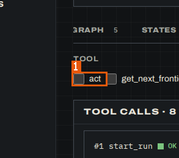

1. `checkbox "act"`

Related: appears on [SCR-026](03-screens.md#SCR-026)

Evidence:

- form `01a17540-90f7-7001-aec7-359aafbf0dac` — form: act, get_next_frontier_item, login, navigate (run `01a1753d-a8da-7000-85d2-b19d666d3587`, map, 2026-10-25)
- screen region `01a17540-9091-7001-8be2-6a2ebaab8ead` `checkbox "act"` — MudPuppy (/app/scans/:scan/:tab) (run `01a1753d-a8da-7000-85d2-b19d666d3587`, map, 2026-10-25)

### DI-039 — get_next_frontier_item (Trace tool filter)

**DI-039** · rev 1 · draft · observed

> DRAFT — not confirmed by a reviewer

**Name (verbatim):** get_next_frontier_item (en)

**English name:** Show get_next_frontier_item tool calls

**Type:** boolean (checkbox)

**Constraints:** format: group "Tool"; required: false

**Seen in:**

- form on /app/scans/:scan/:tab (`01a17540-90f7-7001-aec7-359aafbf0dac`)

**On screen:** MudPuppy (/app/scans/:scan/:tab)

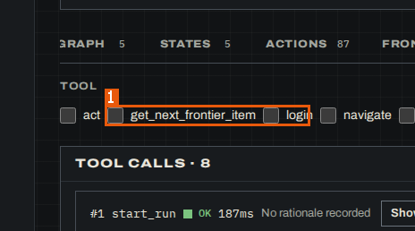

1. `checkbox "get_next_frontier_item"`

Related: appears on [SCR-026](03-screens.md#SCR-026)

Evidence:

- form `01a17540-90f7-7001-aec7-359aafbf0dac` — form: act, get_next_frontier_item, login, navigate (run `01a1753d-a8da-7000-85d2-b19d666d3587`, map, 2026-10-25)
- screen region `01a17540-9091-7001-8be2-6a2ebaab8ead` `checkbox "get_next_frontier_item"` — MudPuppy (/app/scans/:scan/:tab) (run `01a1753d-a8da-7000-85d2-b19d666d3587`, map, 2026-10-25)

### DI-040 — login (Trace tool filter)

**DI-040** · rev 1 · draft · observed

> DRAFT — not confirmed by a reviewer

**Name (verbatim):** login (en)

**English name:** Show login tool calls

**Type:** boolean (checkbox)

**Constraints:** format: group "Tool"; required: false

**Seen in:**

- form on /app/scans/:scan/:tab (`01a17540-90f7-7001-aec7-359aafbf0dac`)

**On screen:** MudPuppy (/app/scans/:scan/:tab)

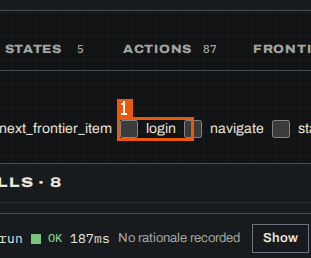

1. `checkbox "login"`

Related: appears on [SCR-026](03-screens.md#SCR-026)

Evidence:

- form `01a17540-90f7-7001-aec7-359aafbf0dac` — form: act, get_next_frontier_item, login, navigate (run `01a1753d-a8da-7000-85d2-b19d666d3587`, map, 2026-10-25)
- screen region `01a17540-9091-7001-8be2-6a2ebaab8ead` `checkbox "login"` — MudPuppy (/app/scans/:scan/:tab) (run `01a1753d-a8da-7000-85d2-b19d666d3587`, map, 2026-10-25)

### DI-041 — navigate (Trace tool filter)

**DI-041** · rev 1 · draft · observed

> DRAFT — not confirmed by a reviewer

**Name (verbatim):** navigate (en)

**English name:** Show navigate tool calls

**Type:** boolean (checkbox)

**Constraints:** format: group "Tool"; required: false

**Seen in:**

- form on /app/scans/:scan/:tab (`01a17540-90f7-7001-aec7-359aafbf0dac`)

**On screen:** MudPuppy (/app/scans/:scan/:tab)

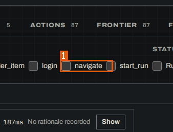

1. `checkbox "navigate"`

Related: appears on [SCR-026](03-screens.md#SCR-026)

Evidence:

- form `01a17540-90f7-7001-aec7-359aafbf0dac` — form: act, get_next_frontier_item, login, navigate (run `01a1753d-a8da-7000-85d2-b19d666d3587`, map, 2026-10-25)
- screen region `01a17540-9091-7001-8be2-6a2ebaab8ead` `checkbox "navigate"` — MudPuppy (/app/scans/:scan/:tab) (run `01a1753d-a8da-7000-85d2-b19d666d3587`, map, 2026-10-25)

### DI-042 — start_run (Trace tool filter)

**DI-042** · rev 1 · draft · observed

> DRAFT — not confirmed by a reviewer

**Name (verbatim):** start_run (en)

**English name:** Show start_run tool calls

**Type:** boolean (checkbox)

**Constraints:** format: group "Tool"; required: false

**Seen in:**

- form on /app/scans/:scan/:tab (`01a17540-90f7-7001-aec7-359aafbf0dac`)

**On screen:** MudPuppy (/app/scans/:scan/:tab)

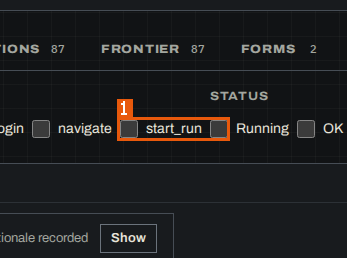

1. `checkbox "start_run"`

Related: appears on [SCR-026](03-screens.md#SCR-026)

Evidence:

- form `01a17540-90f7-7001-aec7-359aafbf0dac` — form: act, get_next_frontier_item, login, navigate (run `01a1753d-a8da-7000-85d2-b19d666d3587`, map, 2026-10-25)
- screen region `01a17540-9091-7001-8be2-6a2ebaab8ead` `checkbox "start_run"` — MudPuppy (/app/scans/:scan/:tab) (run `01a1753d-a8da-7000-85d2-b19d666d3587`, map, 2026-10-25)

### DI-043 — Running (Trace status filter)

**DI-043** · rev 1 · draft · observed

> DRAFT — not confirmed by a reviewer

**Name (verbatim):** Running (en)

**English name:** Show running calls

**Type:** boolean (checkbox)

**Constraints:** format: group "Status": Running, OK, Refused, Stopped, Failed, Unfinished; required: false

**Seen in:**

- form on /app/scans/:scan/:tab (`01a17540-90f7-7001-aec7-359aafbf0dac`)

**On screen:** MudPuppy (/app/scans/:scan/:tab)

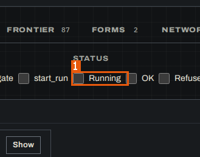

1. `checkbox "Running"`

Related: appears on [SCR-026](03-screens.md#SCR-026)

Evidence:

- form `01a17540-90f7-7001-aec7-359aafbf0dac` — form: act, get_next_frontier_item, login, navigate (run `01a1753d-a8da-7000-85d2-b19d666d3587`, map, 2026-10-25)
- screen region `01a17540-9091-7001-8be2-6a2ebaab8ead` `checkbox "Running"` — MudPuppy (/app/scans/:scan/:tab) (run `01a1753d-a8da-7000-85d2-b19d666d3587`, map, 2026-10-25)

### DI-044 — OK (Trace status filter)

**DI-044** · rev 1 · draft · observed

> DRAFT — not confirmed by a reviewer

**Name (verbatim):** OK (en)

**English name:** Show successful calls

**Type:** boolean (checkbox)

**Constraints:** format: group "Status"; required: false

**Seen in:**

- form on /app/scans/:scan/:tab (`01a17540-90f7-7001-aec7-359aafbf0dac`)

**On screen:** MudPuppy (/app/scans/:scan/:tab)

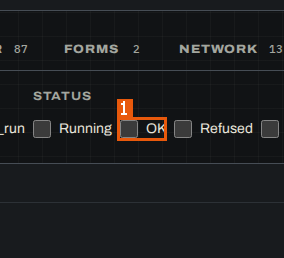

1. `checkbox "OK"`

Related: appears on [SCR-026](03-screens.md#SCR-026)

Evidence:

- form `01a17540-90f7-7001-aec7-359aafbf0dac` — form: act, get_next_frontier_item, login, navigate (run `01a1753d-a8da-7000-85d2-b19d666d3587`, map, 2026-10-25)
- screen region `01a17540-9091-7001-8be2-6a2ebaab8ead` `checkbox "OK"` — MudPuppy (/app/scans/:scan/:tab) (run `01a1753d-a8da-7000-85d2-b19d666d3587`, map, 2026-10-25)

### DI-045 — Refused (Trace status filter)

**DI-045** · rev 1 · draft · observed

> DRAFT — not confirmed by a reviewer

**Name (verbatim):** Refused (en)

**English name:** Show refused calls

**Type:** boolean (checkbox)

**Constraints:** format: group "Status"; required: false

**Seen in:**

- form on /app/scans/:scan/:tab (`01a17540-90f7-7001-aec7-359aafbf0dac`)

**On screen:** MudPuppy (/app/scans/:scan/:tab)

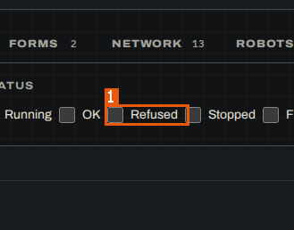

1. `checkbox "Refused"`

Related: appears on [SCR-026](03-screens.md#SCR-026)

Evidence:

- form `01a17540-90f7-7001-aec7-359aafbf0dac` — form: act, get_next_frontier_item, login, navigate (run `01a1753d-a8da-7000-85d2-b19d666d3587`, map, 2026-10-25)
- screen region `01a17540-9091-7001-8be2-6a2ebaab8ead` `checkbox "Refused"` — MudPuppy (/app/scans/:scan/:tab) (run `01a1753d-a8da-7000-85d2-b19d666d3587`, map, 2026-10-25)

### DI-046 — Stopped (Trace status filter)

**DI-046** · rev 1 · draft · observed

> DRAFT — not confirmed by a reviewer

**Name (verbatim):** Stopped (en)

**English name:** Show stopped calls

**Type:** boolean (checkbox)

**Constraints:** format: group "Status"; required: false

**Seen in:**

- form on /app/scans/:scan/:tab (`01a17540-90f7-7001-aec7-359aafbf0dac`)

**On screen:** MudPuppy (/app/scans/:scan/:tab)

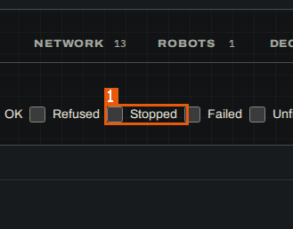

1. `checkbox "Stopped"`

Related: appears on [SCR-026](03-screens.md#SCR-026)

Evidence:

- form `01a17540-90f7-7001-aec7-359aafbf0dac` — form: act, get_next_frontier_item, login, navigate (run `01a1753d-a8da-7000-85d2-b19d666d3587`, map, 2026-10-25)
- screen region `01a17540-9091-7001-8be2-6a2ebaab8ead` `checkbox "Stopped"` — MudPuppy (/app/scans/:scan/:tab) (run `01a1753d-a8da-7000-85d2-b19d666d3587`, map, 2026-10-25)

### DI-047 — Failed (Trace status filter)

**DI-047** · rev 1 · draft · observed

> DRAFT — not confirmed by a reviewer

**Name (verbatim):** Failed (en)

**English name:** Show failed calls

**Type:** boolean (checkbox)

**Constraints:** format: group "Status"; required: false

**Seen in:**

- form on /app/scans/:scan/:tab (`01a17540-90f7-7001-aec7-359aafbf0dac`)

**On screen:** MudPuppy (/app/scans/:scan/:tab)

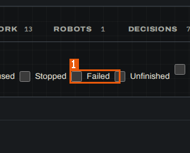

1. `checkbox "Failed"`

Related: appears on [SCR-026](03-screens.md#SCR-026)

Evidence:

- form `01a17540-90f7-7001-aec7-359aafbf0dac` — form: act, get_next_frontier_item, login, navigate (run `01a1753d-a8da-7000-85d2-b19d666d3587`, map, 2026-10-25)
- screen region `01a17540-9091-7001-8be2-6a2ebaab8ead` `checkbox "Failed"` — MudPuppy (/app/scans/:scan/:tab) (run `01a1753d-a8da-7000-85d2-b19d666d3587`, map, 2026-10-25)

### DI-048 — Unfinished (Trace status filter)

**DI-048** · rev 1 · draft · observed

> DRAFT — not confirmed by a reviewer

**Name (verbatim):** Unfinished (en)

**English name:** Show unfinished calls

**Type:** boolean (checkbox)

**Constraints:** format: group "Status"; required: false

**Seen in:**

- form on /app/scans/:scan/:tab (`01a17540-90f7-7001-aec7-359aafbf0dac`)

**On screen:** MudPuppy (/app/scans/:scan/:tab)

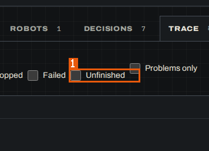

1. `checkbox "Unfinished"`

Related: appears on [SCR-026](03-screens.md#SCR-026)

Evidence:

- form `01a17540-90f7-7001-aec7-359aafbf0dac` — form: act, get_next_frontier_item, login, navigate (run `01a1753d-a8da-7000-85d2-b19d666d3587`, map, 2026-10-25)
- screen region `01a17540-9091-7001-8be2-6a2ebaab8ead` `checkbox "Unfinished"` — MudPuppy (/app/scans/:scan/:tab) (run `01a1753d-a8da-7000-85d2-b19d666d3587`, map, 2026-10-25)

### DI-049 — Problems only (Trace filter)

**DI-049** · rev 1 · draft · observed

> DRAFT — not confirmed by a reviewer

**Name (verbatim):** Problems only (en)

**English name:** Show only calls with problems

**Type:** boolean (checkbox)

**Constraints:** required: false

**Seen in:**

- form on /app/scans/:scan/:tab (`01a17540-90f7-7001-aec7-359aafbf0dac`)

**On screen:** MudPuppy (/app/scans/:scan/:tab)

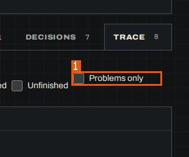

1. `checkbox "Problems only"`

Related: appears on [SCR-026](03-screens.md#SCR-026)

Evidence:

- form `01a17540-90f7-7001-aec7-359aafbf0dac` — form: act, get_next_frontier_item, login, navigate (run `01a1753d-a8da-7000-85d2-b19d666d3587`, map, 2026-10-25)
- screen region `01a17540-9091-7001-8be2-6a2ebaab8ead` `checkbox "Problems only"` — MudPuppy (/app/scans/:scan/:tab) (run `01a1753d-a8da-7000-85d2-b19d666d3587`, map, 2026-10-25)

### DI-050 — 1 · Scan type

**DI-050** · rev 1 · draft · observed

> DRAFT — not confirmed by a reviewer

**Name (verbatim):** 1 · Scan type (en)

**English name:** Type of the next scan

**Type:** enum (radio)

**Constraints:** allowed values: Focused, Recheck, Retry a path; format: field run_type; "Focused" checked by default; required: false

**Seen in:**

- form on /app/portals/reference-insurer-local/scans/plan (`01a17540-b704-7001-bd98-d0f36b161594`)

**On screen:** MudPuppy (/app/portals/reference-insurer-local/scans/plan)

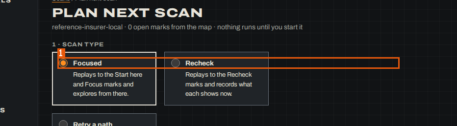

1. `radio "Focused Replays to the Start here and Focus marks and explores from there."`

Related: appears on [SCR-027](03-screens.md#SCR-027)

Evidence:

- form `01a17540-b704-7001-bd98-d0f36b161594` — form: run_type, persona, environment, depth (run `01a1753d-a8da-7000-85d2-b19d666d3587`, map, 2026-10-25)
- screen region `01a17540-b6ab-7000-aa4c-46fedc8a36c3` `radio "Focused Replays to the Start here and Focus marks and explores from there."` — MudPuppy (/app/portals/reference-insurer-local/scans/plan) (run `01a1753d-a8da-7000-85d2-b19d666d3587`, map, 2026-10-25)

### DI-051 — Persona (Plan next scan)

**DI-051** · rev 1 · draft · observed

> DRAFT — not confirmed by a reviewer

**Name (verbatim):** Persona (en)

**English name:** Persona of the next scan

**Type:** enum (select)

**Constraints:** allowed values: agent-anna, guest; format: the portal's personas; first selected; required: false

**Seen in:**

- form on /app/portals/reference-insurer-local/scans/plan (`01a17540-b704-7001-bd98-d0f36b161594`)

**On screen:** MudPuppy (/app/portals/reference-insurer-local/scans/plan)

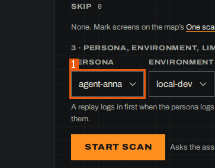

1. `combobox "Persona"`

Related: appears on [SCR-027](03-screens.md#SCR-027)

Evidence:

- form `01a17540-b704-7001-bd98-d0f36b161594` — form: run_type, persona, environment, depth (run `01a1753d-a8da-7000-85d2-b19d666d3587`, map, 2026-10-25)
- screen region `01a17540-b6ab-7000-aa4c-46fedc8a36c3` `combobox "Persona"` — MudPuppy (/app/portals/reference-insurer-local/scans/plan) (run `01a1753d-a8da-7000-85d2-b19d666d3587`, map, 2026-10-25)

### DI-052 — Environment (Plan next scan)

**DI-052** · rev 1 · draft · observed

> DRAFT — not confirmed by a reviewer

**Name (verbatim):** Environment (en)

**English name:** Environment of the next scan

**Type:** enum (select)

**Constraints:** allowed values: local-dev; format: the environments of the portal; required: false

**Seen in:**

- form on /app/portals/reference-insurer-local/scans/plan (`01a17540-b704-7001-bd98-d0f36b161594`)

**On screen:** MudPuppy (/app/portals/reference-insurer-local/scans/plan)

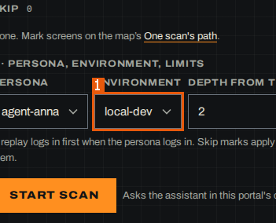

1. `combobox "Environment"`

Related: appears on [SCR-027](03-screens.md#SCR-027)

Evidence:

- form `01a17540-b704-7001-bd98-d0f36b161594` — form: run_type, persona, environment, depth (run `01a1753d-a8da-7000-85d2-b19d666d3587`, map, 2026-10-25)
- screen region `01a17540-b6ab-7000-aa4c-46fedc8a36c3` `combobox "Environment"` — MudPuppy (/app/portals/reference-insurer-local/scans/plan) (run `01a1753d-a8da-7000-85d2-b19d666d3587`, map, 2026-10-25)

### DI-053 — Depth from the start (focused)

**DI-053** · rev 1 · draft · observed

> DRAFT — not confirmed by a reviewer

**Name (verbatim):** Depth from the start (focused) (en)

**English name:** Exploration depth of a focused scan

**Type:** number

**Constraints:** format: integer, default 2; pattern observed: min 0, max 10; required: false

**Seen in:**

- form on /app/portals/reference-insurer-local/scans/plan (`01a17540-b704-7001-bd98-d0f36b161594`)

**On screen:** MudPuppy (/app/portals/reference-insurer-local/scans/plan)

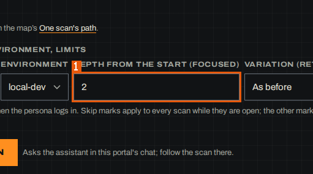

1. `spinbutton "Depth from the start (focused)"`

Related: appears on [SCR-027](03-screens.md#SCR-027)

Evidence:

- form `01a17540-b704-7001-bd98-d0f36b161594` — form: run_type, persona, environment, depth (run `01a1753d-a8da-7000-85d2-b19d666d3587`, map, 2026-10-25)
- screen region `01a17540-b6ab-7000-aa4c-46fedc8a36c3` `spinbutton "Depth from the start (focused)"` — MudPuppy (/app/portals/reference-insurer-local/scans/plan) (run `01a1753d-a8da-7000-85d2-b19d666d3587`, map, 2026-10-25)

### DI-054 — Variation (retry)

**DI-054** · rev 1 · draft · observed

> DRAFT — not confirmed by a reviewer

**Name (verbatim):** Variation (retry) (en)

**English name:** How a retry differs

**Type:** enum (select)

**Constraints:** allowed values: As before, Wait longer, Other input, Don't submit; format: default "As before"; required: false

**Seen in:**

- form on /app/portals/reference-insurer-local/scans/plan (`01a17540-b704-7001-bd98-d0f36b161594`)

**On screen:** MudPuppy (/app/portals/reference-insurer-local/scans/plan)

1. `combobox "Variation (retry)"`

Related: appears on [SCR-027](03-screens.md#SCR-027)

Evidence:

- form `01a17540-b704-7001-bd98-d0f36b161594` — form: run_type, persona, environment, depth (run `01a1753d-a8da-7000-85d2-b19d666d3587`, map, 2026-10-25)
- screen region `01a17540-b6ab-7000-aa4c-46fedc8a36c3` `combobox "Variation (retry)"` — MudPuppy (/app/portals/reference-insurer-local/scans/plan) (run `01a1753d-a8da-7000-85d2-b19d666d3587`, map, 2026-10-25)

### DI-055 — Environment (Save an environment)

**DI-055** · rev 1 · draft · observed

> DRAFT — not confirmed by a reviewer

**Name (verbatim):** Environment (en)

**English name:** Environment to configure

**Type:** enum (select)

**Constraints:** allowed values: production, staging, sandbox; format: field name; default production; required: false

**Seen in:**

- form on /app/portals/reference-insurer-local/settings (`01a17540-ed11-7000-85cd-4c336b5cba88`)

**On screen:** MudPuppy (/app/portals/reference-insurer-local/settings)

1. `combobox "Environment"`

Related: appears on [SCR-030](03-screens.md#SCR-030)

Evidence:

- form `01a17540-ed11-7000-85cd-4c336b5cba88` — form: name, url, limit (run `01a1753d-a8da-7000-85d2-b19d666d3587`, map, 2026-10-25)
- screen region `01a17540-ecac-7000-9714-39aba77839c5` `combobox "Environment"` — MudPuppy (/app/portals/reference-insurer-local/settings) (run `01a1753d-a8da-7000-85d2-b19d666d3587`, map, 2026-10-25)

### DI-056 — Address (Save an environment)

**DI-056** · rev 1 · draft · observed

> DRAFT — not confirmed by a reviewer

**Name (verbatim):** Address (en)

**English name:** Environment base address

**Type:** string (URL)

**Constraints:** format: field url; placeholder "https://"; required: false

**Seen in:**

- form on /app/portals/reference-insurer-local/settings (`01a17540-ed11-7000-85cd-4c336b5cba88`)

**On screen:** MudPuppy (/app/portals/reference-insurer-local/settings)

1. `textbox "Address"`

Related: appears on [SCR-030](03-screens.md#SCR-030)

Evidence:

- form `01a17540-ed11-7000-85cd-4c336b5cba88` — form: name, url, limit (run `01a1753d-a8da-7000-85d2-b19d666d3587`, map, 2026-10-25)
- screen region `01a17540-ecac-7000-9714-39aba77839c5` `textbox "Address"` — MudPuppy (/app/portals/reference-insurer-local/settings) (run `01a1753d-a8da-7000-85d2-b19d666d3587`, map, 2026-10-25)

### DI-057 — How far the crawler may go

**DI-057** · rev 1 · draft · observed

> DRAFT — not confirmed by a reviewer

**Name (verbatim):** How far the crawler may go (en)

**English name:** Crawl limit of the environment

**Type:** enum (select)

**Constraints:** allowed values: fill and submit forms (everything), up to deleting things, no outside effects, change data, never delete, only look, never submit; format: field limit; default "fill and submit forms (everything)"; required: false

**Seen in:**

- form on /app/portals/reference-insurer-local/settings (`01a17540-ed11-7000-85cd-4c336b5cba88`)

**On screen:** MudPuppy (/app/portals/reference-insurer-local/settings)

1. `combobox "How far the crawler may go"`

Related: appears on [SCR-030](03-screens.md#SCR-030)

Evidence:

- form `01a17540-ed11-7000-85cd-4c336b5cba88` — form: name, url, limit (run `01a1753d-a8da-7000-85d2-b19d666d3587`, map, 2026-10-25)
- screen region `01a17540-ecac-7000-9714-39aba77839c5` `combobox "How far the crawler may go"` — MudPuppy (/app/portals/reference-insurer-local/settings) (run `01a1753d-a8da-7000-85d2-b19d666d3587`, map, 2026-10-25)

### DI-058 — Name (Add persona)

**DI-058** · rev 1 · draft · observed

> DRAFT — not confirmed by a reviewer

**Name (verbatim):** Name (en)

**English name:** Persona name

**Type:** string (text)

**Constraints:** format: browser message "Please fill out this field." when empty; inside the collapsed group "Add persona"; max length: 24; required: true

**Seen in:**

- form on /app/portals/reference-insurer-local/settings (`01a17540-ed11-7001-86f9-d7bea337ecf8`)

**On screen:** MudPuppy (/app/portals/reference-insurer-local/settings)

1. `region "Personas"` — the field is inside the collapsed "Add persona" group

Related: appears on [SCR-030](03-screens.md#SCR-030)

Evidence:

- form `01a17540-ed11-7001-86f9-d7bea337ecf8` — form: name, about, signIn (run `01a1753d-a8da-7000-85d2-b19d666d3587`, map, 2026-10-25)
- screen region `01a17540-ecac-7000-9714-39aba77839c5` `region "Personas"` — MudPuppy (/app/portals/reference-insurer-local/settings) (run `01a1753d-a8da-7000-85d2-b19d666d3587`, map, 2026-10-25) — note: the field is inside the collapsed "Add persona" group

### DI-059 — Who this is (Add persona)

**DI-059** · rev 1 · draft · observed

> DRAFT — not confirmed by a reviewer

**Name (verbatim):** Who this is (en)

**English name:** Persona description

**Type:** string (text)

**Constraints:** max length: 140; required: false

**Seen in:**

- form on /app/portals/reference-insurer-local/settings (`01a17540-ed11-7001-86f9-d7bea337ecf8`)

**On screen:** MudPuppy (/app/portals/reference-insurer-local/settings)

1. `region "Personas"`

Related: appears on [SCR-030](03-screens.md#SCR-030)

Evidence:

- form `01a17540-ed11-7001-86f9-d7bea337ecf8` — form: name, about, signIn (run `01a1753d-a8da-7000-85d2-b19d666d3587`, map, 2026-10-25)
- screen region `01a17540-ecac-7000-9714-39aba77839c5` `region "Personas"` — MudPuppy (/app/portals/reference-insurer-local/settings) (run `01a1753d-a8da-7000-85d2-b19d666d3587`, map, 2026-10-25)

### DI-060 — Signs in with (Add persona)

**DI-060** · rev 1 · draft · observed

> DRAFT — not confirmed by a reviewer

**Name (verbatim):** Signs in with (en)

**English name:** Credential the persona signs in with

**Type:** enum (select)

**Constraints:** allowed values: Nothing: browses as a guest, AGENT_ANNA, REF_INSURER_KLIENT, REF_INSURER_PREMIUM, Another credential name…; format: stored credential names; values are never shown; required: false

**Seen in:**

- form on /app/portals/reference-insurer-local/settings (`01a17540-ed11-7001-86f9-d7bea337ecf8`)

**On screen:** MudPuppy (/app/portals/reference-insurer-local/settings)

1. `region "Personas"`

Related: appears on [SCR-030](03-screens.md#SCR-030)

Evidence:

- form `01a17540-ed11-7001-86f9-d7bea337ecf8` — form: name, about, signIn (run `01a1753d-a8da-7000-85d2-b19d666d3587`, map, 2026-10-25)
- screen region `01a17540-ecac-7000-9714-39aba77839c5` `region "Personas"` — MudPuppy (/app/portals/reference-insurer-local/settings) (run `01a1753d-a8da-7000-85d2-b19d666d3587`, map, 2026-10-25)

### DI-061 — Release marker: response header

**DI-061** · rev 1 · draft · observed

> DRAFT — not confirmed by a reviewer

**Name (verbatim):** Release marker: response header (en)

**English name:** Response header that names the release

**Type:** string (text)

**Constraints:** format: inside the collapsed group "Change the hints"; without a marker "releases are told apart by the names of the page's files"; max length: 200; required: false

**Seen in:**

- form on /app/portals/reference-insurer-local/settings (`01a17540-ed11-7002-8492-47b9fbf96fb6`)

**On screen:** MudPuppy (/app/portals/reference-insurer-local/settings)

1. `region "Hints"`

Related: appears on [SCR-030](03-screens.md#SCR-030)

Evidence:

- form `01a17540-ed11-7002-8492-47b9fbf96fb6` — form: marker_header, marker_meta, ab_flags, refusals (run `01a1753d-a8da-7000-85d2-b19d666d3587`, map, 2026-10-25)
- screen region `01a17540-ecac-7000-9714-39aba77839c5` `region "Hints"` — MudPuppy (/app/portals/reference-insurer-local/settings) (run `01a1753d-a8da-7000-85d2-b19d666d3587`, map, 2026-10-25)

### DI-062 — or meta name (release marker)

**DI-062** · rev 1 · draft · observed

> DRAFT — not confirmed by a reviewer

**Name (verbatim):** or meta name (en)

**English name:** Meta tag that names the release

**Type:** string (text)

**Constraints:** max length: 200; required: false

**Seen in:**

- form on /app/portals/reference-insurer-local/settings (`01a17540-ed11-7002-8492-47b9fbf96fb6`)

**On screen:** MudPuppy (/app/portals/reference-insurer-local/settings)

1. `region "Hints"`

Related: appears on [SCR-030](03-screens.md#SCR-030)

Evidence:

- form `01a17540-ed11-7002-8492-47b9fbf96fb6` — form: marker_header, marker_meta, ab_flags, refusals (run `01a1753d-a8da-7000-85d2-b19d666d3587`, map, 2026-10-25)
- screen region `01a17540-ecac-7000-9714-39aba77839c5` `region "Hints"` — MudPuppy (/app/portals/reference-insurer-local/settings) (run `01a1753d-a8da-7000-85d2-b19d666d3587`, map, 2026-10-25)

### DI-063 — A/B cookies, one per line

**DI-063** · rev 1 · draft · observed

> DRAFT — not confirmed by a reviewer

**Name (verbatim):** A/B cookies, one per line (en)

**English name:** A/B test cookies

**Type:** string (textarea)

**Constraints:** format: one cookie per line; "confirming an A/B test in Review adds its cookie"; required: false

**Seen in:**

- form on /app/portals/reference-insurer-local/settings (`01a17540-ed11-7002-8492-47b9fbf96fb6`)

**On screen:** MudPuppy (/app/portals/reference-insurer-local/settings)

1. `region "Hints"`

Related: appears on [SCR-030](03-screens.md#SCR-030)

Evidence:

- form `01a17540-ed11-7002-8492-47b9fbf96fb6` — form: marker_header, marker_meta, ab_flags, refusals (run `01a1753d-a8da-7000-85d2-b19d666d3587`, map, 2026-10-25)
- screen region `01a17540-ecac-7000-9714-39aba77839c5` `region "Hints"` — MudPuppy (/app/portals/reference-insurer-local/settings) (run `01a1753d-a8da-7000-85d2-b19d666d3587`, map, 2026-10-25)

### DI-064 — Business refusals, one per line

**DI-064** · rev 1 · draft · observed

> DRAFT — not confirmed by a reviewer

**Name (verbatim):** Business refusals, one per line (en)

**English name:** Texts the portal uses to refuse a request

**Type:** string (textarea)

**Constraints:** format: one per line; shown as "none listed" when empty; required: false

**Seen in:**

- form on /app/portals/reference-insurer-local/settings (`01a17540-ed11-7002-8492-47b9fbf96fb6`)

**On screen:** MudPuppy (/app/portals/reference-insurer-local/settings)

1. `region "Hints"`

Related: appears on [SCR-030](03-screens.md#SCR-030)

Evidence:

- form `01a17540-ed11-7002-8492-47b9fbf96fb6` — form: marker_header, marker_meta, ab_flags, refusals (run `01a1753d-a8da-7000-85d2-b19d666d3587`, map, 2026-10-25)
- screen region `01a17540-ecac-7000-9714-39aba77839c5` `region "Hints"` — MudPuppy (/app/portals/reference-insurer-local/settings) (run `01a1753d-a8da-7000-85d2-b19d666d3587`, map, 2026-10-25)

### DI-065 — Checks per scan

**DI-065** · rev 1 · draft · observed

> DRAFT — not confirmed by a reviewer

**Name (verbatim):** Checks per scan (en)

**English name:** Check replays per scan

**Type:** number

**Constraints:** format: integer, field checks_per_scan, 20 in the run; pattern observed: min 0, max 1000; required: false

**Seen in:**

- form on /app/portals/reference-insurer-local/settings (`01a17540-ed12-7000-94e3-79de59f15ce2`)

**On screen:** MudPuppy (/app/portals/reference-insurer-local/settings)

1. `spinbutton "Checks per scan"`

Related: appears on [SCR-030](03-screens.md#SCR-030)

Evidence:

- form `01a17540-ed12-7000-94e3-79de59f15ce2` — form: checks_per_scan, probes_per_step, probes_per_scan (run `01a1753d-a8da-7000-85d2-b19d666d3587`, map, 2026-10-25)
- screen region `01a17540-ecac-7000-9714-39aba77839c5` `spinbutton "Checks per scan"` — MudPuppy (/app/portals/reference-insurer-local/settings) (run `01a1753d-a8da-7000-85d2-b19d666d3587`, map, 2026-10-25)

### DI-066 — Probes per form step

**DI-066** · rev 1 · draft · observed

> DRAFT — not confirmed by a reviewer

**Name (verbatim):** Probes per form step (en)

**English name:** Form probes per step

**Type:** number

**Constraints:** format: integer, field probes_per_step, 24 in the run; 0 turns form probing off; pattern observed: min 0, max 1000; required: false

**Seen in:**

- form on /app/portals/reference-insurer-local/settings (`01a17540-ed12-7000-94e3-79de59f15ce2`)

**On screen:** MudPuppy (/app/portals/reference-insurer-local/settings)

1. `spinbutton "Probes per form step"`

Related: appears on [SCR-030](03-screens.md#SCR-030)

Evidence:

- form `01a17540-ed12-7000-94e3-79de59f15ce2` — form: checks_per_scan, probes_per_step, probes_per_scan (run `01a1753d-a8da-7000-85d2-b19d666d3587`, map, 2026-10-25)
- screen region `01a17540-ecac-7000-9714-39aba77839c5` `spinbutton "Probes per form step"` — MudPuppy (/app/portals/reference-insurer-local/settings) (run `01a1753d-a8da-7000-85d2-b19d666d3587`, map, 2026-10-25)

### DI-067 — Probes per scan

**DI-067** · rev 1 · draft · observed

> DRAFT — not confirmed by a reviewer

**Name (verbatim):** Probes per scan (en)

**English name:** Form probes per scan

**Type:** number

**Constraints:** format: integer, field probes_per_scan, 120 in the run; 0 turns form probing off; pattern observed: min 0, max 10000; required: false

**Seen in:**

- form on /app/portals/reference-insurer-local/settings (`01a17540-ed12-7000-94e3-79de59f15ce2`)

**On screen:** MudPuppy (/app/portals/reference-insurer-local/settings)

1. `spinbutton "Probes per scan"`

Related: appears on [SCR-030](03-screens.md#SCR-030)

Evidence:

- form `01a17540-ed12-7000-94e3-79de59f15ce2` — form: checks_per_scan, probes_per_step, probes_per_scan (run `01a1753d-a8da-7000-85d2-b19d666d3587`, map, 2026-10-25)
- screen region `01a17540-ecac-7000-9714-39aba77839c5` `spinbutton "Probes per scan"` — MudPuppy (/app/portals/reference-insurer-local/settings) (run `01a1753d-a8da-7000-85d2-b19d666d3587`, map, 2026-10-25)

### DI-068 — Your answer (Same screen?)

**DI-068** · rev 1 · draft · observed

> DRAFT — not confirmed by a reviewer

**Name (verbatim):** Your answer (en)

**English name:** Same-screen label

**Type:** enum (radio)

**Constraints:** allowed values: Same screen, Same, different data, Different screens; format: field answer; keys 1, 2, 3; the radio group has no label of its own and sits in the region "Your answer"; required: false

**Seen in:**

- form on /app/portals/reference-insurer-local/same-screen (`01a17541-10d4-7001-bef7-ce6452bfa668`)

**On screen:** MudPuppy (/app/portals/reference-insurer-local/same-screen)

1. `region "Your answer"`

Related: appears on [SCR-013](03-screens.md#SCR-013)

Evidence:

- form `01a17541-10d4-7001-bef7-ce6452bfa668` — form: answer (run `01a1753d-a8da-7000-85d2-b19d666d3587`, map, 2026-10-25)
- screen region `01a17541-107a-7000-8bc5-38e73949e5be` `region "Your answer"` — MudPuppy (/app/portals/reference-insurer-local/same-screen) (run `01a1753d-a8da-7000-85d2-b19d666d3587`, map, 2026-10-25)

### DI-069 — Why (optional) W

**DI-069** · rev 1 · draft · observed

> DRAFT — not confirmed by a reviewer

**Name (verbatim):** Why (optional) W (en)

**English name:** Reason for the same-screen label

**Type:** string (text)

**Constraints:** format: placeholder "One line"; "Shown with the label."; key W; max length: 2000; required: false

**Seen in:**

- form on /app/portals/reference-insurer-local/same-screen (`01a17541-10d4-7002-9bcf-dd1be24d6547`)

**On screen:** MudPuppy (/app/portals/reference-insurer-local/same-screen)

1. `textbox "Why (optional) W"`

Related: appears on [SCR-013](03-screens.md#SCR-013)

Evidence:

- form `01a17541-10d4-7002-9bcf-dd1be24d6547` — form: _r_k_ (run `01a1753d-a8da-7000-85d2-b19d666d3587`, map, 2026-10-25)
- screen region `01a17541-107a-7000-8bc5-38e73949e5be` `textbox "Why (optional) W"` — MudPuppy (/app/portals/reference-insurer-local/same-screen) (run `01a1753d-a8da-7000-85d2-b19d666d3587`, map, 2026-10-25)

### DI-070 — Message (Write to the Workbench)

**DI-070** · rev 1 · draft · observed

> DRAFT — not confirmed by a reviewer

**Name (verbatim):** Message (en)

**English name:** Request to the Workbench assistant

**Type:** string (textarea)

**Constraints:** format: placeholder "Ask, or tell the crawler what to do"; disabled while the assistant is unavailable; required: false

**Seen in:**

- form on /app/portals/reference-insurer-local/workbench (`01a17541-8e23-7001-bc6f-0930b1ea7d34`)

**On screen:** MudPuppy (/app/portals/reference-insurer-local/workbench)

1. `textbox "Message"`

Related: appears on [SCR-031](03-screens.md#SCR-031)

Evidence:

- form `01a17541-8e23-7001-bc6f-0930b1ea7d34` — form: _r_d_ (run `01a1753d-a8da-7000-85d2-b19d666d3587`, map, 2026-10-25)
- screen region `01a17541-8dad-7000-8cd1-09927b9bdaf7` `textbox "Message"` — MudPuppy (/app/portals/reference-insurer-local/workbench) (run `01a1753d-a8da-7000-85d2-b19d666d3587`, map, 2026-10-25)

### DI-071 — Short name (optional)

**DI-071** · rev 1 · draft · observed

> DRAFT — not confirmed by a reviewer

**Name (verbatim):** Short name (optional) (en)

**English name:** Portal id

**Type:** string (text)

**Constraints:** format: field id; "Proposed from the first address, e.g. wikipedia-org"; required: false

**Seen in:**

- form on /app/portals/new (`01a17541-b138-7000-8307-39202088586d`)

**On screen:** MudPuppy (/app/portals/new)

1. `textbox "Short name (optional)"`

Related: appears on [SCR-006](03-screens.md#SCR-006)

Evidence:

- form `01a17541-b138-7000-8307-39202088586d` — form: id, envs.0.base_url, envs.0.limit, envs.1.base_url (run `01a1753d-a8da-7000-85d2-b19d666d3587`, map, 2026-10-25)
- screen region `01a17541-b0b3-7000-b23a-7b9ba885ff54` `textbox "Short name (optional)"` — MudPuppy (/app/portals/new) (run `01a1753d-a8da-7000-85d2-b19d666d3587`, map, 2026-10-25)

### DI-072 — Address (New portal, production)

**DI-072** · rev 1 · draft · observed

> DRAFT — not confirmed by a reviewer

**Name (verbatim):** Address (en)

**English name:** Production address

**Type:** string (URL)

**Constraints:** format: field envs.0.base_url in the group "production"; placeholder "https://www.wikipedia.org/"; required: false

**Seen in:**

- form on /app/portals/new (`01a17541-b138-7000-8307-39202088586d`)

**On screen:** MudPuppy (/app/portals/new)

1. `textbox "Address"`

Related: appears on [SCR-006](03-screens.md#SCR-006)

Evidence:

- form `01a17541-b138-7000-8307-39202088586d` — form: id, envs.0.base_url, envs.0.limit, envs.1.base_url (run `01a1753d-a8da-7000-85d2-b19d666d3587`, map, 2026-10-25)
- screen region `01a17541-b0b3-7000-b23a-7b9ba885ff54` `textbox "Address"` — MudPuppy (/app/portals/new) (run `01a1753d-a8da-7000-85d2-b19d666d3587`, map, 2026-10-25)

### DI-073 — Address (New portal, staging)

**DI-073** · rev 1 · draft · observed

> DRAFT — not confirmed by a reviewer

**Name (verbatim):** Address (en)

**English name:** Staging address

**Type:** string (URL)

**Constraints:** format: field envs.1.base_url in the group "staging"; placeholder "Leave empty if there is none"; required: false

**Seen in:**

- form on /app/portals/new (`01a17541-b138-7000-8307-39202088586d`)

**On screen:** MudPuppy (/app/portals/new)

1. `textbox "Address"#2`

Related: appears on [SCR-006](03-screens.md#SCR-006)

Evidence:

- form `01a17541-b138-7000-8307-39202088586d` — form: id, envs.0.base_url, envs.0.limit, envs.1.base_url (run `01a1753d-a8da-7000-85d2-b19d666d3587`, map, 2026-10-25)
- screen region `01a17541-b0b3-7000-b23a-7b9ba885ff54` `textbox "Address"#2` — MudPuppy (/app/portals/new) (run `01a1753d-a8da-7000-85d2-b19d666d3587`, map, 2026-10-25)

### DI-074 — Address (New portal, sandbox)

**DI-074** · rev 1 · draft · observed

> DRAFT — not confirmed by a reviewer

**Name (verbatim):** Address (en)

**English name:** Sandbox address

**Type:** string (URL)

**Constraints:** format: field envs.2.base_url in the group "sandbox"; placeholder "Leave empty if there is none"; required: false

**Seen in:**

- form on /app/portals/new (`01a17541-b138-7000-8307-39202088586d`)

**On screen:** MudPuppy (/app/portals/new)

1. `textbox "Address"#3`

Related: appears on [SCR-006](03-screens.md#SCR-006)

Evidence:

- form `01a17541-b138-7000-8307-39202088586d` — form: id, envs.0.base_url, envs.0.limit, envs.1.base_url (run `01a1753d-a8da-7000-85d2-b19d666d3587`, map, 2026-10-25)
- screen region `01a17541-b0b3-7000-b23a-7b9ba885ff54` `textbox "Address"#3` — MudPuppy (/app/portals/new) (run `01a1753d-a8da-7000-85d2-b19d666d3587`, map, 2026-10-25)

### DI-075 — The most a scan may do here (production)

**DI-075** · rev 1 · draft · observed

> DRAFT — not confirmed by a reviewer

**Name (verbatim):** The most a scan may do here (en)

**English name:** Production crawl limit

**Type:** enum (select)

**Constraints:** allowed values: fill and submit forms (everything), up to deleting things, no outside effects, change data, never delete, only look, never submit; format: field envs.0.limit; default "fill and submit forms (everything)"; required: false

**Seen in:**

- form on /app/portals/new (`01a17541-b138-7000-8307-39202088586d`)

**On screen:** MudPuppy (/app/portals/new)

1. `combobox "The most a scan may do here"`

Related: appears on [SCR-006](03-screens.md#SCR-006)

Evidence:

- form `01a17541-b138-7000-8307-39202088586d` — form: id, envs.0.base_url, envs.0.limit, envs.1.base_url (run `01a1753d-a8da-7000-85d2-b19d666d3587`, map, 2026-10-25)
- screen region `01a17541-b0b3-7000-b23a-7b9ba885ff54` `combobox "The most a scan may do here"` — MudPuppy (/app/portals/new) (run `01a1753d-a8da-7000-85d2-b19d666d3587`, map, 2026-10-25)

### DI-076 — The most a scan may do here (staging)

**DI-076** · rev 1 · draft · observed

> DRAFT — not confirmed by a reviewer

**Name (verbatim):** The most a scan may do here (en)

**English name:** Staging crawl limit

**Type:** enum (select)

**Constraints:** allowed values: fill and submit forms (everything), up to deleting things, no outside effects, change data, never delete, only look, never submit; format: field envs.1.limit; required: false

**Seen in:**

- form on /app/portals/new (`01a17541-b138-7000-8307-39202088586d`)

**On screen:** MudPuppy (/app/portals/new)

1. `combobox "The most a scan may do here"#2`

Related: appears on [SCR-006](03-screens.md#SCR-006)

Evidence:

- form `01a17541-b138-7000-8307-39202088586d` — form: id, envs.0.base_url, envs.0.limit, envs.1.base_url (run `01a1753d-a8da-7000-85d2-b19d666d3587`, map, 2026-10-25)
- screen region `01a17541-b0b3-7000-b23a-7b9ba885ff54` `combobox "The most a scan may do here"#2` — MudPuppy (/app/portals/new) (run `01a1753d-a8da-7000-85d2-b19d666d3587`, map, 2026-10-25)

### DI-077 — The most a scan may do here (sandbox)

**DI-077** · rev 1 · draft · observed

> DRAFT — not confirmed by a reviewer

**Name (verbatim):** The most a scan may do here (en)

**English name:** Sandbox crawl limit

**Type:** enum (select)

**Constraints:** allowed values: fill and submit forms (everything), up to deleting things, no outside effects, change data, never delete, only look, never submit; format: field envs.2.limit; required: false

**Seen in:**

- form on /app/portals/new (`01a17541-b138-7000-8307-39202088586d`)

**On screen:** MudPuppy (/app/portals/new)

1. `combobox "The most a scan may do here"#3`

Related: appears on [SCR-006](03-screens.md#SCR-006)

Evidence:

- form `01a17541-b138-7000-8307-39202088586d` — form: id, envs.0.base_url, envs.0.limit, envs.1.base_url (run `01a1753d-a8da-7000-85d2-b19d666d3587`, map, 2026-10-25)
- screen region `01a17541-b0b3-7000-b23a-7b9ba885ff54` `combobox "The most a scan may do here"#3` — MudPuppy (/app/portals/new) (run `01a1753d-a8da-7000-85d2-b19d666d3587`, map, 2026-10-25)

### DI-078 — robots.txt (New portal)

**DI-078** · rev 1 · draft · observed

> DRAFT — not confirmed by a reviewer

**Name (verbatim):** robots.txt (en)

**English name:** robots.txt policy

**Type:** enum (radio)

**Constraints:** allowed values: ignore it (visit every page; your responsibility), respect it; format: field robots; "ignore it…" checked by default; required: false

**Seen in:**

- form on /app/portals/new (`01a17541-b138-7000-8307-39202088586d`)

**On screen:** MudPuppy (/app/portals/new)

1. `radio "respect it"`

Related: appears on [SCR-006](03-screens.md#SCR-006)

Evidence:

- form `01a17541-b138-7000-8307-39202088586d` — form: id, envs.0.base_url, envs.0.limit, envs.1.base_url (run `01a1753d-a8da-7000-85d2-b19d666d3587`, map, 2026-10-25)
- screen region `01a17541-b0b3-7000-b23a-7b9ba885ff54` `radio "respect it"` — MudPuppy (/app/portals/new) (run `01a1753d-a8da-7000-85d2-b19d666d3587`, map, 2026-10-25)

### DI-079 — Analysis session id in the Docs address

**DI-079** · rev 1 · draft · observed

> DRAFT — not confirmed by a reviewer

**Name (verbatim):** Id (en)

**English name:** Analysis session identifier (path)

**Type:** string (UUID-like id)

**Constraints:** format: path segment of /app/portals/<portal>/docs/sessions/<session id>, set by the session link in "Analysis sessions"; shown shortened (first 13 characters and …) in links and in full under "Id"; required: true

**Seen in:**

- URL http://127.0.0.1:8790/app/portals/reference-insurer-local/docs/sessions/01a16628-bf66-7000-9d7c-e731b752c3df (`01a1753f-e18d-7003-abb1-6765964dbd31`)

**On screen:** MudPuppy (/app/portals/reference-insurer-local/docs/sessions/:param)

1. `region "Session"`

Related: appears on [SCR-022](03-screens.md#SCR-022)

Evidence:

- observation `01a1753f-e18d-7003-abb1-6765964dbd31` — http://127.0.0.1:8790/app/portals/reference-insurer-local/docs/sessions/01a16628-bf66-7000-9d7c-e731b752c3df (run `01a1753d-a8da-7000-85d2-b19d666d3587`, map, 2026-10-25)
- screen region `01a1753f-e0df-7000-a288-35e0110648bb` `region "Session"` — MudPuppy (/app/portals/reference-insurer-local/docs/sessions/:param) (run `01a1753d-a8da-7000-85d2-b19d666d3587`, map, 2026-10-25)

### DI-080 — Scan id in the scan address

**DI-080** · rev 1 · draft · observed

> DRAFT — not confirmed by a reviewer

**Name (verbatim):** Scan (en)

**English name:** Scan identifier (path)

**Type:** string (UUID-like id)

**Constraints:** format: path segment of /app/scans/<scan id> and /app/scans/<scan id>/<section>; shown shortened (first 13 characters) with a "Copy" button that copies the full id; required: true

**Seen in:**

- URL http://127.0.0.1:8790/app/scans/01a16ca2-a071-7000-a024-08bdb17527b3 (`01a17540-27dd-7002-81d8-8e03d75c0997`)
- URL http://127.0.0.1:8790/app/scans/01a16ca2-a071-7000-a024-08bdb17527b3/states (`01a17540-3880-7000-9b58-26e4fa2ac792`)

**On screen:** MudPuppy (/app/portals/reference-insurer-local/scans)

1. `table "Scans of reference-insurer-local"`

Related: appears on [SCR-024](03-screens.md#SCR-024) · appears on [SCR-025](03-screens.md#SCR-025)

Evidence:

- observation `01a17540-27dd-7002-81d8-8e03d75c0997` — http://127.0.0.1:8790/app/scans/01a16ca2-a071-7000-a024-08bdb17527b3 (run `01a1753d-a8da-7000-85d2-b19d666d3587`, map, 2026-10-25)
- screen region `01a17540-1543-7000-9e27-e769fa4b9dd9` `table "Scans of reference-insurer-local"` — MudPuppy (/app/portals/reference-insurer-local/scans) (run `01a1753d-a8da-7000-85d2-b19d666d3587`, map, 2026-10-25)

## Entities

Data items seen together in one form or call, grouped as an entity. No relationships are drawn: none were observed.

## API endpoints

### API-001 — GET /api/portals

**API-001** · rev 1 · draft · observed

> DRAFT — not confirmed by a reviewer

**`GET /api/portals`**

**Purpose:** Portals of the current environment for the shell: id, scan count, running count, last scan time, other environments and whether the Workbench is enabled.

**Called from:** every page (shell)

**Request fields:** —

**Response fields:** `environment`, `portals[].id`, `portals[].scans`, `portals[].running`, `portals[].last_scan_at`, `other_environments[]`, `workbench`, `warnings[]`

**Statuses seen:** 200

Related: appears on [SCR-001](03-screens.md#SCR-001)

Evidence:

- network call `01a1753d-bae8-7001-9616-c4cafece0c54` — GET /api/portals (run `01a1753d-a8da-7000-85d2-b19d666d3587`, map, 2026-10-25)

### API-002 — GET /api/portals/overview

**API-002** · rev 1 · draft · observed

> DRAFT — not confirmed by a reviewer

**`GET /api/portals/overview`**

**Purpose:** Rows of the portals table (release, last scan, changes, need you, in review, processes explored) and the newest Review items across portals.

**Called from:** All portals

**Request fields:** —

**Response fields:** `rows[].portal`, `rows[].has_model`, `rows[].releases`, `rows[].last_scan`, `rows[].changes`, `rows[].needs`, `rows[].explained`, `rows[].review`, `rows[].processes`, `rows[].explored`, `changes`, `review`, `preview[].portal`, `preview[].group`, `preview[].item`

**Statuses seen:** 200

Related: appears on [SCR-001](03-screens.md#SCR-001)

Evidence:

- network call `01a1753d-bae9-7000-b0d4-c1b2254d1a92` — GET /api/portals/overview (run `01a1753d-a8da-7000-85d2-b19d666d3587`, map, 2026-10-25)

### API-003 — GET /api/stores

**API-003** · rev 1 · draft · observed

> DRAFT — not confirmed by a reviewer

**`GET /api/stores`**

**Purpose:** The current data store and the available stores, optionally for one portal (?portal=<id>), for the banner's "Data store" button.

**Called from:** every page (shell)

**Request fields:** `portal (query, optional)`

**Response fields:** `current.key`, `current.label`, `current.kind`, `current.workspace`, `current.path`, `current.size`, `note`, `stores[]`, `follow`

**Statuses seen:** 200

Related: appears on [SCR-001](03-screens.md#SCR-001) · appears on [SCR-011](03-screens.md#SCR-011)

Evidence:

- network call `01a1753d-bae8-7000-8382-d667f3c082f2` — GET /api/stores (run `01a1753d-a8da-7000-85d2-b19d666d3587`, map, 2026-10-25)
- network call `01a1753d-df19-7000-8440-3539532ad7ab` — GET /api/stores (run `01a1753d-a8da-7000-85d2-b19d666d3587`, map, 2026-10-25)

### API-004 — GET /api/assistant-status

**API-004** · rev 1 · draft · observed

> DRAFT — not confirmed by a reviewer

**`GET /api/assistant-status`**

**Purpose:** Whether the assistant (chat service) is up, polled on portal pages.

**Called from:** portal pages (shell)

**Request fields:** —

**Response fields:** `up`

**Statuses seen:** 200

Related: appears on [SCR-011](03-screens.md#SCR-011)

Evidence:

- network call `01a1753d-df19-7001-a20d-529bbde09d4c` — GET /api/assistant-status (run `01a1753d-a8da-7000-85d2-b19d666d3587`, map, 2026-10-25)

### API-005 — GET portal home data

**API-005** · rev 1 · draft · observed

> DRAFT — not confirmed by a reviewer

Captured for the portal reference-insurer-local; the portal id is a path segment.

**`GET /api/portals/reference-insurer-local/home`**

**Purpose:** Portal home: model version, release lanes per part, last scan, what needs the BA by kind, changes by process, process and rule counts.

**Called from:** Portal home

**Request fields:** —

**Response fields:** `portal`, `environment`, `model_seq`, `model_built_at`, `lanes[]`, `last_scan`, `needs.total`, `needs.by_kind[]`, `needs.top[]`, `changes.all`, `changes.needs`, `changes.explained`, `changes.by_process[]`, `processes`, `proposed`, `rules`

**Statuses seen:** 200

Related: appears on [SCR-011](03-screens.md#SCR-011)

Evidence:

- network call `01a1753d-df1a-7000-9745-29cdfbfa9822` — GET /api/portals/reference-insurer-local/home (run `01a1753d-a8da-7000-85d2-b19d666d3587`, map, 2026-10-25)

### API-006 — GET processes of a portal

**API-006** · rev 1 · draft · observed

> DRAFT — not confirmed by a reviewer

Captured for the portal reference-insurer-local.

**`GET /api/portals/reference-insurer-local/processes`**

**Purpose:** The BA's processes with stage, models, live marks, screens and amendments; the assistant's suggestions; the screens in no process; the default persona and trace targets.

**Called from:** Processes

**Request fields:** —

**Response fields:** `rows[].key`, `rows[].name`, `rows[].persona`, `rows[].stage`, `rows[].start_route`, `rows[].end_route`, `rows[].models[]`, `rows[].live[]`, `rows[].screens`, `rows[].amendments`, `rows[].last_by`, `rows[].last_at`, `stages[]`, `suggestions[]`, `loose[]`, `default_persona`, `targets[]`, `archived`, `page`, `pages`, `total`

**Statuses seen:** 200

Related: appears on [SCR-007](03-screens.md#SCR-007)

Evidence:

- network call `01a1753d-f119-7001-9b46-b5edfabdc573` — GET /api/portals/reference-insurer-local/processes (run `01a1753d-a8da-7000-85d2-b19d666d3587`, map, 2026-10-25)

### API-007 — GET one process

**API-007** · rev 1 · draft · observed

> DRAFT — not confirmed by a reviewer

Captured for process PRC-001 of reference-insurer-local; the key is a path segment.

**`GET /api/portals/reference-insurer-local/processes/PRC-001`**

**Purpose:** One process with its models, the selected model (?model=<label>), its steps with records per step, as-is status and stages, facts from the portal model (triggers, outcomes, explored, checked, rules, paths) and scope.

**Called from:** Process (detail)

**Request fields:** `model (query, optional)`

**Response fields:** `key`, `name`, `persona`, `rev`, `stage`, `stage_value`, `live[]`, `screens`, `models[]`, `model`, `steps[].n`, `steps[].title`, `steps[].route`, `steps[].state`, `steps[].records[]`, `as_is.questions`, `as_is.unconfirmed`, `as_is.reanchor`, `as_is.stages[]`, `as_is.addable[]`, `facts.triggers[]`, `facts.outcomes[]`, `facts.paths[]`, `scope`

**Statuses seen:** 200

Related: appears on [SCR-008](03-screens.md#SCR-008)

Evidence:

- network call `01a1753e-02b5-7001-ad3c-0d0b9517868f` — GET /api/portals/reference-insurer-local/processes/PRC-001 (run `01a1753d-a8da-7000-85d2-b19d666d3587`, map, 2026-10-25)
- network call `01a1753e-1f64-7000-9c75-c5edf6e63785` — GET /api/portals/reference-insurer-local/processes/PRC-001 (run `01a1753d-a8da-7000-85d2-b19d666d3587`, map, 2026-10-25)

### API-008 — GET process history

**API-008** · rev 1 · draft · observed

> DRAFT — not confirmed by a reviewer

Captured for process PRC-001 of reference-insurer-local.

**`GET /api/portals/reference-insurer-local/processes/PRC-001/history`**

**Purpose:** Live marks per environment and every revision of the process models, the process and its change specs.

**Called from:** Process history

**Request fields:** —

**Response fields:** `head`, `revision_count`, `marked_in[]`, `live[].environment`, `live[].status`, `models[].revisions[]`, `process[]`, `specs[]`, `conflicts[]`

**Statuses seen:** 200

Related: appears on [SCR-009](03-screens.md#SCR-009)

Evidence:

- network call `01a1753e-1280-7000-8c66-fbef5c6241cb` — GET /api/portals/reference-insurer-local/processes/PRC-001/history (run `01a1753d-a8da-7000-85d2-b19d666d3587`, map, 2026-10-25)

### API-009 — GET process documentation export

**API-009** · rev 1 · draft · observed

> DRAFT — not confirmed by a reviewer

Captured for process PRC-001 of reference-insurer-local.

**`GET /api/portals/reference-insurer-local/processes/PRC-001/export`**

**Purpose:** The rebuild-grade export of a process: its files as tabs (?tab=README.md), the selected file as HTML, a zip link, or an error when the export cannot be built.

**Called from:** Process documentation (export)

**Request fields:** `tab (query)`

**Response fields:** `portal`, `key`, `tabs[].file`, `tabs[].label`, `tab`, `html`, `error`, `zip`

**Statuses seen:** 200

Related: appears on [SCR-010](03-screens.md#SCR-010)

Evidence:

- network call `01a17542-0d96-7001-b22e-982b17486c61` — GET /api/portals/reference-insurer-local/processes/PRC-001/export (run `01a1753d-a8da-7000-85d2-b19d666d3587`, map, 2026-10-25)

### API-010 — GET model versions

**API-010** · rev 1 · draft · observed

> DRAFT — not confirmed by a reviewer

Captured for reference-insurer-local.

**`GET /api/portals/reference-insurer-local/model-versions`**

**Purpose:** The portal model's versions (sequence, build time, releases, scan), optionally for one process or screen (?kind=process&key=PRC-001, ?kind=screen&key=SC-0001); feeds the "As of" selector and the Changes range.

**Called from:** Processes; Process (detail); Screens; Screen (detail)

**Request fields:** `kind (query, optional)`, `key (query, optional)`

**Response fields:** `versions[].seq`, `versions[].built_at`, `versions[].releases`, `versions[].scan`

**Statuses seen:** 200

Related: appears on [SCR-007](03-screens.md#SCR-007) · appears on [SCR-015](03-screens.md#SCR-015)

Evidence:

- network call `01a1753d-f11a-7000-a1fc-596f4eb2eae5` — GET /api/portals/reference-insurer-local/model-versions (run `01a1753d-a8da-7000-85d2-b19d666d3587`, map, 2026-10-25)
- network call `01a1753e-02b5-7000-90df-7b0de890138b` — GET /api/portals/reference-insurer-local/model-versions (run `01a1753d-a8da-7000-85d2-b19d666d3587`, map, 2026-10-25)

### API-011 — GET review of a portal

**API-011** · rev 1 · draft · observed

> DRAFT — not confirmed by a reviewer

Captured for reference-insurer-local and mudpuppy-dashboard-local.

**`GET /api/portals/reference-insurer-local/review`**

**Purpose:** Review: counts per kind, groups with rows, empty kinds, filters (parts, ages), same-screen pair count, the selected item (?select=<kind>:<id>) with detail and neighbours.

**Called from:** Review

**Request fields:** `select (query, optional)`, `show (query, optional)`, `tab (query, optional)`

**Response fields:** `decides`, `tab`, `total`, `explained_count`, `decided_count`, `same_screen_pairs`, `kinds[]`, `counts.findings`, `counts.rules`, `counts.removals`, `counts.processes`, `counts.records`, `counts.assumptions`, `counts.differences`, `counts.reanchor`, `counts.proposals`, `counts.suites`, `counts.conflicts`, `groups[]`, `empty_kinds[]`, `filters`, `selected`, `neighbours`, `explained[]`, `decided[]`

**Statuses seen:** 200

Related: appears on [SCR-012](03-screens.md#SCR-012)

Evidence:

- network call `01a1753e-bef2-7003-a8b0-ce371914a219` — GET /api/portals/reference-insurer-local/review (run `01a1753d-a8da-7000-85d2-b19d666d3587`, map, 2026-10-25)
- network call `01a17541-38a0-7001-b5bc-4409201a4fdc` — GET /api/portals/reference-insurer-local/review (run `01a1753d-a8da-7000-85d2-b19d666d3587`, map, 2026-10-25)

### API-012 — GET same-screen pair

**API-012** · rev 1 · draft · observed

> DRAFT — not confirmed by a reviewer

Captured for reference-insurer-local.

**`GET /api/portals/reference-insurer-local/same-screen`**

**Purpose:** The next page-version pair to label: threshold τ and window, the answers, both sides (state, screen key, title, route, picture, scan, time), similarity, the model's own answer, differences, position and the next pair; can_answer.

**Called from:** Same screen?

**Request fields:** —

**Response fields:** `page.tau`, `page.window`, `page.answers`, `page.pair.a`, `page.pair.b`, `page.pair.sides[]`, `page.pair.similarity`, `page.pair.model_answer`, `page.pair.label`, `page.pair.conflict`, `page.pair.differs[]`, `page.pair.position`, `page.pair.total`, `page.pair.next_pair`, `can_answer`

**Statuses seen:** 200

Related: appears on [SCR-013](03-screens.md#SCR-013)

Evidence:

- network call `01a17541-10d7-7000-820d-edf753763279` — GET /api/portals/reference-insurer-local/same-screen (run `01a1753d-a8da-7000-85d2-b19d666d3587`, map, 2026-10-25)

### API-013 — GET changes of a portal

**API-013** · rev 1 · draft · observed

> DRAFT — not confirmed by a reviewer

**`GET /api/portals/reference-insurer-local/changes`**

**Purpose:** What changed: counts (all, needs, explained, waiting), kinds and processes for the filters, the range (from/to versions, date, scan options), the release timeline with scans, and the change groups.

**Called from:** What changed (Changes)

**Request fields:** —

**Response fields:** `has_model`, `counts.all`, `counts.needs`, `counts.explained`, `counts.waiting`, `show`, `kind`, `process`, `kinds[]`, `processes[]`, `range.froms[]`, `range.tos[]`, `range.scans[]`, `releases.lanes[]`, `releases.scans[]`, `shown`, `groups[]`, `legend[]`, `statuses[]`

**Statuses seen:** 200

Related: appears on [SCR-014](03-screens.md#SCR-014)

Evidence:

- network call `01a1753e-d28f-7001-ab1c-af97196a82fc` — GET /api/portals/reference-insurer-local/changes (run `01a1753d-a8da-7000-85d2-b19d666d3587`, map, 2026-10-25)

### API-014 — GET screens of a portal

**API-014** · rev 1 · draft · observed

> DRAFT — not confirmed by a reviewer

**`GET /api/portals/reference-insurer-local/screens`**

**Purpose:** The screens list with its filter echo (status, q, process, part, why, sort), parts, variant reasons, sort options and one row per screen (key, title, route, status, needs, variants, why, last seen, checked, actions, release, parts, process, picture).

**Called from:** Screens (list); Screen (detail)

**Request fields:** `status`, `q`, `process`, `part`, `why`, `sort`

**Response fields:** `has_model`, `counts.active`, `filter`, `parts[]`, `whys[]`, `sorts[]`, `screens[].key`, `screens[].title`, `screens[].route`, `screens[].status`, `screens[].needs`, `screens[].variants`, `screens[].last_seen`, `screens[].checked`, `screens[].actions`, `screens[].release`, `screens[].parts`, `screens[].process`, `screens[].picture`

**Statuses seen:** 200

Related: appears on [SCR-015](03-screens.md#SCR-015)

Evidence:

- network call `01a1753e-e5c3-7001-9f60-4c300bcfcc60` — GET /api/portals/reference-insurer-local/screens (run `01a1753d-a8da-7000-85d2-b19d666d3587`, map, 2026-10-25)

### API-015 — GET one screen

**API-015** · rev 1 · draft · observed

> DRAFT — not confirmed by a reviewer

Captured for screen SC-0001.

**`GET /api/portals/reference-insurer-local/screens/SC-0001`**

**Purpose:** One screen: its header facts, what needs the BA there, its variants (picture, reason, explanation, status, personas, releases, visits), its actions (element key, kind, status, global or not, where it leads) and its history.

**Called from:** Screen (detail)

**Request fields:** —

**Response fields:** `screen`, `needs[]`, `variants[]`, `actions[].element_key`, `actions[].kind`, `actions[].status`, `actions[].is_global`, `actions[].place`, `actions[].leads_to[]`, `history[]`, `labels[]`

**Statuses seen:** 200

Related: appears on [SCR-016](03-screens.md#SCR-016)

Evidence:

- network call `01a1753e-f875-7000-85db-48752d2b0190` — GET /api/portals/reference-insurer-local/screens/SC-0001 (run `01a1753d-a8da-7000-85d2-b19d666d3587`, map, 2026-10-25)

### API-016 — GET recordings of a screen

**API-016** · rev 1 · draft · observed

> DRAFT — not confirmed by a reviewer

Captured for screen SC-0001.

**`GET /api/portals/reference-insurer-local/screens/SC-0001/recordings`**

**Purpose:** What was recorded for a screen: its state, amendments and their elements, inputs, the URLs it was reached under (visits, via, hops), parameters and whether it can be marked.

**Called from:** Screen (detail)

**Request fields:** —

**Response fields:** `state`, `amendments.items[]`, `amendments.elements[]`, `inputs[]`, `urls[].url`, `urls[].visits`, `urls[].via[]`, `urls[].hops[]`, `urls_more`, `params[]`, `can_mark`

**Statuses seen:** 200

Related: appears on [SCR-016](03-screens.md#SCR-016)

Evidence:

- network call `01a1753e-f875-7001-a801-d6ce20815c08` — GET /api/portals/reference-insurer-local/screens/SC-0001/recordings (run `01a1753d-a8da-7000-85d2-b19d666d3587`, map, 2026-10-25)

### API-017 — GET screens map

**API-017** · rev 1 · draft · observed

> DRAFT — not confirmed by a reviewer

**`GET /api/portals/reference-insurer-local/map`**

**Purpose:** The map: filter (view, layers, process, open), views, layer options, legend, processes for the overlay, nodes (route, title, status, actions inside, position, depth), edges, size, counts (screens, links, bundled) and the links out of each node.

**Called from:** Screens map

**Request fields:** —

**Response fields:** `filter.view`, `filter.layers`, `views[]`, `layer_options[]`, `legend[]`, `processes[]`, `overlay`, `nodes[]`, `edges[]`, `width`, `height`, `screens`, `links`, `bundled`, `since`, `changed`, `out_links`

**Statuses seen:** 200

Related: appears on [SCR-017](03-screens.md#SCR-017)

Evidence:

- network call `01a1753f-4449-7000-bebf-d0b4c1bb61a9` — GET /api/portals/reference-insurer-local/map (run `01a1753d-a8da-7000-85d2-b19d666d3587`, map, 2026-10-25)

### API-018 — GET recorded pages

**API-018** · rev 1 · draft · observed

> DRAFT — not confirmed by a reviewer

**`GET /api/portals/reference-insurer-local/screens/recorded`**

**Purpose:** Recorded pages with paging (q, page, pages, total), one row per state (title, route, picture, confidence, probe mark, scans, personas, last seen) and form-step counts (steps, marked, unprobed).

**Called from:** Recorded pages

**Request fields:** —

**Response fields:** `q`, `page`, `pages`, `total`, `every`, `rows[]`, `steps`, `steps_marked`, `steps_unprobed`

**Statuses seen:** 200

Related: appears on [SCR-018](03-screens.md#SCR-018)

Evidence:

- network call `01a1753f-5852-7000-ad88-822d861f30e5` — GET /api/portals/reference-insurer-local/screens/recorded (run `01a1753d-a8da-7000-85d2-b19d666d3587`, map, 2026-10-25)

### API-019 — GET access by persona

**API-019** · rev 1 · draft · observed

> DRAFT — not confirmed by a reviewer

**`GET /api/portals/reference-insurer-local/access`**

**Purpose:** The access matrix: personas, one row per screen with a cell per persona (state, complete map run or not), the number of elements that differ, total and status, and budget-limited personas.

**Called from:** Access by persona

**Request fields:** —

**Response fields:** `personas[]`, `rows[].title`, `rows[].route`, `rows[].cells[]`, `rows[].differ`, `rows[].total`, `rows[].status`, `budget_limited[]`

**Statuses seen:** 200

Related: appears on [SCR-019](03-screens.md#SCR-019)

Evidence:

- network call `01a1753f-67df-7001-934e-527499224826` — GET /api/portals/reference-insurer-local/access (run `01a1753d-a8da-7000-85d2-b19d666d3587`, map, 2026-10-25)

### API-020 — GET mined rules

**API-020** · rev 1 · draft · observed

> DRAFT — not confirmed by a reviewer

**`GET /api/portals/reference-insurer-local/rules`**

**Purpose:** Mined business rules: total, statuses, groups, export links (zip, csv) and whether writes are allowed.

**Called from:** Business rules (Rules)

**Request fields:** —

**Response fields:** `total`, `statuses[]`, `status`, `groups[]`, `export.zip`, `export.csv`, `writes`

**Statuses seen:** 200

Related: appears on [SCR-020](03-screens.md#SCR-020)

Evidence:

- network call `01a1753f-7760-7000-afb7-41043d436301` — GET /api/portals/reference-insurer-local/rules (run `01a1753d-a8da-7000-85d2-b19d666d3587`, map, 2026-10-25)

### API-021 — GET documentation overview

**API-021** · rev 1 · draft · observed

> DRAFT — not confirmed by a reviewer

**`GET /api/portals/reference-insurer-local/docs`**

**Purpose:** Docs overview: sections with counts, the current section, status counts, analysis sessions (id, short id, status, start, summary, link), records of the section, diagram and capabilities.

**Called from:** Docs (documentation overview)

**Request fields:** —

**Response fields:** `sections[]`, `section`, `statuses[]`, `counts[]`, `sessions[]`, `records`, `diagram`, `capabilities[]`

**Statuses seen:** 200

Related: appears on [SCR-021](03-screens.md#SCR-021)

Evidence:

- network call `01a1753f-8950-7000-b7dd-4ad6d9e9ed71` — GET /api/portals/reference-insurer-local/docs (run `01a1753d-a8da-7000-85d2-b19d666d3587`, map, 2026-10-25)

### API-022 — GET analysis session

**API-022** · rev 1 · draft · observed

> DRAFT — not confirmed by a reviewer

**`GET /api/portals/reference-insurer-local/docs/sessions/:param`**

**Purpose:** One analysis session: status, start and end, summary, input scans, passes with summaries, records written (paged by next_cursor) and gaps.

**Called from:** Analysis session

**Request fields:** —

**Response fields:** `id`, `status`, `started_at`, `ended_at`, `summary`, `scans[]`, `passes[].name`, `passes[].summary`, `passes[].completed_at`, `written[]`, `written_total`, `next_cursor`, `gaps[]`

**Statuses seen:** 200

Related: appears on [SCR-022](03-screens.md#SCR-022)

Evidence:

- network call `01a1753f-e18c-7001-ab4c-84a8fb498575` — GET /api/portals/reference-insurer-local/docs/sessions/:param (run `01a1753d-a8da-7000-85d2-b19d666d3587`, map, 2026-10-25)

### API-023 — GET documentation record

**API-023** · rev 1 · draft · observed

> DRAFT — not confirmed by a reviewer

Captured for BR-001 and BR-016; the record key is a path segment.

**`GET /api/portals/reference-insurer-local/docs/BR-001`**

**Purpose:** One documentation record: key, title, kind, status, confidence, revision facts, change note, session, content blocks, figures with marks, evidence, relations, history and the review panel (enabled, can_decide, reviews).

**Called from:** Documentation record

**Request fields:** —

**Response fields:** `key`, `title`, `kind`, `status`, `confidence`, `not_observable`, `rev`, `latest_rev`, `confirmed_rev`, `is_latest`, `change`, `change_note`, `session`, `written_at`, `blocks[]`, `figures[]`, `evidence[]`, `relations[]`, `history[]`, `panel.enabled`, `panel.can_decide`, `panel.reviews[]`

**Statuses seen:** 200

Related: appears on [SCR-023](03-screens.md#SCR-023)

Evidence:

- network call `01a1753f-f2b6-7001-9003-7839b398106d` — GET /api/portals/reference-insurer-local/docs/BR-001 (run `01a1753d-a8da-7000-85d2-b19d666d3587`, map, 2026-10-25)

### API-024 — GET scans of a portal

**API-024** · rev 1 · draft · observed

> DRAFT — not confirmed by a reviewer

**`GET /api/portals/reference-insurer-local/scans`**

**Purpose:** Scans of a portal: id, persona, mode, kind, status, steps used and maximum, start and end, warning; total.

**Called from:** Scans (list)

**Request fields:** —

**Response fields:** `scans[].id`, `scans[].persona`, `scans[].mode`, `scans[].kind`, `scans[].status`, `scans[].steps_used`, `scans[].max_steps`, `scans[].started_at`, `scans[].ended_at`, `scans[].warning`, `total`

**Statuses seen:** 200

Related: appears on [SCR-024](03-screens.md#SCR-024)

Evidence:

- network call `01a17540-1574-7000-868a-fea0f64f7a01` — GET /api/portals/reference-insurer-local/scans (run `01a1753d-a8da-7000-85d2-b19d666d3587`, map, 2026-10-25)

### API-025 — GET one scan

**API-025** · rev 1 · draft · observed

> DRAFT — not confirmed by a reviewer

**`GET /api/scans/:param`**

**Purpose:** One scan's header: portal, persona, status, warning, summary facts, section tabs with counts, whether it needs attention, hooks.

**Called from:** Scan (graph and summary); Scan section

**Request fields:** —

**Response fields:** `id`, `portal`, `persona`, `status`, `warning`, `facts[].label`, `facts[].value`, `tabs[].id`, `tabs[].label`, `tabs[].count`, `needs_attention`, `hooks[]`

**Statuses seen:** 200

Related: appears on [SCR-025](03-screens.md#SCR-025)

Evidence:

- network call `01a17540-27db-7002-89a7-c5f1cf40998c` — GET /api/scans/:param (run `01a1753d-a8da-7000-85d2-b19d666d3587`, map, 2026-10-25)

### API-026 — GET scan graph

**API-026** · rev 1 · draft · observed

> DRAFT — not confirmed by a reviewer

**`GET /api/scans/:param/graph`**

**Purpose:** The scan graph and recovery data: recovery status, stopped flag, persona, environment, steps, queued; nodes (route, title, status, state, order, failures, queued, unreachable, blocked, stopped_here, position), edges, stop and open node, path, failure counts, retry variations and legends.

**Called from:** Scan (graph and summary)

**Request fields:** —

**Response fields:** `recovery`, `nodes[]`, `edges[]`, `stop_node`, `open_node`, `path[]`, `failures`, `failed_moves`, `unreachable`, `variations[]`, `legend[]`, `edge_legend[]`

**Statuses seen:** 200

Related: appears on [SCR-025](03-screens.md#SCR-025)

Evidence:

- network call `01a17540-27dc-7000-830a-dd7c85a8555a` — GET /api/scans/:param/graph (run `01a1753d-a8da-7000-85d2-b19d666d3587`, map, 2026-10-25)

### API-027 — GET scan states

**API-027** · rev 1 · draft · observed

> DRAFT — not confirmed by a reviewer

**`GET /api/scans/:param/states`**

**Purpose:** The states a scan observed: state, title, route, picture, confidence, stabilization, cluster, evidence reference, observed time.

**Called from:** Scan section (States)

**Request fields:** —

**Response fields:** `[].state`, `[].title`, `[].route`, `[].picture`, `[].confidence`, `[].stabilization`, `[].cluster`, `[].evidence`, `[].observed_at`

**Statuses seen:** 200

Related: appears on [SCR-026](03-screens.md#SCR-026)

Evidence:

- network call `01a17540-387f-7000-9ccf-57a7f661917e` — GET /api/scans/:param/states (run `01a1753d-a8da-7000-85d2-b19d666d3587`, map, 2026-10-25)

### API-028 — GET scan actions

**API-028** · rev 1 · draft · observed

> DRAFT — not confirmed by a reviewer

**`GET /api/scans/:param/actions`**

**Purpose:** A scan's actions with counts per status, safety and decision filter options, and items (name, role, safety, decision, skip reason, locator, href), paged by next_cursor.

**Called from:** Scan section (Actions)

**Request fields:** —

**Response fields:** `counts[]`, `safety_options[]`, `allowed_options[]`, `filter`, `items[]`, `total`, `next_cursor`

**Statuses seen:** 200

Related: appears on [SCR-026](03-screens.md#SCR-026)

Evidence:

- network call `01a17540-4a1e-7000-80f5-b0d0d9ebf36f` — GET /api/scans/:param/actions (run `01a1753d-a8da-7000-85d2-b19d666d3587`, map, 2026-10-25)

### API-029 — GET scan frontier

**API-029** · rev 1 · draft · observed

> DRAFT — not confirmed by a reviewer

**`GET /api/scans/:param/frontier`**

**Purpose:** A scan's frontier: counts per status, status options, and items (status, role, name, href, safety, depth, priority, reason), paged by next_cursor.

**Called from:** Scan section (Frontier)

**Request fields:** —

**Response fields:** `counts[]`, `status_options[]`, `filter.status`, `items[]`, `total`, `next_cursor`

**Statuses seen:** 200

Related: appears on [SCR-026](03-screens.md#SCR-026)

Evidence:

- network call `01a17540-5b81-7000-ac0a-e6efc08057af` — GET /api/scans/:param/frontier (run `01a1753d-a8da-7000-85d2-b19d666d3587`, map, 2026-10-25)

### API-030 — GET scan forms

**API-030** · rev 1 · draft · observed

> DRAFT — not confirmed by a reviewer

**`GET /api/scans/:param/forms`**

**Purpose:** The forms a scan recorded: id, state, fields (name, type, required), raw, confidence, evidence.

**Called from:** Scan section (Forms)

**Request fields:** —

**Response fields:** `[].id`, `[].state`, `[].fields[]`, `[].raw`, `[].confidence`, `[].evidence`

**Statuses seen:** 200

Related: appears on [SCR-026](03-screens.md#SCR-026)

Evidence:

- network call `01a17540-69ba-7000-a324-246dd92141b9` — GET /api/scans/:param/forms (run `01a1753d-a8da-7000-85d2-b19d666d3587`, map, 2026-10-25)

### API-031 — GET scan network calls

**API-031** · rev 1 · draft · observed

> DRAFT — not confirmed by a reviewer

**`GET /api/scans/:param/network`**

**Purpose:** The network calls a scan recorded: method, URL template, transition, code, status, request and response shape, console errors, error count.

**Called from:** Scan section (Network)

**Request fields:** —

**Response fields:** `items[].method`, `items[].url_template`, `items[].transition`, `items[].code`, `items[].status`, `items[].request`, `items[].response`, `items[].console_errors`, `items[].errors`, `total`, `next_cursor`

**Statuses seen:** 200

Related: appears on [SCR-026](03-screens.md#SCR-026)

Evidence:

- network call `01a17540-7667-7001-a763-4e247c350514` — GET /api/scans/:param/network (run `01a1753d-a8da-7000-85d2-b19d666d3587`, map, 2026-10-25)

### API-032 — GET scan decisions

**API-032** · rev 1 · draft · observed

> DRAFT — not confirmed by a reviewer

**`GET /api/scans/:param/decisions`**

**Purpose:** A scan's decisions grouped by kind and rule (count, example), filter options, and items (kind, rule, reason, detail, subject, time).

**Called from:** Scan section (Decisions)

**Request fields:** —

**Response fields:** `groups[]`, `kind_options[]`, `rule_options[]`, `filter`, `items[]`, `total`, `next_cursor`

**Statuses seen:** 200

Related: appears on [SCR-026](03-screens.md#SCR-026)

Evidence:

- network call `01a17540-849c-7001-bccc-d2ae1af98659` — GET /api/scans/:param/decisions (run `01a1753d-a8da-7000-85d2-b19d666d3587`, map, 2026-10-25)

### API-033 — GET scan trace

**API-033** · rev 1 · draft · observed

> DRAFT — not confirmed by a reviewer

**`GET /api/scans/:param/trace`**

**Purpose:** A scan's tool calls: filter (tool, status, problems), options, items (sequence, name, status, duration, rationale, payload, agent text and tokens), unmatched calls.

**Called from:** Scan section (Trace)

**Request fields:** —

**Response fields:** `filter.tool`, `filter.status`, `filter.problems`, `tool_options[]`, `status_options[]`, `items[]`, `total`, `next_cursor`, `unmatched[]`

**Statuses seen:** 200

Related: appears on [SCR-026](03-screens.md#SCR-026)

Evidence:

- network call `01a17540-90fa-7001-beb6-227d665845ed` — GET /api/scans/:param/trace (run `01a1753d-a8da-7000-85d2-b19d666d3587`, map, 2026-10-25)

### API-034 — GET scan trace phases

**API-034** · rev 1 · draft · observed

> DRAFT — not confirmed by a reviewer

**`GET /api/scans/:param/trace/phases`**

**Purpose:** The phases of a scan's trace on a time line: summary, status, steps, phases (name, kind, state, start, end, seconds, first and last step) and axis.

**Called from:** Scan pages

**Request fields:** —

**Response fields:** `has_phases`, `summary`, `status`, `steps`, `phases[]`, `axis[]`

**Statuses seen:** 200

Related: appears on [SCR-025](03-screens.md#SCR-025)

Evidence:

- network call `01a17540-a49e-7001-892d-77f5b051a453` — GET /api/scans/:param/trace/phases (run `01a1753d-a8da-7000-85d2-b19d666d3587`, map, 2026-10-25)

### API-035 — GET scan plan

**API-035** · rev 1 · draft · observed

> DRAFT — not confirmed by a reviewer

**`GET /api/portals/reference-insurer-local/scans/plan`**

**Purpose:** Data for Plan next scan: total open marks, scan types with hints, mark groups, personas, environments and retry variations with hints.

**Called from:** Plan next scan

**Request fields:** —

**Response fields:** `total`, `types[].value`, `types[].label`, `types[].hint`, `groups[].kind`, `groups[].label`, `groups[].marks[]`, `personas[]`, `environments[]`, `variations[]`

**Statuses seen:** 200

Related: appears on [SCR-027](03-screens.md#SCR-027)

Evidence:

- network call `01a17540-b706-7000-9f83-f22aee23aac2` — GET /api/portals/reference-insurer-local/scans/plan (run `01a1753d-a8da-7000-85d2-b19d666d3587`, map, 2026-10-25)

### API-036 — GET scans by process

**API-036** · rev 1 · draft · observed

> DRAFT — not confirmed by a reviewer

**`GET /api/portals/reference-insurer-local/scans/by-process`**

**Purpose:** Scans grouped by process (key, title, scans with persona, mode, status, screens walked, start), the unassigned scans and proposed groupings.

**Called from:** Scans by process

**Request fields:** —

**Response fields:** `processes[].key`, `processes[].title`, `processes[].scans[]`, `unassigned[]`, `proposed[]`

**Statuses seen:** 200

Related: appears on [SCR-028](03-screens.md#SCR-028)

Evidence:

- network call `01a17540-cdc1-7000-844f-83ec8b79c8ed` — GET /api/portals/reference-insurer-local/scans/by-process (run `01a1753d-a8da-7000-85d2-b19d666d3587`, map, 2026-10-25)

### API-037 — GET server activity

**API-037** · rev 1 · draft · observed

> DRAFT — not confirmed by a reviewer

**`GET /api/activity`**

**Purpose:** Tool calls made outside any scan: tool, status, summary, rationale, duration, start; total.

**Called from:** Server activity

**Request fields:** —

**Response fields:** `total`, `calls[].tool`, `calls[].status`, `calls[].summary`, `calls[].rationale`, `calls[].duration_ms`, `calls[].started_at`, `next_cursor`

**Statuses seen:** 200

Related: appears on [SCR-029](03-screens.md#SCR-029)

Evidence:

- network call `01a17540-dc13-7001-ad80-9c27c060bd57` — GET /api/activity (run `01a1753d-a8da-7000-85d2-b19d666d3587`, map, 2026-10-25)

### API-038 — GET portal settings

**API-038** · rev 1 · draft · observed

> DRAFT — not confirmed by a reviewer

**`GET /api/portals/reference-insurer-local/settings`**

**Purpose:** Settings: whether the chat service is up and how to start it, environments, missing ones, crawl limits, credentials, personas with attributes, sign-ins, crawl rules (robots, domains, allowed and disallowed URLs), hints (release marker, A/B flags, refusals, budgets), screen identity (profile, τ, pair labels, classifier) and the data store.

**Called from:** Settings

**Request fields:** —

**Response fields:** `service_up`, `start_hint`, `error`, `environments[]`, `missing[]`, `limits[]`, `not_configured`, `credentials[]`, `personas[]`, `sign_ins[]`, `rules.robots`, `rules.domains[]`, `rules.allowed_urls`, `rules.disallowed_urls[]`, `hints.marker_header`, `hints.marker_meta`, `hints.ab_flags[]`, `hints.refusals[]`, `hints.checks_per_scan`, `hints.probes_per_step`, `hints.probes_per_scan`, `identity.profile`, `identity.tau`, `identity.same_labels`, `identity.distinct_labels`, `identity.classifier`, `identity.can_accept_classifier`, `store.environment`, `store.path`, `store.exists`, `store.size_kb`, `reviewer`

**Statuses seen:** 200

Related: appears on [SCR-030](03-screens.md#SCR-030)

Evidence:

- network call `01a17540-ed15-7000-a00b-f6c9470a97fd` — GET /api/portals/reference-insurer-local/settings (run `01a1753d-a8da-7000-85d2-b19d666d3587`, map, 2026-10-25)

### API-039 — GET new-portal form data

**API-039** · rev 1 · draft · observed

> DRAFT — not confirmed by a reviewer

**`GET /api/portals/new`**

**Purpose:** Data for New portal: whether the chat service is up, the start hint, the environments offered and the crawl limits.

**Called from:** New portal

**Request fields:** —

**Response fields:** `service_up`, `start_hint`, `environments[]`, `limits[].value`, `limits[].label`

**Statuses seen:** 200

Related: appears on [SCR-006](03-screens.md#SCR-006)

Evidence:

- network call `01a17541-b13a-7000-83f3-4a05944f7e21` — GET /api/portals/new (run `01a1753d-a8da-7000-85d2-b19d666d3587`, map, 2026-10-25)

### API-040 — GET glossary

**API-040** · rev 1 · draft · observed

> DRAFT — not confirmed by a reviewer

**`GET /api/glossary`**

**Purpose:** The console glossary filtered by q: groups by category with terms (id, term, category, short text, HTML body, example, where it appears, related, page, wiki page, retired, changed in and on) and problems.

**Called from:** Help and glossary

**Request fields:** `q (query)`

**Response fields:** `scope`, `q`, `groups[].category`, `groups[].group`, `groups[].terms[]`, `problems[]`

**Statuses seen:** 200

Related: appears on [SCR-002](03-screens.md#SCR-002)

Evidence:

- network call `01a1753d-d35f-7000-9eab-4b6ea0c70561` — GET /api/glossary (run `01a1753d-a8da-7000-85d2-b19d666d3587`, map, 2026-10-25)

### API-041 — GET BA wiki index

**API-041** · rev 1 · draft · observed

> DRAFT — not confirmed by a reviewer

**`GET /api/glossary/wiki`**

**Purpose:** The BA wiki pages: slug, title, linked glossary terms and number of sources.

**Called from:** BA wiki

**Request fields:** —

**Response fields:** `[].slug`, `[].title`, `[].terms[]`, `[].sources`

**Statuses seen:** 200

Related: appears on [SCR-003](03-screens.md#SCR-003)

Evidence:

- network call `01a17541-65ba-7001-ba0f-ca0c3460c4eb` — GET /api/glossary/wiki (run `01a1753d-a8da-7000-85d2-b19d666d3587`, map, 2026-10-25)

### API-042 — GET search

**API-042** · rev 1 · draft · observed

> DRAFT — not confirmed by a reviewer

**`GET /api/search`**

**Purpose:** Global search: query, portal scope, total and results in three groups (screens, records with key, title, kind and portal, scans).

**Called from:** Search results

**Request fields:** `q (query)`

**Response fields:** `q`, `portal`, `total`, `screens[]`, `records[].key`, `records[].title`, `records[].kind`, `records[].portal`, `scans[]`

**Statuses seen:** 200

Related: appears on [SCR-004](03-screens.md#SCR-004)

Evidence:

- network call `01a17541-d611-7001-905d-9aeb75c5135c` — GET /api/search (run `01a1753d-a8da-7000-85d2-b19d666d3587`, map, 2026-10-25)

### API-043 — GET Workbench conversation

**API-043** · rev 1 · draft · observed

> DRAFT — not confirmed by a reviewer

**`GET /api/workbench/portals/reference-insurer-local`**

**Purpose:** The Workbench for a portal: the conversation (id, path, title, live), turns with answers, cards, narration, suggestions and commands, starters, recent conversations, blocked and paused texts, path words (chat, mapping, troubleshoot, explain) and status vocabularies for scans and commands (proposed, running, done, failed, undone).

**Called from:** Workbench

**Request fields:** —

**Response fields:** `conversation`, `turns[]`, `sel`, `sheet`, `starters[]`, `recent[]`, `blocked`, `notice`, `live`, `ask`, `paused`, `environment`, `path_words`, `reasons[]`, `statuses.wb_scan`, `statuses.wb_cmd`

**Statuses seen:** 200

Related: appears on [SCR-031](03-screens.md#SCR-031)

Evidence:

- network call `01a17541-8e26-7000-a236-205d16042827` — GET /api/workbench/portals/reference-insurer-local (run `01a1753d-a8da-7000-85d2-b19d666d3587`, map, 2026-10-25) — note: 200, with a 503 console error from another request
