# 8. Glossary

Portal terms in the portal's own language, with English definitions.

### GL-034 — A/B cookies

**GL-034** · rev 1 · draft · observed

> DRAFT — not confirmed by a reviewer

**Term:** A/B cookies (en)

**Definition:** Cookies that select an A/B test variant of the portal; Settings: "none yet: confirming an A/B test in Review adds its cookie".

**Synonyms:** A/B test

**On screen:** MudPuppy (/app/portals/reference-insurer-local/settings)

1. `region "Hints"`

Related: appears on [SCR-015](03-screens.md#SCR-015) · appears on [SCR-030](03-screens.md#SCR-030)

Evidence:

- screen region `01a17540-ecac-7000-9714-39aba77839c5` `region "Hints"` — MudPuppy (/app/portals/reference-insurer-local/settings) (run `01a1753d-a8da-7000-85d2-b19d666d3587`, map, 2026-10-25)

### GL-029 — Amendment

**GL-029** · rev 1 · draft · inferred

> DRAFT — not confirmed by a reviewer

**Term:** Amendments (en)

**Definition:** A BA's correction attached to a screen or process step (counted in "Amendments" on Processes and as the screen tab "Amendments"); amendments must be re-anchored when the screen changes ("Amendments to re-anchor" in Review). Inferred from the counts and labels; none was open in the run.

**Synonyms:** —

**On screen:** MudPuppy (/app/portals/reference-insurer-local/review)

1. `link "Amendments to re-anchor 0"` _(not visible on the screenshot)_

**On screen:** MudPuppy (/app/portals/:portal/screens/:screen)

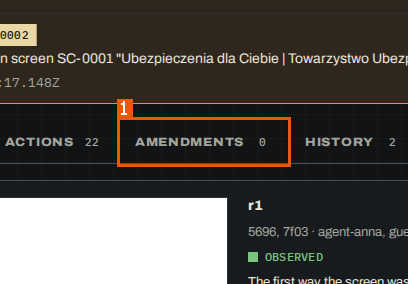

1. `tab "Amendments 0"`

Related: appears on [SCR-007](03-screens.md#SCR-007) · appears on [SCR-012](03-screens.md#SCR-012) · appears on [SCR-016](03-screens.md#SCR-016)

Evidence:

- screen region `01a1753e-be7a-7000-95e6-7606fb6ebc6e` `link "Amendments to re-anchor 0"` — MudPuppy (/app/portals/reference-insurer-local/review) (run `01a1753d-a8da-7000-85d2-b19d666d3587`, map, 2026-10-25)
- screen region `01a1753e-f830-7000-9785-ac5128aa7dbb` `tab "Amendments 0"` — MudPuppy (/app/portals/:portal/screens/:screen) (run `01a1753d-a8da-7000-85d2-b19d666d3587`, map, 2026-10-25)

### GL-026 — Analysis session

**GL-026** · rev 1 · draft · observed

> DRAFT — not confirmed by a reviewer

**Term:** Analysis session (en)

**Definition:** One working session of the BA agent over chosen scans: it records its input scans, seven passes (inventory, capabilities, processes, rules, data, nfr, synthesis) with summaries, the records it created or revised, and its gaps.

**Synonyms:** session

**On screen:** MudPuppy (/app/portals/reference-insurer-local/docs)

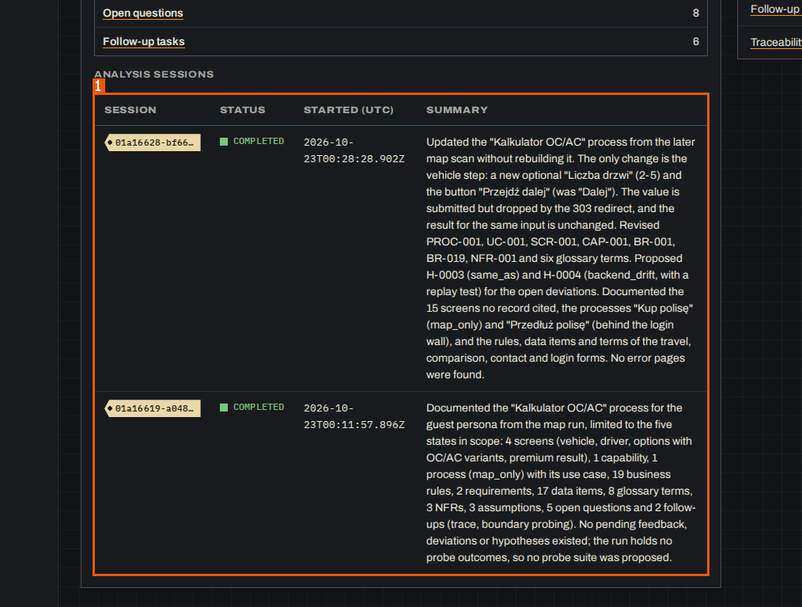

1. `table "Analysis sessions"`

**On screen:** MudPuppy (/app/portals/reference-insurer-local/docs/sessions/:param)

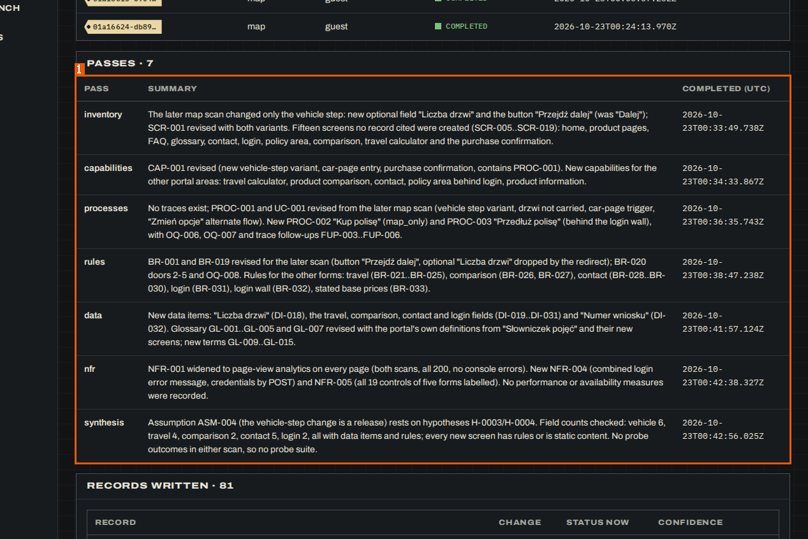

1. `table "Analysis passes completed"`

Related: appears on [SCR-021](03-screens.md#SCR-021) · appears on [SCR-022](03-screens.md#SCR-022)

Evidence:

- screen region `01a1753f-88ed-7000-8899-2ac9d81c7464` `table "Analysis sessions"` — MudPuppy (/app/portals/reference-insurer-local/docs) (run `01a1753d-a8da-7000-85d2-b19d666d3587`, map, 2026-10-25)
- screen region `01a1753f-e0df-7000-a288-35e0110648bb` `table "Analysis passes completed"` — MudPuppy (/app/portals/reference-insurer-local/docs/sessions/:param) (run `01a1753d-a8da-7000-85d2-b19d666d3587`, map, 2026-10-25)

### GL-016 — As-is documentation

**GL-016** · rev 1 · draft · observed

> DRAFT — not confirmed by a reviewer

**Term:** As-is documentation (en)

**Definition:** The documentation of how a process works today, written per step from the observed screens; its status on a process page lists what is "Still open on these screens" (open questions, records to confirm, amendments to re-anchor) and it is closed with "Mark as-is documented". The BA wiki explains it under "As-is process modelling".

**Synonyms:** —

**On screen:** MudPuppy (/app/portals/:portal/processes/:key)

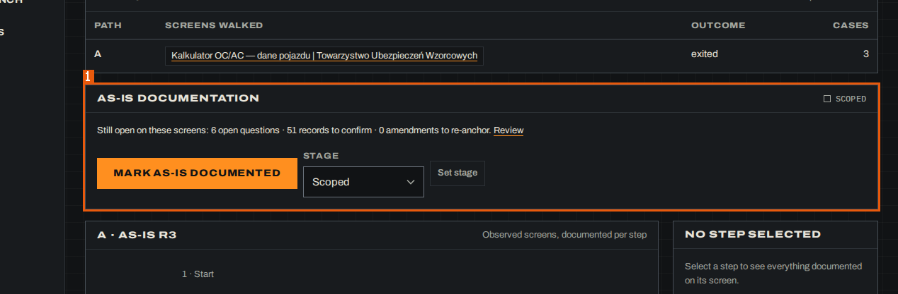

1. `region "As-is documentation"`

**On screen:** MudPuppy (/app/glossary/wiki)

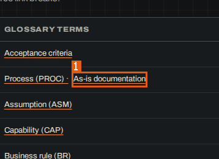

1. `link "As-is documentation"`

Related: appears on [SCR-003](03-screens.md#SCR-003) · appears on [SCR-008](03-screens.md#SCR-008)

Evidence:

- screen region `01a1753e-01fe-7000-91d8-152388d28304` `region "As-is documentation"` — MudPuppy (/app/portals/:portal/processes/:key) (run `01a1753d-a8da-7000-85d2-b19d666d3587`, map, 2026-10-25)
- screen region `01a17541-6569-7000-9a25-e725ff936105` `link "As-is documentation"` — MudPuppy (/app/glossary/wiki) (run `01a1753d-a8da-7000-85d2-b19d666d3587`, map, 2026-10-25)

### GL-023 — Assistant

**GL-023** · rev 1 · draft · observed

> DRAFT — not confirmed by a reviewer

**Term:** Assistant (en)

**Definition:** The console's AI helper, served by the chat service: it answers about the portal ("Ask what changed, or have it explain a finding, start a check run or rebuild the model."), saves portals and settings, and proposes commands and groupings that land in Review and Processes marked as its own.

**Synonyms:** chat, Ask

**On screen:** MudPuppy (/app/portals/reference-insurer-local)

1. `region "Assistant"`

**On screen:** MudPuppy (/app/portals/new)

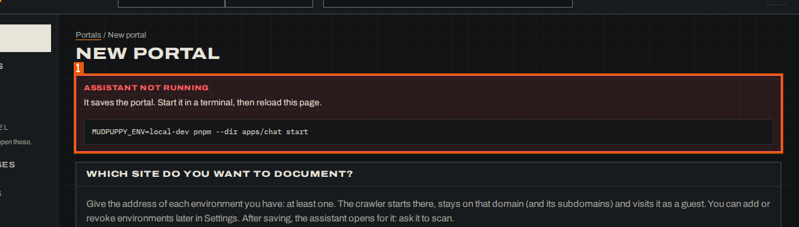

1. `alert`

Related: appears on [SCR-006](03-screens.md#SCR-006) · appears on [SCR-007](03-screens.md#SCR-007) · appears on [SCR-011](03-screens.md#SCR-011) · appears on [SCR-030](03-screens.md#SCR-030) · appears on [SCR-031](03-screens.md#SCR-031)

Evidence:

- screen region `01a1753d-debd-7000-b943-374405412ad9` `region "Assistant"` — MudPuppy (/app/portals/reference-insurer-local) (run `01a1753d-a8da-7000-85d2-b19d666d3587`, map, 2026-10-25)
- screen region `01a17541-b0b3-7000-b23a-7b9ba885ff54` `alert` — MudPuppy (/app/portals/new) (run `01a1753d-a8da-7000-85d2-b19d666d3587`, map, 2026-10-25)

### GL-035 — Business refusals

**GL-035** · rev 1 · draft · inferred

> DRAFT — not confirmed by a reviewer

**Term:** Business refusals (en)

**Definition:** Texts by which the documented portal refuses a request for business reasons, listed as a hint so the crawler can tell them apart from errors ("Business refusals, one per line"; "none listed" in the run). Inferred from the hint's label.

**Synonyms:** —

**On screen:** MudPuppy (/app/portals/reference-insurer-local/settings)

1. `region "Hints"`

Related: appears on [SCR-030](03-screens.md#SCR-030)

Evidence:

- screen region `01a17540-ecac-7000-9714-39aba77839c5` `region "Hints"` — MudPuppy (/app/portals/reference-insurer-local/settings) (run `01a1753d-a8da-7000-85d2-b19d666d3587`, map, 2026-10-25)

### GL-028 — Mined business rule (decision table)

**GL-028** · rev 1 · draft · observed

> DRAFT — not confirmed by a reviewer

**Term:** Business rules (en)

**Definition:** On the Rules section: "Each rule is a decision table the system found from the portal's behaviour. Check runs test it at its boundaries." Mining finds a rule "Where an action leads to different screens depending on what was typed". In Review a rule waiting for the BA carries the chip "Rule decides".

**Synonyms:** Rules, Rule decides

**On screen:** MudPuppy (/app/portals/reference-insurer-local/review)

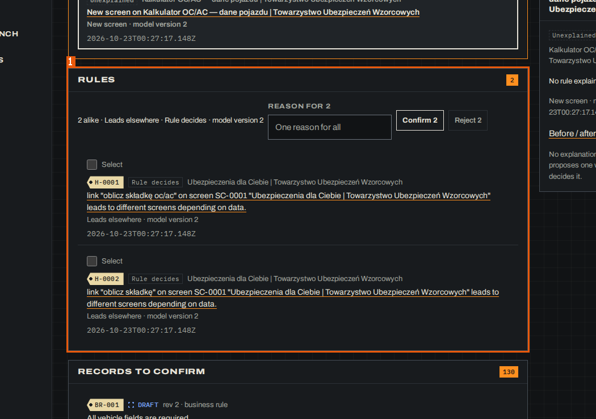

1. `region "Rules"`

**On screen:** MudPuppy (/app/portals/reference-insurer-local/rules)

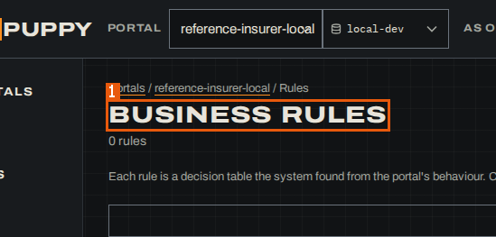

1. `heading "Business rules"`

Related: appears on [SCR-008](03-screens.md#SCR-008) · appears on [SCR-012](03-screens.md#SCR-012) · appears on [SCR-020](03-screens.md#SCR-020)

Evidence:

- screen region `01a1753e-be7a-7000-95e6-7606fb6ebc6e` `region "Rules"` — MudPuppy (/app/portals/reference-insurer-local/review) (run `01a1753d-a8da-7000-85d2-b19d666d3587`, map, 2026-10-25)
- screen region `01a1753f-772d-7000-80bb-2be92ae58bc4` `heading "Business rules"` — MudPuppy (/app/portals/reference-insurer-local/rules) (run `01a1753d-a8da-7000-85d2-b19d666d3587`, map, 2026-10-25)

### GL-030 — Change spec

**GL-030** · rev 1 · draft · observed

> DRAFT — not confirmed by a reviewer

**Term:** Change spec (en)

**Definition:** The specification of the difference between an as-is and a to-be process model; History says "No change spec saved yet. Compare generates one; save it there."

**Synonyms:** —

**On screen:** MudPuppy (/app/portals/reference-insurer-local/processes/PRC-001/history)

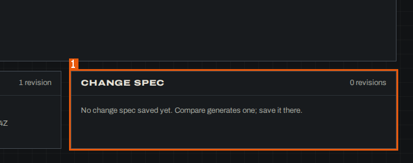

1. `region "Change spec"`

Related: appears on [SCR-009](03-screens.md#SCR-009)

Evidence:

- screen region `01a1753e-122f-7000-ac31-15f9bbe7957d` `region "Change spec"` — MudPuppy (/app/portals/reference-insurer-local/processes/PRC-001/history) (run `01a1753d-a8da-7000-85d2-b19d666d3587`, map, 2026-10-25)

### GL-021 — Check run

**GL-021** · rev 1 · draft · observed

> DRAFT — not confirmed by a reviewer

**Term:** Check runs (en)

**Definition:** Replays the system runs to test what it found: "Checks per scan" are "Replays on the headless driver after a scan (rules R1, R4, R5)"; on Rules "Check runs test it at its boundaries". The Changes timeline marks check scans with "◇ check".

**Synonyms:** check

**On screen:** MudPuppy (/app/portals/reference-insurer-local/settings)

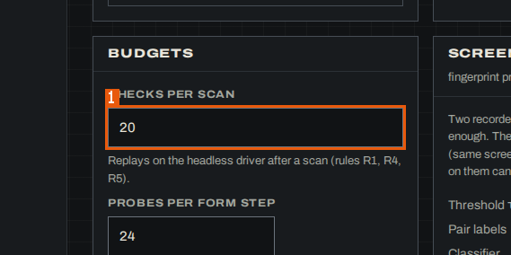

1. `spinbutton "Checks per scan"`

Related: appears on [SCR-014](03-screens.md#SCR-014) · appears on [SCR-020](03-screens.md#SCR-020) · appears on [SCR-030](03-screens.md#SCR-030)

Evidence:

- screen region `01a17540-ecac-7000-9714-39aba77839c5` `spinbutton "Checks per scan"` — MudPuppy (/app/portals/reference-insurer-local/settings) (run `01a1753d-a8da-7000-85d2-b19d666d3587`, map, 2026-10-25)
- state `01a1753f-772d-7000-80bb-2be92ae58bc4` — MudPuppy (/app/portals/reference-insurer-local/rules) (run `01a1753d-a8da-7000-85d2-b19d666d3587`, map, 2026-10-25)

### GL-038 — Continues (scan)

**GL-038** · rev 1 · draft · inferred

> DRAFT — not confirmed by a reviewer

**Term:** Continues (en)

**Definition:** A scan fact naming the earlier scan this one continues ("—" when it is a new scan); a stopped scan is continued with "Resume". Inferred from the label next to "Resume" and the plan's note "To continue a stopped scan, open it from Scans and choose Resume."

**Synonyms:** —

**On screen:** MudPuppy (/app/scans/:scan)

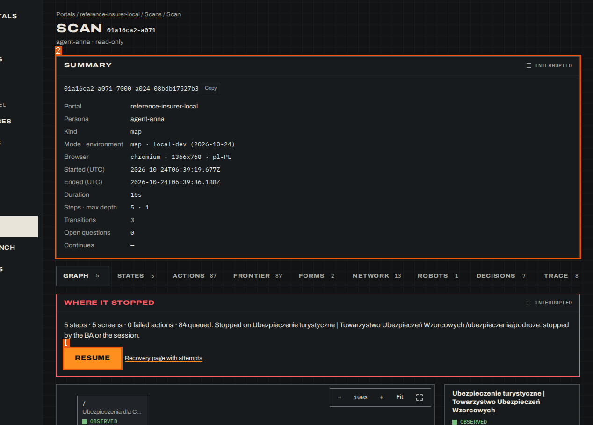

1. `button "Resume"`
2. `region "Summary"`

Related: appears on [SCR-025](03-screens.md#SCR-025)

Evidence:

- screen region `01a17540-2772-7000-8cc1-140f21e49c72` `button "Resume"` — MudPuppy (/app/scans/:scan) (run `01a1753d-a8da-7000-85d2-b19d666d3587`, map, 2026-10-25)
- screen region `01a17540-2772-7000-8cc1-140f21e49c72` `region "Summary"` — MudPuppy (/app/scans/:scan) (run `01a1753d-a8da-7000-85d2-b19d666d3587`, map, 2026-10-25)

### GL-037 — Crawl rules (Allowed domains, Allowed URLs, Disallowed URLs)

**GL-037** · rev 1 · draft · observed

> DRAFT — not confirmed by a reviewer

**Term:** Crawl rules (en)

**Definition:** The limits of where the crawler may go, "Read from the portal file": "robots.txt" policy, "Allowed domains" (e.g. 127.0.0.1), "Allowed URLs" ("everything on the allowed domains") and "Disallowed URLs" (e.g. /__admin/*).

**Synonyms:** Allowed domains, Allowed URLs, Disallowed URLs

**On screen:** MudPuppy (/app/portals/reference-insurer-local/settings)

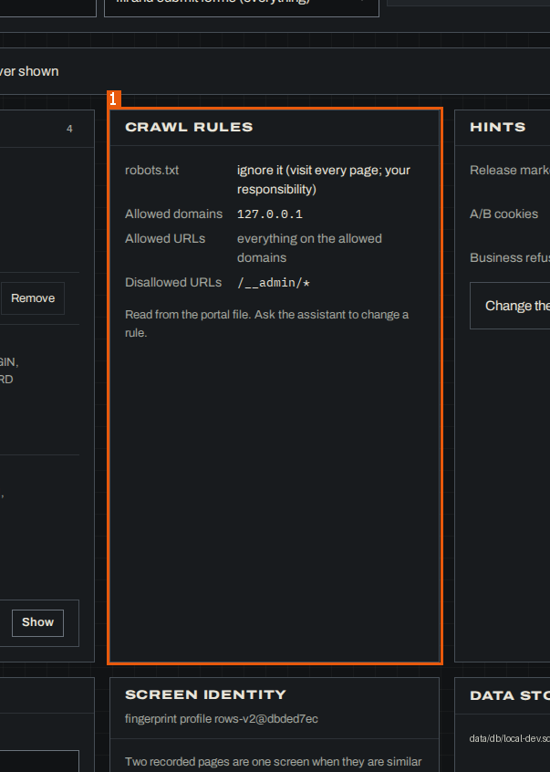

1. `region "Crawl rules"`

Related: appears on [SCR-030](03-screens.md#SCR-030)

Evidence:

- screen region `01a17540-ecac-7000-9714-39aba77839c5` `region "Crawl rules"` — MudPuppy (/app/portals/reference-insurer-local/settings) (run `01a1753d-a8da-7000-85d2-b19d666d3587`, map, 2026-10-25)

### GL-025 — Data store

**GL-025** · rev 1 · draft · observed

> DRAFT — not confirmed by a reviewer

**Term:** Data store (en)

**Definition:** The database file that holds a portal environment's scans and documentation; the banner button shows it ("Data store: local-dev, read-only", or "per portal" with no portal selected) and Settings shows its environment, read-only flag, path and size.

**Synonyms:** store

**On screen:** MudPuppy (/app/portals/reference-insurer-local)

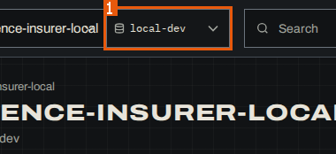

1. `button "Data store: local-dev, read-only"`

**On screen:** MudPuppy (/app/portals/reference-insurer-local/settings)

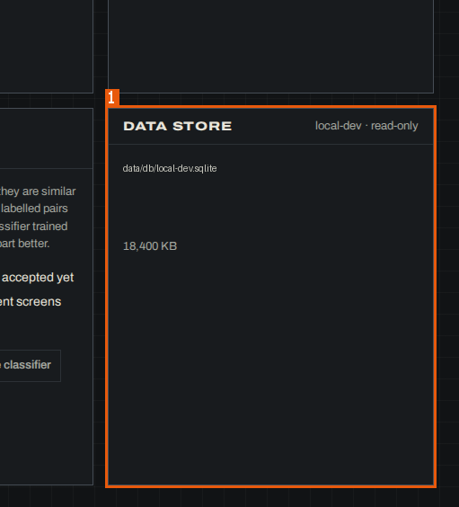

1. `region "Data store"`

Related: appears on [SCR-001](03-screens.md#SCR-001) · appears on [SCR-011](03-screens.md#SCR-011) · appears on [SCR-030](03-screens.md#SCR-030)

Evidence:

- screen region `01a1753d-debd-7000-b943-374405412ad9` `button "Data store: local-dev, read-only"` — MudPuppy (/app/portals/reference-insurer-local) (run `01a1753d-a8da-7000-85d2-b19d666d3587`, map, 2026-10-25)
- screen region `01a17540-ecac-7000-9714-39aba77839c5` `region "Data store"` — MudPuppy (/app/portals/reference-insurer-local/settings) (run `01a1753d-a8da-7000-85d2-b19d666d3587`, map, 2026-10-25)

### GL-002 — Environment

**GL-002** · rev 1 · draft · observed

> DRAFT — not confirmed by a reviewer

**Term:** Environment (en)

**Definition:** Help and glossary: "A copy of a site you declare per portal under a name of your choice (dev, acceptance, live, sandbox), with its own address, its own users and its own store." Scans and documentation of two environments never mix. New portal and Settings offer production, staging and sandbox; the console works in one environment at a time ("environment local-dev").

**Synonyms:** —

**On screen:** MudPuppy (/app/portals/reference-insurer-local/settings)

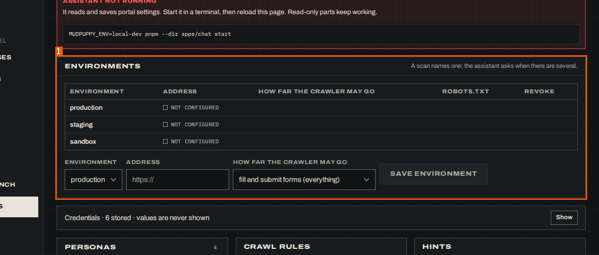

1. `region "Environments"`

Related: appears on [SCR-001](03-screens.md#SCR-001) · appears on [SCR-002](03-screens.md#SCR-002) · appears on [SCR-006](03-screens.md#SCR-006) · appears on [SCR-027](03-screens.md#SCR-027) · appears on [SCR-030](03-screens.md#SCR-030)

Evidence:

- screen region `01a17540-ecac-7000-9714-39aba77839c5` `region "Environments"` — MudPuppy (/app/portals/reference-insurer-local/settings) (run `01a1753d-a8da-7000-85d2-b19d666d3587`, map, 2026-10-25)
- state `01a1753d-cef0-7000-935b-db03378d928b` — MudPuppy (/app/glossary) (run `01a1753d-a8da-7000-85d2-b19d666d3587`, map, 2026-10-25) — note: glossary entry #environment

### GL-032 — Explored and Checked

**GL-032** · rev 1 · draft · inferred

> DRAFT — not confirmed by a reviewer

**Term:** Explored (en)

**Definition:** "Explored" says whether a trace followed the process ("Not explored", with "Explore now"); "Checked" counts the actions on the process's screens followed on the current release ("80 / 80 actions on its screens on 7f03"; screens show "Actions <checked> / <total> on <release>"). Inferred from the values shown.

**Synonyms:** Checked

**On screen:** MudPuppy (/app/portals/:portal/processes/:key)

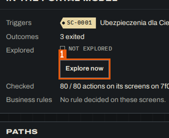

1. `button "Explore now"`

**On screen:** MudPuppy (/app/portals/reference-insurer-local/screens)

1. `table "All screens of reference-insurer-local"`

Related: appears on [SCR-008](03-screens.md#SCR-008) · appears on [SCR-015](03-screens.md#SCR-015) · appears on [SCR-016](03-screens.md#SCR-016)

Evidence:

- screen region `01a1753e-01fe-7000-91d8-152388d28304` `button "Explore now"` — MudPuppy (/app/portals/:portal/processes/:key) (run `01a1753d-a8da-7000-85d2-b19d666d3587`, map, 2026-10-25)
- screen region `01a1753e-e513-7001-9d79-59990eea7c3e` `table "All screens of reference-insurer-local"` — MudPuppy (/app/portals/reference-insurer-local/screens) (run `01a1753d-a8da-7000-85d2-b19d666d3587`, map, 2026-10-25)

### GL-013 — Finding

**GL-013** · rev 1 · draft · observed

> DRAFT — not confirmed by a reviewer

**Term:** Findings (en)

**Definition:** A change the portal model found that waits for an explanation, e.g. "New screen on …" marked "Unexplained" ("No rule explained it yet."), with a "Before / after" view; one of the kinds of decision in Review.

**Synonyms:** change, deviation

**On screen:** MudPuppy (/app/portals/reference-insurer-local/review)

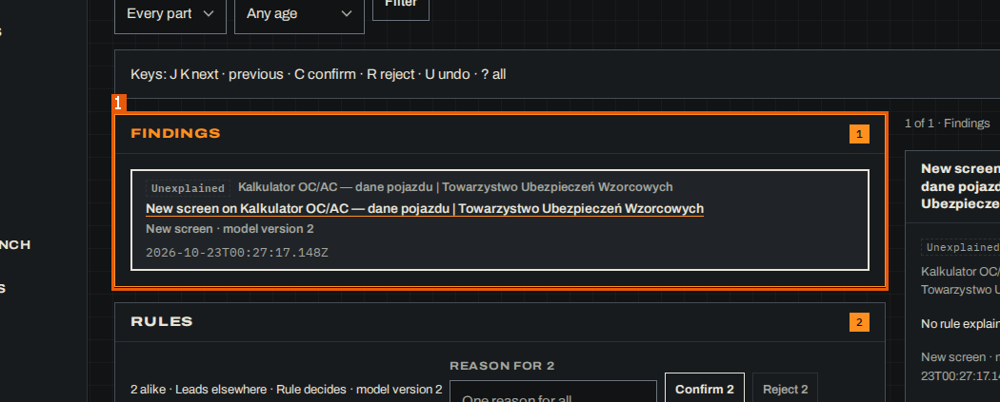

1. `region "Findings"`

Related: appears on [SCR-001](03-screens.md#SCR-001) · appears on [SCR-012](03-screens.md#SCR-012)

Evidence:

- screen region `01a1753e-be7a-7000-95e6-7606fb6ebc6e` `region "Findings"` — MudPuppy (/app/portals/reference-insurer-local/review) (run `01a1753d-a8da-7000-85d2-b19d666d3587`, map, 2026-10-25)

### GL-022 — Form probe

**GL-022** · rev 1 · draft · inferred

> DRAFT — not confirmed by a reviewer

**Term:** Form probes (en)

**Definition:** A try of a form step beyond its happy path, made by the crawler on form steps "marked for probing" ("7 form steps: 0 marked for probing, 7 not probed"), limited by "Probes per form step" and "Probes per scan"; approved probe suites wait in Review ("Probe suites to approve"). Inferred from the counts and budgets.

**Synonyms:** probe

**On screen:** MudPuppy (/app/portals/:portal/screens/:screen)

1. `table "Recorded pages of reference-insurer-local"`

**On screen:** MudPuppy (/app/portals/reference-insurer-local/settings)

1. `spinbutton "Probes per form step"`

Related: appears on [SCR-012](03-screens.md#SCR-012) · appears on [SCR-018](03-screens.md#SCR-018) · appears on [SCR-030](03-screens.md#SCR-030)

Evidence:

- screen region `01a1753f-57a7-7000-8873-02b7af26db70` `table "Recorded pages of reference-insurer-local"` — MudPuppy (/app/portals/:portal/screens/:screen) (run `01a1753d-a8da-7000-85d2-b19d666d3587`, map, 2026-10-25)
- screen region `01a17540-ecac-7000-9714-39aba77839c5` `spinbutton "Probes per form step"` — MudPuppy (/app/portals/reference-insurer-local/settings) (run `01a1753d-a8da-7000-85d2-b19d666d3587`, map, 2026-10-25)

### GL-018 — Frontier

**GL-018** · rev 1 · draft · inferred

> DRAFT — not confirmed by a reviewer

**Term:** Frontier (en)

**Definition:** The queue of actions a scan still has to try, with statuses "Queued", "Done", "Skipped · safety", "Skipped · scope", "Skipped · denylist", "Skipped · robots", "Skipped · budget", "Unreachable"; the scan graph shows "+<n> queued" per screen. Inferred from the Frontier section's filter and the graph.

**Synonyms:** queued

**On screen:** MudPuppy (/app/scans/:scan)

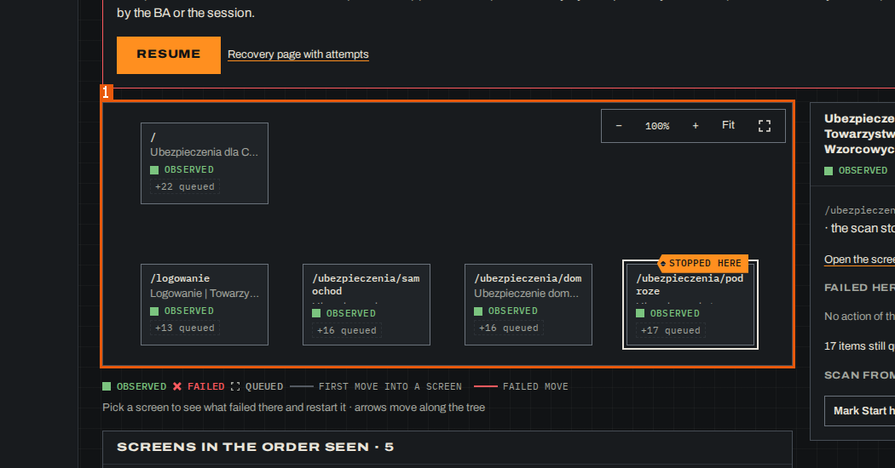

1. `region "Graph of this scan, from its first screen"`

**On screen:** MudPuppy (/app/scans/:scan/:tab)

1. `combobox "Status"`

Related: appears on [SCR-025](03-screens.md#SCR-025) · appears on [SCR-026](03-screens.md#SCR-026)

Evidence:

- screen region `01a17540-2772-7000-8cc1-140f21e49c72` `region "Graph of this scan, from its first screen"` — MudPuppy (/app/scans/:scan) (run `01a1753d-a8da-7000-85d2-b19d666d3587`, map, 2026-10-25)
- screen region `01a17540-5b16-7000-a6d5-88196c70dbdf` `combobox "Status"` — MudPuppy (/app/scans/:scan/:tab) (run `01a1753d-a8da-7000-85d2-b19d666d3587`, map, 2026-10-25)

### GL-005 — Mode (map, trace)

**GL-005** · rev 1 · draft · observed

> DRAFT — not confirmed by a reviewer

**Term:** Mode (en)

**Definition:** Help and glossary: "What a run is for, either map mode, which explores the whole portal, or trace mode, which records one named process step by step." A scan page shows it as "Mode · environment" (e.g. "map · local-dev").

**Synonyms:** Kind

**On screen:** MudPuppy (/app/scans/:scan)

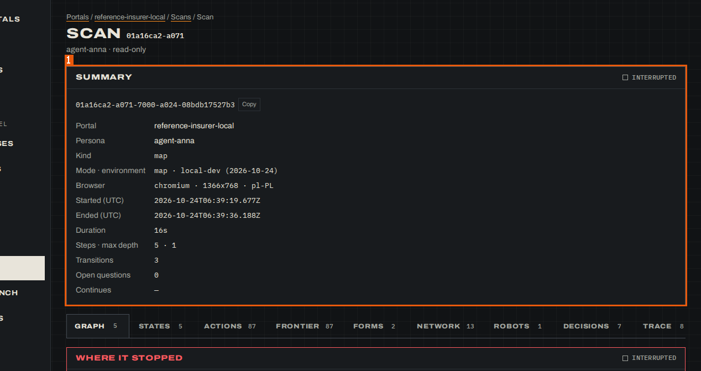

1. `region "Summary"`

Related: appears on [SCR-002](03-screens.md#SCR-002) · appears on [SCR-024](03-screens.md#SCR-024) · appears on [SCR-025](03-screens.md#SCR-025)

Evidence:

- screen region `01a17540-2772-7000-8cc1-140f21e49c72` `region "Summary"` — MudPuppy (/app/scans/:scan) (run `01a1753d-a8da-7000-85d2-b19d666d3587`, map, 2026-10-25)
- state `01a1753d-cef0-7000-935b-db03378d928b` — MudPuppy (/app/glossary) (run `01a1753d-a8da-7000-85d2-b19d666d3587`, map, 2026-10-25) — note: glossary entry #mode

### GL-011 — Model version

**GL-011** · rev 1 · draft · observed

> DRAFT — not confirmed by a reviewer

**Term:** Model version (en)

**Definition:** A numbered build of the portal model: "A model version is built after each scan." Changes are counted between model versions; Portal home shows the current "Version".

**Synonyms:** portal model

**On screen:** MudPuppy (/app/portals/reference-insurer-local)

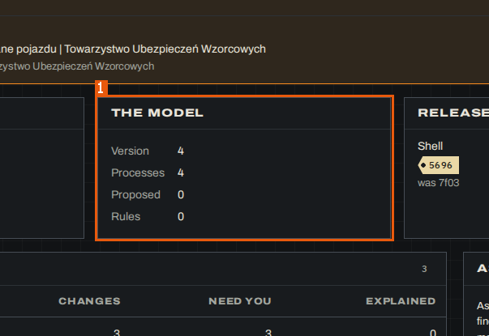

1. `region "The model"`

**On screen:** MudPuppy (/app/portals/reference-insurer-local/changes)

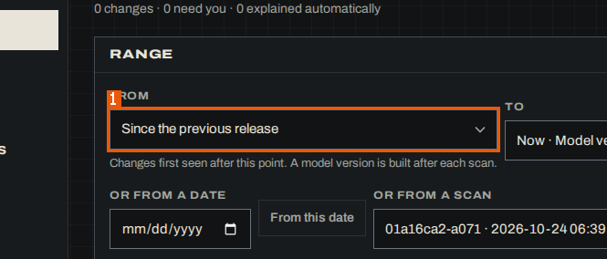

1. `combobox "From"`

Related: appears on [SCR-008](03-screens.md#SCR-008) · appears on [SCR-011](03-screens.md#SCR-011) · appears on [SCR-014](03-screens.md#SCR-014)

Evidence:

- screen region `01a1753d-debd-7000-b943-374405412ad9` `region "The model"` — MudPuppy (/app/portals/reference-insurer-local) (run `01a1753d-a8da-7000-85d2-b19d666d3587`, map, 2026-10-25)
- screen region `01a1753e-d243-7000-ba0d-fae46a006f7b` `combobox "From"` — MudPuppy (/app/portals/reference-insurer-local/changes) (run `01a1753d-a8da-7000-85d2-b19d666d3587`, map, 2026-10-25)

### GL-012 — Needs you

**GL-012** · rev 1 · draft · observed

> DRAFT — not confirmed by a reviewer

**Term:** Needs you (en)

**Definition:** The items that wait for a decision by the BA (findings, rules, records to confirm, assumptions, …), counted on All portals ("Need you"), Portal home, Review, Changes and each screen ("Needs you on this screen"); opposite of "Explained automatically" and "Decided".

**Synonyms:** Need you

**On screen:** MudPuppy (/app/portals/reference-insurer-local)

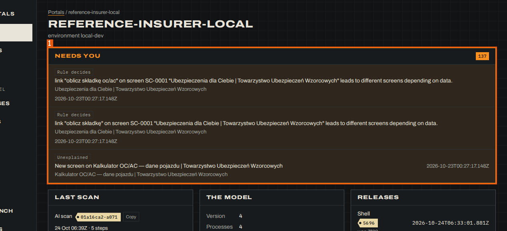

1. `region "Needs you"`

**On screen:** MudPuppy (/app/portals/reference-insurer-local/review)

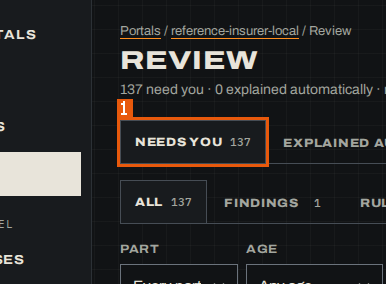

1. `link "Needs you 137"`

Related: appears on [SCR-001](03-screens.md#SCR-001) · appears on [SCR-011](03-screens.md#SCR-011) · appears on [SCR-012](03-screens.md#SCR-012) · appears on [SCR-014](03-screens.md#SCR-014) · appears on [SCR-016](03-screens.md#SCR-016)

Evidence:

- screen region `01a1753d-debd-7000-b943-374405412ad9` `region "Needs you"` — MudPuppy (/app/portals/reference-insurer-local) (run `01a1753d-a8da-7000-85d2-b19d666d3587`, map, 2026-10-25)
- screen region `01a1753e-be7a-7000-95e6-7606fb6ebc6e` `link "Needs you 137"` — MudPuppy (/app/portals/reference-insurer-local/review) (run `01a1753d-a8da-7000-85d2-b19d666d3587`, map, 2026-10-25)

### GL-027 — Link states (Not seen since, Not checked, Retired)

**GL-027** · rev 1 · draft · observed

> DRAFT — not confirmed by a reviewer

**Term:** Not seen since (en)

**Definition:** Map legend: "Not seen since: the link was missing on later visits. Not checked: not followed yet on the part's current release. Retired links are kept; the Retired links layer shows them." Other link states: "Active", "Process overlay", "Changed link", "Error".

**Synonyms:** Not checked, Retired

**On screen:** MudPuppy (/app/portals/:portal/screens/:screen)

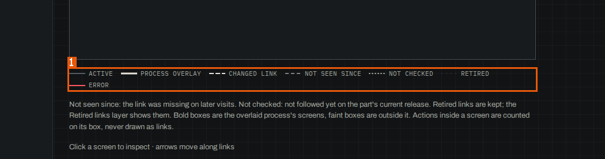

1. `list "Link states"`

Related: appears on [SCR-017](03-screens.md#SCR-017)

Evidence:

- screen region `01a1753f-43e8-7000-ac2e-51e68ab95975` `list "Link states"` — MudPuppy (/app/portals/:portal/screens/:screen) (run `01a1753d-a8da-7000-85d2-b19d666d3587`, map, 2026-10-25)

### GL-036 — Pair labels and Classifier

**GL-036** · rev 1 · draft · observed

> DRAFT — not confirmed by a reviewer

**Term:** Pair labels (en)

**Definition:** "Pair labels" count the BA's answers on Same screen? ("0 same screen · 0 different screens"); they calibrate the threshold τ, and a "Classifier" trained on them "can replace it when it tells pairs apart better" ("none trained yet").

**Synonyms:** Classifier

**On screen:** MudPuppy (/app/portals/reference-insurer-local/settings)

1. `region "Screen identity"`

Related: appears on [SCR-013](03-screens.md#SCR-013) · appears on [SCR-030](03-screens.md#SCR-030)

Evidence:

- screen region `01a17540-ecac-7000-9714-39aba77839c5` `region "Screen identity"` — MudPuppy (/app/portals/reference-insurer-local/settings) (run `01a1753d-a8da-7000-85d2-b19d666d3587`, map, 2026-10-25)

### GL-010 — Part

**GL-010** · rev 1 · draft · inferred

> DRAFT — not confirmed by a reviewer

**Term:** Part (en)

**Definition:** A section of the documented portal that has its own releases (the run shows one part, "Shell"); screens, review items and releases are filtered or grouped by part. Inferred from the filters "Part" and the list "Releases by part".

**Synonyms:** —

**On screen:** MudPuppy (/app/portals/reference-insurer-local)

1. `list "Releases by part"`

**On screen:** MudPuppy (/app/portals/reference-insurer-local/screens)

1. `combobox "Part"`

Related: appears on [SCR-011](03-screens.md#SCR-011) · appears on [SCR-012](03-screens.md#SCR-012) · appears on [SCR-015](03-screens.md#SCR-015)

Evidence:

- screen region `01a1753d-debd-7000-b943-374405412ad9` `list "Releases by part"` — MudPuppy (/app/portals/reference-insurer-local) (run `01a1753d-a8da-7000-85d2-b19d666d3587`, map, 2026-10-25)
- screen region `01a1753e-e513-7001-9d79-59990eea7c3e` `combobox "Part"` — MudPuppy (/app/portals/reference-insurer-local/screens) (run `01a1753d-a8da-7000-85d2-b19d666d3587`, map, 2026-10-25)

### GL-003 — Persona

**GL-003** · rev 1 · draft · observed

> DRAFT — not confirmed by a reviewer

**Term:** Persona (en)

**Definition:** Help and glossary: "Who the crawler acts as during a run, such as an anonymous guest, defined in a persona file that can only narrow what the portal config allows." Settings lists each persona with the credential names it needs, its attributes (e.g. "segment premium") and "logged-in" or "anonymous"; Access by persona compares what each persona reached.

**Synonyms:** —

**On screen:** MudPuppy (/app/portals/reference-insurer-local/settings)

1. `list "Personas"`

Related: appears on [SCR-002](03-screens.md#SCR-002) · appears on [SCR-019](03-screens.md#SCR-019) · appears on [SCR-024](03-screens.md#SCR-024) · appears on [SCR-027](03-screens.md#SCR-027) · appears on [SCR-030](03-screens.md#SCR-030)

Evidence:

- screen region `01a17540-ecac-7000-9714-39aba77839c5` `list "Personas"` — MudPuppy (/app/portals/reference-insurer-local/settings) (run `01a1753d-a8da-7000-85d2-b19d666d3587`, map, 2026-10-25)
- state `01a1753d-cef0-7000-935b-db03378d928b` — MudPuppy (/app/glossary) (run `01a1753d-a8da-7000-85d2-b19d666d3587`, map, 2026-10-25) — note: glossary entry #persona

### GL-001 — Portal

**GL-001** · rev 1 · draft · observed

> DRAFT — not confirmed by a reviewer

**Term:** Portal (en)

**Definition:** A site registered in MudPuppy to be documented ("Which site do you want to document?"), identified by a short name (e.g. "reference-insurer-local"), with one or more environments. The banner's "Portal" group shows the selected portal or "All portals".

**Synonyms:** —

**On screen:** MudPuppy (/app)

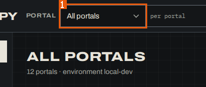

1. `button "Portal: All portals"`

Related: appears on [SCR-001](03-screens.md#SCR-001) · appears on [SCR-006](03-screens.md#SCR-006) · appears on [SCR-011](03-screens.md#SCR-011)

Evidence:

- screen region `01a1753d-ba74-7000-a2d2-3da8da9e7760` `button "Portal: All portals"` — MudPuppy (/app) (run `01a1753d-a8da-7000-85d2-b19d666d3587`, map, 2026-10-25)
- state `01a17541-b0b3-7000-b23a-7b9ba885ff54` — MudPuppy (/app/portals/new) (run `01a1753d-a8da-7000-85d2-b19d666d3587`, map, 2026-10-25)

### GL-014 — Process model

**GL-014** · rev 1 · draft · observed

> DRAFT — not confirmed by a reviewer

**Term:** Process model (en)

**Definition:** A versioned sequence of steps of a process, labelled by a letter and revision ("A r3"); the as-is model holds "Observed screens, documented per step", and a to-be model is started with "Start a to-be design". A model can be marked live per environment.

**Synonyms:** —

**On screen:** MudPuppy (/app/portals/:portal/processes/:key)

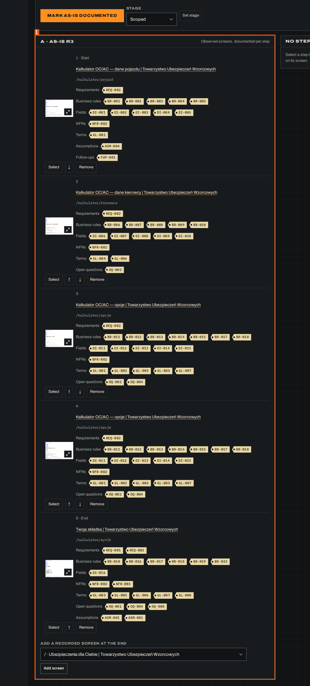

1. `region "A · As-is r3"`

**On screen:** MudPuppy (/app/portals/reference-insurer-local/processes/PRC-001/history)

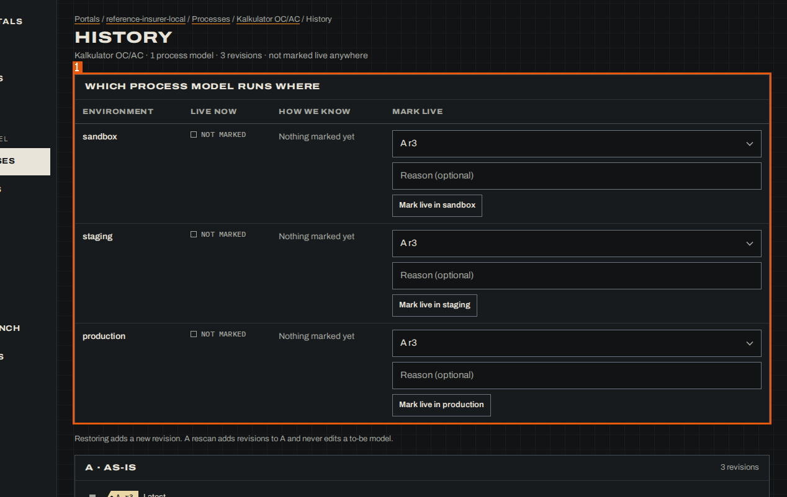

1. `region "Which process model runs where"`

Related: appears on [SCR-007](03-screens.md#SCR-007) · appears on [SCR-008](03-screens.md#SCR-008) · appears on [SCR-009](03-screens.md#SCR-009)

Evidence:

- screen region `01a1753e-01fe-7000-91d8-152388d28304` `region "A · As-is r3"` — MudPuppy (/app/portals/:portal/processes/:key) (run `01a1753d-a8da-7000-85d2-b19d666d3587`, map, 2026-10-25)
- screen region `01a1753e-122f-7000-ac31-15f9bbe7957d` `region "Which process model runs where"` — MudPuppy (/app/portals/reference-insurer-local/processes/PRC-001/history) (run `01a1753d-a8da-7000-85d2-b19d666d3587`, map, 2026-10-25)

### GL-007 — Recorded page

**GL-007** · rev 1 · draft · observed

> DRAFT — not confirmed by a reviewer

**Term:** Recorded pages (en)

**Definition:** A page version the crawler recorded (opened at /app/states/<id>), with its confidence, form-probe status, scans, personas and last seen time; several recorded pages can form one screen.

**Synonyms:** state

**On screen:** MudPuppy (/app/portals/:portal/screens/:screen)

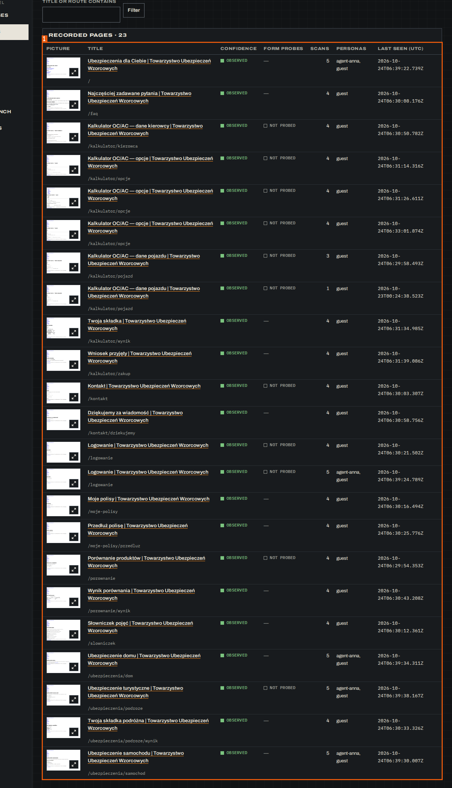

1. `table "Recorded pages of reference-insurer-local"`

Related: appears on [SCR-013](03-screens.md#SCR-013) · appears on [SCR-018](03-screens.md#SCR-018)

Evidence:

- screen region `01a1753f-57a7-7000-8873-02b7af26db70` `table "Recorded pages of reference-insurer-local"` — MudPuppy (/app/portals/:portal/screens/:screen) (run `01a1753d-a8da-7000-85d2-b19d666d3587`, map, 2026-10-25)

### GL-009 — Release

**GL-009** · rev 1 · draft · observed

> DRAFT — not confirmed by a reviewer

**Term:** Release (en)

**Definition:** A version of a part of the documented portal (e.g. "5696", "7f03" of the part "Shell"); without a release marker "releases are told apart by the names of the page's files". Portal home lists "Releases by part"; the Changes timeline links each release to the changes from it.

**Synonyms:** —

**On screen:** MudPuppy (/app/portals/reference-insurer-local)

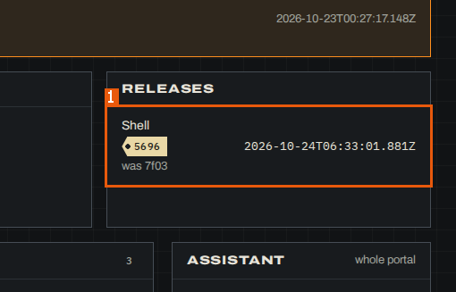

1. `list "Releases by part"`

**On screen:** MudPuppy (/app/portals/reference-insurer-local/settings)

1. `region "Hints"`

Related: appears on [SCR-001](03-screens.md#SCR-001) · appears on [SCR-011](03-screens.md#SCR-011) · appears on [SCR-014](03-screens.md#SCR-014)

Evidence:

- screen region `01a1753d-debd-7000-b943-374405412ad9` `list "Releases by part"` — MudPuppy (/app/portals/reference-insurer-local) (run `01a1753d-a8da-7000-85d2-b19d666d3587`, map, 2026-10-25)
- screen region `01a17540-ecac-7000-9714-39aba77839c5` `region "Hints"` — MudPuppy (/app/portals/reference-insurer-local/settings) (run `01a1753d-a8da-7000-85d2-b19d666d3587`, map, 2026-10-25)

### GL-033 — Release marker

**GL-033** · rev 1 · draft · observed

> DRAFT — not confirmed by a reviewer

**Term:** Release marker (en)

**Definition:** A response header or meta name that names the portal's release; Settings shows "none: releases are told apart by the names of the page's files" when none is set.

**Synonyms:** —

**On screen:** MudPuppy (/app/portals/reference-insurer-local/settings)

1. `region "Hints"`

Related: appears on [SCR-030](03-screens.md#SCR-030)

Evidence:

- screen region `01a17540-ecac-7000-9714-39aba77839c5` `region "Hints"` — MudPuppy (/app/portals/reference-insurer-local/settings) (run `01a1753d-a8da-7000-85d2-b19d666d3587`, map, 2026-10-25)

### GL-019 — Safety class

**GL-019** · rev 1 · draft · observed

> DRAFT — not confirmed by a reviewer

**Term:** Safety class (en)

**Definition:** The class the crawler gives an action by its effect: "read", "mutating", "destructive", "external-side-effect"; an action is "Allowed" or "Skipped" according to the environment's limit.

**Synonyms:** —

**On screen:** MudPuppy (/app/scans/:scan/:tab)

1. `combobox "Safety class"`

Related: appears on [SCR-026](03-screens.md#SCR-026)

Evidence:

- screen region `01a17540-49ac-7000-90a2-4f381d47fbb4` `combobox "Safety class"` — MudPuppy (/app/scans/:scan/:tab) (run `01a1753d-a8da-7000-85d2-b19d666d3587`, map, 2026-10-25)

### GL-004 — Scan (run)

**GL-004** · rev 1 · draft · observed

> DRAFT — not confirmed by a reviewer

**Term:** Scan (en)

**Definition:** One session of the crawler against one portal; the glossary calls it a run: "One session of the crawler against one portal, as one persona, in one mode, and everything it recorded on the way." Statuses: "Completed", "Running", "Stopped" and "Interrupted" ("it can be resumed without repeating recorded work"). The console lists scans with persona, kind, status and steps ("<used> / <max>").

**Synonyms:** run, AI scan

**On screen:** MudPuppy (/app/portals/reference-insurer-local/scans)

1. `table "Scans of reference-insurer-local"`

Related: appears on [SCR-002](03-screens.md#SCR-002) · appears on [SCR-011](03-screens.md#SCR-011) · appears on [SCR-024](03-screens.md#SCR-024) · appears on [SCR-025](03-screens.md#SCR-025)

Evidence:

- screen region `01a17540-1543-7000-9e27-e769fa4b9dd9` `table "Scans of reference-insurer-local"` — MudPuppy (/app/portals/reference-insurer-local/scans) (run `01a1753d-a8da-7000-85d2-b19d666d3587`, map, 2026-10-25)
- state `01a1753d-cef0-7000-935b-db03378d928b` — MudPuppy (/app/glossary) (run `01a1753d-a8da-7000-85d2-b19d666d3587`, map, 2026-10-25) — note: glossary entry #run

### GL-006 — Screen

**GL-006** · rev 1 · draft · observed

> DRAFT — not confirmed by a reviewer

**Term:** Screen (en)

**Definition:** A page of the documented portal as the portal model groups it, with a key such as "SC-0001"; "Two recorded pages are one screen when they are similar enough. The threshold τ says how similar". A screen has variants, actions, amendments and a history, and a status ("Active", "Merged", "Retired").

**Synonyms:** —

**On screen:** MudPuppy (/app/portals/reference-insurer-local/screens)

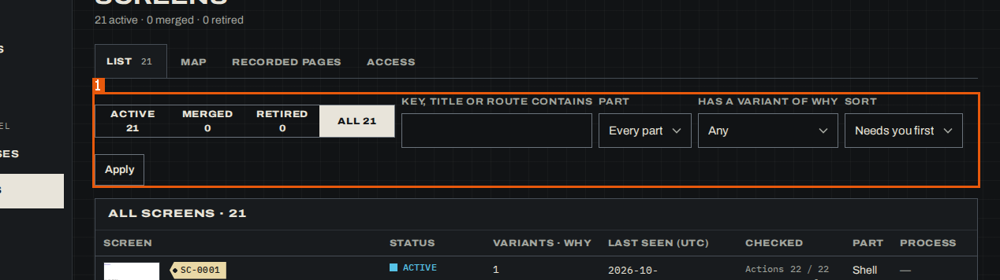

1. `form "Filter screens"`

**On screen:** MudPuppy (/app/portals/reference-insurer-local/settings)

1. `region "Screen identity"`

Related: appears on [SCR-015](03-screens.md#SCR-015) · appears on [SCR-016](03-screens.md#SCR-016) · appears on [SCR-017](03-screens.md#SCR-017)

Evidence:

- screen region `01a1753e-e513-7001-9d79-59990eea7c3e` `form "Filter screens"` — MudPuppy (/app/portals/reference-insurer-local/screens) (run `01a1753d-a8da-7000-85d2-b19d666d3587`, map, 2026-10-25)
- screen region `01a17540-ecac-7000-9714-39aba77839c5` `region "Screen identity"` — MudPuppy (/app/portals/reference-insurer-local/settings) (run `01a1753d-a8da-7000-85d2-b19d666d3587`, map, 2026-10-25)

### GL-015 — Stage

**GL-015** · rev 1 · draft · observed

> DRAFT — not confirmed by a reviewer

**Term:** Stage (en)

**Definition:** How far a process is in documentation and migration: "Suggested", "Scoped", "As-is documented", "To-be in design", "Migrating", "Migrated"; "A process can move back at any time."

**Synonyms:** —

**On screen:** MudPuppy (/app/portals/:portal/processes/:key)

1. `combobox "Stage"`

Related: appears on [SCR-007](03-screens.md#SCR-007) · appears on [SCR-008](03-screens.md#SCR-008)

Evidence:

- screen region `01a1753e-01fe-7000-91d8-152388d28304` `combobox "Stage"` — MudPuppy (/app/portals/:portal/processes/:key) (run `01a1753d-a8da-7000-85d2-b19d666d3587`, map, 2026-10-25)
- state `01a1753d-f0de-7001-94e6-0e4cf819f4b8` — MudPuppy (/app/portals/reference-insurer-local/processes) (run `01a1753d-a8da-7000-85d2-b19d666d3587`, map, 2026-10-25)

### GL-020 — Marks (Start here, Focus, Recheck, Retry, Skip)

**GL-020** · rev 1 · draft · observed

> DRAFT — not confirmed by a reviewer

**Term:** Start here (en)

**Definition:** Marks the BA sets on screens (on the map's "One scan's path" or a scan's graph with "Mark Start here") to steer the next scan: "Start here" and "Focus" for a focused scan, "Recheck" for a recheck, "Retry" for a failed action, "Skip" to leave a screen out.

**Synonyms:** Focus, Recheck, Retry, Skip

**On screen:** MudPuppy (/app/scans/:scan)

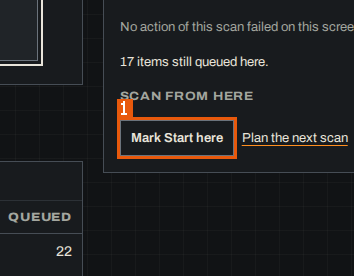

1. `button "Mark Start here"`

**On screen:** MudPuppy (/app/portals/reference-insurer-local/scans/plan)

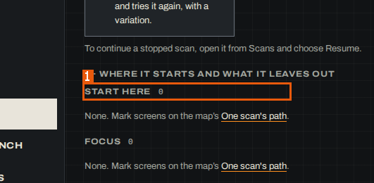

1. `heading "Start here 0"`

Related: appears on [SCR-025](03-screens.md#SCR-025) · appears on [SCR-027](03-screens.md#SCR-027)

Evidence:

- screen region `01a17540-2772-7000-8cc1-140f21e49c72` `button "Mark Start here"` — MudPuppy (/app/scans/:scan) (run `01a1753d-a8da-7000-85d2-b19d666d3587`, map, 2026-10-25)
- screen region `01a17540-b6ab-7000-aa4c-46fedc8a36c3` `heading "Start here 0"` — MudPuppy (/app/portals/reference-insurer-local/scans/plan) (run `01a1753d-a8da-7000-85d2-b19d666d3587`, map, 2026-10-25)

### GL-017 — Threshold τ

**GL-017** · rev 1 · draft · observed

> DRAFT — not confirmed by a reviewer

**Term:** Threshold τ (en)

**Definition:** The similarity above which two recorded pages count as one screen (0.90 in the run): "The threshold τ says how similar; labelled pairs (same screen or not) calibrate it, and a classifier trained on them can replace it when it tells pairs apart better." Same screen? asks first about the pairs nearest τ.

**Synonyms:** τ

**On screen:** MudPuppy (/app/portals/reference-insurer-local/settings)

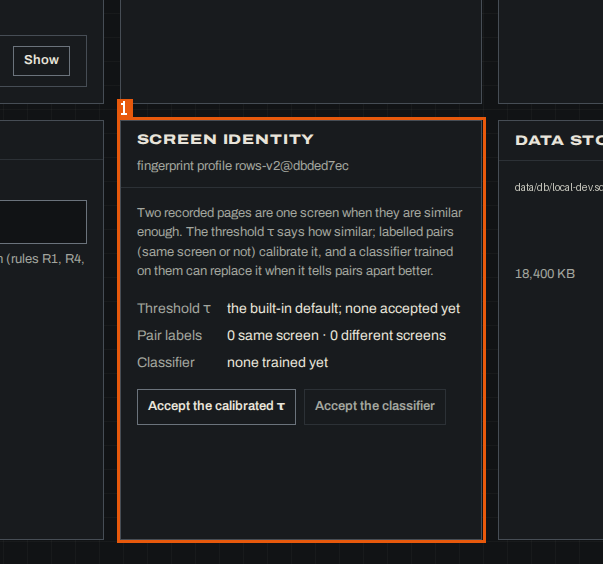

1. `region "Screen identity"`

Related: appears on [SCR-013](03-screens.md#SCR-013) · appears on [SCR-030](03-screens.md#SCR-030)

Evidence:

- screen region `01a17540-ecac-7000-9714-39aba77839c5` `region "Screen identity"` — MudPuppy (/app/portals/reference-insurer-local/settings) (run `01a1753d-a8da-7000-85d2-b19d666d3587`, map, 2026-10-25)
- state `01a17541-107a-7000-8bc5-38e73949e5be` — MudPuppy (/app/portals/reference-insurer-local/same-screen) (run `01a1753d-a8da-7000-85d2-b19d666d3587`, map, 2026-10-25)

### GL-031 — Triggers and Outcomes (process facts)

**GL-031** · rev 1 · draft · inferred

> DRAFT — not confirmed by a reviewer

**Term:** Triggers (en)

**Definition:** Facts the portal model records for a process in "In the portal model": "Triggers" are the screen and action that entered the process and how often (e.g. a link on SC-0001, "3×"), "Outcomes" how the walks ended (e.g. "3 exited"). Inferred from the values shown.

**Synonyms:** Outcomes

**On screen:** MudPuppy (/app/portals/:portal/processes/:key)

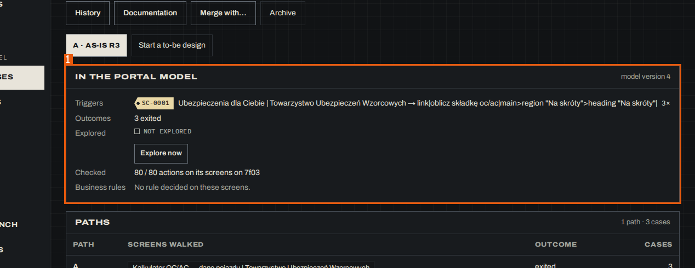

1. `region "In the portal model"`

Related: appears on [SCR-008](03-screens.md#SCR-008)

Evidence:

- screen region `01a1753e-01fe-7000-91d8-152388d28304` `region "In the portal model"` — MudPuppy (/app/portals/:portal/processes/:key) (run `01a1753d-a8da-7000-85d2-b19d666d3587`, map, 2026-10-25)

### GL-008 — Variant

**GL-008** · rev 1 · draft · observed

> DRAFT — not confirmed by a reviewer

**Term:** Variant (en)

**Definition:** One way a screen was seen (r1, r2, …); the first is the "Baseline" ("The first way the screen was seen.") and "A second one appears here when a scan sees this screen differently (another release, persona or state)." Its reason is one of "Release", "Persona", "Error", "A/B test", "Data", "Unknown".

**Synonyms:** —

**On screen:** MudPuppy (/app/portals/reference-insurer-local/screens)

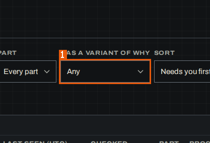

1. `combobox "Has a variant of why"`

**On screen:** MudPuppy (/app/portals/:portal/screens/:screen)

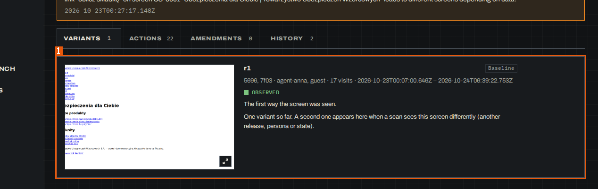

1. `region "Variants"`

Related: appears on [SCR-014](03-screens.md#SCR-014) · appears on [SCR-015](03-screens.md#SCR-015) · appears on [SCR-016](03-screens.md#SCR-016)

Evidence:

- screen region `01a1753e-e513-7001-9d79-59990eea7c3e` `combobox "Has a variant of why"` — MudPuppy (/app/portals/reference-insurer-local/screens) (run `01a1753d-a8da-7000-85d2-b19d666d3587`, map, 2026-10-25)
- screen region `01a1753e-f830-7000-9785-ac5128aa7dbb` `region "Variants"` — MudPuppy (/app/portals/:portal/screens/:screen) (run `01a1753d-a8da-7000-85d2-b19d666d3587`, map, 2026-10-25)

### GL-024 — Workbench

**GL-024** · rev 1 · draft · observed

> DRAFT — not confirmed by a reviewer

**Term:** Workbench (en)

**Definition:** A beta screen where "the assistant composes this screen for what you are doing": a conversation with command cards, in the paths "Chat" or "Mapping", with a live variant over a WebSocket (spike).

**Synonyms:** —

**On screen:** MudPuppy (/app/portals/reference-insurer-local/workbench)

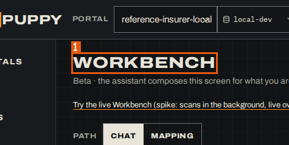

1. `heading "Workbench"`

Related: appears on [SCR-011](03-screens.md#SCR-011) · appears on [SCR-031](03-screens.md#SCR-031)

Evidence:

- screen region `01a17541-8dad-7000-8cd1-09927b9bdaf7` `heading "Workbench"` — MudPuppy (/app/portals/reference-insurer-local/workbench) (run `01a1753d-a8da-7000-85d2-b19d666d3587`, map, 2026-10-25)
