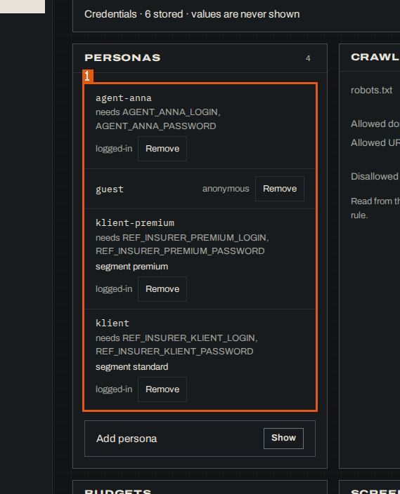
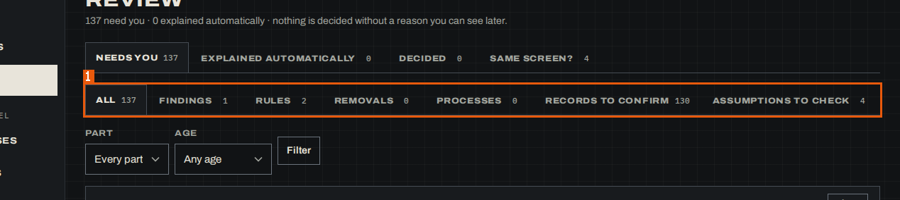
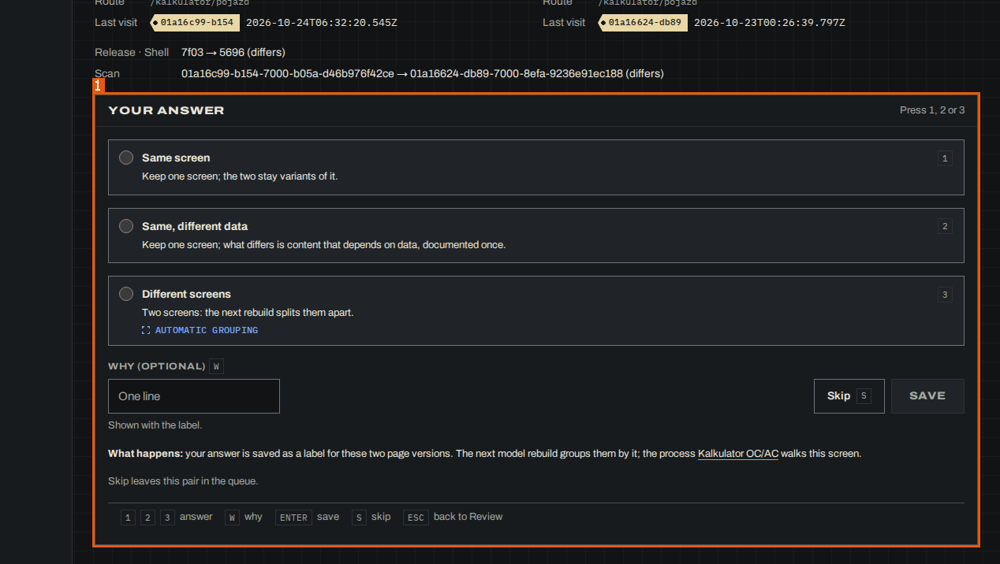
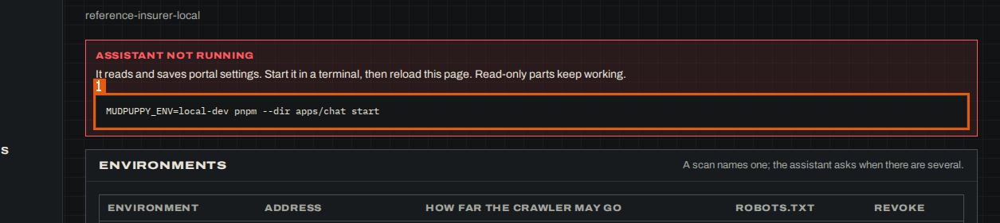
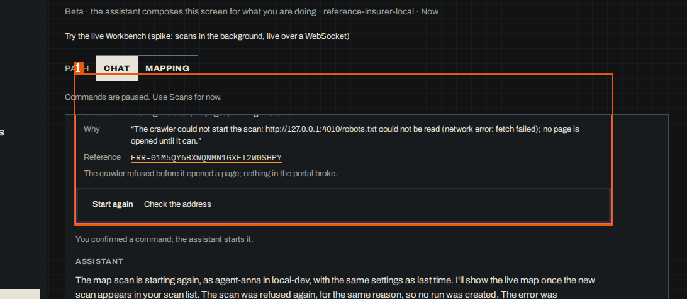
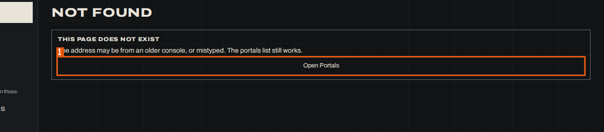

# 9. Non-functional requirements

## Security

### NFR-006 — Credential values are never shown

**NFR-006** · rev 1 · draft · observed

> DRAFT — not confirmed by a reviewer

Settings shows only the number and names of stored credentials ("Credentials · 6 stored · values are never shown"); personas name the credential variables they need (e.g. "needs AGENT_ANNA_LOGIN, AGENT_ANNA_PASSWORD") and "Signs in with" lists credential names, never values.

**On screen:** MudPuppy (/app/portals/reference-insurer-local/settings)

1. `list "Personas"`

Evidence:

- form `01a17540-ed11-7001-86f9-d7bea337ecf8` — form: name, about, signIn (run `01a1753d-a8da-7000-85d2-b19d666d3587`, map, 2026-10-25)
- screen region `01a17540-ecac-7000-9714-39aba77839c5` `list "Personas"` — MudPuppy (/app/portals/reference-insurer-local/settings) (run `01a1753d-a8da-7000-85d2-b19d666d3587`, map, 2026-10-25)
- state `01a17540-ecac-7000-9714-39aba77839c5` — MudPuppy (/app/portals/reference-insurer-local/settings) (run `01a1753d-a8da-7000-85d2-b19d666d3587`, map, 2026-10-25)

## Accessibility

### NFR-003 — Accessible structure and keyboard use

**NFR-003** · rev 2 · draft · observed

> DRAFT — not confirmed by a reviewer

Every page whose snapshot was read starts with a "Skip to content" link to the main region, uses landmarks (banner, navigation "Portal sections", navigation "Breadcrumb", main, named regions), gives tables a caption, labels its form fields (the only unlabelled control found is the answer radio group on Same screen?, inside the region "Your answer"), and offers keyboard shortcuts: "Ctrl K" for search, "Ctrl J" for the assistant, Review keys "J K next · previous · C confirm · R reject · U undo · ? all" (opt-in per browser) and Same screen? keys "1 2 3 answer W why Enter save S skip Esc back to Review".

**Measured:** 35 of 35 read states with "Skip to content"; 1 unlabelled field group among the recorded form fields states (ARIA snapshots read in this session (35 of 44 states; the glossary snapshots were too large to read) and the form fields of all 85 recorded forms)

**On screen:** MudPuppy (/app)

1. `link "Skip to content"` _(not visible on the screenshot)_

**On screen:** MudPuppy (/app/portals/reference-insurer-local/review)

1. `navigation "Kinds of decision"`

**On screen:** MudPuppy (/app/portals/reference-insurer-local/same-screen)

1. `region "Your answer"`

Evidence:

- form `01a17541-10d4-7001-bef7-ce6452bfa668` — form: answer (run `01a1753d-a8da-7000-85d2-b19d666d3587`, map, 2026-10-25) — note: radio group without label
- screen region `01a1753d-ba74-7000-a2d2-3da8da9e7760` `link "Skip to content"` — MudPuppy (/app) (run `01a1753d-a8da-7000-85d2-b19d666d3587`, map, 2026-10-25)
- screen region `01a1753e-be7a-7000-95e6-7606fb6ebc6e` `navigation "Kinds of decision"` — MudPuppy (/app/portals/reference-insurer-local/review) (run `01a1753d-a8da-7000-85d2-b19d666d3587`, map, 2026-10-25)
- screen region `01a17541-107a-7000-8bc5-38e73949e5be` `region "Your answer"` — MudPuppy (/app/portals/reference-insurer-local/same-screen) (run `01a1753d-a8da-7000-85d2-b19d666d3587`, map, 2026-10-25)

## Availability

### NFR-001 — Read-only console works with the chat service down

**NFR-001** · rev 1 · draft · observed

> DRAFT — not confirmed by a reviewer

With the chat service deliberately down, every recorded page loaded and every API call of the console's own server answered 200; the only console error was one 503 on the Workbench, and the assistant-backed actions were disabled with a start hint.

**Measured:** 129 of 129 API calls 200; 1 console error (503) on 1 page calls (network calls recorded by the map run over 44 states)

**On screen:** MudPuppy (/app/portals/reference-insurer-local/settings)

1. `region "Command that starts the chat service"`

Evidence:

- network call `01a1753d-bae9-7000-b0d4-c1b2254d1a92` — GET /api/portals/overview (run `01a1753d-a8da-7000-85d2-b19d666d3587`, map, 2026-10-25)
- network call `01a17541-8e26-7000-a236-205d16042827` — GET /api/workbench/portals/reference-insurer-local (run `01a1753d-a8da-7000-85d2-b19d666d3587`, map, 2026-10-25) — note: only call with a console error (503)
- screen region `01a17540-ecac-7000-9714-39aba77839c5` `region "Command that starts the chat service"` — MudPuppy (/app/portals/reference-insurer-local/settings) (run `01a1753d-a8da-7000-85d2-b19d666d3587`, map, 2026-10-25)

## Usability

### NFR-002 — In-app navigation without full page reloads

**NFR-002** · rev 1 · draft · observed

> DRAFT — not confirmed by a reviewer

The console is a single-page application: every link the map run followed inside the console changed the address in the same document (hop kind same_document) without a full page load or HTTP redirect.

**Measured:** 41 of 41 followed transitions same_document; 0 HTTP redirects transitions (URL observations with hops recorded by the map run)

Evidence:

- observation `01a1753d-d360-7003-baa2-988d8daa6561` — http://127.0.0.1:8790/app/glossary (run `01a1753d-a8da-7000-85d2-b19d666d3587`, map, 2026-10-25)
- observation `01a17540-27dd-7002-81d8-8e03d75c0997` — http://127.0.0.1:8790/app/scans/01a16ca2-a071-7000-a024-08bdb17527b3 (run `01a1753d-a8da-7000-85d2-b19d666d3587`, map, 2026-10-25)
- observation `01a17541-e9d1-7002-859f-2b46b76a5c7d` — http://127.0.0.1:8790/app/portals/reference-insurer-local/docs/BR-016 (run `01a1753d-a8da-7000-85d2-b19d666d3587`, map, 2026-10-25)

### NFR-004 — Errors are shown in place with a way on

**NFR-004** · rev 1 · draft · observed

> DRAFT — not confirmed by a reviewer

Failures are shown inside the console instead of a broken page: an unknown address shows "Not found" ("The address may be from an older console, or mistyped. The portals list still works.") with "Open Portals"; a refused Workbench command shows "Didn't start" with "Created", "Why" and an error "Reference" link plus "Start again" and "Check the address"; a process export that cannot be built shows "No documentation export for PRC-001 The export could not be built: …". The export API answered 200 with an error field.

**On screen:** MudPuppy (/app/portals/reference-insurer-local/workbench)

1. `region "Start a map scan"#2`

**On screen:** MudPuppy (/app/portals/reference-insurer-local/:param)

1. `link "Open Portals"`

Evidence:

- network call `01a17542-0d96-7001-b22e-982b17486c61` — GET /api/portals/reference-insurer-local/processes/PRC-001/export (run `01a1753d-a8da-7000-85d2-b19d666d3587`, map, 2026-10-25)
- screen region `01a17541-8dad-7000-8cd1-09927b9bdaf7` `region "Start a map scan"#2` — MudPuppy (/app/portals/reference-insurer-local/workbench) (run `01a1753d-a8da-7000-85d2-b19d666d3587`, map, 2026-10-25)
- screen region `01a17541-c349-7000-8e17-ea196a8e2b6b` `link "Open Portals"` — MudPuppy (/app/portals/reference-insurer-local/:param) (run `01a1753d-a8da-7000-85d2-b19d666d3587`, map, 2026-10-25)
- state `01a17542-0d6a-7001-993f-14da3ff639c8` — MudPuppy (/app/portals/reference-insurer-local/:param/PRC-001/documentation) (run `01a1753d-a8da-7000-85d2-b19d666d3587`, map, 2026-10-25)

## Localisation

### NFR-005 — English interface with UTC timestamps

**NFR-005** · rev 1 · draft · observed

> DRAFT — not confirmed by a reviewer

The console's labels are in English (the documented portal's content keeps its own language, e.g. Polish page titles), and times are shown in UTC as ISO 8601 (e.g. "2026-10-24T06:39:22.753Z", columns "Last seen (UTC)", "Started (UTC)") or as short dates ("24 Oct 06:39Z").

**On screen:** MudPuppy (/app/portals/reference-insurer-local/screens)

1. `table "All screens of reference-insurer-local"`

**On screen:** MudPuppy (/app/portals/reference-insurer-local/scans)

1. `table "Scans of reference-insurer-local"`

Evidence:

- screen region `01a1753e-e513-7001-9d79-59990eea7c3e` `table "All screens of reference-insurer-local"` — MudPuppy (/app/portals/reference-insurer-local/screens) (run `01a1753d-a8da-7000-85d2-b19d666d3587`, map, 2026-10-25)
- screen region `01a17540-1543-7000-9e27-e769fa4b9dd9` `table "Scans of reference-insurer-local"` — MudPuppy (/app/portals/reference-insurer-local/scans) (run `01a1753d-a8da-7000-85d2-b19d666d3587`, map, 2026-10-25)
