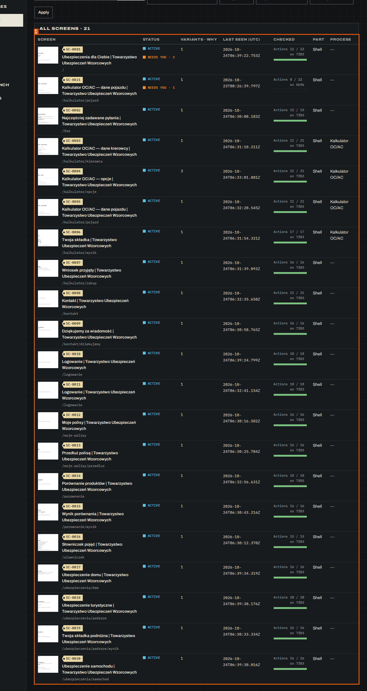
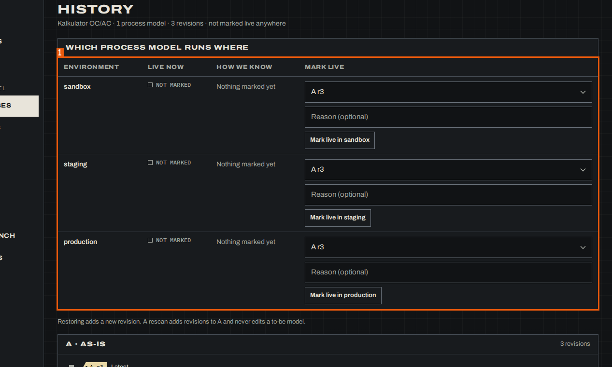
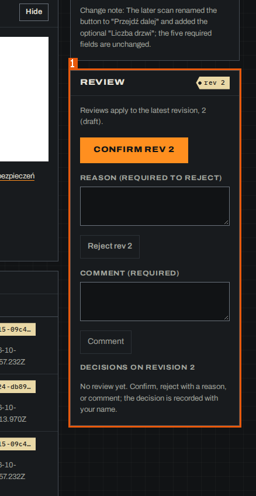
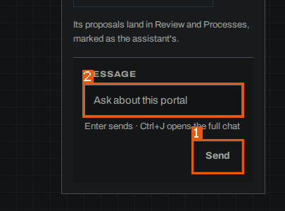
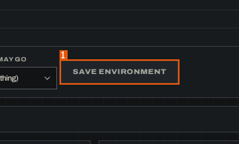

# 10. Assumptions and open questions

## 10.1 Assumptions

### ASM-001 — The scanned console ran on a read-only copy of its store

**ASM-001** · rev 1 · draft · needs_confirmation

> DRAFT — not confirmed by a reviewer

The banner and Settings showed "Data store: local-dev, read-only" with a store file in a temporary copy; the documentation assumes the write controls (confirm, reject, stage, mark live, save, accept) behave as their labels say on a writable store, and that their disabled states seen here come from empty inputs or the stopped chat service, not from the read-only flag.

**Impact if wrong:** Some action enablers (BR-005, BR-009, BR-012, BR-023, BR-024) could be read-only effects rather than business rules, and the write processes could behave differently.

**On screen:** MudPuppy (/app/portals/reference-insurer-local)

1. `button "Data store: local-dev, read-only"`

**On screen:** MudPuppy (/app/portals/reference-insurer-local/settings)

1. `region "Data store"`

Related: answers [OQ-002](#OQ-002) · depends on [BR-005](06-business-rules.md#BR-005) · depends on [BR-009](06-business-rules.md#BR-009) · depends on [BR-023](06-business-rules.md#BR-023) · depends on [BR-024](06-business-rules.md#BR-024)

Evidence:

- screen region `01a1753d-debd-7000-b943-374405412ad9` `button "Data store: local-dev, read-only"` — MudPuppy (/app/portals/reference-insurer-local) (run `01a1753d-a8da-7000-85d2-b19d666d3587`, map, 2026-10-25)
- screen region `01a17540-ecac-7000-9714-39aba77839c5` `region "Data store"` — MudPuppy (/app/portals/reference-insurer-local/settings) (run `01a1753d-a8da-7000-85d2-b19d666d3587`, map, 2026-10-25)

### ASM-002 — The data shown is test data and does not change the console's behaviour

**ASM-002** · rev 1 · draft · needs_confirmation

> DRAFT — not confirmed by a reviewer

The portals, scans, records and insurer pages shown inside the console (twelve local test portals, the fake insurer "reference-insurer-local" with its Polish page titles) are test data; the screens, rules and processes documented here are assumed to behave the same for any portal and any amount of data, except where a rule says it depends on data (e.g. "Same screen?" shown only when pairs wait).

**Impact if wrong:** Pages with more data (paging, more processes or models, several releases) could show controls not seen here, and some counts or empty states would differ.

**On screen:** MudPuppy (/app/portals/reference-insurer-local/screens)

1. `table "All screens of reference-insurer-local"`

Related: depends on [BR-037](06-business-rules.md#BR-037)

Evidence:

- screen region `01a1753e-e513-7001-9d79-59990eea7c3e` `table "All screens of reference-insurer-local"` — MudPuppy (/app/portals/reference-insurer-local/screens) (run `01a1753d-a8da-7000-85d2-b19d666d3587`, map, 2026-10-25)
- state `01a1753d-ba74-7000-a2d2-3da8da9e7760` — MudPuppy (/app) (run `01a1753d-a8da-7000-85d2-b19d666d3587`, map, 2026-10-25)

## 10.2 Open questions

### OQ-001 — What do the assistant-backed actions do when the chat service runs?

**OQ-001** · rev 1 · draft · needs_confirmation

> DRAFT — not confirmed by a reviewer

The scanned copy ran with the chat service deliberately down. What happens, and what does the BA see, after: "Send" in "Ask the assistant" (Portal home) and in "Write to the Workbench"; the suggestion buttons ("What changed since the last scan?", "What can I do here?", "Sort screens into processes", "Follow one process start to end"); "Ask the assistant to regroup"; "Explore now"; "Start scan" on Plan next scan; "Save portal"; "Save environment" and the other settings saves; the "Confirm" of a proposed command in the Workbench?

**Why it matters:** Saving a portal, saving settings, starting scans and every assistant answer depend on the chat service; without its outcomes the processes that end in these actions are documented only up to the button, and a rebuild cannot reproduce what the user gets.

**Answer needed from:** either

**On screen:** MudPuppy (/app/portals/reference-insurer-local/workbench)

1. `form "Write to the Workbench"` — "Assistant unavailable"

**On screen:** MudPuppy (/app/portals/new)

1. `alert` — "Assistant not running It saves the portal."

Related: asks about [CAP-010](02-capabilities.md#CAP-010) · asks about [SCR-006](03-screens.md#SCR-006) · asks about [SCR-011](03-screens.md#SCR-011) · asks about [SCR-027](03-screens.md#SCR-027) · asks about [SCR-030](03-screens.md#SCR-030) · asks about [SCR-031](03-screens.md#SCR-031)

Evidence:

- network call `01a17541-8e26-7000-a236-205d16042827` — GET /api/workbench/portals/reference-insurer-local (run `01a1753d-a8da-7000-85d2-b19d666d3587`, map, 2026-10-25) — note: 503 console error on the Workbench
- open question `01a17542-59d7-7001-ba24-01576d0e199a` — Not reached: no rule rows on the Rules list (only 'Run the rule tests'), so no single-rule page there (BR-001/BR-016 reached via Docs/Search); process Compare page not found (no link seen); process Documentation only by guessed URL .../processes/PRC-001/documentation, recorded as nearly empty; item_view_cap 18 stopped further item pages; assistant/chat buttons skipped. (run `01a1753d-a8da-7000-85d2-b19d666d3587`, map, 2026-10-25) — note: crawler: assistant/chat buttons skipped
- screen region `01a17541-8dad-7000-8cd1-09927b9bdaf7` `form "Write to the Workbench"` — MudPuppy (/app/portals/reference-insurer-local/workbench) (run `01a1753d-a8da-7000-85d2-b19d666d3587`, map, 2026-10-25) — note: "Assistant unavailable"
- screen region `01a17541-b0b3-7000-b23a-7b9ba885ff54` `alert` — MudPuppy (/app/portals/new) (run `01a1753d-a8da-7000-85d2-b19d666d3587`, map, 2026-10-25) — note: "Assistant not running It saves the portal."
- state `01a17540-ecac-7000-9714-39aba77839c5` — MudPuppy (/app/portals/reference-insurer-local/settings) (run `01a1753d-a8da-7000-85d2-b19d666d3587`, map, 2026-10-25) — note: "Assistant not running It reads and saves portal settings."

### OQ-002 — What do the console's write actions do?

**OQ-002** · rev 1 · draft · needs_confirmation

> DRAFT — not confirmed by a reviewer

The map run only read pages (the data store was shown as "local-dev, read-only"). What happens after: "Confirm rev <n>", "Reject rev <n>" and "Comment" on a record; "Confirm 2" / "Reject 2" in Review; "Save" on Same screen?; "Set stage" and "Mark as-is documented"; "Merge with…", "Archive", "Start a to-be design"; "Add screen", "Move step N up/down", "Remove step N from A"; "Mark live in <environment>"; "Save the budgets"; "Accept the calibrated τ"; "Run the rule tests"; "Resume" and "Mark Start here" on a scan; "Remove <persona>"? Which confirmation, message or new state follows, and which are refused on a read-only store?

**Why it matters:** These are the outcomes of the console's processes (review, staging, mark live, labelling, planning); without them the processes are documented as map_only up to the button.

**Answer needed from:** either

**On screen:** MudPuppy (/app/portals/reference-insurer-local)

1. `button "Data store: local-dev, read-only"`

**On screen:** MudPuppy (/app/portals/:portal/processes/:key)

1. `region "As-is documentation"`

**On screen:** MudPuppy (/app/portals/reference-insurer-local/processes/PRC-001/history)

1. `table "Which process model runs where"`

**On screen:** MudPuppy (/app/portals/:portal/docs/:key)

1. `region "Review"`

Related: asks about [SCR-008](03-screens.md#SCR-008) · asks about [SCR-009](03-screens.md#SCR-009) · asks about [SCR-012](03-screens.md#SCR-012) · asks about [SCR-013](03-screens.md#SCR-013) · asks about [SCR-023](03-screens.md#SCR-023) · asks about [SCR-025](03-screens.md#SCR-025) · asks about [SCR-030](03-screens.md#SCR-030)

Evidence:

- screen region `01a1753d-debd-7000-b943-374405412ad9` `button "Data store: local-dev, read-only"` — MudPuppy (/app/portals/reference-insurer-local) (run `01a1753d-a8da-7000-85d2-b19d666d3587`, map, 2026-10-25)
- screen region `01a1753e-01fe-7000-91d8-152388d28304` `region "As-is documentation"` — MudPuppy (/app/portals/:portal/processes/:key) (run `01a1753d-a8da-7000-85d2-b19d666d3587`, map, 2026-10-25)
- screen region `01a1753e-122f-7000-ac31-15f9bbe7957d` `table "Which process model runs where"` — MudPuppy (/app/portals/reference-insurer-local/processes/PRC-001/history) (run `01a1753d-a8da-7000-85d2-b19d666d3587`, map, 2026-10-25)
- screen region `01a1753f-f23f-7000-9333-d142f8824a10` `region "Review"` — MudPuppy (/app/portals/:portal/docs/:key) (run `01a1753d-a8da-7000-85d2-b19d666d3587`, map, 2026-10-25)

### OQ-003 — Why could the process documentation export not be built?

**OQ-003** · rev 1 · draft · needs_confirmation

> DRAFT — not confirmed by a reviewer

PRC-001 documentation showed "No documentation export for PRC-001 The export could not be built: ╰─▶ No such file or directory (os error 2)". Is this because the scanned copy of the store lacked the export files (an environment issue of the test copy), or does the export fail in normal use? What does the page show when the export exists (tabs per file, a download)?

**Why it matters:** The Documentation page is the only view of the rebuild-grade export; only its error state was observed, so its normal content cannot be documented.

**Answer needed from:** either

Related: asks about [SCR-010](03-screens.md#SCR-010)

Evidence:

- network call `01a17542-0d96-7001-b22e-982b17486c61` — GET /api/portals/reference-insurer-local/processes/PRC-001/export (run `01a1753d-a8da-7000-85d2-b19d666d3587`, map, 2026-10-25)
- open question `01a17542-59d7-7001-ba24-01576d0e199a` — Not reached: no rule rows on the Rules list (only 'Run the rule tests'), so no single-rule page there (BR-001/BR-016 reached via Docs/Search); process Compare page not found (no link seen); process Documentation only by guessed URL .../processes/PRC-001/documentation, recorded as nearly empty; item_view_cap 18 stopped further item pages; assistant/chat buttons skipped. (run `01a1753d-a8da-7000-85d2-b19d666d3587`, map, 2026-10-25) — note: crawler: Documentation only by guessed URL, recorded as nearly empty
- state `01a17542-0d6a-7001-993f-14da3ff639c8` — MudPuppy (/app/portals/reference-insurer-local/:param/PRC-001/documentation) (run `01a1753d-a8da-7000-85d2-b19d666d3587`, map, 2026-10-25)

### OQ-004 — Which console pages were not reached?

**OQ-004** · rev 1 · draft · needs_confirmation

> DRAFT — not confirmed by a reviewer

The map run did not open: a single mined-rule page (the Rules list had no rows), the process Compare page (no link seen), "Sort the 18 screens into processes" (/processes/loose), the live Workbench (/workbench/live), the scan "Robots" and "Docs" sections and "Recovery page with attempts", recorded-state pages (/app/states/<id>), error pages (/app/errors/<id>), the change "Before / after" page, the BA wiki pages, Docs sections (?section=…), Review views ?tab=explained / ?tab=decided / ?show=<kind>, and the portal homes of the other eleven portals. What do these pages show?

**Why it matters:** These are screens of the console a rebuild needs; the crawler stopped at its item-page cap and depth limit, and the remembered-portal redirect (BR-004) hid the portals list's links.

**Answer needed from:** crawler

Related: asks about [SCR-001](03-screens.md#SCR-001) · asks about [SCR-008](03-screens.md#SCR-008) · asks about [SCR-012](03-screens.md#SCR-012) · asks about [SCR-020](03-screens.md#SCR-020) · asks about [SCR-025](03-screens.md#SCR-025)

Evidence:

- decision `01a1753f-8962-7001-bd43-e15c2c0c6194` — skip budget:max_depth: depth 11 exceeds 10 (run `01a1753d-a8da-7000-85d2-b19d666d3587`, map, 2026-10-25) — note: max_depth skips
- decision `01a17541-f98d-7002-9350-d9cf8a5b7c9c` — refuse cap:item_view_cap: item_view_cap 18 reached (18 item pages visited) (run `01a1753d-a8da-7000-85d2-b19d666d3587`, map, 2026-10-25) — note: item_view_cap 18 reached
- open question `01a17542-59d7-7001-ba24-01576d0e199a` — Not reached: no rule rows on the Rules list (only 'Run the rule tests'), so no single-rule page there (BR-001/BR-016 reached via Docs/Search); process Compare page not found (no link seen); process Documentation only by guessed URL .../processes/PRC-001/documentation, recorded as nearly empty; item_view_cap 18 stopped further item pages; assistant/chat buttons skipped. (run `01a1753d-a8da-7000-85d2-b19d666d3587`, map, 2026-10-25)
- open question `01a17542-59df-7000-b667-5ec699b04fcb` — Opening /app/ after visiting a portal redirects to that portal's home instead of the Portals list, so pending frontier items of the portals list (count links of empty portals, proving-ground-shop-local) came back 'no longer present'; max_depth 10 also blocked docs sub-pages reached through long chains. A hook could reset the remembered portal. (run `01a1753d-a8da-7000-85d2-b19d666d3587`, map, 2026-10-25)

### OQ-005 — Is the remembered-portal redirect intended?

**OQ-005** · rev 1 · draft · needs_confirmation

> DRAFT — not confirmed by a reviewer

After a portal was visited, opening /app/ brought the crawler to that portal's home instead of "All portals" (BR-004). Is this intended behaviour (resume where the BA left off), when exactly does it apply, and how does the BA get back to the portals list other than with "All portals"?

**Why it matters:** It changes the console's entry point and hid the portals list from later visits; a rebuild must reproduce or drop it on purpose.

**Answer needed from:** sme

Related: asks about [BR-004](06-business-rules.md#BR-004) · asks about [SCR-001](03-screens.md#SCR-001)

Evidence:

- record [BR-004](06-business-rules.md#BR-004) — The console remembers the last opened portal
- open question `01a17542-59df-7000-b667-5ec699b04fcb` — Opening /app/ after visiting a portal redirects to that portal's home instead of the Portals list, so pending frontier items of the portals list (count links of empty portals, proving-ground-shop-local) came back 'no longer present'; max_depth 10 also blocked docs sub-pages reached through long chains. A hook could reset the remembered portal. (run `01a1753d-a8da-7000-85d2-b19d666d3587`, map, 2026-10-25)

### OQ-006 — Why was "Send" disabled on Portal home?

**OQ-006** · rev 1 · draft · needs_confirmation

> DRAFT — not confirmed by a reviewer

In "Ask the assistant" on Portal home the textbox "Message" was enabled but "Send" disabled, with no hint. Is "Send" disabled only while the message is empty, or because the assistant was not running (the Workbench said so explicitly)?

**Why it matters:** Decides whether the rule is an empty-message guard or part of the chat-service dependency (BR-022).

**Answer needed from:** either

**On screen:** MudPuppy (/app/portals/reference-insurer-local)

1. `button "Send"`
2. `textbox "Message"`

Related: asks about [BR-022](06-business-rules.md#BR-022) · asks about [SCR-011](03-screens.md#SCR-011)

Evidence:

- screen region `01a1753d-debd-7000-b943-374405412ad9` `button "Send"` — MudPuppy (/app/portals/reference-insurer-local) (run `01a1753d-a8da-7000-85d2-b19d666d3587`, map, 2026-10-25)
- screen region `01a1753d-debd-7000-b943-374405412ad9` `textbox "Message"` — MudPuppy (/app/portals/reference-insurer-local) (run `01a1753d-a8da-7000-85d2-b19d666d3587`, map, 2026-10-25)

### OQ-007 — When is "Save environment" enabled?

**OQ-007** · rev 1 · draft · needs_confirmation

> DRAFT — not confirmed by a reviewer

"Save environment" was disabled while the assistant was not running and "Address" was empty. Is it disabled because of the chat service, because of the empty address, or both? Is the address checked for a format (the placeholder is "https://")?

**Why it matters:** Needed to state the enabling rule and the address constraint of the Settings form exactly.

**Answer needed from:** either

**On screen:** MudPuppy (/app/portals/reference-insurer-local/settings)

1. `button "Save environment"`

Related: asks about [BR-022](06-business-rules.md#BR-022) · asks about [SCR-030](03-screens.md#SCR-030)

Evidence:

- form `01a17540-ed11-7000-85cd-4c336b5cba88` — form: name, url, limit (run `01a1753d-a8da-7000-85d2-b19d666d3587`, map, 2026-10-25)
- screen region `01a17540-ecac-7000-9714-39aba77839c5` `button "Save environment"` — MudPuppy (/app/portals/reference-insurer-local/settings) (run `01a1753d-a8da-7000-85d2-b19d666d3587`, map, 2026-10-25)

## 10.3 Open crawler questions

Questions the crawler raised during its runs that are still open.

_none_
