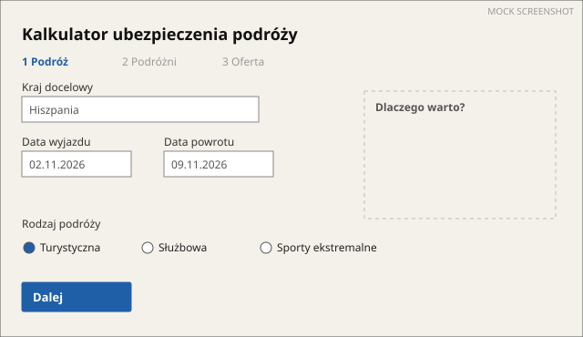
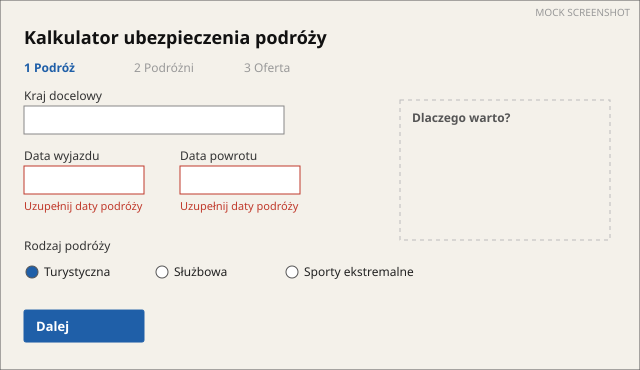
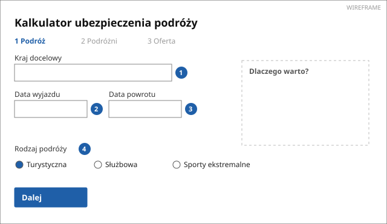
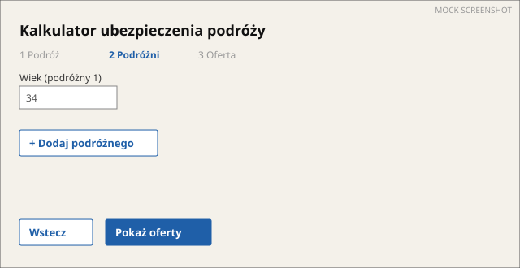
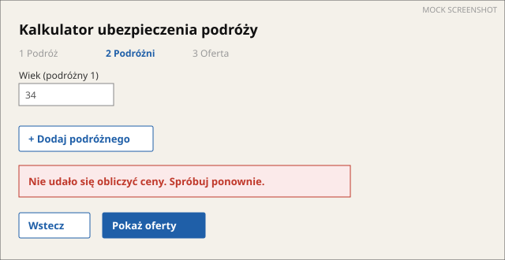
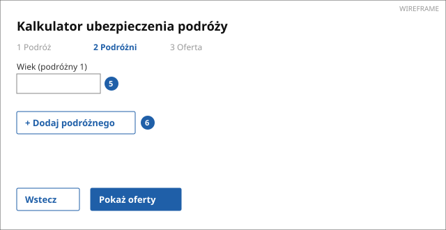
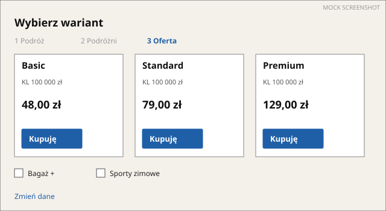
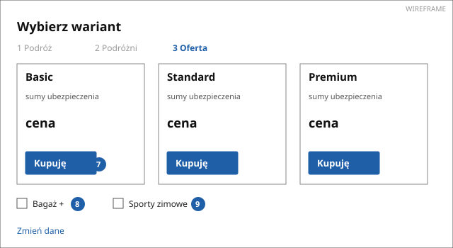
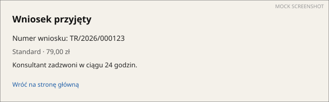

# PROC-001 Process steps

> **MOCK** for rating (spec 034, R-68). Made-up data.

[README](README.md) · Steps · [Business](BUSINESS_REQUIREMENTS.md) ·
[Functional](FUNCTIONAL_REQUIREMENTS.md) · [EARS](EARS.md) · [Contracts](CONTRACTS.md) ·
[Gaps](GAPS.md)

Four steps in walking order. Each step: what it is for, what the user sees, its states, the
fields, the rules and requirements that apply on it, and where it goes next.

---

## Step 1 · Szczegóły podróży (trip details)

`SCR-002` · route `/podroz/kalkulator` · form step 1 of 2 on this URL (React wizard; the URL does
not change between steps 1 and 2) · seen in 4 scans · confidence observed

**Purpose.** The guest says where and when they travel. Entered from "Oblicz cenę" on `/podroze`
or directly by URL (`/podroz/kalkulator?kraj=ES` preselects the country: seen once, scan `01a1f0…`).

**What the user sees.** Heading "Kalkulator ubezpieczenia podróży", a step indicator "1 Podróż · 2
Podróżni · 3 Oferta", the form "Szczegóły podróży" and the button "Dalej". A side box "Dlaczego
warto?" with three bullet points (static text).

### States

| State | Kind | How it was reached | Picture |
|---|---|---|---|
| Empty form | happy path (start) | open the URL |  |
| "Uzupełnij daty podróży" under both date fields | validation | "Dalej" with empty dates (probe `required`) |  |
| "Data powrotu musi być późniejsza niż data wyjazdu" | validation | return date before departure (probe `boundary`) | same layout, message under "Data powrotu" |
| Country list empty, spinner in the field | loading | `GET /api/countries` slower than 2 s (probe `slow request`) | spinner only; the form stays usable |

### Wireframe and fields

| # | Label (verbatim) | English | Type | Required | Validation | Options | Value comes from |
|---|---|---|---|---|---|---|---|
| 1 | Kraj docelowy | Destination country | select, searchable | yes | must be in the list | 195 countries from `GET /api/countries`; "Cały świat", "Europa" on top | user; preselected by `?kraj=` |
| 2 | Data wyjazdu | Departure date | date | yes | today … today + 365 days | — | user |
| 3 | Data powrotu | Return date | date | yes | after Data wyjazdu, at most 180 days later | — | user |
| 4 | Rodzaj podróży | Trip type | radio | yes | — | "Turystyczna" (default), "Służbowa", "Sporty ekstremalne" | user |

### Rules and requirements on this step

- `BR-001` Return date after departure, at most 180 days (confirmed) → [business](BUSINESS_REQUIREMENTS.md#br-001)
- `BR-002` Departure within one year from today (draft, inferred from the date picker's max)
- `REQ-001` Validate dates before moving on (confirmed) → [functional](FUNCTIONAL_REQUIREMENTS.md#req-001)
- `NFR-002` Errors are announced to screen readers (`role="alert"`) (observed)

### Next

| Action | Leads to | Calls |
|---|---|---|
| "Dalej" (valid data) | Step 2, same URL | none (client-side only) |
| "Dalej" (invalid data) | Step 1, validation state | none |

---

## Step 2 · Podróżni (travellers)

`SCR-002` (form step 2) · route `/podroz/kalkulator` · seen in 3 scans · confidence observed

**Purpose.** The guest says who travels; on "Pokaż oferty" the portal prices the trip.

**What the user sees.** The same heading, step indicator on "2 Podróżni", a list of travellers with
"+ Dodaj podróżnego" (max 9), each with "Wiek" and a remove button, and "Pokaż oferty". "Wstecz"
goes back to step 1 with the values kept.

### States

| State | Kind | How it was reached | Picture |
|---|---|---|---|
| One traveller row | happy path | "Dalej" from step 1 |  |
| "Pokaż oferty" pressed, button shows a spinner | loading | while `POST /api/quotes` runs (1.2 s median, 3 scans) | — (too short for a screenshot) |
| "Nie udało się obliczyć ceny. Spróbuj ponownie." | technical | `POST /api/quotes` answered 503 (scan `01a301…`, once; probe `HTTP 500` reproduced it) |  |
| "Wiek musi być liczbą od 0 do 99" | validation | age 120 (probe `boundary`) | message under the field |

### Wireframe and fields

| # | Label (verbatim) | English | Type | Required | Validation | Options | Value comes from |
|---|---|---|---|---|---|---|---|
| 5 | Wiek | Age (per traveller) | number | yes | 0 … 99 | — | user |
| 6 | + Dodaj podróżnego | Add traveller | button | — | at most 9 travellers (button disabled at 9) | — | — |

### Rules and requirements on this step

- `BR-003` Traveller age 0 … 99 (confirmed)
- `BR-004` At most 9 travellers per application (observed: button disabled after the 9th)
- `REQ-002` Price the trip on "Pokaż oferty" (confirmed) → [contracts](CONTRACTS.md#post-apiquotes)
- `NFR-001` Pricing answers within 3 s (draft; measured 1.2 s median)

### Next

| Action | Leads to | Calls |
|---|---|---|
| "Pokaż oferty" | Step 3 `/podroz/oferta` | `POST /api/quotes` (200) |
| "Pokaż oferty" when the API fails | Step 2, technical state | `POST /api/quotes` (503) |
| "Wstecz" | Step 1, values kept | none |

---

## Step 3 · Wybierz wariant (choose a variant)

`SCR-003` · route `/podroz/oferta` · query `?quote=<id>` (opens directly with a valid quote id:
seen in 2 scans; an expired id shows step 3's technical state) · confidence observed

**Purpose.** The guest compares three variants and picks one, with optional add-ons.

**What the user sees.** Three cards "Basic", "Standard" (marked "Najczęściej wybierany"),
"Premium", each with the sum insured for medical costs, luggage and liability, and the price.
Add-ons "Bagaż +" and "Sporty zimowe" change the price live. "Kupuję" under each card. "Zmień
dane" goes back to step 1.

### States

| State | Kind | How it was reached | Picture |
|---|---|---|---|
| Three variants | happy path | from step 2 |  |
| "Oferta wygasła. Oblicz cenę ponownie." | technical | quote older than 30 minutes (scan `01a2c4…`, URL reopened) | message plate, no cards |

### Wireframe and fields

| # | Label (verbatim) | English | Type | Required | Validation | Options | Value comes from |
|---|---|---|---|---|---|---|---|
| 7 | Wariant | Variant | three buttons "Kupuję" | yes (one) | — | Basic, Standard, Premium | user |
| 8 | Bagaż + | Extra luggage cover | checkbox | no | — | — | user; price + 39,00 zł |
| 9 | Sporty zimowe | Winter sports cover | checkbox | no | only when Rodzaj podróży ≠ "Sporty ekstremalne" | — | user; price × 1.5 |
| 10 | Cena | Price (output) | money | — | — | — | `POST /api/quotes` → `variants[].price` |

### Rules and requirements on this step

- `BR-005` Winter sports add-on multiplies the price by 1.5 (inferred from 2 observations)
- `BR-006` A quote is valid for 30 minutes (needs confirmation)
- `REQ-003` Show three variants with sums insured and prices (confirmed)

### Next

| Action | Leads to | Calls |
|---|---|---|
| "Kupuję" (any variant) | Step 4 | `POST /api/applications` (201) |
| "Zmień dane" | Step 1 with values kept | none |
| add-on ticked | Step 3, new price | `POST /api/quotes` (200, `addons` set) |

---

## Step 4 · Wniosek przyjęty (application accepted)

`SCR-004` · route `/podroz/potwierdzenie` · seen in 1 trace · confidence observed

**Purpose.** Confirms the application. End of the process.

**What the user sees.** Heading "Wniosek przyjęty", "Numer wniosku: TR/2026/000123", the variant
and price to pay, "Konsultant zadzwoni w ciągu 24 godzin.", link "Wróć na stronę główną".

| State | Kind | Picture |
|---|---|---|
| Confirmation | happy path (goal) |  |

| # | Label (verbatim) | English | Type | Value comes from |
|---|---|---|---|---|
| 11 | Numer wniosku | Application number (output) | text `TR/<year>/<6 digits>` | `POST /api/applications` → `number` |

Rules and requirements: `REQ-004` register the application (confirmed), `REQ-005` say how payment
happens (draft).
