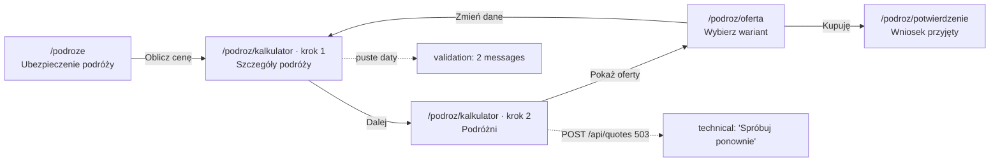

# PROC-001 Wycena ubezpieczenia turystycznego (travel insurance quote)

> **MOCK** for rating (spec 034, R-68). Made-up data.

Portal [Demo Ubezpieczenia](../README.md) · status **confirmed** (Owner, 2026-10-16) · observed
**full** (goal reached) · 3 scans, 2 traces · exported 2026-10-17

## What this service does

A guest who plans a trip abroad gets the price of travel insurance and sends a purchase
application. The service asks where and when the guest travels and who travels, prices three
variants (Basic, Standard, Premium), and on "Kupuję" registers an application with a number
(`TR/2026/000123`). Payment is not part of this service: a consultant calls the customer.

| | |
|---|---|
| Goal | Get the price of travel insurance and send a purchase application |
| Persona | guest (not logged in) |
| Trigger | "Oblicz cenę" on the product page `/podroze` |
| Outcome | Page "Wniosek przyjęty" with the application number |
| Steps | 4 (2 of them on one URL: a React wizard) |
| Fields | 11 input, 4 output |
| Business rules | 7 · Requirements 5 · NFRs 3 · Open questions 3 |
| APIs called | 3 (`POST /api/quotes`, `GET /api/countries`, `POST /api/applications`) |

## The steps at a glance

| # | Step | Route | What happens |
|---|---|---|---|
| 1 | Szczegóły podróży (trip details) | `/podroz/kalkulator` (step 1) | Destination, dates, trip type |
| 2 | Podróżni (travellers) | `/podroz/kalkulator` (step 2) | Number and age of travellers; prices are fetched |
| 3 | Wybierz wariant (choose a variant) | `/podroz/oferta` | Three variants with prices; add-ons |
| 4 | Wniosek przyjęty (application accepted) | `/podroz/potwierdzenie` | Application number, price to pay |

## Files

| File | What it holds |
|---|---|
| [PROCESS_STEPS.md](PROCESS_STEPS.md) | Every step: what the user sees, its states (happy path, validation, technical, loading), screenshot, wireframe, fields, the rules and requirements of that step |
| [BUSINESS_REQUIREMENTS.md](BUSINESS_REQUIREMENTS.md) | The capability and use case goals, business rules with decision tables and pseudo-code |
| [FUNCTIONAL_REQUIREMENTS.md](FUNCTIONAL_REQUIREMENTS.md) | What the system shall do, with acceptance criteria; non-functional requirements |
| [EARS.md](EARS.md) | Every requirement and rule as one EARS statement |
| [CONTRACTS.md](CONTRACTS.md) + [openapi.yaml](openapi.yaml) | Which APIs each step calls, what is sent and returned per attempt, OpenAPI |
| [GAPS.md](GAPS.md) | What we are unsure about and what to ask the business |
| `images/` | Screenshots and wireframes per step and state |
| `process.json` | All of the above as data, for agents |

## Scans behind this documentation

| Scan | Kind | Persona | Date | Reached |
|---|---|---|---|---|
| `01a1f0…` | map | guest | 2026-10-14 | steps 1–3 |
| `01a2c4…` | trace "travel quote" | guest | 2026-10-15 | steps 1–4 (goal) |
| `01a2c9…` | probe | guest | 2026-10-16 | steps 1–2, 9 probe outcomes |
| `01a301…` | trace "travel quote" | guest | 2026-10-17 | steps 1–2, stopped on 503 (kept as a technical state) |
